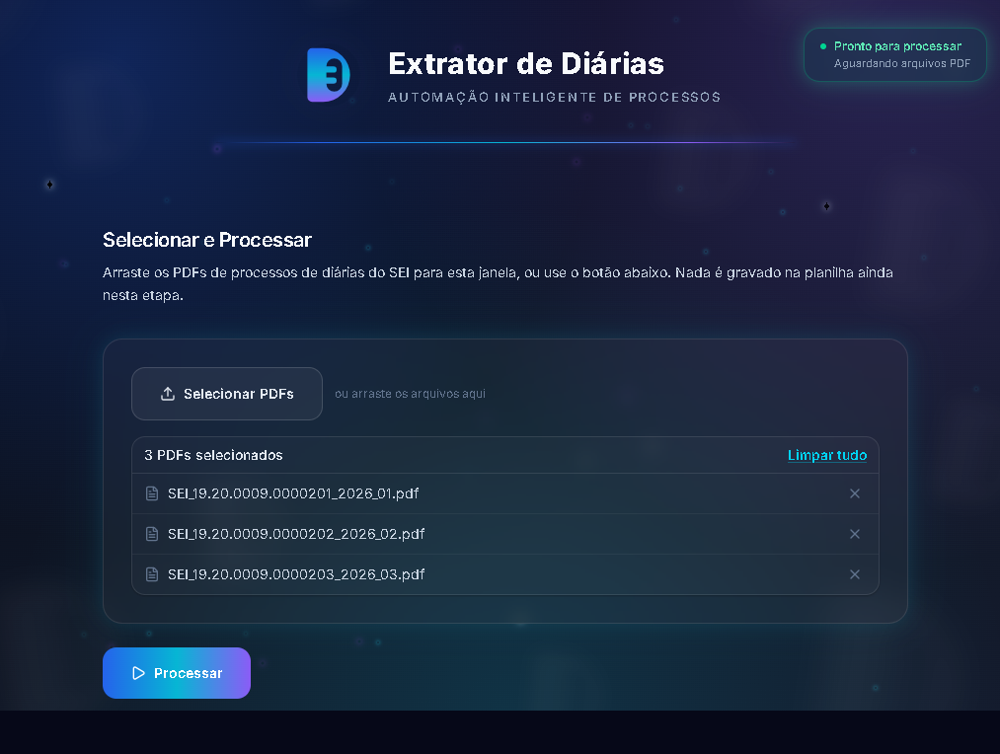
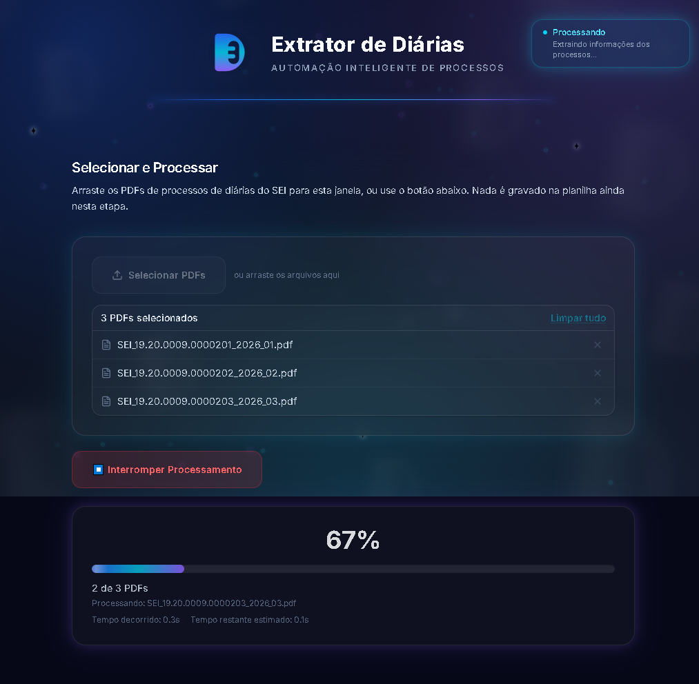
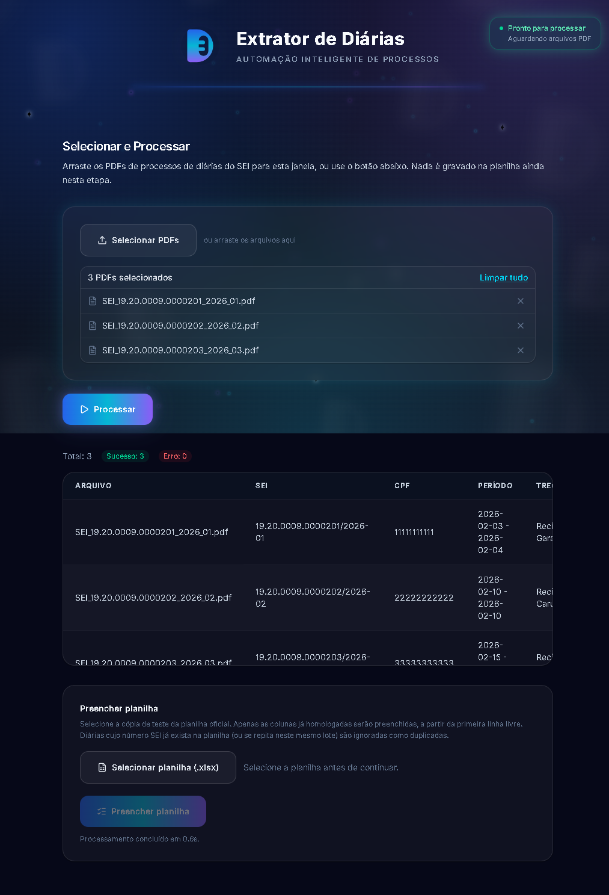
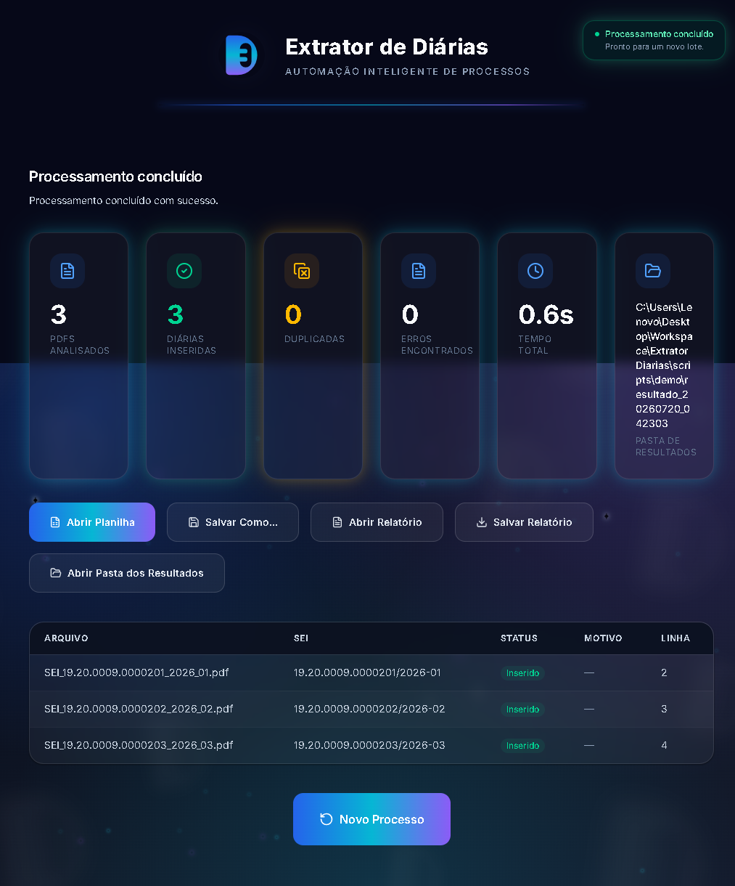

<p align="center">
  
</p>

<h1 align="center">Extrator de Diárias</h1>
<p align="center"><strong>Automação Inteligente de Processos</strong></p>

<p align="center">
  
  
  
  
  
  
</p>

---

## Visão Geral

Processos de diária no SEI (Sistema Eletrônico de Informações) trazem os mesmos campos — número do processo, CPF, período, cidades de origem e destino, Documento Hábil, valor autorizado — espalhados dentro de um PDF de várias páginas, muitas vezes com documentos repetidos (um requerimento corrigido, uma validação refeita) e pequenas inconsistências de digitação e formatação do próprio SEI.

**O processo manual** era abrir cada PDF, localizar cada campo visualmente e copiá-lo, um por um, para a planilha oficial de controle — repetido para cada processo de um lote, com o risco de erro de transcrição inerente a qualquer tarefa repetitiva feita à mão.

**O Extrator de Diárias automatiza esse fluxo inteiro**: você seleciona os PDFs, o aplicativo extrai e valida os campos automaticamente — inclusive resolvendo os casos difíceis (documento substituído por uma versão mais recente, campo partido por quebra de página, erro de digitação no nome do município) — e preenche a planilha oficial existente, sinalizando com clareza o que foi inserido com segurança e o que precisa de revisão manual. Um relatório HTML autossuficiente fecha cada execução com o resumo do lote.

Nenhuma regra de extração deste projeto foi inventada em teoria — cada uma existe por causa de um padrão documental real de processo SEI encontrado durante a homologação (documentado nos comentários do código-fonte, hoje com dados fictícios equivalentes nas fixtures de teste — veja [Dados sintéticos](#dados-sintéticos)).

## Demonstração

| Tela inicial | Seleção de PDFs |
| --- | --- |
|  |  |

| Processamento | Resultado |
| --- | --- |
|  |  |

| Preenchimento da planilha | Relatório |
| --- | --- |
|  |  |

Todas as capturas acima são geradas automaticamente (mesma resolução, mesmo tema, mesmo zoom) por [`frontend/scripts/capturar-screenshots.mjs`](frontend/scripts/capturar-screenshots.mjs), que usa o Playwright para dirigir o próprio aplicativo Electron de ponta a ponta sobre dados 100% sintéticos (veja [`scripts/demo/`](scripts/demo/)). Rode `npm run screenshots` (a partir de `frontend/`) para regerá-las.

## Principais recursos

- **Extração automática** dos campos-chave de um processo de diária do SEI a partir do PDF, sem digitação manual.
- **Robusta contra os padrões documentais reais do SEI**: múltiplos documentos do mesmo tipo anexados ao processo (sempre o mais recente vence), campos partidos por quebra de página, CPF com separador atípico, prefixo institucional antes do nome do município.
- **Resolução geográfica inteligente**: corrige erros de digitação em nomes de município (correspondência aproximada) e desambigua nomes que existem em mais de um estado usando o contexto do próprio processo.
- **Nunca "adivinha"**: quando um campo não pode ser resolvido com segurança, fica em branco com um aviso explícito para revisão manual — em vez de preencher um valor possivelmente errado.
- **Preenchimento direto na planilha oficial existente**, com detecção de duplicidade (mesmo processo já presente ou repetido no lote).
- **Relatório HTML autossuficiente** por execução, com resumo executivo e lista do que precisa de atenção.
- **100% desktop e local** — nenhum dado sai da máquina do usuário; o backend só escuta em `127.0.0.1`.
- **Cancelamento seguro** de um processamento em andamento, sem deixar arquivo parcial.

## Tecnologias

| Camada | Linguagem | Frameworks / bibliotecas principais |
| --- | --- | --- |
| Backend | Python 3.12 | FastAPI, Uvicorn, pdfplumber, PyMuPDF, openpyxl, PyInstaller |
| Frontend | TypeScript | React 18, Vite, Tailwind CSS 4 |
| Desktop | TypeScript | Electron, electron-builder |
| Testes | Python / TypeScript | pytest, Vitest, Testing Library, Playwright |

## Arquitetura


Aplicativo Electron com um backend FastAPI local (`127.0.0.1`, sem acesso externo): o processo main sobe/derruba o backend junto com a janela, e o renderer React fala com ele por HTTP. Documentação completa, incluindo o pipeline de extração passo a passo e os diagramas detalhados, em **[`docs/architecture/`](docs/architecture/)**.

## Estrutura do projeto

```
ExtratorDiarias/
├── backend/                    # Serviço FastAPI local
│   ├── app/
│   │   ├── api/                 # Rotas HTTP (processamento, planilha, saúde)
│   │   ├── domain/               # Entidades e regras de negócio puras
│   │   ├── extraction/           # Leitura de PDF, parser, enriquecimento
│   │   ├── planilha/              # Escrita no .xlsx e geração do relatório HTML
│   │   ├── schemas/               # Contratos Pydantic da API
│   │   └── services/              # Orquestração de caso de uso
│   ├── tests/                   # pytest — unit + integration
│   │   └── fixtures/              # PDFs sintéticos (ver gerar_fixtures_sinteticas.py)
│   └── requirements*.txt
├── frontend/                   # Casca Electron + interface React
│   ├── electron/                # Processo main + preload + IPC nativo
│   ├── src/                     # Renderer (páginas, componentes, tema, serviços)
│   ├── scripts/                 # Geração de ícone e de screenshots
│   └── public/brand/            # Logo e identidade visual (SVG)
├── scripts/demo/                # PDFs/planilha sintéticos usados só para screenshots
├── docs/
│   ├── architecture/             # Arquitetura, pipeline, diagramas
│   ├── branding/                  # Identidade visual: cores, tipografia, logo
│   ├── roadmap/                   # Histórico de sprints
│   └── screenshots/                # Capturas de tela do README
└── tests/e2e/                   # Testes de ponta a ponta (app inteiro)
```

## Como executar

Pré-requisitos: **Node.js 20+**, **Python 3.12**, Windows (o instalador final é `.exe`/NSIS; em desenvolvimento roda em qualquer SO com Electron).

```bash
# 1. Backend — cria o ambiente virtual e instala as dependências
cd backend
python -m venv .venv
.venv\Scripts\pip install -r requirements.txt

# 2. Frontend — instala as dependências Node
cd ../frontend
npm install

# 3. Roda tudo junto (Vite + build do Electron em watch + app)
npm run dev
```

`npm run dev` sobe o Vite, compila o processo Electron em modo watch e abre o app — que, por sua vez, inicia o backend a partir do `.venv` automaticamente (nenhum passo manual de subir o backend separadamente).

### Gerar o instalador Windows

```bash
cd frontend
npm run release
```

Empacota o backend com PyInstaller, compila o frontend e gera o instalador NSIS em `frontend/release/`.

### Testes

```bash
# Backend
cd backend && .venv\Scripts\python.exe -m pytest tests/ -q

# Frontend
cd frontend && npm run typecheck && npm run test
```

## Roadmap

Histórico completo, sprint a sprint, em **[`docs/roadmap/`](docs/roadmap/)**.

| Status | Descrição |
| --- | --- |
| ✅ Concluído | Pipeline de extração completo, enriquecimento (Documento Hábil, transporte, local, Diária de Membro), preenchimento de planilha, relatório HTML, identidade visual própria, empacotamento Windows, publicação pública v1.0.0 |
| 🔄 Em desenvolvimento | Nenhum item ativo no momento desta publicação |
| 📋 Planejado (não comprometido) | Stream de progresso via SSE; camada de persistência local — ambos descritos, não implementados, na concepção original do backend |

## Dados sintéticos

**Este repositório é público — nenhum dado real (documento, processo administrativo, CPF, nome, planilha) jamais é versionado, nem mesmo para teste.** Toda fixture de PDF e toda planilha de demonstração usada pela suíte de testes e pelas screenshots acima é gerada artificialmente, reproduzindo o mesmo comportamento de extração sem expor nenhuma informação real. Veja a política completa em **[`CONTRIBUTING.md`](CONTRIBUTING.md#política-de-dados-sintéticos-leitura-obrigatória)**.

## Licença

Distribuído sob a licença [MIT](LICENSE).

## Autor

**Vinicius Mendes**
