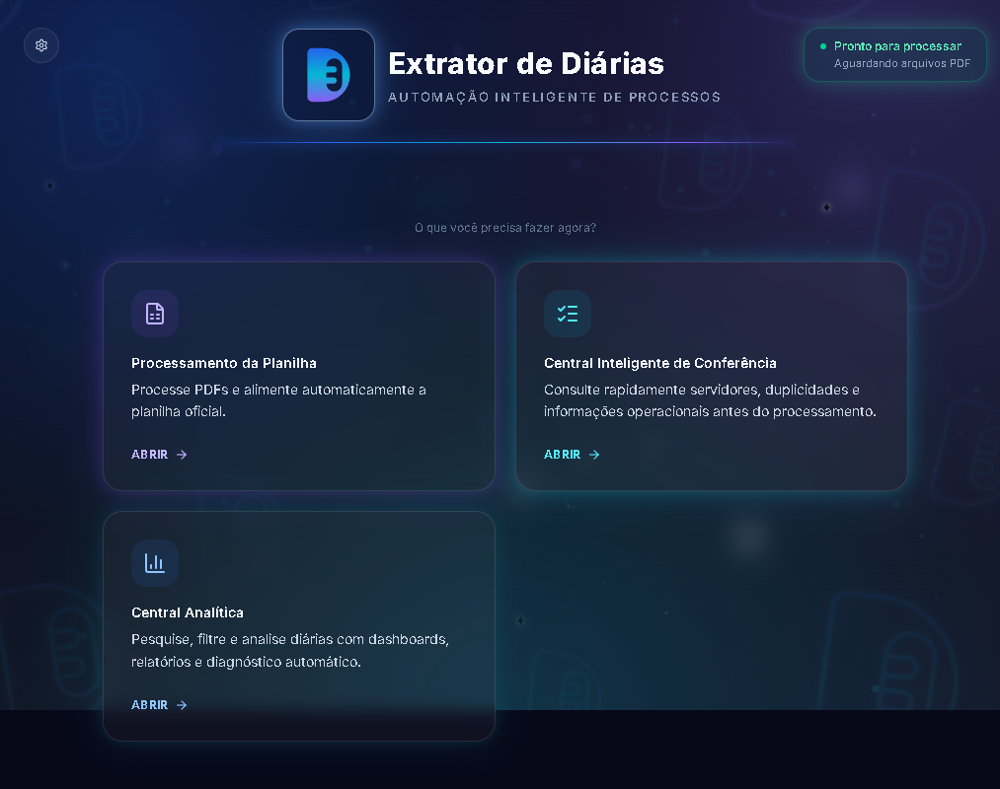
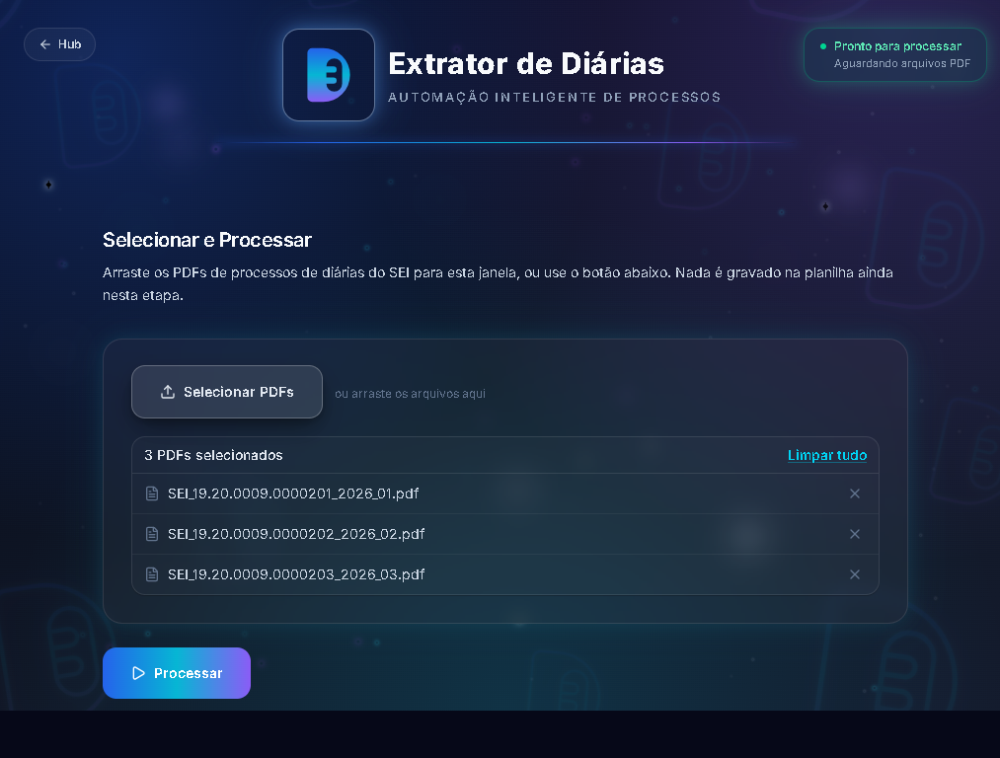
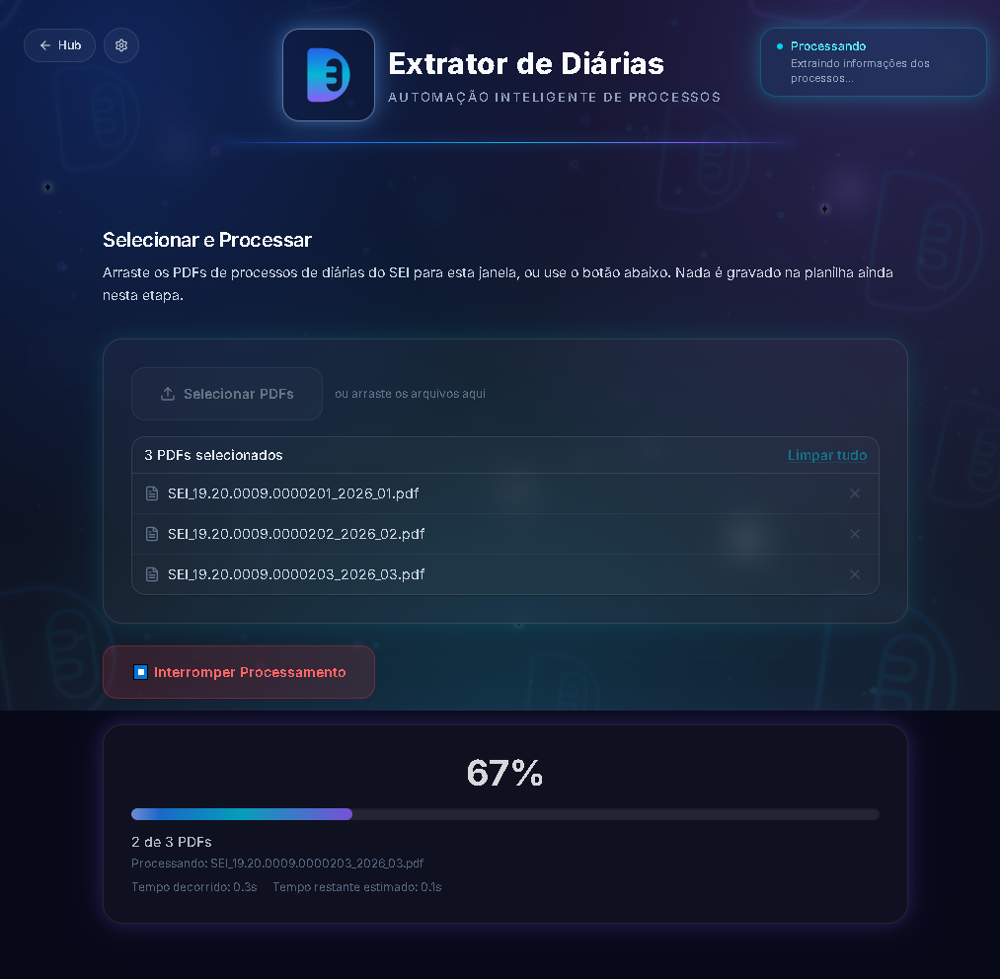
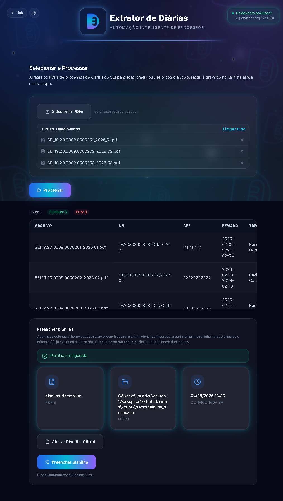
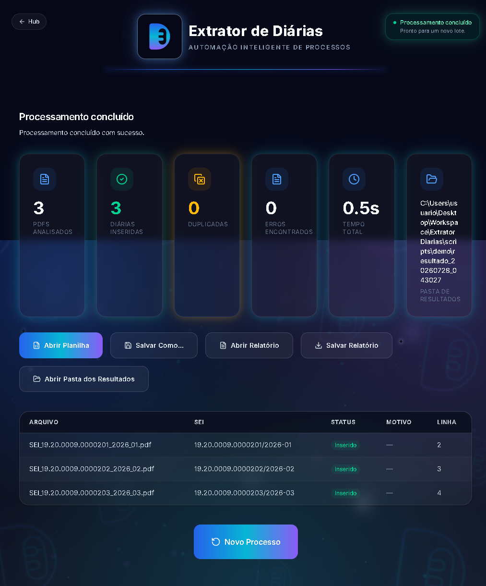
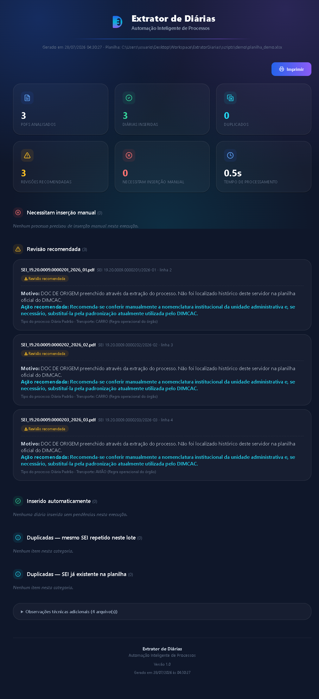
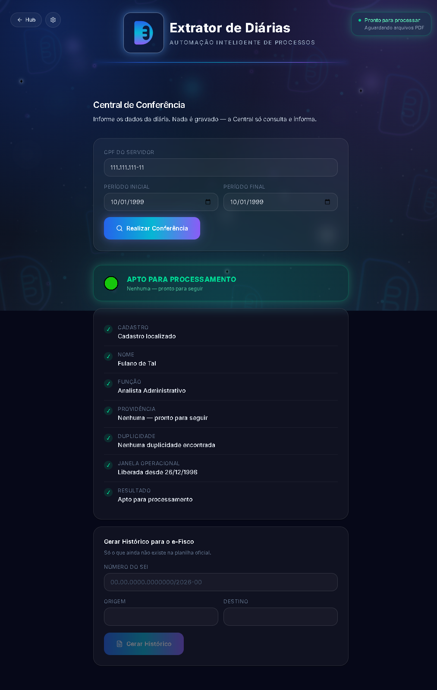
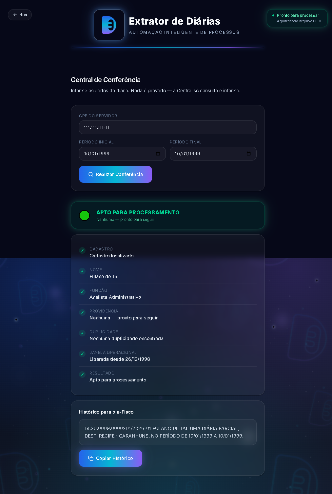
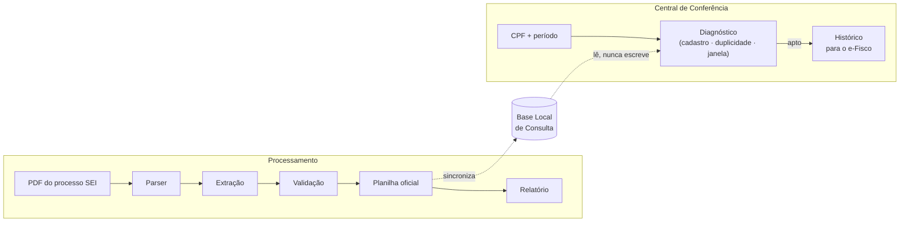

<p align="center">
  
</p>

<h1 align="center">Extrator de Diárias</h1>
<p align="center"><strong>Automação Inteligente do Processo de Concessão de Diárias</strong></p>

<p align="center">
  
</p>

<p align="center">
  
  
  
  
  
  
  
</p>

---

## Visão Geral

O processo de concessão de diárias do DIMCAC tem duas metades. A **primeira** é extrair os dados de cada processo do SEI (Sistema Eletrônico de Informações) — número do processo, CPF, período, cidades de origem e destino, Documento Hábil, valor autorizado — espalhados dentro de um PDF de várias páginas, muitas vezes com documentos repetidos (um requerimento corrigido, uma validação refeita) e pequenas inconsistências de digitação e formatação do próprio SEI. A **segunda**, historicamente inteira manual dentro do Excel, é **conferir** se cada solicitação está apta a virar diária: o servidor está cadastrado? já existe uma diária para o mesmo CPF e período? o processo já pode seguir para as próximas etapas administrativas?

**O Extrator de Diárias automatiza as duas metades.** Na primeira, você seleciona os PDFs e o aplicativo extrai e valida os campos automaticamente — inclusive resolvendo os casos difíceis (documento substituído por uma versão mais recente, campo partido por quebra de página, erro de digitação no nome do município) — e preenche a planilha oficial existente, sinalizando com clareza o que foi inserido com segurança e o que precisa de revisão manual. Um relatório HTML autossuficiente fecha cada execução com o resumo do lote. Na segunda, a **Central Inteligente de Conferência** consulta a planilha oficial já preenchida e devolve, em segundos, um diagnóstico completo (cadastro, duplicidade, janela operacional) e o texto pronto para registrar no e-Fisco — sem nunca decidir nada por conta própria: a Central só informa, a decisão continua sempre com o servidor.

Nenhuma regra deste projeto foi inventada em teoria — cada uma existe por causa de um padrão documental real de processo SEI ou de uma fórmula real da planilha oficial, encontrados durante a homologação e a engenharia reversa (documentados nos comentários do código-fonte e em [`docs/central-conferencia/`](docs/central-conferencia/README.md), hoje com dados fictícios equivalentes nas fixtures de teste — veja [Dados sintéticos](#dados-sintéticos)).

## Demonstração

| Boas-vindas | Hub |
| --- | --- |
|  |  |

| Seleção de PDFs | Processamento |
| --- | --- |
|  |  |

| Resultado | Preenchimento da planilha |
| --- | --- |
|  |  |

| Relatório | Central Inteligente de Conferência |
| --- | --- |
|  |  |

| Geração do histórico para o e-Fisco |
| --- |
|  |

Todas as capturas acima (e o GIF no topo do README) são geradas automaticamente — mesma resolução, mesmo tema, mesmo zoom, mesmos dados 100% sintéticos (veja [`scripts/demo/`](scripts/demo/)) — dirigindo o próprio aplicativo Electron de ponta a ponta com Playwright:

```bash
# a partir de frontend/
npm run screenshots   # regera docs/screenshots/*.png
npm run gif           # regera docs/screenshots/demo.gif
```

`npm run screenshots` usa [`frontend/scripts/capturar-screenshots.mjs`](frontend/scripts/capturar-screenshots.mjs). `npm run gif` usa [`frontend/scripts/gerar-gif.mjs`](frontend/scripts/gerar-gif.mjs) (novo — Sprint 14.1): captura uma sequência de estados reais do app e monta o GIF com [`gifenc`](https://github.com/mattdesl/gifenc), um encoder em JavaScript puro, sem depender de `ffmpeg`/ImageMagick. Ambos os scripts são ferramentas de documentação — não fazem parte do app em runtime nem do instalador distribuído ao usuário final.

## Principais recursos

**Processamento de PDFs**
- **Extração automática** dos campos-chave de um processo de diária do SEI a partir do PDF, sem digitação manual, por um parser dedicado ao formato SEI.
- **Robusta contra os padrões documentais reais do SEI**: múltiplos documentos do mesmo tipo anexados ao processo (sempre o mais recente vence), campos partidos por quebra de página, CPF com separador atípico, prefixo institucional antes do nome do município.
- **Resolução geográfica inteligente**: corrige erros de digitação em nomes de município (correspondência aproximada) e desambigua nomes que existem em mais de um estado usando o contexto do próprio processo.
- **Nunca "adivinha"**: quando um campo não pode ser resolvido com segurança, fica em branco com um aviso explícito para revisão manual — em vez de preencher um valor possivelmente errado.
- **Preenchimento inteligente da planilha oficial existente**, com detecção de duplicidade (mesmo processo já presente ou repetido no lote) e relatório HTML autossuficiente por execução.

**Central Inteligente de Conferência**
- **Sincronização automática da Base Local de Consulta** — a cada processamento bem-sucedido, uma cópia somente-leitura da planilha oficial é atualizada de forma transparente (pasta de dados do app), sempre a mais recente.
- **Consulta cadastral por CPF** — nome, cargo e previdência do servidor, na hora.
- **Verificação de duplicidade** — mesma chave de negócio já usada pela planilha oficial (CPF + período inicial + período final), com linha, SEI, trecho e período do registro encontrado.
- **Verificação da janela operacional** — informa se o processo já atingiu a data mínima para seguir no fluxo administrativo, com a mesma regra já usada pelo setor.
- **Geração automática do histórico do e-Fisco** — texto pronto para colar, no formato exato já usado manualmente pelo DIMCAC, só depois que o diagnóstico confirma que o processo está apto.
- **Puramente consultiva, por princípio arquitetural** — nunca aprova, rejeita ou grava na planilha oficial; só informa. A decisão continua sempre com o servidor (ver [Diferenciais](#diferenciais)).

**Aplicativo**
- **Arquitetura modular**: Boas-vindas → Hub → funcionalidade (Processamento ou Conferência), cada módulo independente — um 3º módulo futuro é uma entrada a mais no Hub, não uma navegação redesenhada.
- **100% desktop e local** — nenhum dado sai da máquina do usuário; o backend só escuta em `127.0.0.1`.
- **Cancelamento seguro** de um processamento em andamento, sem deixar arquivo parcial.

## Diferenciais

- **Toda regra de negócio é rastreável** — cada verificação da Central de Conferência remonta a uma fórmula real da planilha oficial ou a uma regra operacional confirmada pelo especialista do processo (RN-01 a RN-13, documentadas linha a linha em [`docs/central-conferencia/`](docs/central-conferencia/README.md)). Nada foi implementado por suposição.
- **A Central nunca decide** — só consulta e informa (cadastro, duplicidade, janela operacional); a aprovação, negação ou solicitação de complementação continua sempre sendo uma decisão administrativa do servidor do DIMCAC.
- **Nunca "adivinha"** — tanto na extração de PDF quanto na conferência, qualquer coisa que não possa ser resolvida com segurança fica explícita para revisão humana, nunca é preenchida com um palpite.
- **Identidade visual própria** ("Neon Tech UI", Design System v2.0+) — sem qualquer referência a uma instituição específica, para que o software possa ser usado e distribuído por qualquer equipe.
- **100% sintético em qualquer artefato público** — testes, fixtures, screenshots e o GIF de demonstração usam apenas dados fictícios; nenhum documento, processo ou planilha real é versionado neste repositório público.

## Tecnologias

| Camada | Linguagem | Frameworks / bibliotecas principais |
| --- | --- | --- |
| Backend | Python 3.12 | FastAPI, Uvicorn, pdfplumber, PyMuPDF, openpyxl, PyInstaller |
| Frontend | TypeScript | React 18, Vite, Tailwind CSS 4 |
| Desktop | TypeScript | Electron, electron-builder |
| Testes | Python / TypeScript | pytest, Vitest, Testing Library, Playwright |
| Documentação (dev-only) | TypeScript | Playwright (screenshots/GIF), `sharp`, `gifenc` — nunca no runtime do app nem no instalador |

## Arquitetura



Aplicativo Electron com um backend FastAPI local (`127.0.0.1`, sem acesso externo): o processo main sobe/derruba o backend junto com a janela, e o renderer React fala com ele por HTTP. As duas funcionalidades — Processamento e Central de Conferência — são fluxos paralelos e independentes, escolhidos a partir de um Hub; a Central só lê a Base Local de Consulta, nunca escreve na planilha oficial (princípio arquitetural RN-11). Documentação completa, incluindo o pipeline de extração passo a passo, os diagramas detalhados e as 13 regras de negócio da Central de Conferência, em **[`docs/architecture/`](docs/architecture/)** e **[`docs/central-conferencia/`](docs/central-conferencia/README.md)**.

## Estrutura do projeto

```
ExtratorDiarias/
├── backend/                    # Serviço FastAPI local
│   ├── app/
│   │   ├── api/                 # Rotas HTTP (processamento, planilha, conferência, saúde)
│   │   ├── consulta/              # Base Local de Consulta — leitura somente-leitura (Central de Conferência)
│   │   ├── domain/               # Entidades e regras de negócio puras (validação e conferência)
│   │   ├── extraction/           # Leitura de PDF, parser, enriquecimento
│   │   ├── planilha/              # Escrita no .xlsx e geração do relatório HTML
│   │   ├── schemas/               # Contratos Pydantic da API
│   │   └── services/              # Orquestração de caso de uso
│   ├── tests/                   # pytest — unit + integration
│   │   └── fixtures/              # PDFs sintéticos (ver gerar_fixtures_sinteticas.py)
│   └── requirements*.txt
├── frontend/                   # Casca Electron + interface React
│   ├── electron/                # Processo main + preload + IPC nativo (planilha, relatório, conferência)
│   ├── src/
│   │   ├── pages/                 # BoasVindas, Hub, SelecionarProcessar, Conferencia
│   │   └── components/            # conferencia/, hub/, layout/, progress/, results/, ui/, upload/
│   ├── scripts/                 # Geração de ícone, screenshots e GIF do README
│   └── public/brand/            # Logo e identidade visual (SVG)
├── scripts/demo/                # PDFs/planilha sintéticos usados só para screenshots/GIF
├── docs/
│   ├── architecture/             # Arquitetura, pipeline, diagramas
│   ├── branding/                  # Identidade visual: cores, tipografia, logo
│   ├── central-conferencia/       # Engenharia reversa e regras de negócio (RN-01 a RN-13)
│   ├── backlog/                   # Evoluções futuras fora do escopo já aprovado
│   ├── roadmap/                   # Histórico de sprints
│   └── screenshots/                # Capturas de tela e GIF do README
└── tests/e2e/                   # Testes de ponta a ponta (app inteiro)
```

## Como executar

Pré-requisitos: **Node.js 20+**, **Python 3.12**, Windows (o instalador final é `.exe`/NSIS; em desenvolvimento roda em qualquer SO com Electron).

```bash
# 1. Backend — cria o ambiente virtual e instala as dependências
cd backend
python -m venv .venv
.venv\Scripts\pip install -r requirements.txt

# 2. Frontend — instala as dependências Node
cd ../frontend
npm install

# 3. Roda tudo junto (Vite + build do Electron em watch + app)
npm run dev
```

`npm run dev` sobe o Vite, compila o processo Electron em modo watch e abre o app — que, por sua vez, inicia o backend a partir do `.venv` automaticamente (nenhum passo manual de subir o backend separadamente).

### Gerar o instalador Windows

```bash
cd frontend
npm run release
```

Empacota o backend com PyInstaller, compila o frontend e gera o instalador NSIS em `frontend/release/`.

### Testes

```bash
# Backend (278 testes)
cd backend && .venv\Scripts\python.exe -m pytest tests/ -q

# Frontend (84 testes)
cd frontend && npm run typecheck && npm run test
```

## Roadmap

Histórico completo, sprint a sprint, em **[`docs/roadmap/`](docs/roadmap/)**.

| Status | Descrição |
| --- | --- |
| ✅ Concluído | Pipeline de extração completo (enriquecimento de Documento Hábil, transporte, local, Diária de Membro), preenchimento de planilha, relatório HTML; **Central Inteligente de Conferência** completa (diagnóstico de cadastro/duplicidade/janela operacional + geração do histórico do e-Fisco); Hub de funcionalidades e tela de Boas-vindas; identidade visual própria, empacotamento Windows, publicação pública v1.0.0; documentação revisada de ponta a ponta (Sprint 14.1); arquitetura da Configuração Inicial da Planilha Oficial definida, sem código ainda (Sprint 15 — ver [`docs/configuracao-inicial/`](docs/configuracao-inicial/)) |
| 🔄 Em desenvolvimento | Nenhum item ativo — a implementação da Sprint 15 (Configuração Inicial da Planilha Oficial) ainda não foi iniciada, nem a Sprint 16 (Build e Distribuição, rumo à Release Candidate v1.0.0-RC1) |
| 📋 Planejado (não comprometido) | Evoluções da Central de Conferência (consulta por matrícula/nome, histórico completo por servidor — ver [`docs/backlog/`](docs/backlog/README.md)); stream de progresso via SSE; camada de persistência local — descritos, não implementados, na concepção original do backend |

## Status atual do projeto

Todas as funcionalidades descritas neste README estão implementadas, testadas (362 testes automatizados) e refletidas fielmente nas capturas de tela e no GIF acima — nenhuma delas é aspiracional. O projeto está encerrando a Sprint 15 (arquitetura da Configuração Inicial da Planilha Oficial — documentação apenas, sem código); a implementação dela e, na sequência, a Sprint 16 (Build e Distribuição), rumo a uma Release Candidate v1.0.0-RC1, ainda não foram iniciadas, sem build, instalador ou tag publicados a partir deste ponto da documentação.

## Dados sintéticos

**Este repositório é público — nenhum dado real (documento, processo administrativo, CPF, nome, planilha) jamais é versionado, nem mesmo para teste.** Toda fixture de PDF, toda planilha de demonstração e todo cadastro de servidor usados pela suíte de testes e pelas capturas de tela/GIF acima são gerados artificialmente, reproduzindo o mesmo comportamento de extração e conferência sem expor nenhuma informação real. Veja a política completa em **[`CONTRIBUTING.md`](CONTRIBUTING.md#política-de-dados-sintéticos-leitura-obrigatória)**.

## Licença

Distribuído sob a licença [MIT](LICENSE).

## Autor

**Vinicius Mendes**
