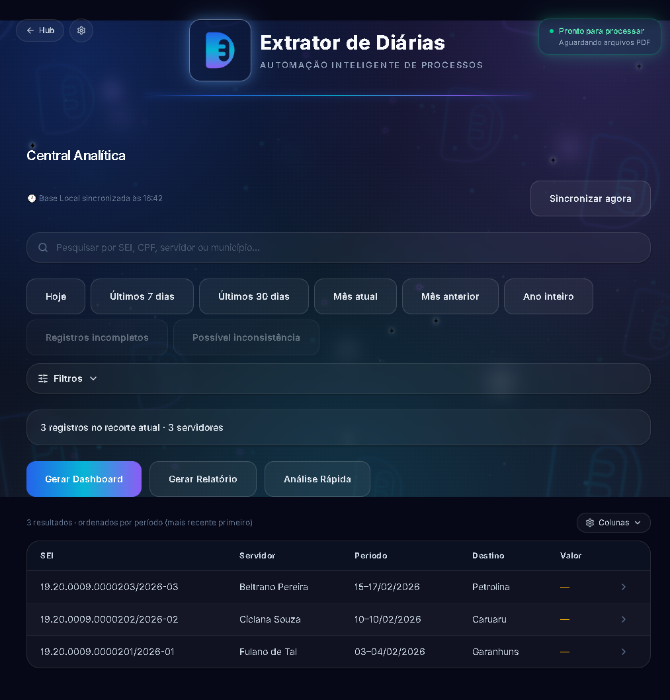
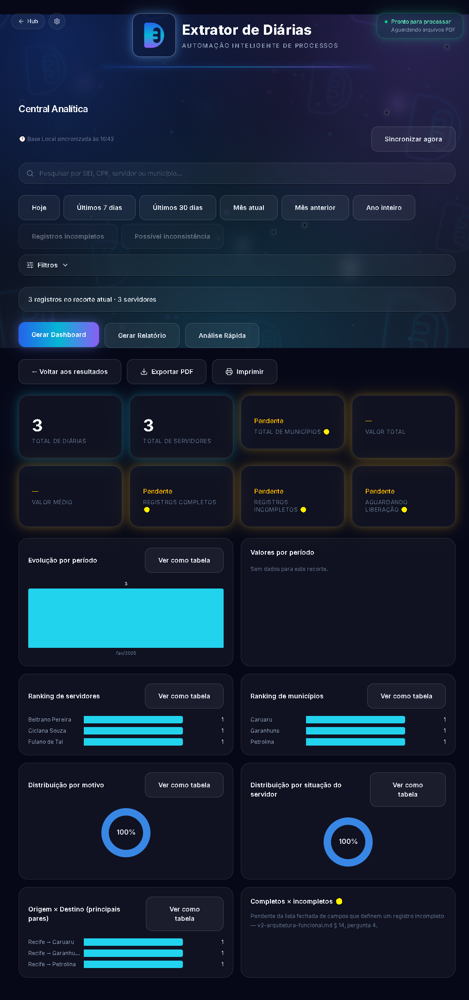
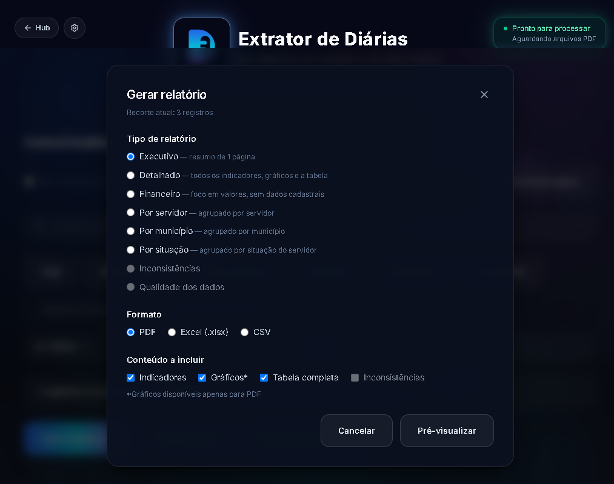
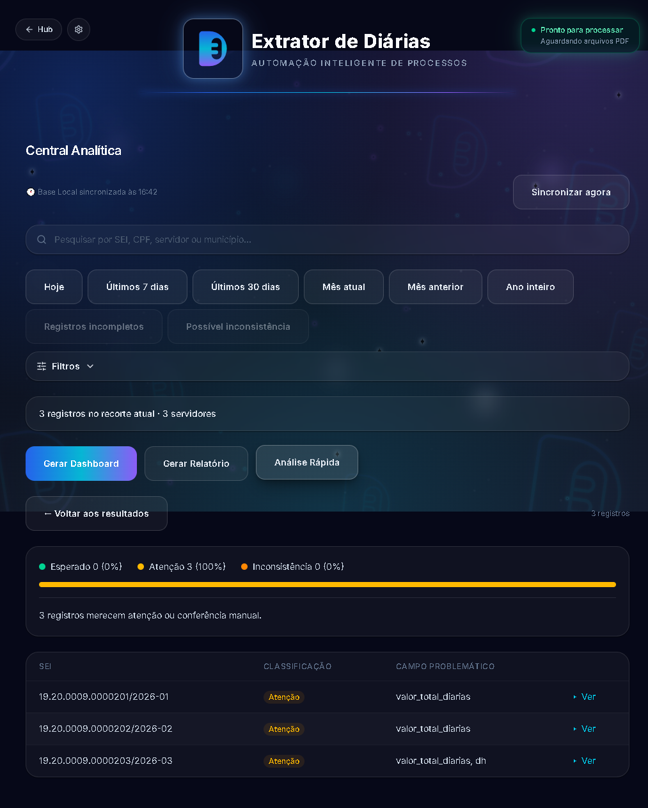
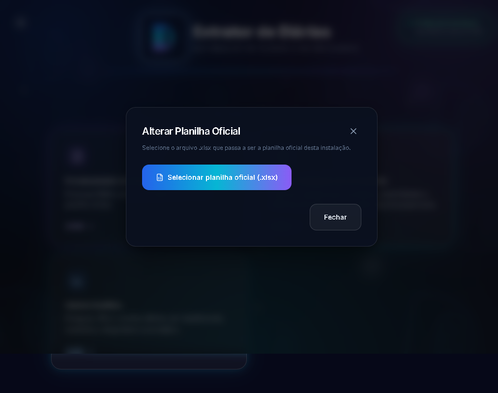
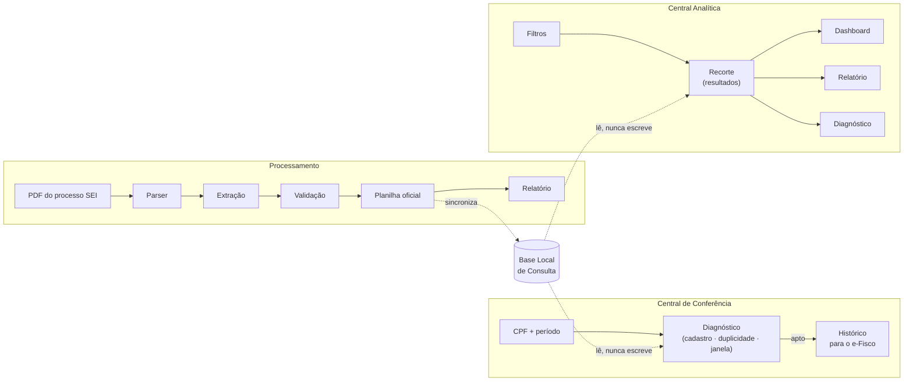

<p align="center">
  
</p>

<h1 align="center">Automatizador de Diárias</h1>
<p align="center"><strong>Automação Inteligente do Processo de Concessão de Diárias</strong></p>

<p align="center">
  
</p>

<p align="center">
  
  
  
  
  
  
  
</p>

---

## Visão Geral

O processo de concessão de diárias do DIMCAC tem três partes. A **primeira** é extrair os dados de cada processo do SEI (Sistema Eletrônico de Informações) — número do processo, CPF, período, cidades de origem e destino, Documento Hábil, valor autorizado — espalhados dentro de um PDF de várias páginas, muitas vezes com documentos repetidos (um requerimento corrigido, uma validação refeita) e pequenas inconsistências de digitação e formatação do próprio SEI. A **segunda**, historicamente inteira manual dentro do Excel, é **conferir** se cada solicitação está apta a virar diária: o servidor está cadastrado? já existe uma diária para o mesmo CPF e período? o processo já pode seguir para as próximas etapas administrativas? A **terceira** é **enxergar o conjunto**: quantas diárias foram pagas em tal período ou cidade, qual o valor total, quais merecem atenção — hoje só possível abrindo a planilha oficial e montando tabelas dinâmicas manualmente.

**O Automatizador de Diárias automatiza as três.** Na primeira, você seleciona os PDFs e o aplicativo extrai e valida os campos automaticamente — inclusive resolvendo os casos difíceis (documento substituído por uma versão mais recente, campo partido por quebra de página, erro de digitação no nome do município) — e preenche a planilha oficial existente, sinalizando com clareza o que foi inserido com segurança e o que precisa de revisão manual. Um relatório HTML autossuficiente fecha cada execução com o resumo do lote. Na segunda, a **Central Inteligente de Conferência** consulta a planilha oficial já preenchida e devolve, em segundos, um diagnóstico completo (cadastro, duplicidade, janela operacional) e o texto pronto para registrar no e-Fisco. Na terceira, a **Central Analítica** deixa pesquisar, filtrar e analisar todas as diárias já registradas — com Dashboard, Relatórios exportáveis (PDF/Excel/CSV) e Diagnóstico automático do recorte filtrado. Nenhum dos três módulos decide nada por conta própria: todos só informam, a decisão continua sempre com o servidor.

Nenhuma regra deste projeto foi inventada em teoria — cada uma existe por causa de um padrão documental real de processo SEI ou de uma fórmula real da planilha oficial, encontrados durante a homologação e a engenharia reversa (documentados nos comentários do código-fonte, em [`docs/central-conferencia/`](docs/central-conferencia/README.md) e em [`docs/central-analitica/`](docs/central-analitica/README.md), hoje com dados fictícios equivalentes nas fixtures de teste — veja [Dados sintéticos](#dados-sintéticos)).

## Demonstração do Fluxo da Aplicação

| Boas-vindas | Hub |
| --- | --- |
|  |  |

| Seleção de PDFs | Processamento |
| --- | --- |
|  |  |

| Resultado | Preenchimento da planilha |
| --- | --- |
|  |  |

| Relatório | Central Inteligente de Conferência |
| --- | --- |
|  |  |

| Geração do histórico para o e-Fisco | Central Analítica — resultados |
| --- | --- |
|  |  |

| Dashboard do recorte | Gerar relatório |
| --- | --- |
|  |  |

| Análise Rápida (Diagnóstico) | Configurações |
| --- | --- |
|  |  |

Todas as capturas acima (e o GIF no topo do README) são geradas automaticamente — mesma resolução, mesmo tema, mesmo zoom, mesmos dados 100% sintéticos (veja [`scripts/demo/`](scripts/demo/)) — dirigindo o próprio aplicativo Electron de ponta a ponta com Playwright:

```bash
# a partir de frontend/
npm run screenshots   # regera docs/screenshots/*.png
npm run gif           # regera docs/screenshots/demo.gif
```

`npm run screenshots` usa [`frontend/scripts/capturar-screenshots.mjs`](frontend/scripts/capturar-screenshots.mjs). `npm run gif` usa [`frontend/scripts/gerar-gif.mjs`](frontend/scripts/gerar-gif.mjs) (novo — Sprint 14.1): captura uma sequência de estados reais do app e monta o GIF com [`gifenc`](https://github.com/mattdesl/gifenc), um encoder em JavaScript puro, sem depender de `ffmpeg`/ImageMagick. Ambos os scripts são ferramentas de documentação — não fazem parte do app em runtime nem do instalador distribuído ao usuário final.

## Principais recursos

**Processamento de PDFs**
- **Extração automática** dos campos-chave de um processo de diária do SEI a partir do PDF, sem digitação manual, por um parser dedicado ao formato SEI.
- **Robusta contra os padrões documentais reais do SEI**: múltiplos documentos do mesmo tipo anexados ao processo (sempre o mais recente vence), campos partidos por quebra de página, CPF com separador atípico, prefixo institucional antes do nome do município.
- **Resolução geográfica inteligente**: corrige erros de digitação em nomes de município (correspondência aproximada) e desambigua nomes que existem em mais de um estado usando o contexto do próprio processo.
- **Nunca "adivinha"**: quando um campo não pode ser resolvido com segurança, fica em branco com um aviso explícito para revisão manual — em vez de preencher um valor possivelmente errado.
- **Preenchimento inteligente da planilha oficial existente**, com detecção de duplicidade (mesmo processo já presente ou repetido no lote) e relatório HTML autossuficiente por execução.

**Central Inteligente de Conferência**
- **Sincronização automática da Base Local de Consulta** — a cada processamento bem-sucedido, uma cópia somente-leitura da planilha oficial é atualizada de forma transparente (pasta de dados do app), sempre a mais recente.
- **Consulta cadastral por CPF** — nome, cargo e previdência do servidor, na hora.
- **Verificação de duplicidade** — mesma chave de negócio já usada pela planilha oficial (CPF + período inicial + período final), com linha, SEI, trecho e período do registro encontrado.
- **Verificação da janela operacional** — informa se o processo já atingiu a data mínima para seguir no fluxo administrativo, com a mesma regra já usada pelo setor.
- **Geração automática do histórico do e-Fisco** — texto pronto para colar, no formato exato já usado manualmente pelo DIMCAC, só depois que o diagnóstico confirma que o processo está apto.
- **Puramente consultiva, por princípio arquitetural** — nunca aprova, rejeita ou grava na planilha oficial; só informa. A decisão continua sempre com o servidor (ver [Diferenciais](#diferenciais)).

**Central Analítica**
- **Fluxo único orientado por tarefa** — filtrar → revisar o recorte → agir; Dashboard, Relatório e Diagnóstico são sempre uma ação sobre o recorte já filtrado, nunca uma tela que pede os mesmos filtros de novo.
- **Pesquisa e filtros completos** sobre a Base Local (SQLite, sincronizada automaticamente, somente leitura) — SEI, CPF, servidor, matrícula, origem, destino, trecho, município, motivo, situação do servidor, período e faixa de valor, com paginação, ordenação e busca global.
- **Dashboard do recorte filtrado** — indicadores (total de diárias, servidores, valor total/médio) e distribuições (evolução por período, valores, ranking de servidores/municípios, motivo, situação), com gráficos próprios que também servem para refinar o filtro com um clique.
- **Relatórios exportáveis** — PDF, Excel ou CSV, em 6 tipos (executivo, detalhado, financeiro, por servidor, por município, por situação), sempre sobre o mesmo recorte filtrado, nunca reconfigurado do zero.
- **Análise Rápida (Diagnóstico)** — classifica cada diária do recorte (esperado, atenção ou inconsistência) e aponta o campo problemático; inconsistência de negócio nunca é vermelha — vermelho fica reservado a falha técnica real, mesma disciplina de cor da Central de Conferência.
- **Também puramente consultiva** — a Base Local Analítica nunca é escrita pelo módulo; só leitura, mesmo princípio arquitetural da Central de Conferência.

**Aplicativo**
- **Arquitetura modular**: Boas-vindas → Hub → funcionalidade (Processamento, Conferência ou Central Analítica), cada módulo independente — um 4º módulo futuro é uma entrada a mais no Hub, não uma navegação redesenhada.
- **Configuração obrigatória da planilha oficial** na primeira execução (seleção, validação em 5 critérios e persistência local), com "Alterar Planilha Oficial" acessível a qualquer momento pelo ícone de Configurações do cabeçalho.
- **100% desktop e local** — nenhum dado sai da máquina do usuário; o backend só escuta em `127.0.0.1`.
- **Cancelamento seguro** de um processamento em andamento, sem deixar arquivo parcial.

## Diferenciais

- **Toda regra de negócio é rastreável** — cada verificação da Central de Conferência remonta a uma fórmula real da planilha oficial ou a uma regra operacional confirmada pelo especialista do processo (RN-01 a RN-13, documentadas linha a linha em [`docs/central-conferencia/`](docs/central-conferencia/README.md)); cada filtro/indicador da Central Analítica remonta a um campo real do mesmo esquema (ver [`docs/central-analitica/`](docs/central-analitica/README.md)). Nada foi implementado por suposição.
- **Nenhum módulo consultivo decide** — Central de Conferência e Central Analítica só consultam e informam; a aprovação, negação ou solicitação de complementação continua sempre sendo uma decisão administrativa do servidor do DIMCAC.
- **Nunca "adivinha"** — na extração de PDF, na conferência e na análise, qualquer coisa que não possa ser resolvida com segurança fica explícita para revisão humana, nunca é preenchida com um palpite; e uma inconsistência de negócio nunca é sinalizada em vermelho (reservado a falha técnica real).
- **Identidade visual própria** ("Neon Tech UI", Design System v2.0+) — sem qualquer referência a uma instituição específica, para que o software possa ser usado e distribuído por qualquer equipe.
- **100% sintético em qualquer artefato público** — testes, fixtures, screenshots e o GIF de demonstração usam apenas dados fictícios; nenhum documento, processo ou planilha real é versionado neste repositório público.

## Tecnologias

| Camada | Linguagem | Frameworks / bibliotecas principais |
| --- | --- | --- |
| Backend | Python 3.12 | FastAPI, Uvicorn, pdfplumber, PyMuPDF, openpyxl, reportlab (PDF), SQLite (stdlib), PyInstaller |
| Frontend | TypeScript | React 18, Vite, Tailwind CSS 4, gráficos SVG próprios (sem biblioteca externa) |
| Desktop | TypeScript | Electron, electron-builder |
| Testes | Python / TypeScript | pytest, Vitest, Testing Library, Playwright |
| Documentação (dev-only) | TypeScript | Playwright (screenshots/GIF), `sharp`, `gifenc` — nunca no runtime do app nem no instalador |

## Arquitetura



Aplicativo Electron com um backend FastAPI local (`127.0.0.1`, sem acesso externo): o processo main sobe/derruba o backend junto com a janela, e o renderer React fala com ele por HTTP. As três funcionalidades — Processamento, Central de Conferência e Central Analítica — são fluxos paralelos e independentes, escolhidos a partir de um Hub; os dois módulos consultivos só leem a Base Local de Consulta, nunca escrevem na planilha oficial (princípio arquitetural RN-11). Documentação completa, incluindo o pipeline de extração passo a passo, os diagramas detalhados, as 13 regras de negócio da Central de Conferência e a arquitetura da Central Analítica, em **[`docs/architecture/`](docs/architecture/)**, **[`docs/central-conferencia/`](docs/central-conferencia/README.md)** e **[`docs/central-analitica/`](docs/central-analitica/README.md)**.

## Estrutura do projeto

```
ExtratorDiarias/
├── backend/                    # Serviço FastAPI local
│   ├── app/
│   │   ├── api/                 # Rotas HTTP (processamento, planilha, conferência, analítica, configuração, saúde)
│   │   ├── consulta/              # Bases Locais de Consulta — leitura somente-leitura (Conferência: Excel · Analítica: SQLite)
│   │   ├── domain/               # Entidades e regras de negócio puras (validação, conferência, analitica/ — indicadores, distribuições, diagnóstico)
│   │   ├── extraction/           # Leitura de PDF, parser, enriquecimento
│   │   ├── infra/db/              # Esquema e conexão SQLite da Base Local Analítica
│   │   ├── planilha/              # Escrita no .xlsx e geração do relatório HTML
│   │   ├── schemas/               # Contratos Pydantic da API
│   │   └── services/              # Orquestração de caso de uso
│   ├── tests/                   # pytest — unit + integration
│   │   └── fixtures/              # PDFs sintéticos (ver gerar_fixtures_sinteticas.py)
│   └── requirements*.txt
├── frontend/                   # Casca Electron + interface React
│   ├── electron/                # Processo main + preload + IPC nativo (planilha, relatório, conferência, clipboard)
│   ├── src/
│   │   ├── pages/                 # BoasVindas, Hub, ConfiguracaoInicial, SelecionarProcessar, Conferencia, CentralAnalitica
│   │   └── components/            # analitica/, conferencia/, configuracao/, hub/, layout/, progress/, results/, ui/, upload/
│   ├── scripts/                 # Geração de ícone, screenshots e GIF do README
│   └── public/brand/            # Logo e identidade visual (SVG)
├── scripts/demo/                # PDFs/planilha sintéticos usados só para screenshots/GIF
├── docs/
│   ├── architecture/             # Arquitetura, pipeline, diagramas
│   ├── branding/                  # Identidade visual: cores, tipografia, logo
│   ├── central-conferencia/       # Engenharia reversa e regras de negócio (RN-01 a RN-13)
│   ├── central-analitica/         # Arquitetura, plano técnico e registro de execução da Central Analítica
│   ├── configuracao-inicial/      # Configuração obrigatória da planilha oficial (Sprint 15)
│   ├── backlog/                   # Evoluções futuras fora do escopo já aprovado
│   ├── roadmap/                   # Histórico de sprints
│   └── screenshots/                # Capturas de tela e GIF do README
└── tests/e2e/                   # Testes de ponta a ponta (app inteiro)
```

## Como executar

Pré-requisitos: **Node.js 20+**, **Python 3.12**, Windows (o instalador final é `.exe`/NSIS; em desenvolvimento roda em qualquer SO com Electron).

```bash
# 1. Backend — cria o ambiente virtual e instala as dependências
cd backend
python -m venv .venv
.venv\Scripts\pip install -r requirements.txt

# 2. Frontend — instala as dependências Node
cd ../frontend
npm install

# 3. Roda tudo junto (Vite + build do Electron em watch + app)
npm run dev
```

`npm run dev` sobe o Vite, compila o processo Electron em modo watch e abre o app — que, por sua vez, inicia o backend a partir do `.venv` automaticamente (nenhum passo manual de subir o backend separadamente).

### Gerar o instalador Windows

```bash
cd frontend
npm run release
```

Empacota o backend com PyInstaller, compila o frontend e gera o instalador NSIS em `frontend/release/`.

### Testes

```bash
# Backend (753 testes)
cd backend && .venv\Scripts\python.exe -m pytest tests/ -q

# Frontend (534 testes)
cd frontend && npm run typecheck && npm run test
```

## Roadmap

Histórico completo, sprint a sprint, em **[`docs/roadmap/`](docs/roadmap/)**.

| Status | Descrição |
| --- | --- |
| ✅ Concluído | Pipeline de extração completo (enriquecimento de Documento Hábil, transporte, local, Diária de Membro), preenchimento de planilha, relatório HTML; **Central Inteligente de Conferência** completa (diagnóstico de cadastro/duplicidade/janela operacional + geração do histórico do e-Fisco); **Central Analítica** completa (pesquisa/filtros, Dashboard, Relatórios exportáveis, Diagnóstico automático — Sprints 17-19, homologada em 2026-08-04); **Configuração Inicial da Planilha Oficial** (Sprint 15); Hub de funcionalidades e tela de Boas-vindas; identidade visual própria, empacotamento Windows; documentação revisada de ponta a ponta para a primeira release pública da versão definitiva V2 |
| 🔄 Em desenvolvimento | Nenhum item ativo — release da versão definitiva V2 em preparação |
| 📋 Planejado (não comprometido) | Evoluções da Central de Conferência e da Central Analítica além do escopo já homologado (consulta por matrícula/nome, histórico completo por servidor, filtros sintéticos de qualidade de dados — ver [`docs/backlog/`](docs/backlog/README.md)); stream de progresso via SSE (`app/events/`); Sprint de Build e Distribuição formal, rumo a uma Release Candidate — descritos, não implementados |

## Status atual do projeto

Todas as funcionalidades descritas neste README estão implementadas, testadas (1.287 testes automatizados — 753 backend + 534 frontend) e refletidas fielmente nas capturas de tela e no GIF acima — nenhuma delas é aspiracional. A **Central Analítica V2 está homologada definitivamente** (2026-08-04): este README documenta a versão definitiva do Automatizador de Diárias, em preparação para sua primeira publicação pública.

## Dados sintéticos

**Este repositório é público — nenhum dado real (documento, processo administrativo, CPF, nome, planilha) jamais é versionado, nem mesmo para teste.** Toda fixture de PDF, toda planilha de demonstração e todo cadastro de servidor usados pela suíte de testes e pelas capturas de tela/GIF acima são gerados artificialmente, reproduzindo o mesmo comportamento de extração e conferência sem expor nenhuma informação real. Veja a política completa em **[`CONTRIBUTING.md`](CONTRIBUTING.md#política-de-dados-sintéticos-leitura-obrigatória)**.

## Licença

Distribuído sob a licença [MIT](LICENSE).

## Autor

**Vinicius Mendes**
