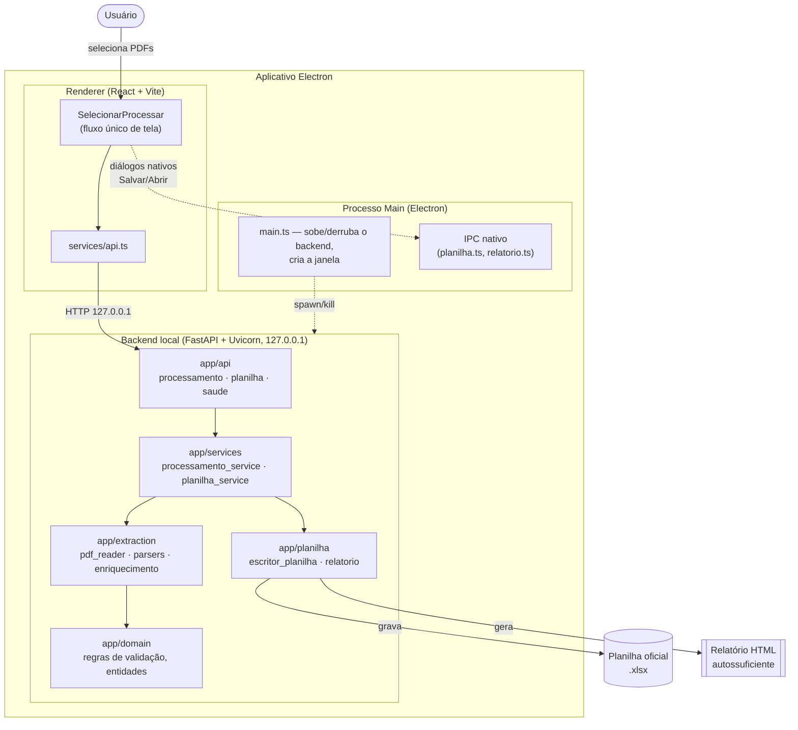
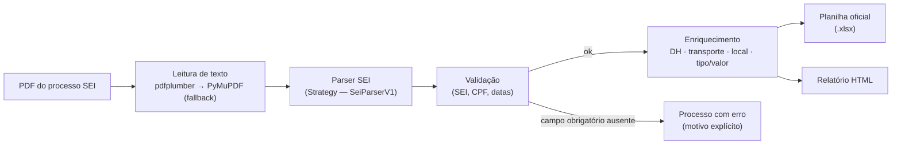

# Arquitetura

## Visão geral

O Extrator de Diárias é um aplicativo desktop Electron com dois processos cooperando localmente, sem nenhuma dependência de rede externa: um **renderer** React (interface) e um **backend FastAPI local**, iniciado automaticamente pelo processo principal do Electron e encerrado com ele. Toda a extração, validação e escrita na planilha acontece no backend; o frontend só orquestra a experiência do usuário e chama a API HTTP local.

## O pipeline de extração

Cada PDF selecionado passa pelo mesmo pipeline, orquestrado por `processar_lote` ([`backend/app/services/processamento_service.py`](../../backend/app/services/processamento_service.py)):

1. **Leitura** ([`extraction/pdf_reader.py`](../../backend/app/extraction/pdf_reader.py)) — extrai o texto do PDF com `pdfplumber`; se vier vazio (layout incomum), tenta de novo com `PyMuPDF`.
2. **Segmentação** ([`extraction/segmentacao_documentos.py`](../../backend/app/extraction/segmentacao_documentos.py)) — um processo SEI é, na prática, vários formulários concatenados no mesmo PDF, às vezes com o mesmo tipo de documento repetido (um requerimento corrigido, uma validação refeita). Este módulo isola o texto do **último** documento de um tipo, para nunca misturar informação de uma versão já substituída.
3. **Parser** ([`extraction/parsers/`](../../backend/app/extraction/parsers/)) — um `ParserSei` (Strategy Pattern, `parser_factory.py`) lê o texto segmentado e extrai os campos-chave (SEI, CPF, datas, cidades, unidade, finalidade) por expressão regular, tolerando os artefatos reais de um PDF do SEI (campo partido por quebra de página, CPF com separador atípico entre grupos).
4. **Validação de domínio** ([`domain/rules/validacao_diaria.py`](../../backend/app/domain/rules/validacao_diaria.py)) — barreira única antes de qualquer enriquecimento: SEI, CPF (exatamente 11 dígitos) e as duas datas do período são obrigatórios; qualquer ausência vira um `Processo` com status de erro e o(s) motivo(s) explícito(s), sem derrubar o restante do lote.
5. **Enriquecimento** ([`extraction/enriquecimento/`](../../backend/app/extraction/enriquecimento/)) — só roda sobre processos já válidos; cada módulo é independente e devolve também um aviso quando não consegue decidir com segurança (nunca "adivinha"):
   - `documento_habil.py` — número do Documento Hábil, sempre a partir do Despacho de Validação (nunca de reproduções posteriores, como Nota de Liquidação/Ordem Bancária).
   - `local_destino.py` — resolve cidade(s)/UF de destino contra uma base de municípios do Brasil, com correspondência aproximada para erros de digitação e desambiguação por contexto para nomes de cidade que existem em mais de um estado.
   - `transporte.py` / `transporte_regra_operacional.py` — meio de transporte a partir de evidência textual direta; na ausência dela, aplica a regra operacional histórica do setor (fallback determinístico por estado/município de destino).
   - `tipo_processo.py` / `valor_diarias_membro.py` — identifica processos de "Diária de Membro" (tipo distinto, com valor total autorizado por despacho específico).
6. **Planilha** ([`app/planilha/escritor_planilha.py`](../../backend/app/planilha/escritor_planilha.py)) — grava cada processo na planilha oficial existente, detecta duplicidade (mesmo SEI já presente) e usa o próprio histórico da planilha (por CPF) como primeira fonte para a coluna de unidade de origem antes de cair para a evidência extraída do PDF.
7. **Relatório** ([`app/planilha/relatorio.py`](../../backend/app/planilha/relatorio.py)) — gera um HTML autossuficiente (mesma identidade visual do app) com o resumo executivo do lote, o que foi inserido automaticamente e o que precisa de revisão manual.

## Camadas do backend

Arquitetura em camadas, sem framework de DI — dependências fluem por import direto, de fora para dentro:

| Camada | Pasta | Responsabilidade |
| --- | --- | --- |
| API | `app/api/` | Rotas FastAPI (`processamento`, `planilha`, `saude`) — só tradução HTTP ⇄ serviço |
| Schemas | `app/schemas/` | Contratos Pydantic de entrada/saída da API |
| Serviços | `app/services/` | Orquestração de caso de uso (`processar_lote`, `preencher_planilha`) |
| Extração | `app/extraction/` | Leitura de PDF, parsing, segmentação, enriquecimento |
| Domínio | `app/domain/` | Entidades e regras de negócio puras (validação, tipos, estrutura de uma Diária) |
| Planilha | `app/planilha/` | Escrita no `.xlsx` oficial e geração do relatório HTML |
| Infra | `app/infra/` | Configuração, logging (a camada de banco local em `infra/db` está preparada para uso futuro, não é usada no fluxo atual) |

## Frontend (Electron + React)

- **Processo main** ([`frontend/electron/main.ts`](../../frontend/electron/main.ts)) — sobe o backend (do `.venv` em desenvolvimento; do executável PyInstaller standalone quando empacotado), cria a janela, expõe IPC nativo para diálogos de arquivo (`ipc/planilha.ts`, `ipc/relatorio.ts` — "Salvar Como"/"Abrir Local", que exigem API nativa do SO, não HTTP) e encerra o backend ao fechar.
- **Renderer** ([`frontend/src/`](../../frontend/src/)) — fluxo de tela único (`pages/SelecionarProcessar.tsx`): seleção de PDFs → processamento com barra de progresso → tabela de resultado → preenchimento da planilha → relatório. `services/api.ts` fala HTTP com o backend local (`127.0.0.1`); `theme/` é a fonte única de verdade da identidade visual (ver [`docs/branding/`](../branding/)).

## Empacotamento

`npm run release` (`frontend/package.json`) produz o instalador Windows final:
1. `vite build` (renderer) + `tsc` (processo main do Electron).
2. `PyInstaller` empacota o backend FastAPI num executável standalone (`--onedir`) — a máquina do usuário final não precisa ter Python instalado.
3. `electron-builder` empacota tudo num instalador NSIS único, com o executável do backend embutido como recurso (`extraResources`).
