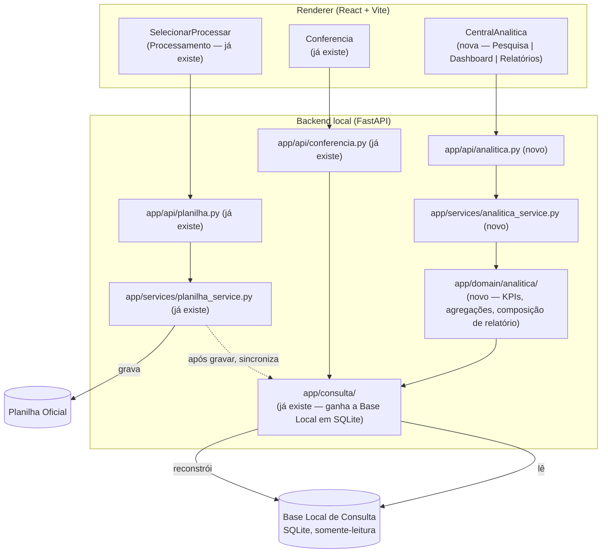
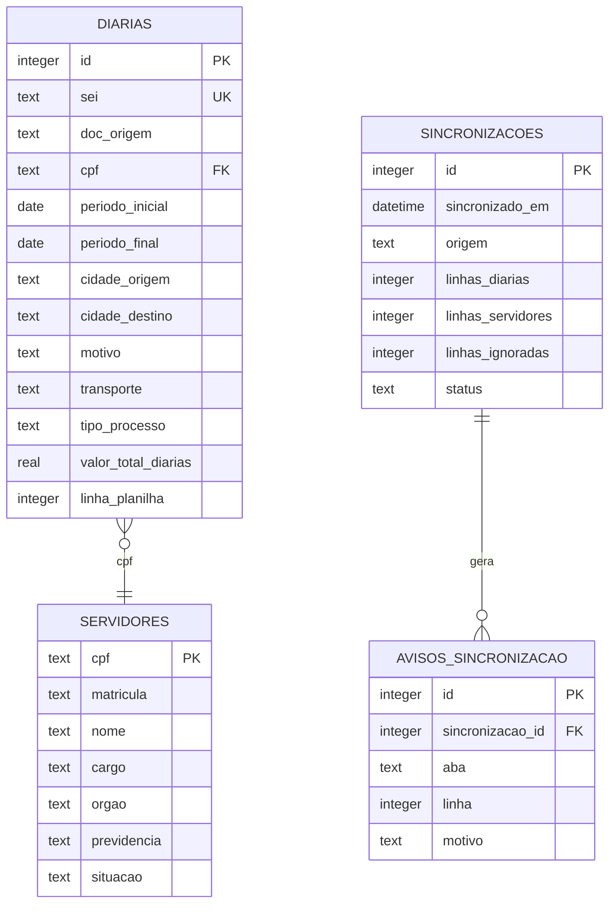
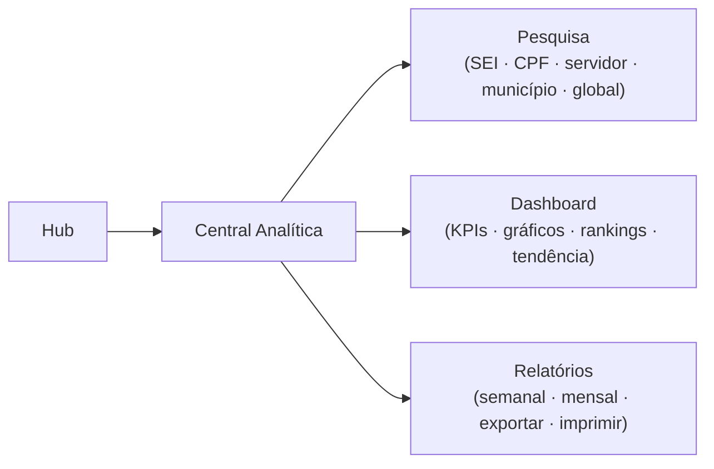

# Central Analítica — Proposta Arquitetural (Sprint 17)

> **Sprint 17 — exclusivamente análise de domínio, arquitetura e
> documentação. Nenhuma linha de código de produção foi escrita nesta
> Sprint.** Implementação só começa após aprovação explícita do DIMCAC a
> este documento, seguindo a mesma disciplina das Sprints 11 (arquitetura da
> Central de Conferência), 12 (UX) e 15 (arquitetura da Configuração
> Inicial).

> **Nota de numeração:** o usuário se referiu a esta iniciativa como "Sprint
> 16" durante o pedido. Pelo [`docs/roadmap/README.md`](../roadmap/README.md),
> o número **16** já está reservado (não implementado) para a *Sprint de
> Build e Distribuição*, e o **15** já foi usado (Configuração Inicial da
> Planilha Oficial). Seguindo a disciplina de numeração já praticada no
> projeto (nunca pular, nunca reaproveitar sem justificar por escrito — ver
> nota equivalente em [`docs/configuracao-inicial/README.md`](../configuracao-inicial/README.md)),
> esta proposta adota **Sprint 17**, o próximo número livre. Confirmado com
> o usuário em 2026-07-30.

> **✅ Arquitetura aprovada em 2026-07-30.** Todas as 9 decisões de
> [§ 0.1](#01-decisões-desta-sprint-2026-07-30) foram incorporadas antes da
> aprovação final. A Sprint 17.1 está concluída; a próxima etapa, seguindo a
> ordem recomendada da [Seção 12](#12-divisão-em-subetapas-e-ordem-recomendada),
> é a Sprint 17.2 (UX/wireframe da Central Analítica) — ainda sem nenhuma
> linha de código de produção.

## Sumário

0. [Decisões oficiais](#0-decisões-oficiais)
1. [Contexto e entendimento do domínio](#1-contexto-e-entendimento-do-domínio)
2. [Requisitos funcionais](#2-requisitos-funcionais)
3. [Casos de uso](#3-casos-de-uso)
4. [Perfis de utilização e problemas resolvidos](#4-perfis-de-utilização-e-problemas-resolvidos)
5. [Arquitetura da solução](#5-arquitetura-da-solução)
6. [Modelagem da Base Local de Consulta](#6-modelagem-da-base-local-de-consulta)
7. [Separação de responsabilidades por camada](#7-separação-de-responsabilidades-por-camada)
8. [Estratégia de sincronização da Base Local](#8-estratégia-de-sincronização-da-base-local)
9. [Proposta de interface](#9-proposta-de-interface)
10. [Riscos arquiteturais e trade-offs](#10-riscos-arquiteturais-e-trade-offs)
11. [Impacto no restante do sistema](#11-impacto-no-restante-do-sistema)
12. [Divisão em subetapas e ordem recomendada](#12-divisão-em-subetapas-e-ordem-recomendada)
13. [Perguntas em aberto](#13-perguntas-em-aberto)

---

## 0. Decisões oficiais

### 0.1 Decisões desta Sprint (2026-07-30)

Formalizadas antes da aprovação final do documento, a pedido explícito —
deixam de ser proposta em aberto e passam a ser regra vinculante para
qualquer implementação futura da Central Analítica:

| # | Tema | Decisão oficial | Onde se aplica neste documento |
| --- | --- | --- | --- |
| 1 | Verificação automática de atualização | A checagem de frescor da Base Local roda **automaticamente toda vez que o usuário entra na Central Analítica** — não é "sob demanda" nem opcional; é o gatilho padrão, silencioso quando os dados já estão em dia. | Seção 8, "Quando a sincronização deve acontecer?" e "Como detectar alterações..." |
| 2 | Botão manual como recurso complementar | "Sincronizar agora" permanece sempre disponível, mas como **complemento** à verificação automática do item 1 — não a substitui, cobre o caso de o usuário querer forçar uma reconstrução sem esperar a próxima entrada no módulo. | Seção 8, "Quando a sincronização deve acontecer?" |
| 3 | Separação entre validação estrutural e alteração de conteúdo | A verificação de **frescor de conteúdo** (dados podem ter mudado) é um mecanismo independente da **validação estrutural** já existente (Sprint 15, `FingerprintEstrutural` — cabeçalho/abas). Uma nunca substitui a outra. | Seção 8, "Como detectar alterações..." |
| 4 | Sincronização inicial por reconstrução completa e atômica | A **primeira** vez que a Base Local em SQLite precisa existir (instalação nova, banco removido/corrompido) segue exatamente o mesmo procedimento de qualquer outra sincronização — reconstrução total a partir da cópia `.xlsx`, escrita em arquivo temporário + `os.replace` atômico. Não existe um caminho de bootstrap especial ou simplificado. | Seção 6.1, Seção 8 |
| 5 | Falha nunca substitui a última base válida | Regra vinculante, não só comportamento esperado: nenhuma sincronização (automática, manual ou inicial) pode remover ou sobrescrever a última Base Local válida antes que a nova esteja completa e verificada. | Seção 8, "Como tratar falhas..." |
| 6 | Dados potencialmente desatualizados nunca são apresentados silenciosamente | O indicador de frescor (timestamp da última sincronização) é **obrigatório em toda tela** da Central Analítica — não só quando há um problema — e é **impresso também nos artefatos exportados** (PDF/Excel/impressão), já que um relatório exportado não carrega indicador "ao vivo" próprio depois de gerado. | Seção 8, "Como garantir..."; Seção 9 |
| 7 | Metadados de sincronização persistidos no SQLite | `SINCRONIZACOES` e `AVISOS_SINCRONIZACAO` não são log volátil — são parte formal do esquema da Base Local, persistidas no mesmo banco, e são elas que sustentam as decisões 1 e 6 (não há como mostrar "dados de HH:MM" sem esse registro persistido). | Seção 6.2 |
| 8 | Chave de negócio independente da linha do Excel | A identidade de um registro em `DIARIAS` é o **SEI normalizado** (índice único), não `linha_planilha`. O número da linha é mantido só como dado diagnóstico/auditoria — nunca como identidade, porque desloca a cada inserção/exclusão manual de linha na planilha entre sincronizações. | Seção 6.2 |
| 9 | Compartilhamento de serviços sem acoplar ao fluxo da Conferência | A Central Analítica compartilha com a Central de Conferência **apenas** a camada `app/consulta/` (Base Local + sincronização). Nenhum dos dois módulos importa domínio, serviço ou schema do outro — `app/domain/rules/conferencia.py`, `conferencia_service.py`, `schemas/conferencia.py` continuam exclusivos da Conferência; a Central Analítica tem seus próprios `app/domain/analitica/`, `analitica_service.py`, `schemas/analitica.py`. | Seção 5, Seção 7, Seção 11 |

### 0.2 Decisões e princípios herdados de sprints anteriores

Esta proposta não parte do zero — ela é uma extensão deliberada de decisões
já oficiais. Nenhuma delas é reaberta aqui; são listadas porque toda a
arquitetura da Central Analítica se apoia nelas:

| # | Decisão herdada | Onde foi fixada | Como se aplica aqui |
| --- | --- | --- | --- |
| 1 | A Planilha Oficial é a única fonte administrativa/legal dos dados; nenhum módulo consultivo escreve nela. | RN-11, [`docs/central-conferencia/README.md`](../central-conferencia/README.md#rn-11--princípio-arquitetural-a-central-inteligente-é-um-módulo-exclusivamente-consultivo) | A Central Analítica é, como a Central de Conferência, **100% somente-leitura**. |
| 2 | Vermelho nunca representa um veredito de negócio, só falha técnica do próprio sistema. | RN-08 + memória `sprint12-ux-aprovado` | KPIs/gráficos da Central Analítica seguem a mesma paleta semântica — nenhuma cor de negócio "crítico" em vermelho; vermelho fica reservado a "Base Local indisponível"/"sincronização falhou". |
| 3 | A Base Local de Consulta é uma cópia derivada, nunca a fonte da verdade, e o resto do sistema só conhece a **interface** do pacote `app/consulta/`, nunca o formato do arquivo. | `backend/app/consulta/base_local.py:5-11` | É a premissa que **habilita** a migração proposta na Seção 6 (xlsx → SQLite) sem impacto acima de `app/consulta/`. |
| 4 | Escrita local sempre por arquivo temporário + `os.replace` atômico. | `base_local.py:48-71`, `configuracao_app.py` | Reaproveitado tal e qual para a reconstrução da Base Local em SQLite (Seção 8). |
| 5 | Bloqueio por ação, não por módulo inteiro, quando uma dependência fica indisponível. | Sprint 15, [`docs/configuracao-inicial/README.md § 7`](../configuracao-inicial/README.md) | Se a sincronização falhar, só as ações que exigem dado fresco avisam — o módulo inteiro não fica inacessível (Seção 8, item 5). |
| 6 | Toda regra nova precisa ser rastreável — a uma fórmula real, a uma decisão confirmada com data, ou marcada como pendente. Nunca invenção teórica. | [`docs/backlog/README.md`](../backlog/README.md), repetido em vários docs | Cada requisito da Seção 2 é rastreado à sua origem (planilha, backlog já existente, ou pedido explícito desta Sprint). |
| 7 | Sem framework de estado global, sem `react-router`; navegação por estado local (`App.tsx`). | `docs/architecture/README.md:92` | A Seção 9 propõe manter o mesmo padrão para a Central Analítica (abas internas, não rotas). |
| 8 | `app/infra/db/` está reservada desde a estrutura original do projeto, nunca usada. | `docs/roadmap/README.md`, "Planejado (não implementado)" | Esta Sprint é a primeira a propor efetivamente **ativar** essa camada (Seção 6). |
| 9 | Evoluções já cogitadas para a Central de Conferência (busca por matrícula, por nome, histórico completo por CPF, por período) estavam registradas como backlog, fora de escopo até virarem uma Sprint própria. | [`docs/backlog/README.md`](../backlog/README.md) | Esta proposta **absorve** esses itens dentro do escopo da Central Analítica (Seção 2) — deixam de ser backlog avulso e passam a ter arquitetura própria. |

---

## 1. Contexto e entendimento do domínio

O DIMCAC opera hoje com dois módulos consultivos/operacionais no app:
**Processamento** (extrai PDFs do SEI e grava a Planilha Oficial) e
**Central Inteligente de Conferência** (checagem pontual de um CPF + período
antes de registrar uma diária, para evitar duplicidade e checar cadastro).

O que falta — e é o gap que motiva esta Sprint — é uma visão **agregada e
histórica** sobre os dados já registrados. Hoje, para responder perguntas
como "quantas diárias foram emitidas para Araripina em junho?", "qual é o
volume total pago no trimestre?", "quais servidores mais viajaram este ano?"
ou "preciso do relatório mensal para a chefia", a única ferramenta
disponível é abrir a Planilha Oficial diretamente no Excel e montar um
filtro/tabela dinâmica manualmente — trabalho manual, sujeito a erro, sem
nenhuma garantia de que a pessoa está lendo a coluna certa (a planilha tem
29 colunas, várias delas fórmulas, e uma inconsistência de nomenclatura já
documentada em `Dados!A`).

A Central Analítica não é um substituto da Planilha Oficial nem da Central
de Conferência — é um **terceiro módulo consultivo**, especializado em
consultas amplas (múltiplos registros, agregações, séries temporais),
enquanto a Central de Conferência continua especializada em uma checagem
pontual (um CPF, um período, uma decisão de registrar ou não).

O domínio de dados é o mesmo já mapeado integralmente na Sprint 11
(`Controle de Diárias`, `Dados`, `Tabela Valores` — ver
[`docs/central-conferencia/README.md § 2`](../central-conferencia/README.md#2-estrutura-da-planilha-oficial)).
Esta Sprint não remapeia a planilha; reaproveita o mapeamento já homologado.

---

## 2. Requisitos funcionais

Cada requisito abaixo cita sua origem — nenhum é proposto sem rastreabilidade
(princípio herdado #6).

### 2.1 Pesquisa

| Requisito | Origem |
| --- | --- |
| Localizar um processo específico por número SEI | Pedido explícito do usuário nesta Sprint |
| Pesquisar por CPF (dado pontual e histórico completo, não só duplicidade) | Pedido explícito + backlog "Histórico completo de diárias do servidor" |
| Pesquisar por servidor (nome e/ou matrícula) | Pedido explícito + backlog "Consulta por matrícula"/"Consulta por nome" |
| Pesquisar por município (origem e/ou destino) | Pedido explícito nesta Sprint |
| Pesquisa global (campo único, múltiplos critérios) | Pedido explícito nesta Sprint |

### 2.2 Filtros

| Requisito | Origem |
| --- | --- |
| Filtro por período (data inicial/final) | Pedido explícito + backlog "Consulta por período" |
| Filtro por município | Pedido explícito |
| Filtro por servidor | Pedido explícito |
| Filtro por motivo (coluna `L`) | Pedido explícito |
| Filtro por situação (`Dados!H`) | Pedido explícito |
| Combinação de múltiplos filtros simultâneos (AND) | Implícito no uso esperado (dashboards/relatórios filtrados) |

### 2.3 Dashboards

| Requisito | Origem |
| --- | --- |
| KPIs: total de diárias, valor total, nº de servidores atendidos, valor médio | Pedido explícito ("indicadores") |
| Gráfico de evolução temporal (mês a mês) | Pedido explícito ("tendências", "evolução temporal") |
| Ranking (top municípios, top servidores) por período | Pedido explícito |
| Distribuição por motivo/situação/tipo de processo | Pedido explícito |

### 2.4 Relatórios

| Requisito | Origem |
| --- | --- |
| Relatório semanal consolidado | Pedido explícito |
| Relatório mensal consolidado | Pedido explícito |
| Exportação em PDF | Pedido explícito |
| Exportação em Excel | Pedido explícito |
| Impressão | Pedido explícito |

Como o próprio pedido reforça, **nem tudo precisa ser implementado de
imediato** — o objetivo desta Sprint é uma arquitetura que suporte todo esse
crescimento sem retrabalho estrutural, não entregar tudo de uma vez (ver
Seção 12).

---

## 3. Casos de uso

1. Pesquisar diária por número de processo SEI.
2. Consultar o histórico completo de diárias de um servidor (por CPF).
3. Consultar diárias por município de origem/destino.
4. Realizar uma pesquisa global (um campo, múltiplos critérios possíveis).
5. Filtrar diárias por período, combinando com outros filtros.
6. Visualizar o painel geral de indicadores (KPIs) do estado atual da base.
7. Visualizar ranking de municípios/servidores em um período.
8. Visualizar a evolução temporal (tendência mês a mês) de emissões/valores.
9. Visualizar distribuição por motivo, situação ou tipo de processo.
10. Gerar relatório semanal consolidado.
11. Gerar relatório mensal consolidado.
12. Exportar um resultado de pesquisa, dashboard ou relatório em PDF.
13. Exportar um resultado de pesquisa, dashboard ou relatório em Excel.
14. Imprimir um relatório ou dashboard.
15. Sincronizar manualmente a Base Local de Consulta (ver Seção 8).
16. Verificar quando foi a última sincronização e se ela teve falhas/avisos.

---

## 4. Perfis de utilização e problemas resolvidos

O aplicativo não tem sistema de contas/login (é uma instalação desktop de
uso interno, sem essa camada em nenhum módulo hoje) — "perfis" aqui
descrevem **padrões de uso**, não papéis autenticados:

- **Servidor DIMCAC operacional** — mesmo perfil que já usa a Central de
  Conferência hoje. Precisa de respostas pontuais e rápidas: "esse CPF já
  tem diária nesse período?", "quantas diárias esse servidor já recebeu
  este ano?", "qual processo é esse SEI?". Problema resolvido: elimina a
  necessidade de abrir a planilha no Excel e procurar manualmente.
- **Gestor/coordenador DIMCAC** — precisa de visão agregada para prestação
  de contas e tomada de decisão: volume por período, comparação entre
  municípios, tendência de gastos, relatório pronto para repassar à chefia.
  Problema resolvido: elimina a montagem manual de tabela dinâmica e reduz
  o risco de erro de leitura de uma planilha com 29 colunas e fórmulas.

Os dois perfis usam a **mesma interface** (não há segregação de acesso
técnica) — a diferença é de fluxo de uso (pesquisa pontual vs.
dashboard/relatório), não de permissão. Se o DIMCAC quiser segregação de
acesso real no futuro, isso é uma decisão de produto nova, fora do escopo
desta Sprint (não há hoje nenhuma noção de usuário/sessão em nenhum módulo
do app para apoiar isso).

---

## 5. Arquitetura da solução

A Central Analítica entra como um **terceiro módulo paralelo**, na mesma
arquitetura em camadas já documentada em
[`docs/architecture/README.md`](../architecture/README.md) — não substitui
nem altera o comportamento de Processamento ou Central de Conferência.

Pontos deliberados:

- **Nenhuma seta nova de escrita na Planilha Oficial.** A única escrita
  continua sendo `SVC1 --> XLSX` (Processamento), herança direta de RN-11.
- `app/api/analitica.py` só tem rotas de leitura — mesma disciplina de
  `app/api/conferencia.py`.
- A Central Analítica **reaproveita** `app/consulta/` em vez de criar um
  pacote de acesso a dados paralelo — evita duplicar a regra de
  normalização de CPF, a lógica de leitura da planilha e o mecanismo de
  sincronização já existentes (atende diretamente à observação adicional do
  pedido: reaproveitar componentes existentes, evitar duplicação).
- A única mudança estrutural real é **dentro** de `app/consulta/`: a Base
  Local deixa de ser só uma cópia `.xlsx` e passa a ter uma representação
  em SQLite derivada dela (detalhado na Seção 6) — mudança que **não é
  visível** para `app/domain/rules/conferencia.py` nem
  `app/services/conferencia_service.py`, porque ambos já dependem apenas da
  interface de `app/consulta/` (`servidores_por_cpf`, `diarias_por_cpf`),
  nunca do formato do arquivo. Essa garantia já estava documentada como
  intenção desde a Sprint 13 (`base_local.py:5-11`) — esta Sprint é quem a
  exercita pela primeira vez.
- **✅ Decisão oficial (2026-07-30, § 0.1 item 9) — compartilhamento sem
  acoplamento:** o único ponto de contato entre a Central Analítica e a
  Central de Conferência é `app/consulta/` (`CONS` no diagrama acima — Base
  Local + sincronização). `DOM3` (`app/domain/analitica/`), `SVC3`
  (`analitica_service.py`) e os schemas da Central Analítica são exclusivos
  dela; nunca importam nem são importados por
  `app/domain/rules/conferencia.py`, `conferencia_service.py` ou
  `schemas/conferencia.py`. Uma mudança futura em uma regra de negócio da
  Conferência não pode, por construção, quebrar a Central Analítica, e
  vice-versa.

---

## 6. Modelagem da Base Local de Consulta

### 6.1 Por que evoluir de "cópia `.xlsx`" para SQLite

A Base Local de Consulta de hoje (Sprint 13) é uma cópia integral do
`.xlsx`, e cada consulta reabre o arquivo do zero com `openpyxl` e indexa em
memória dentro da própria chamada. A Sprint 13.1 mediu esse custo:
**~2,2–2,4s por operação**, quase todo dominado pela abertura do arquivo —
aceitável para a Central de Conferência (uma pergunta pontual por vez, com
o usuário esperando o resultado de qualquer forma).

Isso **não escala** para a Central Analítica: um dashboard típico dispara
várias agregações diferentes (KPIs + ranking + série temporal +
distribuição) na mesma tela, e cada mudança de filtro repete a consulta.
Se cada uma reabrir o `.xlsx` do zero, um único carregamento de tela custaria
dezenas de segundos — inaceitável.

A solução proposta ativa, finalmente, a camada `app/infra/db/`, reservada
desde o início do projeto e nunca usada: a Base Local passa a ter uma
representação em **SQLite**, reconstruída a partir da cópia `.xlsx` a cada
sincronização (Seção 8), e consultada com índices — trocando "reabrir e
reindexar em memória a cada pergunta" por "indexar uma vez por
sincronização, consultar quantas vezes for preciso depois, em milissegundos".

Isso não é invenção nova: é a consequência natural de uma decisão de design
já registrada em `base_local.py` — o resto do sistema nunca conheceu o
formato do arquivo, exatamente para permitir esta migração sem onda de
impacto.

**✅ Decisão oficial (2026-07-30, § 0.1 item 4) — sincronização inicial:** a
primeiríssima vez que a Base Local em SQLite precisa existir (instalação
nova do app, ou banco removido/corrompido) segue **exatamente** o mesmo
procedimento de qualquer outra sincronização (Seção 8) — reconstrução total
a partir da cópia `.xlsx` + `os.replace` atômico. Não há um caminho de
bootstrap simplificado nem um caso especial de "primeira vez" no código.

### 6.2 Esquema proposto

O esquema espelha diretamente as entidades de domínio já existentes
(`Diaria`, `Servidor`, `RegistroDiariaExistente`, `AvisoLinhaIgnorada`) —
não introduz nenhum conceito novo de negócio, só uma representação
relacional e indexada do que já é lido hoje.

- **`DIARIAS`** — uma linha por registro de `Controle de Diárias`, com
  índices em `cpf`, `sei`, `periodo_inicial`, `cidade_destino`, `motivo` (as
  colunas usadas por pesquisa/filtro — Seção 2). Mesmos campos já lidos
  hoje por `Diaria` (`backend/app/domain/entities/diaria.py`).

  **✅ Decisão oficial (2026-07-30, § 0.1 item 8) — chave de negócio:** `id`
  é só a chave técnica autoincrementada do SQLite; a **identidade real** do
  registro é `sei` (normalizado, `UNIQUE`). `linha_planilha` é mantido
  apenas como dado diagnóstico (permite localizar a linha na planilha para
  auditoria manual) e nunca é usado como chave/junção — o número da linha
  não é estável: desloca sempre que alguém insere ou apaga uma linha
  manualmente na Planilha Oficial entre duas sincronizações, o que
  corromperia silenciosamente qualquer referência baseada nele. Se a
  reconstrução encontrar dois registros com o mesmo `sei`, trata como
  `AvisoLinhaIgnorada` (mantém a primeira ocorrência, regista a colisão em
  `AVISOS_SINCRONIZACAO`) — nunca decide sozinha qual delas é a "certa"
  (mesmo espírito de RN-08: a Central nunca decide por conta própria algo
  que é responsabilidade administrativa do DIMCAC).
- **`SERVIDORES`** — uma linha por pessoa em `Dados`, índice em `nome`
  (busca textual) e `matricula`. Mesmos campos de `Servidor`. Chave de
  negócio: `cpf` normalizado (já é `PK` na tabela).
- **`SINCRONIZACOES`** — auditoria de cada reconstrução da Base Local:
  quando aconteceu, quantas linhas entraram, quantas foram ignoradas
  (dados malformados), se terminou com sucesso. É o que sustenta a
  transparência de "dados atualizados em..." exigida na Seção 8.
- **`AVISOS_SINCRONIZACAO`** — persiste o que hoje é `AvisoLinhaIgnorada`
  (linhas descartadas por dado histórico malformado), hoje efêmero
  (existe só durante a chamada). Persistir permite um painel simples de
  "qualidade dos dados" na Central Analítica, sem esconder problema.

**✅ Decisão oficial (2026-07-30, § 0.1 item 7) — metadados persistidos:**
`SINCRONIZACOES` e `AVISOS_SINCRONIZACAO` não são um log volátil opcional —
são parte formal e obrigatória do esquema da Base Local, gravadas no mesmo
arquivo SQLite (mesma transação/reconstrução atômica das tabelas de dados).
É essa persistência que sustenta, de forma verificável, tanto a verificação
automática de frescor (§ 0.1 item 1) quanto a proibição de dado
desatualizado silencioso (§ 0.1 item 6) — sem ela, "última sincronização às
HH:MM" seria uma alegação sem lastro.

A cópia `.xlsx` da Base Local (mecanismo já existente da Sprint 13)
**continua existindo** — vira a fonte a partir da qual o SQLite é
reconstruído, e mantém-se como fallback/trilha de auditoria. Ver trade-off
explícito na Seção 10.

---

## 7. Separação de responsabilidades por camada

| Camada | Responsabilidade em relação à Central Analítica | O que **não** faz |
| --- | --- | --- |
| **Planilha Oficial** | Continua sendo o único documento administrativo/legal. Fonte original de todo dado. | Nunca é lida diretamente pela Central Analítica em uso corrente (só indiretamente, via sincronização) e nunca é escrita por ela. |
| **Base Local de Consulta** | Cópia derivada e descartável, otimizada para consulta (SQLite, Seção 6). Única fonte usada por pesquisa, filtros, dashboards, KPIs e relatórios. | Nunca é a fonte oficial; pode ser apagada e reconstruída a qualquer momento sem perda de dado real. |
| **Backend** | Dono exclusivo da sincronização, das regras de agregação/KPI, da composição de relatórios e de toda consulta. Único escritor da Base Local. | Nunca expõe escrita na Planilha Oficial nem na Base Local por rota de API da Central Analítica. |
| **APIs** (`app/api/analitica.py`) | Tradução HTTP ⇄ serviço, só rotas de leitura (`GET`/`POST` de consulta) + uma rota de ação para sincronização manual. | Nenhuma regra de negócio dentro da rota — mesma disciplina de `app/api/conferencia.py`. |
| **Frontend** | Renderiza pesquisa, filtros, dashboards e relatórios; consome `services/api.ts`; dispara exportação via IPC quando precisa de diálogo nativo. | Nunca calcula KPI/agregação no cliente a partir do dataset bruto — sempre consome dado já agregado do backend (evita duplicar regra de negócio em duas linguagens). |
| **Electron** | Diálogos nativos de "Salvar Como" para exportação PDF/Excel e impressão nativa — mesmo padrão de `ipc/relatorio.ts`. | Nunca decide o que exportar nem formata dado — só abre o diálogo do SO e recebe o arquivo já pronto do backend/renderer. |

**✅ Decisão oficial (2026-07-30, § 0.1 item 9):** dentro do Backend, o
único ponto de compartilhamento entre a Central Analítica e a Central de
Conferência é a linha "Base Local de Consulta" desta tabela
(`app/consulta/`). Regras de negócio, orquestração de caso de uso e
contratos de API de cada módulo são exclusivos — nenhum dos dois módulos
depende do domínio, serviço ou schema do outro.

---

## 8. Estratégia de sincronização da Base Local

Respondendo diretamente às perguntas obrigatórias do pedido:

### Quando a sincronização deve acontecer?

Orientada a evento, não a tempo — sem *timer*, sem *polling* contínuo, sem
observador de sistema de arquivos rodando em segundo plano. Quatro
momentos, com papéis diferentes (três deles formalizados como decisão
oficial em [§ 0.1](#01-decisões-desta-sprint-2026-07-30)):

1. **Reconstrução automática pós-preenchimento** — ao final de todo
   preenchimento bem-sucedido da Planilha Oficial (o gancho já existe,
   `app/services/planilha_service.py` já chama `base_local.sincronizar()`
   hoje; passa a também reconstruir o SQLite). É o único momento em que o
   próprio app altera os dados por conta de uma ação do usuário sobre
   PDFs, então é o gatilho automático "clássico" — reconstrução completa
   sem precisar de confirmação do usuário.
2. **✅ Decisão oficial (2026-08-02, Sprint 18.7) — reconstrução automática
   após salvar a Configuração Inicial (ou "Alterar Planilha Oficial",
   mesmo endpoint `POST /api/v1/configuracao`):** `app/api/configuracao.py`
   passa a chamar `base_local.sincronizar(..., origem="configuracao_inicial")`
   de forma síncrona e best-effort logo após persistir a configuração —
   corrige o defeito de a Central Analítica só ficar utilizável depois de
   um processamento com gravação efetiva. Isto **amplia** a afirmação
   original desta seção (2026-07-30) de que a reconstrução pós-
   preenchimento seria o único gatilho automático sem confirmação — essa
   frase deixou de valer; agora há dois. Gatilho de "entrar no módulo com
   base ausente" (proposto no diagnóstico desta Sprint) foi avaliado e
   **não aprovado**: a responsabilidade de materializar a Base Local fica
   concentrada só na Configuração Inicial, e a Central Analítica continua
   apenas consumindo — uma base ausente por condição excepcional (remoção
   manual, corrupção) continua só informada ao usuário, com a
   sincronização manual (item 4 abaixo) como única ação oferecida, nunca
   disparada sozinha.
3. **✅ Decisão oficial (2026-07-30, § 0.1 item 1) — verificação automática
   ao entrar no módulo:** toda vez que o usuário abre a Central Analítica,
   o backend compara o sinal de frescor de conteúdo (ver "Como detectar
   alterações" abaixo) contra o que foi registrado na última sincronização.
   É uma **verificação leve** (não reabre o `.xlsx` inteiro, não reconstrói
   nada por conta própria) — só leva a uma reconstrução se o usuário
   confirmar o aviso de possível desatualização (decisão 6). Silenciosa e
   sem nenhum efeito visível quando os dados já estão em dia.
4. **✅ Decisão oficial (2026-07-30, § 0.1 item 2) — botão manual como
   recurso complementar:** "Sincronizar agora" continua disponível a
   qualquer momento dentro do módulo, independente da verificação
   automática do item 3 — não a substitui, é um complemento para quando o
   usuário quer forçar uma reconstrução de imediato (por exemplo, sabe que
   acabou de editar a planilha manualmente e não quer esperar a próxima
   entrada no módulo).

### Quem é responsável por executá-la?

Exclusivamente o backend, dentro de `app/consulta/` — mesmo módulo e mesmo
autor de hoje. Nunca o frontend, nunca o processo *main* do Electron.
Caminho automático chamado a partir de `planilha_service.py` (como já
acontece); caminho manual chamado a partir de uma nova rota
`POST /api/v1/analitica/sincronizar`, que executa exatamente o mesmo código.

### Como detectar alterações na Planilha Oficial (feitas fora do app)?

Este é um gap que já existe hoje (a Central de Conferência também não
detecta edição manual externa) e que esta Sprint propõe fechar, sem
recorrer a um observador de arquivo em tempo real: a cada verificação
automática de entrada no módulo (item 2 acima) ou a pedido do usuário
(item 3), o backend compara um sinal barato — tamanho + data de modificação
do arquivo, complementado pela contagem de linhas preenchidas (`max_row` da
aba `Controle de Diárias`, lido com `read_only=True`, sem parse completo) —
contra o que foi registrado na última sincronização (tabela
`SINCRONIZACOES`). Se diferente, mostra um aviso não bloqueante: *"Os dados
podem estar desatualizados — última sincronização às HH:MM. Sincronizar
agora?"*. Nunca dispara uma resincronização pesada sozinho, sem o usuário
pedir.

**✅ Decisão oficial (2026-07-30, § 0.1 item 3) — separação entre validação
estrutural e alteração de conteúdo:** este sinal de frescor é
deliberadamente **independente** da validação estrutural já existente
(`FingerprintEstrutural`, Sprint 15 — hash do cabeçalho + nomes das abas,
usada por `app/infra/config/configuracao_app.py` para confirmar que a
planilha configurada ainda tem a estrutura que o escritor/leitor espera).
São dois concerns diferentes, que este documento propõe nunca fundir num
único mecanismo:
- **Validação estrutural** (já existe, Sprint 15) — responde "esta ainda é
  uma planilha que o sistema sabe ler?" (cabeçalho/abas). Não é acionada
  por edição de conteúdo normal — adicionar uma linha de diária não muda o
  cabeçalho, então a validação estrutural passaria sem indicar nada.
- **Verificação de frescor de conteúdo** (nova, desta Sprint) — responde
  "os dados podem ter mudado desde a última sincronização?" (linhas/dados).
  Não avalia estrutura — pressupõe que a planilha já passou pela validação
  estrutural (pré-requisito para estar configurada, regra da Sprint 15).

Um sinal nunca substitui o outro nem é reaproveitado no lugar do outro,
mesmo compartilhando a ideia de "hash/assinatura barata do arquivo" — a
motivação e a resposta a cada um são diferentes.

### Como evitar inconsistências entre Planilha Oficial e Base Local?

- Reconstrução **sempre total**, nunca incremental/parcial — mesma
  filosofia já adotada no projeto (reabrir e reindexar do zero a cada
  operação, decisão explícita da Sprint 13.1 de não introduzir cache
  parcial). Evita bugs de sincronização incremental mal-feita.
- Escrita do novo banco SQLite em arquivo temporário + `os.replace`
  atômico, exatamente como a cópia `.xlsx` já faz hoje (`base_local.py:62-64`)
  — uma sincronização que falha no meio nunca deixa a Base Local num
  estado parcial.
- Timestamp da última sincronização bem-sucedida, visível em toda tela da
  Central Analítica — nunca deixa implícito que o dado é "tempo real".

### Como tratar falhas durante a sincronização?

**✅ Decisão oficial (2026-07-30, § 0.1 item 5):** a Base Local anterior
(última boa) **nunca é apagada ou substituída** antes de a nova estar
completa e verificada — não é apenas o comportamento esperado do mecanismo
de escrita atômica, é uma regra vinculante para qualquer sincronização
(automática, manual ou inicial). Se a sincronização
falhar (planilha bloqueada, malformada, disco cheio), a Central Analítica
continua servindo a última base válida, com um aviso visível ("última
sincronização falhou às HH:MM"). Segue o princípio de "bloqueio por ação,
não por módulo" já estabelecido na Sprint 15 — só as ações que exigiriam
dado fresco ficam marcadas como potencialmente desatualizadas; o módulo
inteiro não some. Esta Sprint também é a primeira a justificar ativar
`app/infra/logging/` (reservada, nunca usada) para registrar essas falhas —
hoje `base_local.sincronizar()` engole exceção em silêncio, risco já
documentado no próprio código (`base_local.py:65-70`).

### Como garantir que a Central Analítica nunca apresente dados incorretos?

Não há "tempo real" prometido — a garantia é **transparência do frescor**,
não instantaneidade:
1. Escrita atômica (nunca dado parcial/corrompido).
2. Timestamp de sincronização sempre visível.
3. Linha malformada nunca é adivinhada/coagida — vira um aviso persistido e
   contável (`AVISOS_SINCRONIZACAO`), nunca um valor inventado silenciosamente.
4. Sincronização manual sempre disponível quando o usuário suspeitar de
   desatualização.

**✅ Decisão oficial (2026-07-30, § 0.1 item 6) — nunca silencioso:** os
itens 2 e 4 acima deixam de ser recomendação e passam a ser regra: o
timestamp da última sincronização é **elemento obrigatório em toda tela**
da Central Analítica (não aparece só quando há um problema — é permanente),
e é **impresso também nos artefatos exportados** (rodapé do PDF/Excel/
impressão), porque um relatório já exportado não carrega mais nenhum
indicador "ao vivo" do app — sem essa marca, quem recebe o relatório não
tem como saber quando os dados foram sincronizados.

### Como essa arquitetura impacta o desempenho da aplicação?

O custo de abrir o `.xlsx` (~2,2s) deixa de ser pago a cada pesquisa/filtro
e passa a ser pago uma vez por sincronização — que já acontece hoje, sem
custo adicional perceptível, ao final de cada processamento. Depois de
sincronizada, toda consulta da Central Analítica é uma leitura indexada em
SQLite (ordem de milissegundos), o que é o que torna dashboards com várias
agregações simultâneas viáveis.

### Como essa arquitetura se comporta quando a planilha crescer significativamente?

O lado da consulta (SQLite com índice) escala bem além do volume atual
(~3 mil diárias, ~1.580 servidores) sem mudança de desenho. O que cresce de
forma linear é o custo do **parse** do `.xlsx` via `openpyxl` durante a
sincronização — hoje ~2,2s, tende a crescer com o número de linhas. Se algum
dia isso se tornar perceptível (ex.: dezenas de segundos), a mitigação
natural seria sincronização incremental (ler só linhas novas desde a última
marca d'água) — deliberadamente **não** proposta nesta Sprint, seguindo o
mesmo critério já usado na Sprint 13.1 (não otimizar antes de o problema
existir de fato).

---

## 9. Proposta de interface

Um terceiro item no Hub (`pages/Hub.tsx`, já documentado como preparado
para crescer — "um 3º módulo é uma linha a mais"), ao lado de "Processamento"
e "Central de Conferência". Mantém o mesmo padrão de navegação sem
`react-router` (estado local em `App.tsx`) — dentro da Central Analítica,
três abas internas:

- Reaproveita os componentes de UI já existentes (`Cartao`, `Badge`,
  `Alerta`, `Campo`, `Botao`) e os tokens do Design System "Neon Tech UI" —
  nenhuma cor/espaçamento novo fora de `theme/`.
- Uma faixa de status de sincronização (timestamp + aviso, se houver)
  presente nas três abas, no mesmo lugar em que hoje fica o indicador de
  saúde do backend (`useBackendStatus`) — **elemento obrigatório, não
  opcional** (decisão oficial [§ 0.1 item 6](#01-decisões-desta-sprint-2026-07-30)),
  e reproduzido também no cabeçalho/rodapé de qualquer PDF/Excel exportado
  ou impresso (Seção 2.4), para que o dado exportado nunca circule sem sua
  própria marca de frescor.
- Gráficos exigem um primitivo novo, ainda não existente em
  `components/ui/` — a escolha da biblioteca de gráficos é decisão de
  implementação, deliberadamente **não** tomada nesta Sprint arquitetural.
- Exportação em PDF/impressão: candidato natural é a API nativa de
  impressão do Electron (já disponível, sem nova dependência), no mesmo
  espírito do relatório HTML autossuficiente já gerado hoje — decisão
  também deixada para a sub-etapa de implementação (Seção 12).
- Sempre reversível via "← Hub" no `Cabecalho`, mesmo padrão das outras
  duas funcionalidades.

---

## 10. Riscos arquiteturais e trade-offs

| # | Risco / trade-off | Mitigação |
| --- | --- | --- |
| 1 | SQLite é a primeira dependência de banco embutido real do projeto — novo modo de falha (corrupção de arquivo de banco) que a cópia `.xlsx` simples não tinha. | A Base Local em SQLite é 100% descartável e reconstruível a partir da cópia `.xlsx`/Planilha Oficial a qualquer momento — corrupção significa "ressincronizar", nunca perda de dado real (que continua só na Planilha Oficial). |
| 2 | Duas representações da Base Local coexistem (cópia `.xlsx` + SQLite derivado) — alguma duplicação de armazenamento. | Deliberado: a cópia `.xlsx` já existente vira a fonte de reconstrução e trilha de auditoria barata; mantém a Central de Conferência (que já lê o `.xlsx`) intocada durante a adoção do SQLite, permitindo migrar os dois repositórios de consulta existentes para SQLite depois, com risco controlado, em vez de forçar as duas mudanças juntas. |
| 3 | Nenhuma detecção de edição manual da Planilha Oficial fora do app existia antes; a heurística proposta (tamanho+data) pode gerar falso positivo/negativo. | Heurística é só um *aviso*, nunca uma ação automática — o usuário decide se sincroniza; erro de heurística custa, no pior caso, um aviso desnecessário ou tardio, nunca dado incorreto silencioso. |
| 4 | O gancho de pós-preenchimento (`planilha_service.py`) ganha mais uma responsabilidade (reconstruir SQLite). | Deve permanecer não bloqueante para o fluxo de Processamento já homologado — qualquer falha na reconstrução da Central Analítica nunca pode impedir ou atrasar visivelmente a resposta do preenchimento da planilha (mesmo princípio que `sincronizar()` já segue hoje). |
| 5 | Escolha de biblioteca de gráficos e mecanismo de exportação PDF ainda em aberto. | Deliberadamente adiado para a sub-etapa de implementação correspondente (Seção 12) — não é uma decisão arquitetural, é um detalhe de camada de apresentação. |
| 6 | Ausência de qualquer controle de acesso/perfil autenticado no app (Seção 4) — a Central Analítica expõe dados agregados a qualquer pessoa com acesso ao aplicativo, igual às demais telas hoje. | Consistente com a postura de segurança já adotada em todo o app (uso interno, desktop, sem rede externa); não é uma regressão introduzida por esta Sprint. Fica registrado como pergunta em aberto (Seção 13) caso o DIMCAC queira mudar essa postura. |

---

## 11. Impacto no restante do sistema

| Módulo | Impacto |
| --- | --- |
| `app/consulta/base_local.py` | Estendido — passa também a orquestrar a reconstrução do SQLite após copiar o `.xlsx`. Interface pública (`servidores_por_cpf`, `diarias_por_cpf`, `caminho_base_local`) preservada. |
| `app/consulta/repositorio_diarias.py`, `repositorio_servidores.py` | Podem ser migrados para ler do SQLite em vez de reindexar o `.xlsx` a cada chamada — ganho de desempenho também para a Central de Conferência, sem mudança de assinatura. Migração opcional/posterior (Seção 10, item 2), não obrigatória para a Central Analítica funcionar. |
| `app/domain/rules/conferencia.py`, `app/services/conferencia_service.py` | **Nenhum impacto.** Continuam consumindo só a interface de `app/consulta/`. |
| `app/services/planilha_service.py` | Um gancho adicional (reconstrução do SQLite), não bloqueante. |
| `app/api/planilha.py`, `app/api/conferencia.py`, `app/api/processamento.py`, `app/api/configuracao.py` | **Nenhum impacto.** |
| `frontend/src/pages/Hub.tsx` | Um item novo no array de funcionalidades. |
| `frontend/src/App.tsx` | Um novo estado de página/aba, mesmo padrão das existentes. |
| `theme/`, `components/ui/` | Reaproveitados; só um primitivo de gráfico é novo. |
| `frontend/electron/main.ts`, `ipc/` | Um novo módulo IPC (`analitica.ts` ou reaproveitamento de `relatorio.ts`) para diálogos de exportação. |
| Planilha Oficial | **Nenhum impacto** — nunca lida em tempo real pela Central Analítica em uso normal, nunca escrita por ela. |
| `docs/backlog/README.md` | Os itens de "Evoluções da Central Inteligente de Conferência" relativos a busca por matrícula/nome/histórico/período passam a estar cobertos pela Central Analítica — a atualização desse arquivo é uma ação de documentação a fazer **após** aprovação desta proposta (fora do escopo desta Sprint, que não altera documentação existente). |

---

## 12. Divisão em subetapas e ordem recomendada

Seguindo o mesmo padrão de sequenciamento já validado no projeto para a
Central de Conferência (11 → 12 → 13 → 13.1 = arquitetura → UX →
implementação → linha de base de desempenho):

| Sub-etapa | Entrega | Depende de | Critério de validação |
| --- | --- | --- | --- |
| **17.1** | Esta arquitetura (documento atual) | — | Aprovação explícita do DIMCAC |
| **17.2** | UX/wireframe da Central Analítica (fluxo de telas, estados, inventário de componentes) — mesmo formato da Sprint 12 | 17.1 | Aprovação explícita do DIMCAC, sem código |
| **17.3** | Base Local em SQLite: esquema (Seção 6), reconstrução a partir do `.xlsx`, sincronização automática + manual (Seção 8) — **sem nenhuma tela nova**, só a camada de dados, testável isoladamente | 17.1 | Testes automatizados da reconstrução/consulta; nenhuma regressão em Central de Conferência |
| **17.4** | Pesquisa e filtros (backend `app/api/analitica.py` + UI) — caso de uso mais simples e mais imediatamente útil | 17.2, 17.3 | Entrega validável isolada: buscar por SEI/CPF/servidor/município funciona fim a fim — **backend concluído, homologado 2026-07-31** (sub-etapas 17.4.1–17.4.7.1, detalhadas em `api-arquitetura.md`/`api-plano-tecnico.md`); **UI ainda não iniciada** |
| **17.5** | Dashboard: KPIs + gráficos (ranking, tendência, distribuição) | 17.3 (independente de 17.4) | Entrega validável isolada |
| **17.6** | Relatórios (semanal/mensal) + exportação PDF/Excel + impressão | 17.4, 17.5 (reaproveita os dados já expostos por ambos) | Entrega validável isolada |
| **17.7** | Linha de base de desempenho da Central Analítica (medição real, mesmo formato da 13.1) | 17.4, 17.5, 17.6 | Números medidos documentados, decisão explícita sobre necessidade (ou não) de otimização adicional |

**Ordem recomendada:** 17.1 → 17.2 → 17.3 → 17.4 → 17.5 → 17.6 → 17.7. UX
antes de qualquer implementação (mesmo motivo da Sprint 12: decisões de
fluxo/tela são baratas de mudar no papel, caras depois de codificadas). A
Base Local em SQLite (17.3) é pré-requisito de tudo que segue, mas pode
começar em paralelo à revisão da UX (17.2), já que são preocupações
independentes.

---

## 13. Perguntas em aberto

1. A Central Analítica deve migrar também os repositórios da Central de
   Conferência para SQLite (Seção 11), ou manter a Central de Conferência
   lendo o `.xlsx` como hoje, pelo menos nesta rodada? (Risco 2, Seção 10)
2. O DIMCAC quer, em algum momento, algum controle de acesso/perfil dentro
   do app (hoje inexistente em qualquer módulo)? Impacta ou não o desenho
   da Central Analítica, mas vale registrar a pergunta agora que o módulo
   passa a agregar uma visão mais ampla dos dados. (Risco 6, Seção 10)
3. Relatório semanal/mensal deve ser gerado sob demanda (usuário escolhe o
   período e clica "Gerar") ou existe expectativa de algum agendamento
   automático (ex.: gerado toda segunda-feira)? Esta proposta assume
   **sob demanda** — nenhum agendamento foi pedido explicitamente, e um
   scheduler seria uma peça de infraestrutura nova (o projeto não tem
   nenhuma hoje) que não deve ser assumida sem confirmação.
4. A "pesquisa global" (item 2.1) deve buscar em quais campos exatamente?
   Esta proposta assume SEI + CPF + nome do servidor + município, mas a
   lista final de campos é uma decisão a confirmar na Sprint 17.2 (UX).
5. Depois da aprovação desta arquitetura, `docs/backlog/README.md` deve ser
   atualizado para apontar que os itens de busca por matrícula/nome/
   histórico/período passaram a ser escopo da Central Analítica — ação de
   documentação a fazer separadamente, fora desta Sprint.
