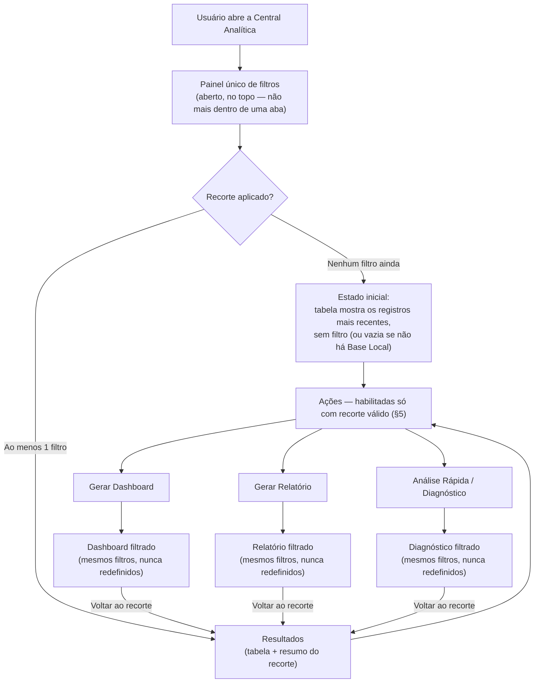
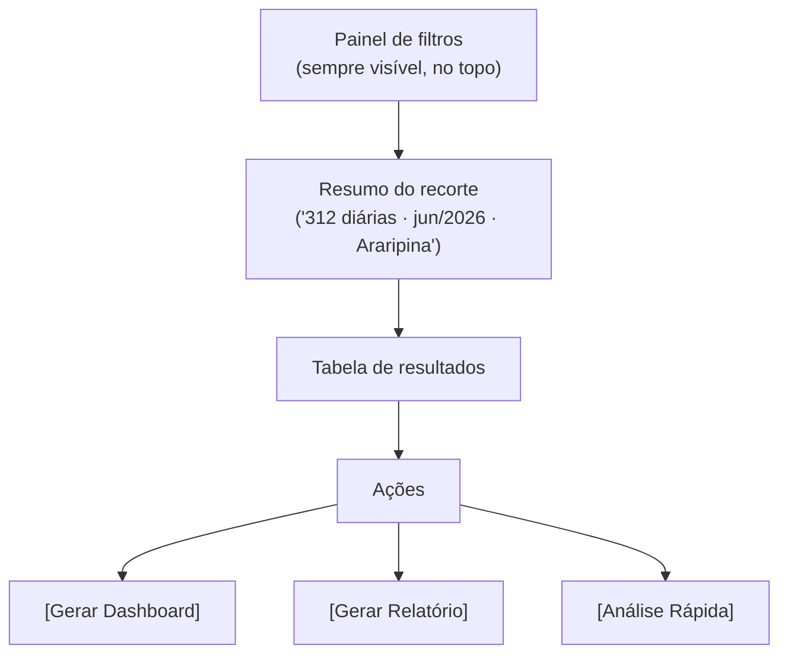

# Central Analítica — Redefinição Funcional v2 (Sprint 19.1)

> **Sprint 19.1 — exclusivamente arquitetura funcional e de experiência.
> Nenhuma linha de código de produção foi escrita nesta Sprint.** Backend,
> frontend, endpoints e componentes existentes permanecem intocados até
> aprovação explícita do DIMCAC a este documento. Wireframes (próxima
> etapa, Sprint 19.2) só começam depois dessa aprovação — mesma disciplina
> das Sprints 11→12 (Central de Conferência) e 17.1→17.2 (Central
> Analítica v1).

> **Nota de numeração:** a última Sprint numerada em
> `docs/central-analitica/` é 18.7 (correção de sincronização). Esta
> proposta usa **19.1** — próximo número livre — porque redefine o
> *produto* da Central Analítica antes de suas etapas 17.5/17.6
> (Dashboard, Relatórios) serem implementadas. Ela não é uma correção
> pontual: é uma revisão da arquitetura de experiência aprovada em
> [`README.md`](README.md) § 9, por isso ganha número de Sprint próprio, não
> um sufixo de 18.

## Sumário

0. [O que este documento muda, e o que preserva](#0-o-que-este-documento-muda-e-o-que-preserva)
1. [Contexto e motivação](#1-contexto-e-motivação)
2. [Fluxo principal da Central Analítica](#2-fluxo-principal-da-central-analítica)
3. [Painel de filtros](#3-painel-de-filtros)
4. [Resultado da pesquisa](#4-resultado-da-pesquisa)
5. [Ações após aplicar filtros](#5-ações-após-aplicar-filtros)
6. [Dashboard baseado no filtro](#6-dashboard-baseado-no-filtro)
7. [Relatórios baseados no filtro](#7-relatórios-baseados-no-filtro)
8. [Análise Rápida / Diagnóstico](#8-análise-rápida--diagnóstico)
9. [Regras da planilha a formalizar](#9-regras-da-planilha-a-formalizar)
10. [Nova organização visual](#10-nova-organização-visual)
11. [Reaproveitamento vs. redesenho](#11-reaproveitamento-vs-redesenho)
12. [Backend necessário (contratos conceituais)](#12-backend-necessário-contratos-conceituais)
13. [Riscos arquiteturais e trade-offs](#13-riscos-arquiteturais-e-trade-offs)
14. [Perguntas em aberto](#14-perguntas-em-aberto)
15. [Critérios de aceite desta Sprint](#15-critérios-de-aceite-desta-sprint)
16. [Roadmap](#16-roadmap)

---

## 0. O que este documento muda, e o que preserva

| # | Decisão | Motivo |
| --- | --- | --- |
| 1 | O modelo de navegação por **três abas fixas** (Dashboard / Pesquisa / Relatórios, `SeletorDeAbas.tsx`, aprovado em [`README.md` § 9](README.md#9-proposta-de-interface)) é **substituído** por um fluxo único orientado por tarefa: filtrar → revisar recorte → agir. | Pedido explícito do DIMCAC nesta Sprint — o modelo de abas não corresponde à forma como o servidor pensa a tarefa ("eu quero ver diárias de tal período e tal cidade, e então decidir o que fazer com isso"), e obrigava a repetir os mesmos filtros em três lugares separados. |
| 2 | A pesquisa (`AbaPesquisa`, `PainelFiltrosAvancados`, `ChipsFiltroAtivo`, `TabelaDiarias`, `PainelDetalhamentoDiaria`) deixa de ser "uma das três abas" e passa a ser **o corpo único da tela** — o ponto de entrada, não um destino entre outros. | Consequência direta da decisão 1. |
| 3 | Dashboard, Relatório e Diagnóstico deixam de ser abas paralelas e passam a ser **ações sobre o recorte já filtrado** — nunca uma tela nova que o usuário monta do zero. | Regra de produto explícita desta Sprint (contexto do pedido, item 5). |
| 4 | `AbaBloqueada` (placeholder de "em construção" para Dashboard/Relatórios, Sprint 18.4.4) deixa de fazer sentido no novo modelo — não há mais aba para bloquear. | Consequência das decisões 1 e 3; ver § 11. |
| 5 | Tudo o que já está **homologado e funcionando** na Pesquisa (Base Local SQLite, 5 endpoints de leitura, filtros, paginação, ordenação, detalhamento, sincronização, máscara de CPF) é **preservado por completo** — nada disso é jogado fora, só reorganizado na tela. | Nenhuma funcionalidade existente é removida nesta Sprint (regra explícita do pedido). |
| 6 | Este documento **não substitui** a arquitetura de dados da Sprint 17 (`README.md` §§ 5–8: Base Local SQLite, estratégia de sincronização, separação de camadas) — ele se apoia nela e a estende só onde o novo fluxo exige dado que hoje não existe (§ 12). | Evita redigitar o que já foi aprovado e continua correto; rastreabilidade. |

**Timing favorável:** como Dashboard e Relatórios (Sprint 17.5/17.6) nunca chegaram a ser implementados — hoje são só o placeholder `AbaBloqueada` —, esta correção de rumo custa apenas trocar um componente de casca (`SeletorDeAbas` + o objeto `CONTEUDO_POR_ABA` em `CentralAnalitica.tsx`) e não descarta nenhum trabalho de Dashboard/Relatório já construído, porque não existe nenhum ainda.

---

## 1. Contexto e motivação

A Central Analítica v1 ([`README.md`](README.md)) resolveu corretamente o **acesso ao dado** (Base Local em SQLite, pesquisa rápida, sincronização transparente) mas herdou, sem questionar, o modelo de navegação por abas da metáfora "um módulo, três telas" — adequado para separar *funcionalidades independentes* (como Processamento vs. Conferência no Hub), mas errado para separar *etapas da mesma tarefa*.

O problema concreto: hoje, para responder "quantas diárias foram pagas em Araripina em junho, e eu quero o relatório disso", o usuário precisaria (no modelo de abas) filtrar na aba Pesquisa, depois trocar para a aba Dashboard e re-configurar o mesmo período/cidade do zero, depois trocar para Relatórios e configurar de novo — três pontos de filtro desincronizados, três chances de o recorte divergir sem o usuário perceber.

A correção de produto pedida nesta Sprint elimina essa divergência por construção: existe **um único recorte** (o resultado dos filtros aplicados), e Dashboard/Relatório/Diagnóstico são sempre uma *função* desse recorte, nunca uma tela que redefine seus próprios filtros.

---

## 2. Fluxo principal da Central Analítica



**Como o usuário entra, filtra, revisa e escolhe uma ação:**

1. **Entra** — a Central Analítica abre direto no painel de filtros + tabela (não numa tela de boas-vindas nem numa aba). A verificação automática de frescor da Base Local (já aprovada, `README.md` § 8, decisão 1) continua rodando silenciosamente nesse momento.
2. **Filtra** — usa o painel de filtros (§ 3) e/ou os filtros rápidos. Cada mudança já reflete na tabela abaixo, com debounce nos campos de texto (comportamento já existente, `useDiarias`/`PainelFiltrosAvancados`, preservado).
3. **Revisa o recorte** — a tabela de resultados (§ 4) mostra o que aquele filtro representa: quantos registros, resumo textual do recorte ("312 diárias · jun/2026 · Araripina"), e a lista propriamente dita.
4. **Escolhe uma ação** (§ 5) — os três botões ficam abaixo/ao lado da tabela, sempre visíveis, habilitados quando há um recorte válido. Nenhum botão abre uma tela que pergunta os filtros de novo.
5. **Usa a saída** (Dashboard, Relatório ou Diagnóstico) — cada uma é uma visualização derivada do mesmo recorte, com um caminho explícito de **voltar** ao recorte original (nunca um beco sem saída) e, no caso do Dashboard, a possibilidade de **refinar** o recorte a partir de um gráfico (§ 6).

Não há mais o conceito de "aba" — existe uma tela contínua com uma área que muda de conteúdo (resultados ⇄ dashboard ⇄ relatório ⇄ diagnóstico) mas nunca perde o filtro que a originou.

---

## 3. Painel de filtros

### 3.1 Filtros mapeados ao domínio real (DIMCAC)

Cada filtro abaixo é rastreado ao campo real do esquema `DIARIAS`/`SERVIDORES` (`app/infra/db/esquema.py`, Sprint 17.3) e ao endpoint atual (`app/api/analitica.py`) quando já existe — **nenhum é inventado**; onde o dado não existe hoje, está marcado como gap.

| Filtro pedido | Campo técnico | Status hoje | Observação |
| --- | --- | --- | --- |
| Período | `periodo_inicial`/`periodo_final` | ✅ Existe (`GET /diarias`) | Intervalo, já com validação de "final ≥ inicial". |
| SEI | `sei` | ✅ Existe | Busca parcial já suportada (`LIKE`, ver `repositorio_analitico.py`). |
| CPF | `cpf` | ✅ Existe | — |
| Servidor (nome) | `servidor_nome` | ✅ Existe | — |
| Matrícula | `servidor_matricula` | ✅ Existe | — |
| Origem | `cidade_origem` | ⚠️ **Gap** — hoje só existe `municipio`, que busca em origem OU destino juntos (`UNION`, `repositorio_analitico.py:211`) | Precisa de um parâmetro próprio (`origem`) para restringir só à cidade de partida. |
| Destino | `cidade_destino` | ⚠️ **Gap** — mesmo motivo acima | Precisa de um parâmetro próprio (`destino`). |
| Trecho | `cidade_origem` + `cidade_destino` combinados (coluna `J` da planilha, `"{origem} - {destino}"`) | ⚠️ **Gap** — não existe filtro por trecho como par | Proposta: campo de texto único que casa contra a concatenação "origem - destino"; não é feature nova de negócio, só reflete a coluna `TRECHO` já escrita hoje pelo sistema. |
| Município | `municipio` (união origem/destino) | ✅ Existe | Mantido como está — é o "em qualquer ponta da viagem", diferente de origem/destino isolados. |
| Motivo | `motivo` | ✅ Existe | Lista fechada (`GET /opcoes-filtro`). |
| Situação | `servidor_situacao` | ✅ Existe, **mas é do servidor, não da diária** | **Correção de nomenclatura necessária:** o filtro "Situação" hoje reflete `Dados!H` ("Em exercício" / `#N/A`) — situação **cadastral do servidor**, não um status de tramitação da diária (a planilha não tem uma coluna "status do processo" homologada — ver § 9, pergunta 1). A UI deve rotular isso como "Situação do servidor" para não confundir com "situação do processo". |
| Valor | `valor_total_diarias` | ⚠️ **Gap** — nenhum filtro por faixa de valor hoje | Proposta: `valor_minimo`/`valor_maximo`. |
| Registros com campos vazios | — | ⚠️ **Gap**, precisa de regra formal (§ 9) | Proposta: filtro sintético `somente_incompletos=true` — "incompleto" precisa de definição fechada antes de implementar (quais campos contam). |
| Registros com inconsistências | — | ⚠️ **Gap**, precisa de regra formal (§ 8/§ 9) | Depende do catálogo de diagnósticos (§ 8) estar definido primeiro — filtro sintético `somente_inconsistentes=true`. |

### 3.2 Filtros rápidos (atalhos, não filtros novos)

Cada atalho é só um preenchimento automático dos campos acima — nenhum exige lógica de backend nova além do que já existe, **exceto** os três últimos:

| Atalho | Como se traduz nos filtros existentes |
| --- | --- |
| Hoje | `periodo_inicial = periodo_final = hoje` |
| Últimos 7 dias | `periodo_inicial = hoje-7`, `periodo_final = hoje` |
| Últimos 30 dias | `periodo_inicial = hoje-30`, `periodo_final = hoje` |
| Mês atual | 1º dia do mês corrente até hoje |
| Mês anterior | 1º e último dia do mês anterior |
| Ano inteiro | 1º de janeiro até 31 de dezembro do ano corrente |
| Aguardando liberação | ⚠️ Depende de § 9 — candidato natural é a regra `PASSAR DIA` (`RN-06`, `Vn = Hn - 15`: `periodo_inicial - 15 dias > hoje`), mas isso é um cálculo, não uma coluna armazenada; precisa de decisão explícita (backend calcula em consulta, ou é pré-computado na sincronização). |
| Registros incompletos | = "registros com campos vazios" (§ 3.1) |
| Registros com possível inconsistência | = "registros com inconsistências" (§ 3.1), mesmo catálogo do Diagnóstico (§ 8) |

### 3.3 Regra de combinação

Mantém a semântica já aprovada e implementada: todos os filtros preenchidos se combinam por **interseção (AND)** — decisão já oficial (`repositorio_analitico.py:222`, "Semântica de interseção, aprovada 2026-07-30"). Esta Sprint não propõe mudar isso.

---

## 4. Resultado da pesquisa

### 4.1 Colunas

| Categoria | Colunas | Observação |
| --- | --- | --- |
| **Essenciais** (sempre visíveis) | SEI · Servidor · Período · Destino · Valor | Mesmo conjunto já implementado em `TabelaDiarias.tsx` — validado, preservado. |
| **Opcionais** (config. de colunas, § 4.4) | Origem · Trecho · Motivo · Situação do servidor · Matrícula · CPF (mascarado) · DOC ORIGEM · Transporte | Hoje só aparecem no painel de detalhamento (`PainelDetalhamentoDiaria`); passam a poder ser adicionadas à tabela sob demanda. |

CPF, quando exibido em qualquer coluna, segue mascarado por padrão (`mascararCpf.ts`, decisão vinculante já existente — preservada sem alteração).

### 4.2 Comportamento da tabela

| Requisito | Proposta |
| --- | --- |
| Rolagem horizontal | Necessária a partir do momento em que colunas opcionais são ativadas (hoje a tabela de 5 colunas cabe sem rolagem); contêiner com `overflow-x: auto` próprio — nunca a página inteira rola na horizontal. |
| Largura mínima | Cada coluna com `min-width` definido (ex.: SEI 160px, Servidor 220px, Valor 120px) para não colapsar ilegível em telas estreitas. |
| Tooltip para conteúdo cortado | Células truncadas com `text-overflow: ellipsis` ganham `title`/tooltip acessível com o conteúdo completo — útil sobretudo em "Motivo" e "Trecho", que já hoje têm texto longo. |
| Ordenação | Mantida (`onOrdenarPor`, já implementado) — estendida às novas colunas opcionais que fizerem sentido ordenar (ex.: Motivo, Situação). |
| Paginação | Mantida (paginação sempre no servidor, já implementado — nenhuma mudança). |
| Configuração de colunas | **Novo**: um controle ("Colunas") que abre a lista de opcionais com checkbox; preferência de colunas visíveis pode persistir localmente (não é dado de negócio, não precisa ir ao backend). |
| Destaque de campos vazios | **Novo**: célula com valor ausente (`—`, já usado hoje) ganha um indicador visual sutil (não vermelho — vermelho é reservado a falha técnica, herdado de RN-08) quando o vazio é potencialmente relevante (ex.: Destino vazio) — a decisão de "o que conta como vazio relevante" depende de § 9. |
| Destaque de inconsistências | **Novo**: linha/célula sinalizada quando bate com algum item do catálogo de diagnóstico (§ 8), com o mesmo ícone/cor usado no painel de Diagnóstico — nunca a cor vermelha de erro técnico (mesma regra herdada). |
| Painel de detalhes completo | Mantido — `PainelDetalhamentoDiaria`, já implementado, abre ao clicar na linha (`GET /diarias/{sei}`). |
| Ações por registro | Hoje só "ver detalhes". Propor adicionar, no painel de detalhes: "copiar SEI", "ver histórico do mesmo CPF" (atalho que aplica filtro `cpf` = o desta linha e volta para a tabela) — ambas reaproveitam mecanismos já existentes (filtro por CPF), sem endpoint novo. |

### 4.3 Resumo do recorte

Acima da tabela, uma linha de resumo textual sempre visível quando há filtro aplicado: contagem total, período coberto, e — quando o filtro tiver 1–2 dimensões dominantes (ex.: só município, ou só motivo) — o valor delas no resumo ("312 diárias · Araripina · jun/2026"). Runs sobre o mesmo `resultado.paginacao.total_itens` já devolvido por `GET /diarias` — não é dado novo.

---

## 5. Ações após aplicar filtros

Os três botões — **Gerar Dashboard**, **Gerar Relatório**, **Análise Rápida/Diagnóstico** — ficam fixos logo abaixo do resumo do recorte (§ 4.3), sempre visíveis, mas com estado habilitado/desabilitado:

| Estado | Condição | Comportamento dos botões |
| --- | --- | --- |
| Recorte inválido | Backend offline, Base Local indisponível, ou pesquisa ainda carregando | Desabilitados, com tooltip explicando o motivo (mesmo padrão de bloqueio por ação já usado no resto do app, `docs/configuracao-inicial/README.md` § 7). |
| Recorte vazio | Filtro aplicado mas 0 resultados | Desabilitados — não faz sentido gerar dashboard/relatório/diagnóstico de nada; mensagem "Ajuste os filtros para habilitar as ações". |
| Recorte válido | Ao menos 1 resultado, backend online, Base Local sincronizada | Habilitados. |

**"Recorte válido" não exige que o usuário tenha digitado um filtro** — o estado inicial (tabela com os registros mais recentes, sem filtro algum, § 2 passo 1) já é um recorte válido por si (equivalente a "todos os registros"); os três botões funcionam também sobre a base inteira, coerente com o caso de uso "quero o dashboard geral, sem filtro".

Cada botão navega para a respectiva visualização carregando o **mesmo objeto de filtros já aplicado** (`ParametrosPesquisaDiariasQuery`, reaproveitado tal e qual — ver § 12) — nunca abre um formulário de configuração próprio.

---

## 6. Dashboard baseado no filtro

### 6.1 Indicadores (KPIs)

| Indicador | Fonte |
| --- | --- |
| Total de diárias | `COUNT(*)` sobre o recorte |
| Total de processos | Mesmo que total de diárias, já que 1 SEI = 1 diária (chave única, decisão 8 já oficial) — **a rotular como sinônimo na UI, não como métrica distinta**, para não sugerir uma contagem diferente que não existe no modelo de dados atual. |
| Total de servidores | `COUNT(DISTINCT cpf)` sobre o recorte |
| Total de municípios | `COUNT(DISTINCT cidade_destino)` (e/ou origem, a decidir — § 14) sobre o recorte |
| Valor total | `SUM(valor_total_diarias)` sobre o recorte, ignorando nulos |
| Valor médio | `AVG(valor_total_diarias)` sobre o recorte, ignorando nulos |
| Registros completos | Contagem por complemento do catálogo de "campos vazios" (§ 9) |
| Registros incompletos | Contagem pelo catálogo de "campos vazios" (§ 9) |
| Aguardando liberação | Contagem pela regra `PASSAR DIA` (RN-06), condicionada à decisão de § 3.2 |

### 6.2 Gráficos

| Gráfico | Dimensão × Métrica |
| --- | --- |
| Evolução por período | Mês (ou dia, se período curto) × contagem de diárias |
| Valores por período | Mês × soma de `valor_total_diarias` |
| Ranking de servidores | Top N servidores (nome) × contagem ou valor total, dentro do recorte |
| Ranking de municípios | Top N `cidade_destino` × contagem ou valor total |
| Distribuição por situação | `servidor_situacao` × contagem (rotulado "Situação do servidor", § 3.1) |
| Distribuição por motivo | `motivo` × contagem |
| Origem × Destino | Matriz ou top pares `cidade_origem` → `cidade_destino` |
| Completos × incompletos | Proporção simples (pizza/barra), mesma base do KPI "registros incompletos" |

### 6.3 Interações

| Interação | Comportamento |
| --- | --- |
| Tooltip | Ao passar o mouse sobre um ponto/barra, mostra o valor exato e o rótulo — padrão de qualquer lib de gráfico (biblioteca ainda não escolhida, decisão de implementação, herdada de `README.md` § 9). |
| Clique refina a tabela | Clicar numa fatia (ex.: um mês na evolução temporal, um município no ranking) aplica esse valor como filtro adicional sobre o recorte atual e volta para a área de resultados (§ 4) — nunca substitui os filtros existentes, só adiciona um a mais (mesma semântica de interseção, § 3.3). |
| Desfazer filtro do gráfico | Como qualquer filtro adicionado vira um chip em `ChipsFiltroAtivo` (já existente), removê-lo é o mecanismo já implementado — nenhuma UI nova, só reaproveita o componente. |
| Exportar dashboard | Gera um PDF/imagem do dashboard atual (mesmos indicadores/gráficos do recorte corrente) — ver § 7 para o mecanismo de exportação compartilhado com Relatórios. |
| Retornar ao recorte original | Botão "← Voltar aos resultados" sempre visível dentro do Dashboard — mesmo destino de qualquer clique em gráfico, mas sem adicionar filtro nenhum. |

---

## 7. Relatórios baseados no filtro

### 7.1 Tipos

| Tipo | Conteúdo |
| --- | --- |
| Executivo | KPIs principais + 1–2 gráficos-chave, 1 página, para "levar à chefia". |
| Detalhado | Todos os KPIs + todos os gráficos (§ 6) + tabela completa do recorte. |
| Financeiro | Foco em valores: total, médio, por período, por município — sem os campos cadastrais do servidor. |
| Por servidor | Agrupado por servidor: total de diárias e valor por pessoa, dentro do recorte. |
| Por município | Agrupado por `cidade_destino` (e/ou origem). |
| Por situação | Agrupado por `servidor_situacao`. |
| Inconsistências | Lista só dos registros sinalizados pelo Diagnóstico (§ 8), com a classificação de cada um. |
| Qualidade dos dados | Visão agregada: % de registros completos/incompletos, contagem por tipo de lacuna — não é sobre uma diária específica, é sobre a saúde do recorte. |

### 7.2 Formatos

PDF, Excel (`.xlsx`) e CSV — os três já citados no pedido original (`README.md` § 2.4) como requisito, ainda não implementados. Nenhuma mudança de escopo aqui.

### 7.3 Estrutura visual do PDF

```
┌───────────────────────────────┐
│ Capa                          │  título do relatório, tipo, brasão/identidade visual do app
│ Período coberto               │  do recorte (ou "todos os registros" se sem filtro de data)
│ Filtros aplicados              │  lista legível de todo filtro ativo (nunca omitido — transparência do recorte)
│ Indicadores                    │  KPIs do § 6.1 relevantes ao tipo de relatório
│ Gráficos                       │  os do § 6.2 relevantes ao tipo
│ Tabela                         │  registros do recorte (paginada dentro do PDF se grande)
│ Inconsistências                │  seção dedicada, mesmo catálogo do Diagnóstico (§ 8)
│ Data de geração                │  timestamp de quando o relatório foi criado
│ Última sincronização           │  timestamp da Base Local (decisão já oficial e vinculante, README.md § 0.1 item 6 — obrigatório em todo artefato exportado)
└───────────────────────────────┘
```

---

## 8. Análise Rápida / Diagnóstico

### 8.1 Princípio obrigatório

**Campo vazio esperado não pode ser tratado como erro.** Cada diagnóstico abaixo cita a fórmula/regra real que o sustenta (`docs/central-conferencia/README.md`); onde a regra ainda não está confirmada, o rótulo é explicitamente "não determinado", nunca uma explicação inventada.

### 8.2 Catálogo de diagnósticos

| Caso | Classificação | Explicação rastreável |
| --- | --- | --- |
| **DH (coluna `A`) vazia** | Depende do estágio do processo — ver correção abaixo | `DH` é escrito pelo próprio sistema a partir do Despacho de Validação extraído do PDF (`COLUNA_DH`, `escritor_planilha.py`); a extração já documenta e testa (`test_documento_habil.py::test_processo_sem_nota_de_liquidacao_fica_sem_dh`) que **"processo que ainda não chegou à fase de liquidação — nenhum DH no texto. Isso é esperado, não é um erro."** → classificar como **esperado** quando o processo é recente/ainda em tramitação; **atenção** se o processo é antigo (ex.: > 60 dias, limiar a confirmar com o DIMCAC) e ainda sem DH. |
| **Correção necessária ao pedido original** | — | O exemplo do pedido ("DH vazia → aguardando liberação pela data, conforme fórmula da planilha") descreve na verdade a coluna **`V` — PASSAR DIA** (`Vn = Hn - 15`, RN-06), não a coluna `DH`. São duas colunas e duas regras diferentes — `DH` não é fórmula, é escrita direta do sistema após a extração do PDF; `PASSAR DIA` é fórmula de data. Este documento usa a regra real e documentada de cada uma (não inventa uma explicação só para preencher o exemplo do pedido). |
| **Valores ausentes** (`valor_total_diarias` nulo) | Atenção | `P = R + S`, calculado por fórmula (RN-05) a partir do estado de destino (`Q`) em `Tabela Valores`; nulo pode significar que `Q`/`N`/`O` ainda não foram preenchidos, ou que o estado não bate com nenhuma faixa da `Tabela Valores` — não há regra documentada que diga "vazio aqui é normal", então fica **atenção**, não **esperado**. |
| **Matrícula ausente** | Depende do CPF ter cadastro em `Dados` | Se o CPF da diária não existe em `Dados`, o servidor é `None` na Central Analítica (já documentado, `RegistroAnalitico.servidor`) — **esperado** só se o próprio cadastro do servidor também estiver ausente (RN-01: `#N/A` no Excel = "servidor ainda não cadastrado"); se o servidor existe mas a matrícula específica está vazia, é **atenção** (dado cadastral incompleto na aba `Dados`, fora do controle da Central Analítica). |
| **Situação (do servidor) ausente** | Atenção | Mesma origem de `Dados!H`; `#N/A` na fórmula já documentado como "sem correspondência" — se o servidor existe mas a situação está vazia, é dado cadastral incompleto, **atenção**. |
| **Período inválido** (final < inicial) | Inconsistência | Já validado tecnicamente na gravação (`_periodo_valido`, `schemas/analitica.py`) — se aparecer no banco mesmo assim, é uma inconsistência real de dado histórico, nunca esperada. |
| **Origem/destino ausentes** | Atenção | `cidade_origem`/`cidade_destino` são campos do sistema (`COLUNA_TRECHO`), preenchidos na extração do PDF — vazio aqui não tem uma regra de "vazio esperado" documentada; **atenção**, candidato a checagem manual. |
| **Trecho incompleto** (só origem ou só destino preenchido, não os dois) | Atenção | Mesma base do item acima — um trecho parcial é mais raro que os dois vazios juntos e sugere erro de extração específico, não um padrão conhecido. |
| **Fórmulas ausentes** (colunas `E`/`F`/`G`/`N`/`P`/`R`/`S`/`V`/`Z`/`AA` mostrando `#N/A` ou vazio na origem) | Esperado (se o CPF não tem cadastro) ou Inconsistência (se o CPF tem cadastro e mesmo assim falhou) | RN-01/RN-02 já documentam que `#N/A` é o comportamento nativo do Excel para "não encontrado" — **esperado** quando rastreável a um CPF sem cadastro; **inconsistência** se o CPF existe em `Dados` e a fórmula deveria ter resolvido. |
| **Registros possivelmente duplicados** | Atenção (nunca decidido automaticamente) | RN-02 já define a chave de duplicidade real: **CPF + Período Inicial + Período Final**, não o SEI. A Central Analítica pode sinalizar candidatos com essa mesma chave — mas, seguindo RN-07 (exceções reais de "complemento de diária" já encontradas na planilha), **nunca decide sozinha que é erro**; sempre "atenção", nunca "inconsistência" definitiva, porque já existe precedente de duplicidade legítima. |
| **Dados incoerentes** (ex.: valor muito fora da faixa esperada para o estado de destino) | Motivo não determinado automaticamente | Não há hoje nenhuma regra documentada de faixa aceitável por estado além do cálculo de RN-05 em si — classificar como inconsistência exigiria uma tolerância que ninguém validou ainda. Aplica-se a regra do pedido: **"Motivo não determinado automaticamente. Recomenda-se conferência manual."** |

### 8.3 Como o Diagnóstico se conecta ao recorte

Mesma regra das demais ações (§ 5): o Diagnóstico roda **só sobre os registros do recorte filtrado**, nunca sobre a base inteira por padrão — se o usuário quer diagnosticar tudo, basta não aplicar filtro (recorte = base inteira, § 5).

---

## 9. Regras da planilha a formalizar

Antes de qualquer diagnóstico definitivo (§ 8) virar comportamento implementado, as perguntas abaixo precisam de resposta confirmada com a planilha real e/ou o DIMCAC — nenhuma tem uma resposta assumida neste documento além do que já está documentado em `docs/central-conferencia/README.md`:

1. **Quais colunas têm fórmula, e quais são preenchidas pelo sistema?** — Já mapeado por completo em `docs/central-conferencia/README.md § 2.1`; este documento reaproveita esse mapeamento (não remapeia).
2. **Quais colunas podem ficar vazias legitimamente, e sob qual condição?** — Parcialmente respondido (`DH`: sim, se o processo ainda não chegou à liquidação; fórmulas de `VLOOKUP`: sim, se o CPF não tem cadastro). Falta confirmar as demais (valor, origem/destino, matrícula) com o DIMCAC.
3. **Quando o vazio deixa de ser esperado e passa a ser inconsistência?** — Sem limiar definido hoje (ex.: "DH vazio há mais de X dias é atenção"). Precisa de decisão explícita do DIMCAC, não de suposição.
4. **Como a data interfere?** — `PASSAR DIA` (RN-06) já é a regra confirmada para "aguardando liberação por data". Falta decidir se ela deve ser: (a) calculada em tempo de consulta a partir de `periodo_inicial`, ou (b) persistida como coluna derivada no esquema SQLite na sincronização (Sprint 17.3, esquema hoje não tem esse campo).
5. **Como a "situação" interfere?** — Confirmar com o DIMCAC se `servidor_situacao` (`Dados!H`, cadastral) é de fato o único "situação" relevante para filtro/diagnóstico, ou se existe uma necessidade real de rastrear "situação do processo" (ex.: em tramitação / concluído / cancelado) que hoje **não existe em nenhuma coluna homologada** da planilha.
6. **Especificamente a coluna `DH`:** confirmar com o DIMCAC o limiar de "processo antigo demais para estar sem DH" (pergunta 3), e se o Diagnóstico deve usar `DMTC`/`DMOF` (colunas `T`/`U`, datas de registro administrativo, ~89% preenchidas) como referência adicional de quando o DH deveria ter sido emitido.
7. **O que conta como "registro incompleto" para o filtro sintético (§ 3.1)?** — Precisa de uma lista fechada de campos (provável: destino, valor, matrícula, situação) e da regra "quantos precisam estar vazios para contar" (1 já basta, ou um mínimo).
8. **Existe uma regra real de faixa de valor aceitável por estado (para o diagnóstico "dados incoerentes")?** — Hoje não há nenhuma documentada além do cálculo de RN-05; sem resposta, o diagnóstico correspondente permanece "motivo não determinado automaticamente" (regra obrigatória do pedido).

---

## 10. Nova organização visual

### 10.1 Remoção das abas fixas

`SeletorDeAbas` (Dashboard/Pesquisa/Relatórios) e `AbaBloqueada` deixam de existir como conceito — substituídos por uma tela única orientada por tarefa:



### 10.2 Linguagem para o servidor do DIMCAC

Nenhum termo técnico na interface — nomes já usados no pedido e no domínio real do DIMCAC, nunca jargão de banco de dados ou de programação:

| Termo técnico (backend/código) | Termo na tela |
| --- | --- |
| `FiltrosDiaria` | "Filtros" |
| `servidor_situacao` | "Situação do servidor" (nunca só "Situação", para não sugerir status do processo — § 3.1) |
| `possivelmente_desatualizado` | "Dados podem estar desatualizados" |
| `RegistroAnalitico` | "Diária" / "Registro" |
| Diagnóstico "inconsistência" | Sempre acompanhado de explicação em linguagem natural (§ 8), nunca um código de erro cru. |

A regra herdada de RN-08 (vermelho nunca representa veredito de negócio) continua valendo integralmente para todo destaque visual desta nova tela — inconsistência de dado usa a paleta de "atenção" (âmbar/laranja), nunca vermelho, que fica reservado a falha técnica real (backend indisponível, sincronização falhou).

---

## 11. Reaproveitamento vs. redesenho

| Item | Reaproveitado como está | Precisa mudar |
| --- | --- | --- |
| Base Local SQLite (`app/consulta/base_local_sqlite.py`, esquema, sincronização) | ✅ Integral | — |
| Endpoints de pesquisa (`GET /diarias`, `GET /diarias/{sei}`, `GET /opcoes-filtro`) | ✅ Integral | Estendidos com novos parâmetros (origem, destino, valor mín/máx, vazios, inconsistências — § 12), nunca substituídos. |
| Filtros (`FiltrosDiaria`, `useDiarias`, `PainelFiltrosAvancados`) | ✅ Lógica de combinação (AND) e componentes de campo | Painel ganha novos campos (§ 3.1) e os filtros rápidos (§ 3.2); mesma base de componente (`Campo`, `CampoSelecao`). |
| Paginação (`ParametrosPaginacao`, rodapé de `TabelaDiarias`) | ✅ Integral | — |
| Detalhamento (`PainelDetalhamentoDiaria`, `GET /diarias/{sei}`) | ✅ Integral | Ganha as duas ações novas do § 4.2 (copiar SEI, ver histórico do CPF) — sem mudar o contrato do endpoint. |
| Sincronização (`useSincronizacao`, `IndicadorSincronizacao`, `GET`/`POST /sincronizacao`) | ✅ Integral | Indicador de frescor passa a aparecer uma vez, no topo da tela única, em vez de em cada aba (era redundante nas 3 abas por decisão herdada de "elemento obrigatório em toda tela" — continua obrigatório, só deixa de ser repetido). |
| Tabela (`TabelaDiarias`) | ✅ Estados de carregando/erro/vazio/sem-resultado | Ganha configuração de colunas, tooltip, destaque de vazio/inconsistência (§ 4) — extensão, não reescrita. |
| Design System ("Neon Tech UI": `Cartao`, `Badge`, `Alerta`, `Campo`, `Botao`, tokens de `theme/`) | ✅ Integral | Gráficos exigem um primitivo novo (já era uma decisão em aberto na v1, `README.md` § 9 — segue aberta, § 14). |
| Máscara de CPF (`mascararCpf.ts`) | ✅ Integral, sem mudança de formato | — |
| `SeletorDeAbas.tsx` | ❌ Não reaproveitado | Substituído pelo layout de tarefa única (§ 10). |
| `AbaBloqueada.tsx` | ❌ Não reaproveitado | Sem mais "aba" para bloquear; qualquer indisponibilidade (backend offline, base vazia) passa a ser tratada dentro da própria área de resultados/ações, mesmo padrão que `TabelaDiarias` já usa para seus próprios estados vazios. |
| `CentralAnalitica.tsx` (componente raiz) | ⚠️ Parcial | Estrutura interna muda (não monta mais `CONTEUDO_POR_ABA`), mas o contrato externo (`Props { backendOnline }`, chamado pelo Hub) não muda. |

---

## 12. Backend necessário (contratos conceituais)

Sem código — só a forma dos contratos, todos **reutilizando exatamente os mesmos parâmetros de filtro** já usados em `GET /diarias` (`ParametrosPesquisaDiariasQuery`, estendido conforme § 3.1), para que Dashboard/Relatório/Diagnóstico nunca divirjam do recorte da Pesquisa.

| Contrato conceitual | Entrada | Saída (conceito) |
| --- | --- | --- |
| **Indicadores** | Mesmos filtros de `GET /diarias` (sem paginação — opera sobre o recorte inteiro, não uma página) | Os 9 KPIs do § 6.1, calculados sobre o recorte |
| **Distribuições** | Mesmos filtros + qual dimensão (período, servidor, município, motivo, situação, origem×destino, completo×incompleto) | Série agregada pronta para o gráfico correspondente (§ 6.2) — o backend agrega, o frontend só desenha (mesmo princípio já registrado em `README.md` § 7: frontend nunca calcula agregação a partir do dataset bruto) |
| **Diagnóstico** | Mesmos filtros | Lista de registros do recorte que batem com algum item do catálogo (§ 8.2), cada um com o(s) caso(s) e a classificação (esperado/atenção/inconsistência) |
| **Geração de relatório** | Mesmos filtros + tipo de relatório (§ 7.1) + formato (§ 7.2) | Arquivo pronto (PDF/Excel/CSV) ou HTML intermediário para impressão — mesmo padrão de relatório autossuficiente já usado em `ipc/relatorio.ts` |
| **Exportações** (dashboard, tabela) | Mesmos filtros + formato | Arquivo pronto, mesmo mecanismo de diálogo nativo do Electron já usado hoje |

Nenhum desses contratos escreve na Planilha Oficial nem na Base Local — todos são leitura pura, mesma disciplina de `app/api/analitica.py` hoje (`README.md` § 7).

---

## 13. Riscos arquiteturais e trade-offs

| # | Risco / trade-off | Mitigação |
| --- | --- | --- |
| 1 | O catálogo de diagnóstico (§ 8) depende de decisões do DIMCAC ainda não confirmadas (§ 9) — implementar antes disso arrisca fixar uma explicação incorreta em produção. | Nenhum diagnóstico entra em código antes de sua linha correspondente em § 9 estar resolvida; onde não houver resposta, usar sempre "Motivo não determinado automaticamente. Recomenda-se conferência manual." (regra obrigatória do pedido), nunca uma suposição. |
| 2 | "Situação" hoje é um campo do servidor (`servidor_situacao`), não do processo — o pedido original lista "situação" como se fosse um atributo de tramitação da diária, criando risco de expectativa desalinhada com o dado real. | Este documento já corrige a nomenclatura (§ 3.1, § 10.2) e registra a pergunta em aberto (§ 14) — não implementar um campo "situação do processo" sem antes confirmar se ele deveria existir na Planilha Oficial (decisão fora do escopo desta Sprint, que é só consultiva). |
| 3 | Combinar Dashboard/Relatório/Diagnóstico como "ações sobre o mesmo recorte" nos três novos contratos do § 12 aumenta a carga de trabalho de implementação futura em relação ao modelo de abas independentes (cada endpoint precisa aceitar o superconjunto de filtros). | Aceito deliberadamente — é exatamente a correção de produto pedida; o custo de implementação é menor que o custo de manter os três descolados, que é o problema original (§ 1). |
| 4 | Filtros novos (origem, destino, trecho, valor, vazios, inconsistências) exigem índices adicionais no esquema SQLite (Sprint 17.3) para não degradar a performance já medida e aprovada. | Fica registrado como trabalho da Sprint técnica futura (19.5, § 16) — este documento não assume que o esquema atual já suporta esses filtros com a mesma velocidade. |
| 5 | Biblioteca de gráficos e mecanismo de exportação PDF continuam sem escolha (mesmo risco já registrado na v1, `README.md` § 9/§ 10) — decisão de implementação, não arquitetural. | Deliberadamente adiado para a Sprint de plano técnico (19.4, § 16). |
| 6 | Remover `AbaBloqueada`/`SeletorDeAbas` é uma mudança de casca pequena, mas ainda é uma remoção de componente já testado (`AbaBloqueada.test.tsx`, `SeletorDeAbas.test.tsx`) — precisa de atenção para não deixar teste órfão apontando para componente inexistente. | Fica registrado como item explícito da Sprint de implementação (19.6+), não desta Sprint (que não altera código nem testes). |

---

## 14. Perguntas em aberto

1. "Situação" deve continuar sendo só a situação cadastral do servidor (`Dados!H`), ou o DIMCAC quer, no futuro, uma coluna real de "situação do processo" na Planilha Oficial? Isso é uma decisão de dado-fonte, fora do escopo desta Central (que é só consultiva) — mas vale registrar antes de a UI prometer algo que a planilha não sustenta (§ 3.1, § 13 risco 2).
2. "Total de municípios" (§ 6.1) deve contar municípios de destino, de origem, ou a união de ambos (mesma semântica do filtro "Município", § 3.1)? Esta proposta não assume — precisa de confirmação na Sprint de wireframes (19.2).
3. O atalho "Aguardando liberação" (§ 3.2) deve ser calculado em tempo de consulta (mais simples, sem mudança de esquema) ou persistido como coluna derivada na sincronização (mais rápido, mas expande o esquema Sprint 17.3)? Depende também da resposta à pergunta 4 do § 9.
4. Qual o limiar de "processo antigo demais para estar sem DH" (§ 9, pergunta 3/6)? Sem essa resposta, o diagnóstico de DH vazia fica só em duas classes (esperado quando recente, "não determinado automaticamente" quando não há limiar para decidir se é antigo).
5. A lista fechada de campos que definem "registro incompleto" (§ 9, pergunta 7) — motivo, destino, valor, matrícula, situação — está completa, ou faltam outros campos que o DIMCAC considera essenciais?
6. Existe uma regra real de faixa de valor aceitável por estado de destino, para o diagnóstico "dados incoerentes" (§ 8.2, § 9 pergunta 8)? Sem ela, esse diagnóstico permanece "não determinado automaticamente" indefinidamente.
7. (Herdada da v1, ainda sem resposta, `README.md` § 13) — o app deve migrar também os repositórios da Central de Conferência para SQLite, ou manter só a Central Analítica nessa base?
8. (Herdada da v1) — o DIMCAC quer algum controle de acesso/perfil dentro do app? Sem resposta ainda, mas a Central Analítica agora expõe uma visão ainda mais agregada (KPIs, relatórios) do que a v1, o que reforça a relevância da pergunta.

---

## 15. Critérios de aceite desta Sprint

Esta Sprint (19.1) entrega **só este documento** — os critérios de aceite são sobre a qualidade da proposta, não sobre software funcionando:

- [ ] O fluxo único (filtros → resultados → ações → Dashboard/Relatório/Diagnóstico) está descrito de forma que o DIMCAC consegue visualizar a experiência sem precisar imaginar código.
- [ ] Todo filtro, indicador e diagnóstico proposto está rastreado a um campo real do esquema atual, a uma fórmula/regra já documentada em `docs/central-conferencia/README.md`, ou explicitamente marcado como gap/pergunta em aberto — nenhum é apresentado como certeza sem lastro.
- [ ] A correção do exemplo "DH vazia" do pedido original (§ 8.2) está registrada de forma clara, sem simplesmente reproduzir a explicação do pedido sem verificação.
- [ ] Nenhuma funcionalidade da v1 homologada (pesquisa, filtros, paginação, detalhamento, sincronização, máscara de CPF) é descrita como removida — só reorganizada.
- [ ] Nenhum código, endpoint ou componente foi criado ou alterado nesta Sprint.
- [ ] O documento foi aprovado explicitamente pelo DIMCAC antes de a Sprint 19.2 (wireframes) começar.

---

## 16. Roadmap

| Sub-etapa | Entrega | Depende de | Critério de validação |
| --- | --- | --- | --- |
| **19.1** | Esta arquitetura funcional (documento atual) | — | Aprovação explícita do DIMCAC |
| **19.2** | Wireframes de tela (fluxo único, painel de filtros, tabela configurável, telas de Dashboard/Relatório/Diagnóstico) | 19.1 | Aprovação explícita do DIMCAC, sem código |
| **19.3** | Demonstração visual navegável (protótipo estático ou clicável, sem backend real) | 19.2 | Validação de usabilidade com o DIMCAC — linguagem, disposição dos filtros, clareza dos 3 botões de ação |
| **19.4** | Plano técnico (escolha de biblioteca de gráficos, mecanismo de exportação PDF, extensão do esquema SQLite para os novos filtros) | 19.1, 19.3 | Documento técnico revisado, sem código de produção ainda |
| **19.5** | Backend analítico (§ 12): extensão de `FiltrosDiaria`/esquema com origem, destino, valor, vazios/inconsistências; endpoints de indicadores e distribuições | 19.4 | Testes automatizados; nenhuma regressão nos 5 endpoints já homologados |
| **19.6** | Dashboard (UI + integração com indicadores/distribuições) | 19.5 | Entrega validável isolada — gera dashboard a partir de um recorte real |
| **19.7** | Relatórios (tipos, formatos, exportação PDF/Excel/CSV) | 19.5, 19.6 (reaproveita indicadores/gráficos já expostos) | Entrega validável isolada |
| **19.8** | Diagnóstico (catálogo do § 8, com as regras de § 9 já respondidas) | 19.5 | Cada caso do catálogo testado contra dados reais/sintéticos, nenhuma explicação inventada |
| **19.9** | Auditoria de acessibilidade/consistência da tela única (WCAG, mesma disciplina já aplicada às Sprints 17.4/18.x) | 19.6, 19.7, 19.8 | Relatório de auditoria sem pendência crítica |
| **19.10** | Homologação com a Planilha Oficial real (não só fixture sintética) — validação final dos indicadores, diagnósticos e relatórios contra o dado de produção | 19.9 | DIMCAC confirma que os números batem com a leitura manual da planilha para uma amostra de casos |

**Ordem recomendada:** 19.1 → 19.2 → 19.3 → 19.4 → 19.5 → 19.6 → 19.7 → 19.8 → 19.9 → 19.10. A demonstração visual (19.3) é intencionalmente separada dos wireframes estáticos (19.2) para dar ao DIMCAC uma validação de fluxo antes de qualquer investimento técnico (19.4+) — mesmo espírito de "decisão de tela é barata no papel, cara depois de codificada" já usado nas Sprints 11→12 e 17.1→17.2.
