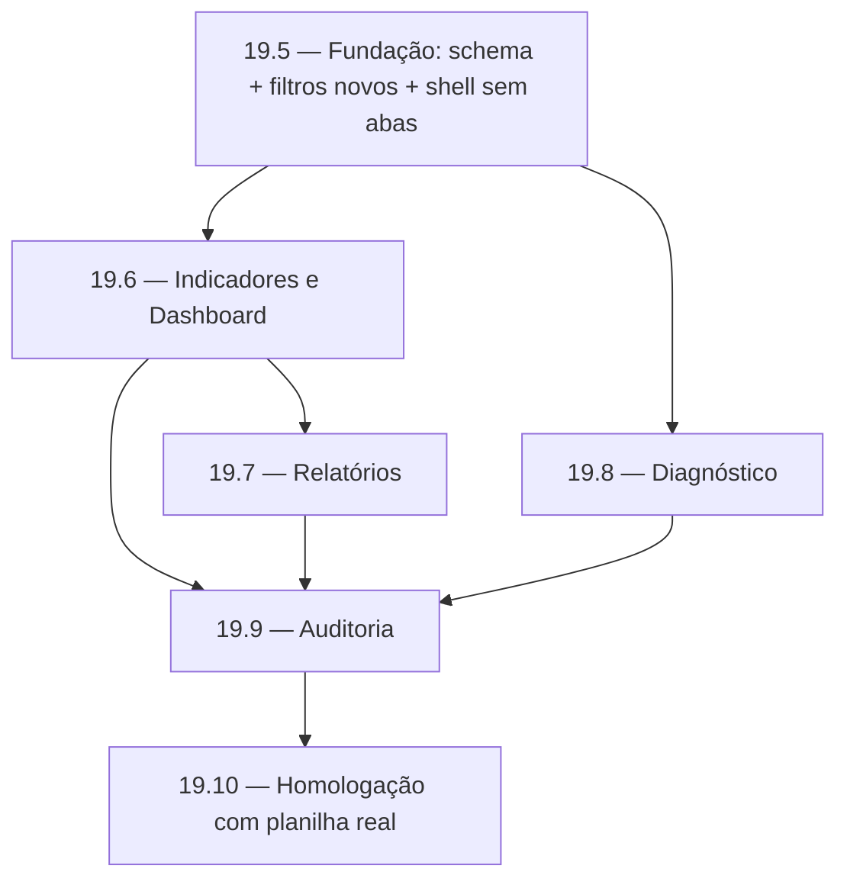
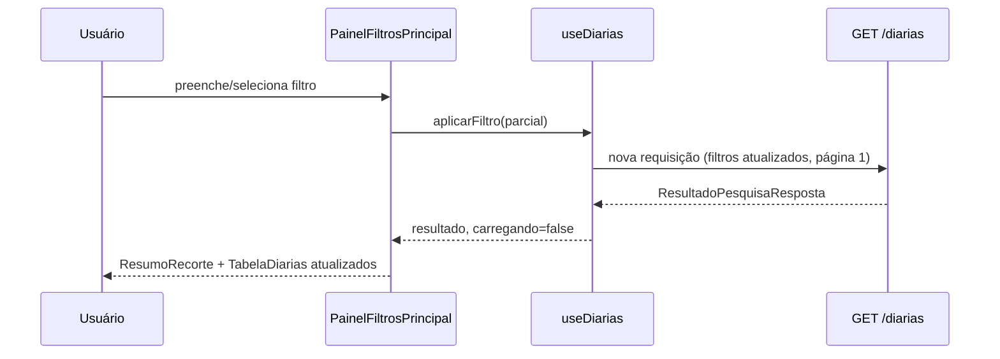
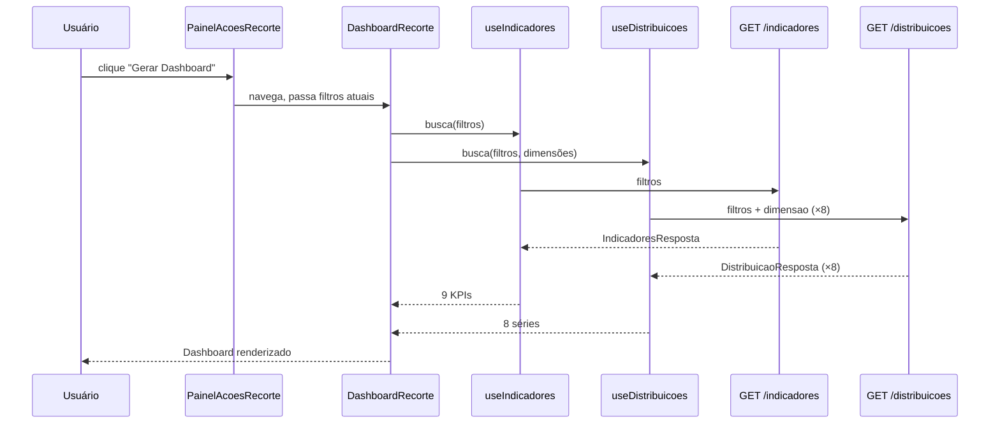
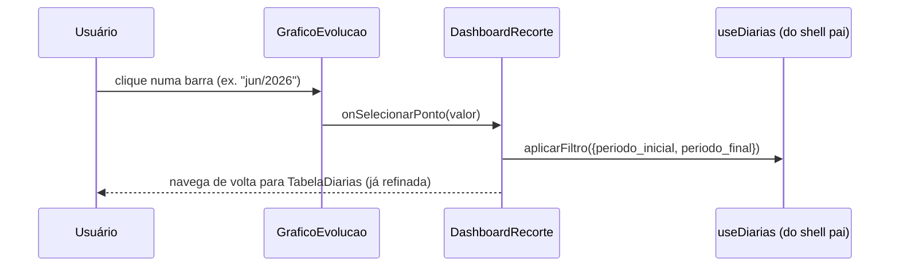
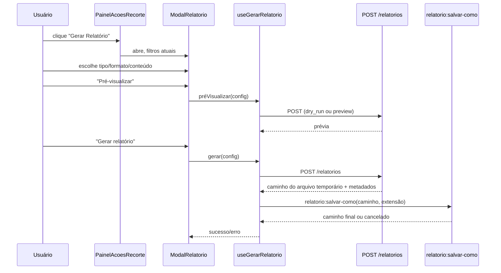
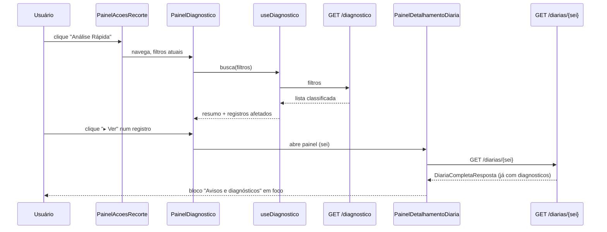
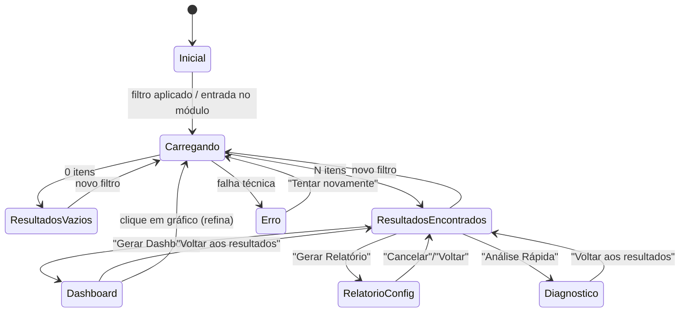
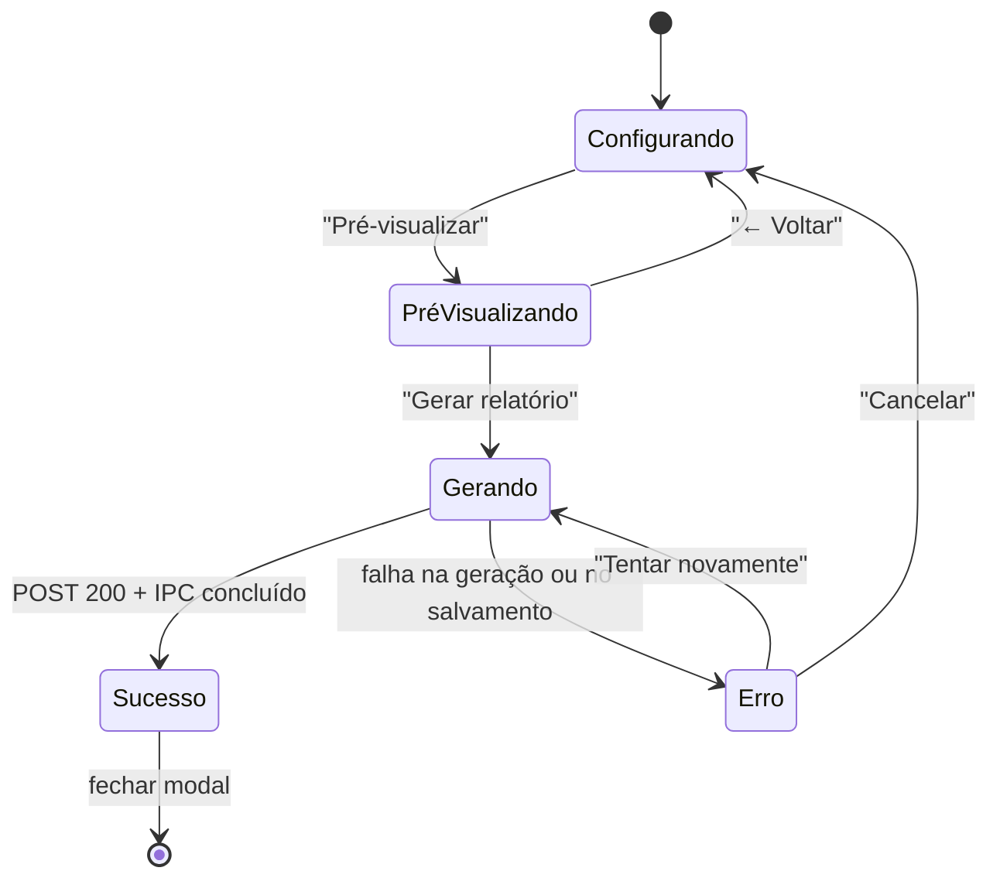

# Central Analítica — Plano Técnico de Implementação V2 (Sprint 19.4)

> **Sprint 19.4 — planejamento técnico original desta Sprint. Na redação
> original, nenhuma linha de código de produção havia sido escrita ainda.**
> Traduz `v2-arquitetura-funcional.md` (19.1), `v2-wireframes.md` (19.2) e
> `v2-demonstracao-visual.md` (19.3) em módulos, arquivos, contratos e uma
> sequência de micro-sprints pequenas e auditáveis. Nenhuma decisão de
> produto/UX já aprovada é reaberta aqui — só decisões de **como
> construir**.
>
> **Nota de atualização (release da versão definitiva V2):** as
> micro-sprints 19.5–19.5.7.1.1 e seguintes, planejadas abaixo, foram
> implementadas, testadas e homologadas — ver § 18 (Registro de
> execução) para o estado real de cada uma. O texto das seções 1–19
> permanece como a especificação original (histórico de planejamento);
> só o aviso acima e o § 20 foram corrigidos para não afirmar que nada
> foi implementado. Achado como dívida documental pela Auditoria Técnica
> de 2026-08-03 (`docs/backlog/README.md`), corrigido nesta atualização.

## Sumário

0. [Correções e esclarecimentos em relação às Sprints anteriores](#0-correções-e-esclarecimentos-em-relação-às-sprints-anteriores)
1. [Módulos a implementar](#1-módulos-a-implementar)
2. [Ordem de implementação](#2-ordem-de-implementação)
3. [Reaproveitamento](#3-reaproveitamento)
4. [O que será removido](#4-o-que-será-removido)
5. [O que será refatorado](#5-o-que-será-refatorado)
6. [O que será criado do zero](#6-o-que-será-criado-do-zero)
7. [Componentes React](#7-componentes-react)
8. [Hooks](#8-hooks)
9. [Endpoints](#9-endpoints)
10. [Fluxos completos](#10-fluxos-completos)
11. [Máquina de estados](#11-máquina-de-estados)
12. [Contratos](#12-contratos)
13. [Estratégia de migração v1 → V2](#13-estratégia-de-migração-v1--v2)
14. [Estratégia de rollback](#14-estratégia-de-rollback)
15. [Plano de testes](#15-plano-de-testes)
16. [Plano de auditoria](#16-plano-de-auditoria)
17. [Critérios de aceite transversais](#17-critérios-de-aceite-transversais)
18. [Roadmap em micro-sprints](#18-roadmap-em-micro-sprints)
19. [Matriz: componente atual → destino na V2](#19-matriz-componente-atual--destino-na-v2)
20. [Confirmação de escopo](#20-confirmação-de-escopo)

---

## 0. Correções e esclarecimentos em relação às Sprints anteriores

| # | Ponto | Esclarecimento |
| --- | --- | --- |
| 1 | `BarraPesquisaGlobal.tsx` (busca por `q`) não apareceu nos mockups de `v2-wireframes.md`/`v2-demonstracao-visual.md` § 1. | Não é uma remoção decidida — é uma lacuna de representação. `BarraPesquisaGlobal` é **mantida sem alteração de lógica**, só reposicionada: passa a ficar como o campo de topo do painel "Filtros" (acima dos filtros rápidos), em vez de uma faixa separada acima do seletor de abas (que deixou de existir). Ver § 3 e § 19. |
| 2 | O esquema SQLite atual (`app/infra/db/esquema.py`, Sprint 17.3) **não tem coluna `dh`**, e `RegistroAnalitico` também não carrega esse campo. | Achado técnico desta Sprint: o diagnóstico "DH vazio" (19.1 § 8.2) não pode ser calculado sobre o esquema atual sem uma extensão de schema. Tratado como pré-requisito explícito no roadmap (§ 18, micro-sprint 19.5.1) — não estava quantificado nos documentos anteriores. |
| 3 | O esquema atual não tem índice em `cidade_origem` isolado (só `cidade_destino`), nem em `servidor_situacao`, nem em `valor_total_diarias`. | Os novos filtros (origem, valor, situação já filtrável mas sem índice) exigem índices adicionais para não degradar a performance já medida na v1 — tratado no mesmo micro-sprint 19.5.1. |

---

## 1. Módulos a implementar

| Módulo | Camada | Natureza |
| --- | --- | --- |
| `app/infra/db/esquema.py` | Backend — dados | Estendido (coluna `dh`, índices novos) |
| `app/consulta/base_local_sqlite.py` | Backend — dados | Estendido (lê/grava `dh` na reconstrução) |
| `app/domain/entities/registro_analitico.py` | Backend — domínio | Estendido (campo `dh`) |
| `app/domain/analitica/` (pacote novo, reserva já prevista em `README.md` § 5 — "DOM3", nunca criada) | Backend — domínio | **Novo** — `indicadores.py`, `distribuicoes.py`, `diagnostico.py`, `relatorios.py` |
| `app/consulta/repositorio_analitico.py` | Backend — dados | Estendido (novos filtros, novas agregações) |
| `app/services/analitica_service.py` | Backend — orquestração | Estendido (novas funções de orquestração) |
| `app/schemas/analitica.py` | Backend — contrato HTTP | Estendido (novos campos/endpoints) |
| `app/api/analitica.py` | Backend — HTTP | Estendido (novas rotas) |
| `frontend/electron/ipc/relatorio.ts` | Electron — exportação | Estendido (generalizado para qualquer extensão de arquivo, não só `.html`) |
| `frontend/src/pages/CentralAnalitica.tsx` | Frontend — shell | Refatorado (fluxo único, sem abas) |
| `frontend/src/components/analitica/` | Frontend — UI | Parcialmente removido, parcialmente estendido, parcialmente novo |
| `frontend/src/hooks/` (analíticos) | Frontend — estado | Parcialmente estendido, parcialmente novo |
| `frontend/src/types/analitica.ts` | Frontend — contrato | Estendido (espelha 1:1 `schemas/analitica.py`, regra já vinculante) |
| `frontend/src/services/api.ts` | Frontend — HTTP | Estendido (novas funções, mesmo padrão das existentes) |

---

## 2. Ordem de implementação

**Por que esta ordem:**

1. **19.5 primeiro, sempre** — schema, filtros estendidos e o shell sem
   abas são pré-requisito de tudo que segue (nenhuma das três ações
   funciona sem o recorte já existir da forma nova).
2. **19.6 (Dashboard) antes de 19.7 (Relatórios)** — Relatório reaproveita
   as mesmas funções de indicadores/distribuições que o Dashboard usa
   (regra obrigatória de não duplicar), então precisa que elas já
   existam.
3. **19.8 (Diagnóstico) é independente de 19.6/19.7** — depende só de
   19.5 (schema com `dh`) — pode correr em paralelo ao Dashboard/
   Relatórios se houver mais de uma frente de trabalho.
4. **19.9 (Auditoria) só depois de tudo estar implementado** — auditoria
   parcial a cada micro-sprint já acontece (§ 16), mas a auditoria de
   consistência global (contrato, cor, acessibilidade, performance) só
   faz sentido com o conjunto completo.
5. **19.10 (Homologação com planilha real) é sempre a última** — só
   depois de auditado.

---

## 3. Reaproveitamento

**Regra obrigatória desta Sprint, aplicada em cada item abaixo:** nada é
recriado se já existe uma peça capaz de cumprir o mesmo papel.

| Peça existente | Reaproveitada como | Sem duplicar |
| --- | --- | --- |
| `GET /api/v1/analitica/diarias` | Único endpoint de listagem — estendido com novos parâmetros de query (origem, destino, trecho, valor_min, valor_max), nunca um segundo endpoint de busca. | Não há `GET /diarias-v2`. |
| `GET /api/v1/analitica/diarias/{sei}` | Único endpoint de detalhamento — estendido com o campo `diagnosticos` (§ 12). | Não há `GET /diagnostico/{sei}` separado. |
| `GET /api/v1/analitica/opcoes-filtro` | Reaproveitado sem mudança — já cobre motivo/situação/município. | — |
| `GET`/`POST /api/v1/analitica/sincronizacao` | Reaproveitados sem mudança. | — |
| `FiltrosDiaria` (`analitica_service.py` e `repositorio_analitico.py`) | Estendida com os campos novos — a mesma dataclass usada por listagem, indicadores, distribuições, diagnóstico e relatório (regra explícita: um único objeto de filtro para as 5 finalidades). | Nenhuma segunda estrutura de filtro é criada. |
| `useDiarias.ts` | Dono do estado de filtros/paginação/ordenação — os hooks novos (`useIndicadores`, `useDistribuicoes`, `useDiagnostico`) **recebem os mesmos `filtros` já existentes em `useDiarias`** como parâmetro, nunca duplicam o estado de filtro. | Nenhum hook novo tem seu próprio `useState` de filtro. |
| `ChipsFiltroAtivo.tsx` | Reaproveitado sem mudança — inclusive para o chip adicionado por clique em gráfico (19.1 § 6.3). | — |
| `IndicadorSincronizacao.tsx` | Reaproveitado sem mudança — passa a aparecer 1 vez no topo do shell (antes repetido em 3 abas). | — |
| `PainelDetalhamentoDiaria.tsx` | Estendido (bloco de diagnóstico + 2 ações novas), nunca substituído por um componente novo. | — |
| `TabelaDiarias.tsx` | Estendido (colunas configuráveis, tooltip, destaque), nunca substituído. | — |
| `PainelFiltrosAvancados.tsx` | Estendido (campos novos: Origem, Destino, Trecho, Valor), nunca substituído. | — |
| `BarraPesquisaGlobal.tsx` | Reaproveitado sem mudança de lógica, só reposicionado (§ 0). | — |
| `mascararCpf.ts` | Reaproveitado sem mudança. | — |
| `lib/datas.ts` | Reaproveitado — os filtros rápidos de período (§ 18, 19.5.6) usam as mesmas funções de formatação/cálculo de data já existentes. | Nenhuma função de data duplicada. |
| Design System (`Cartao`, `Badge`, `Alerta`, `Campo`, `Botao`, `theme/`) | Reaproveitado integralmente. | Nenhum token de cor novo. |
| `electron/ipc/relatorio.ts` (`relatorio:salvar-como`, `nomeRelatorioSugerido`) | Generalizado para aceitar extensão de arquivo/nome de filtro variáveis, reaproveitado para PDF/Excel/CSV do Relatório e para exportação do Dashboard — nunca um canal IPC novo por formato. | Não há `relatorio-pdf:salvar-como`, `relatorio-excel:salvar-como`, etc. |
| Base Local SQLite (`base_local_sqlite.py`, reconstrução total, escrita atômica) | Reaproveitada integralmente como mecanismo — só o **conteúdo** de uma linha (coluna `dh`) e os **índices** são estendidos. | Nenhum segundo banco/arquivo de dados é criado. |
| `app/domain/analitica/` | Pacote **reservado desde a Sprint 17** (`README.md` § 5, "DOM3", nunca implementado) — esta Sprint é quem finalmente o preenche, como já estava previsto. | Não é um pacote novo fora do desenho original. |

---

## 4. O que será removido

| Arquivo | Motivo |
| --- | --- |
| `frontend/src/components/analitica/SeletorDeAbas.tsx` | Não há mais "aba" — substituído pelo shell sem abas (19.1 § 10). |
| `frontend/src/components/analitica/SeletorDeAbas.test.tsx` | Segue o componente removido. |
| `frontend/src/components/analitica/AbaBloqueada.tsx` | Não há mais estado de "aba bloqueada" — Dashboard/Relatório/Diagnóstico deixam de ser abas e passam a ser ações sobre o recorte, cada uma com seus próprios estados (§ 11), não um placeholder genérico de "em construção". |
| `frontend/src/components/analitica/AbaBloqueada.test.tsx` | Segue o componente removido. |
| Trecho de `CentralAnalitica.tsx` que monta `CONTEUDO_POR_ABA`/`abaAtiva` | Substituído pela nova estrutura de shell único (§ 5). |

Nenhum arquivo de backend é removido — todas as mudanças de backend são
aditivas (§ 13).

---

## 5. O que será refatorado

| Arquivo | Natureza da mudança |
| --- | --- |
| `frontend/src/pages/CentralAnalitica.tsx` | Remove `abaAtiva`/`CONTEUDO_POR_ABA`; monta o shell único: `IndicadorSincronizacao` → `BarraPesquisaGlobal` (dentro do painel de filtros) → `PainelFiltrosPrincipal` (novo, engloba `FiltrosRapidos` + `PainelFiltrosAvancados`) → `ResumoRecorte` (novo) → `PainelAcoesRecorte` (novo) → área de conteúdo (`TabelaDiarias` por padrão, ou `DashboardRecorte`/`ModalRelatorio`/`PainelDiagnostico` quando uma ação é escolhida). |
| `frontend/src/components/analitica/PainelFiltrosAvancados.tsx` | Adiciona os campos Origem, Destino, Trecho, Valor (mín/máx) — mesmo padrão de `Campo`/`CampoSelecao` já existente, sem mudar a mecânica de debounce/aplicação. |
| `frontend/src/components/analitica/TabelaDiarias.tsx` | Adiciona: prop de colunas visíveis (controlada por `useColunasTabela`), tooltip acessível em células truncadas, destaque de vazio/inconsistência (usa campos já presentes na resposta + o novo `diagnosticos` quando disponível). Ordenação/paginação/estados existentes não mudam. |
| `frontend/src/components/analitica/PainelDetalhamentoDiaria.tsx` | Adiciona o bloco "Avisos e diagnósticos" (consome `DiariaCompletaResposta.diagnosticos`, § 12) e os botões "Ver histórico deste CPF" (aplica filtro `cpf` via callback já existente no componente pai) / "Copiar SEI" (`navigator.clipboard`, sem dependência nova). |
| `backend/app/consulta/repositorio_analitico.py` | `FiltrosDiaria` ganha `cidade_origem`, `cidade_destino` (isolados, além do `municipio` já existente), `trecho`, `valor_minimo`, `valor_maximo`; `_montar_where` estendido com as condições correspondentes; `opcoes_filtro` sem mudança. |
| `backend/app/services/analitica_service.py` | `FiltrosDiaria` (a do serviço, traduzida para a do repositório em `pesquisar_diarias`) ganha os mesmos campos novos — mesmo padrão de tradução já documentado no topo do arquivo. |
| `backend/app/schemas/analitica.py` | `ParametrosPesquisaDiariasQuery` ganha os campos novos como query params opcionais (aditivo, nunca quebra clientes existentes); `DiariaCompletaResposta` ganha `diagnosticos: list[DiagnosticoResposta] | None` (novo). |
| `backend/app/infra/db/esquema.py` | `SQL_CRIAR_DIARIAS` ganha coluna `dh TEXT`; `SQL_CRIAR_INDICES` ganha índices em `cidade_origem`, `servidor_situacao`, `valor_total_diarias`. |
| `backend/app/consulta/base_local_sqlite.py` | `reconstruir()` passa a ler a coluna `DH` (coluna `A`) da planilha e gravá-la na linha de `diarias`. |
| `backend/app/domain/entities/registro_analitico.py` | Ganha o campo `dh: str | None`. |
| `frontend/src/types/analitica.ts` | Espelha 1:1 cada mudança de `schemas/analitica.py` (regra já vinculante, comentário do próprio arquivo) — nunca diverge. |
| `frontend/electron/ipc/relatorio.ts` | `nomeRelatorioSugerido`/`relatorio:salvar-como` generalizados para receber extensão e filtro de tipo de arquivo como parâmetro, em vez de fixar `.html`. |

---

## 6. O que será criado do zero

### Backend

| Arquivo | Responsabilidade |
| --- | --- |
| `app/domain/analitica/__init__.py` | Marca o pacote reservado (19.1) como finalmente ativo. |
| `app/domain/analitica/indicadores.py` | Funções puras: a partir de uma lista de `RegistroAnalitico`, calcula os 9 KPIs (19.1 § 6.1). Sem I/O, 100% testável com dado sintético. |
| `app/domain/analitica/distribuicoes.py` | Funções puras: agregação por dimensão (período, servidor, município, motivo, situação, origem×destino, completo×incompleto) — 19.1 § 6.2. |
| `app/domain/analitica/diagnostico.py` | Uma função por caso do catálogo (19.1 § 8.2) — cada uma recebe um `RegistroAnalitico` e devolve `None` (não se aplica) ou um `Diagnostico` (classificação + campo + explicação). Nunca mistura a regra de `DH` com a de `PASSAR DIA` na mesma função (requisito explícito, 19.1/19.2/19.3). |
| `app/domain/analitica/relatorios.py` | Composição de conteúdo por tipo de relatório (19.1 § 7.1) a partir de `indicadores.py`/`distribuicoes.py`/`diagnostico.py` — nunca recalcula o que essas três já sabem calcular. |
| `app/consulta/repositorio_analitico.py` (novas funções, mesmo arquivo) | `agregar_indicadores`, `agregar_distribuicao`, `listar_para_diagnostico` — cada uma 1 consulta SQL sobre `diarias`, devolvendo dado bruto para as funções puras do domínio processarem. |
| `app/services/analitica_service.py` (novas funções, mesmo arquivo) | `calcular_indicadores`, `calcular_distribuicoes`, `executar_diagnostico`, `gerar_relatorio` — mesma disciplina de orquestração já usada em `pesquisar_diarias`/`detalhar_diaria`. |
| `app/schemas/analitica.py` (novas classes, mesmo arquivo) | `IndicadoresResposta`, `DistribuicaoResposta`, `DiagnosticoResposta`, `ParametrosRelatorioQuery`, `RelatorioGeradoResposta` (§ 12). |

### Frontend

| Arquivo | Responsabilidade |
| --- | --- |
| `components/analitica/PainelFiltrosPrincipal.tsx` | Composição de `FiltrosRapidos` + `PainelFiltrosAvancados` (existente) + os botões Aplicar/Limpar — substitui a montagem hoje feita direto em `CentralAnalitica.tsx`. |
| `components/analitica/FiltrosRapidos.tsx` | Os 9 atalhos (19.1 § 3.2) — calcula datas com `lib/datas.ts` e chama `aplicarFiltro` de `useDiarias`, sem estado próprio de negócio. |
| `components/analitica/ResumoRecorte.tsx` | Contagem, período coberto, resumo básico — consome `useDiarias` (contagem já existente) + `useIndicadores` (resumo básico, mesma fonte que o Dashboard, 19.1 § 2). |
| `components/analitica/PainelAcoesRecorte.tsx` | Os 3 botões, com a lógica de habilitado/desabilitado (19.1 § 5). |
| `components/analitica/ConfiguracaoColunas.tsx` | Popover de checkboxes de coluna — estado local via `useColunasTabela`. |
| `components/analitica/DashboardRecorte.tsx` | Composição dos 9 KPIs + 8 gráficos (19.1 § 6). |
| `components/analitica/graficos/*.tsx` (um por tipo: `GraficoEvolucao`, `GraficoRanking`, `GraficoDistribuicao`, `GraficoOrigemDestino`) | Componentes de apresentação puros — recebem dado já agregado do backend, nunca calculam agregação no cliente (regra herdada, `README.md` § 7). |
| `components/analitica/ModalRelatorio.tsx` | Configuração de tipo/formato/conteúdo + pré-visualização + progresso/sucesso/erro (19.1 § 7, 19.2 § 6). |
| `components/analitica/PainelDiagnostico.tsx` | Resumo por classificação + lista de registros afetados (19.1 § 8, 19.2 § 7). |
| `components/analitica/CartaoDiagnostico.tsx` | Um cartão de diagnóstico individual — usado tanto dentro de `PainelDiagnostico` quanto dentro do bloco "Avisos e diagnósticos" de `PainelDetalhamentoDiaria` (reaproveitado entre as duas telas, nunca duplicado). |
| `hooks/useIndicadores.ts` | Busca `GET /indicadores` a partir dos filtros já existentes. |
| `hooks/useDistribuicoes.ts` | Busca `GET /distribuicoes` (uma chamada por dimensão ativa, ou uma chamada composta — decisão de 19.6.3). |
| `hooks/useDiagnostico.ts` | Busca `GET /diagnostico` a partir dos filtros já existentes. |
| `hooks/useGerarRelatorio.ts` | Orquestra `POST /relatorios` + o IPC de exportação (estados: configurando, pré-visualizando, gerando, sucesso, erro — § 11). |
| `hooks/useColunasTabela.ts` | Estado local (não é dado de negócio, 19.1 § 4.2) de quais colunas opcionais estão ativas. |

---

## 7. Componentes React

| Componente | Caminho | Status |
| --- | --- | --- |
| `CentralAnalitica` | `pages/CentralAnalitica.tsx` | Refatorado |
| `PainelFiltrosPrincipal` | `components/analitica/PainelFiltrosPrincipal.tsx` | Novo |
| `FiltrosRapidos` | `components/analitica/FiltrosRapidos.tsx` | Novo |
| `PainelFiltrosAvancados` | `components/analitica/PainelFiltrosAvancados.tsx` | Estendido |
| `ChipsFiltroAtivo` | `components/analitica/ChipsFiltroAtivo.tsx` | Reaproveitado |
| `BarraPesquisaGlobal` | `components/analitica/BarraPesquisaGlobal.tsx` | Reaproveitado (reposicionado) |
| `ResumoRecorte` | `components/analitica/ResumoRecorte.tsx` | Novo |
| `PainelAcoesRecorte` | `components/analitica/PainelAcoesRecorte.tsx` | Novo |
| `TabelaDiarias` | `components/analitica/TabelaDiarias.tsx` | Estendido |
| `ConfiguracaoColunas` | `components/analitica/ConfiguracaoColunas.tsx` | Novo |
| `PainelDetalhamentoDiaria` | `components/analitica/PainelDetalhamentoDiaria.tsx` | Estendido |
| `IndicadorSincronizacao` | `components/analitica/IndicadorSincronizacao.tsx` | Reaproveitado |
| `DashboardRecorte` | `components/analitica/DashboardRecorte.tsx` | Novo |
| `GraficoEvolucao`/`GraficoRanking`/`GraficoDistribuicao`/`GraficoOrigemDestino` | `components/analitica/graficos/*.tsx` | Novo |
| `ModalRelatorio` | `components/analitica/ModalRelatorio.tsx` | Novo |
| `PainelDiagnostico` | `components/analitica/PainelDiagnostico.tsx` | Novo |
| `CartaoDiagnostico` | `components/analitica/CartaoDiagnostico.tsx` | Novo (reaproveitado em 2 telas) |
| `SeletorDeAbas` | ~~`components/analitica/SeletorDeAbas.tsx`~~ | **Removido** |
| `AbaBloqueada` | ~~`components/analitica/AbaBloqueada.tsx`~~ | **Removido** |

---

## 8. Hooks

| Hook | Caminho | Status | Depende de |
| --- | --- | --- | --- |
| `useDiarias` | `hooks/useDiarias.ts` | Estendido (novos campos de filtro no tipo `CampoDeFiltro`) | `GET /diarias` |
| `useOpcoesFiltro` | `hooks/useOpcoesFiltro.ts` | Reaproveitado | `GET /opcoes-filtro` |
| `useDetalhamentoDiaria` | `hooks/useDetalhamentoDiaria.ts` | Reaproveitado (o campo novo `diagnosticos` chega de graça na mesma resposta) | `GET /diarias/{sei}` |
| `useSincronizacao` | `hooks/useSincronizacao.ts` | Reaproveitado | `GET`/`POST /sincronizacao` |
| `useColunasTabela` | `hooks/useColunasTabela.ts` | Novo | Nenhum (estado local) |
| `useIndicadores` | `hooks/useIndicadores.ts` | Novo | `GET /indicadores`, recebe `filtros` de `useDiarias` |
| `useDistribuicoes` | `hooks/useDistribuicoes.ts` | Novo | `GET /distribuicoes`, recebe `filtros` de `useDiarias` |
| `useDiagnostico` | `hooks/useDiagnostico.ts` | Novo | `GET /diagnostico`, recebe `filtros` de `useDiarias` |
| `useGerarRelatorio` | `hooks/useGerarRelatorio.ts` | Novo | `POST /relatorios` + IPC `relatorio:salvar-como` |

---

## 9. Endpoints

| Método | Rota | Status | Reaproveita |
| --- | --- | --- | --- |
| `GET` | `/api/v1/analitica/diarias` | Estendido (novos query params) | — |
| `GET` | `/api/v1/analitica/diarias/{sei:path}` | Estendido (campo `diagnosticos`) | `diagnostico.py` |
| `GET` | `/api/v1/analitica/opcoes-filtro` | Reaproveitado | — |
| `GET`/`POST` | `/api/v1/analitica/sincronizacao` | Reaproveitado | — |
| `GET` | `/api/v1/analitica/sincronizacao/avisos` | Reaproveitado | — |
| `GET` | `/api/v1/analitica/indicadores` | **Novo** | `FiltrosDiaria` (mesma classe de `/diarias`) |
| `GET` | `/api/v1/analitica/distribuicoes` | **Novo** | `FiltrosDiaria` + parâmetro `dimensao` |
| `GET` | `/api/v1/analitica/diagnostico` | **Novo** | `FiltrosDiaria` |
| `POST` | `/api/v1/analitica/relatorios` | **Novo** | `FiltrosDiaria` + `indicadores.py`/`distribuicoes.py`/`diagnostico.py` |

**Nenhum endpoint novo além destes 4** — indicadores, distribuições,
diagnóstico e geração de relatório. Exportação de Dashboard/tabela usa o
mesmo `POST /relatorios` com `tipo` apropriado (§ 12), nunca uma rota de
exportação própria — atende à regra obrigatória de não criar endpoint
novo quando um existente cobre o caso.

---

## 10. Fluxos completos

### 10.1 Aplicar filtro → ver resultado

### 10.2 Gerar Dashboard

### 10.3 Clique em gráfico refina o recorte

### 10.4 Gerar Relatório

### 10.5 Executar Diagnóstico e abrir um registro afetado

---

## 11. Máquina de estados

### 11.1 Estado do recorte (nível do shell — `CentralAnalitica.tsx`)

`Inicial` e `ResultadosVazios`/`Erro` **desabilitam** as 3 ações
(19.1 § 5); `ResultadosEncontrados`, `Dashboard`, `RelatorioConfig` e
`Diagnostico` mantêm o recorte acessível — nunca se perde o filtro ao
transitar entre esses estados.

### 11.2 Estado da geração de relatório (`useGerarRelatorio`)

### 11.3 Estado do painel de detalhamento

Sem mudança em relação à v1 (`fechado` ⇄ `aberto(sei)`) — só o
**conteúdo** interno ganha um sub-estado de carregamento do bloco de
diagnóstico, que chega na mesma resposta de `GET /diarias/{sei}`
(§ 10.5) e não introduz uma segunda chamada nem um estado de
carregamento independente.

---

## 12. Contratos

Especificação de campos — não implementação. Segue a mesma convenção já
usada em `schemas/analitica.py`/`types/analitica.ts` (nomes em
`snake_case` no contrato HTTP, espelhados 1:1 no TypeScript).

### 12.1 `GET /api/v1/analitica/diarias` (extensão)

Novos parâmetros de query, todos opcionais (aditivo — nenhum cliente
existente quebra):

| Campo | Tipo | Descrição |
| --- | --- | --- |
| `origem` | `string \| null` | Busca parcial em `cidade_origem`. |
| `destino` | `string \| null` | Busca parcial em `cidade_destino`. |
| `trecho` | `string \| null` | Busca parcial na concatenação "origem - destino". |
| `valor_minimo` | `float \| null` | Filtro de faixa, inclusive. |
| `valor_maximo` | `float \| null` | Filtro de faixa, inclusive; mesma validação cruzada de período (`valor_maximo >= valor_minimo`). |

### 12.2 `GET /api/v1/analitica/indicadores` (novo)

**Entrada:** os mesmos campos de filtro de `ParametrosPesquisaDiariasQuery`
(sem paginação/ordenação — opera sobre o recorte inteiro).

**Saída (`IndicadoresResposta`):**

| Campo | Tipo | Origem (19.1 § 6.1) |
| --- | --- | --- |
| `total_diarias` | `int` | `COUNT(*)` |
| `total_servidores` | `int` | `COUNT(DISTINCT cpf)` |
| `total_municipios` | `int` | 🟡 pendente (19.1 § 14, pergunta 2) — implementação aguarda decisão |
| `valor_total` | `float \| null` | `SUM(valor_total_diarias)` |
| `valor_medio` | `float \| null` | `AVG(valor_total_diarias)` |
| `registros_completos` | `int` | 🟡 pendente (pergunta 5) |
| `registros_incompletos` | `int` | 🟡 pendente (pergunta 5) |
| `aguardando_liberacao` | `int` | 🟡 pendente (pergunta 4) |
| `sincronizacao` | `EstadoSincronizacaoResumidoResposta` | Reaproveitado, mesmo padrão de `/diarias`. |

### 12.3 `GET /api/v1/analitica/distribuicoes` (novo)

**Entrada:** filtros + `dimensao: Literal["periodo", "servidor",
"municipio", "motivo", "situacao", "origem_destino", "completude"]`
(um valor por chamada — o Dashboard faz 8 chamadas, uma por gráfico,
cada uma cacheável/cancelável independentemente).

**Saída (`DistribuicaoResposta`):**

| Campo | Tipo | Descrição |
| --- | --- | --- |
| `dimensao` | `string` | Eco do parâmetro de entrada. |
| `pontos` | `list[PontoDistribuicao]` | `{ rotulo: string, contagem: int, valor: float \| null }` — `valor` nulo para dimensões sem sentido financeiro (ex. distribuição por situação). |

### 12.4 `GET /api/v1/analitica/diagnostico` (novo)

**Entrada:** os mesmos filtros de `/diarias` (sem paginação).

**Saída (`DiagnosticoResposta`):**

| Campo | Tipo | Descrição |
| --- | --- | --- |
| `resumo` | `{ esperado: int, atencao: int, inconsistencia: int }` | Contagem por classificação sobre o recorte inteiro. |
| `registros` | `list[RegistroDiagnosticado]` | `{ sei: string, classificacao: "esperado"\|"atencao"\|"inconsistencia", casos: list[CasoDiagnostico] }` |

`CasoDiagnostico`: `{ campo: string \| null, titulo: string, motivo:
string, acao_recomendada: string }` — mesma estrutura usada também no
campo `diagnosticos` de `DiariaCompletaResposta` (§ 12.5), garantindo
que o cartão de diagnóstico (`CartaoDiagnostico.tsx`) seja **o mesmo
componente** em ambas as telas (regra de não duplicar).

### 12.5 `GET /api/v1/analitica/diarias/{sei}` (extensão)

Novo campo em `DiariaCompletaResposta`:

| Campo | Tipo | Descrição |
| --- | --- | --- |
| `diagnosticos` | `list[CasoDiagnostico]` | Vazio quando o registro é "esperado" sem nenhum caso a reportar; um item por caso do catálogo que se aplica a este registro específico. |

### 12.6 `POST /api/v1/analitica/relatorios` (novo)

**Entrada (`ParametrosRelatorioQuery`, corpo JSON):**

| Campo | Tipo | Descrição |
| --- | --- | --- |
| `filtros` | `ParametrosPesquisaDiariasQuery` (sem paginação/ordenação) | Mesmo recorte da Pesquisa. |
| `tipo` | `Literal["executivo","detalhado","financeiro","por_servidor","por_municipio","por_situacao","inconsistencias","qualidade_dados"]` | 19.1 § 7.1. |
| `formato` | `Literal["pdf","excel","csv"]` | 19.1 § 7.2. |
| `incluir_indicadores`/`incluir_graficos`/`incluir_tabela`/`incluir_inconsistencias` | `bool` | Conteúdo a incluir (19.2 § 6). |
| `modo` | `Literal["previsualizacao","final"]` | Reaproveita o mesmo endpoint para pré-visualização (§ 10.4) e geração final — evita um endpoint `POST /relatorios/preview` separado. |

**Saída (`RelatorioGeradoResposta`):**

| Campo | Tipo | Descrição |
| --- | --- | --- |
| `caminho_arquivo_temporario` | `string` | Mesmo padrão já usado pelo relatório HTML de Processamento — o Electron copia daqui para o destino escolhido pelo usuário (`relatorio:salvar-como`, generalizado). |
| `nome_sugerido` | `string` | Nome de arquivo sugerido, já com a extensão certa para `formato`. |
| `sincronizado_em` | `datetime` | Timestamp obrigatório impresso no artefato (regra vinculante herdada). |

---

## 13. Estratégia de migração v1 → V2

**Princípio geral: nenhuma migração de dado é necessária.** A Base
Local em SQLite é, por decisão já oficial (`README.md` § 0.1, decisão
4), **sempre reconstruída por completo** a partir da Planilha Oficial —
nunca há um `ALTER TABLE`/migração incremental de linhas existentes.
Estender o esquema (§ 5, coluna `dh` + índices) é só mudar o `CREATE
TABLE`/`CREATE INDEX` e deixar a próxima sincronização (automática ou
manual) reconstruir o arquivo do zero, já no formato novo.

| Camada | Estratégia |
| --- | --- |
| **Schema SQLite** | Aditivo. Primeira sincronização após o deploy já grava `dh`; nenhum script de migração de dado é necessário (decisão 4 já elimina essa categoria de risco). |
| **API (query params)** | Aditiva. Todo parâmetro novo é opcional com comportamento neutro quando ausente — nenhum contrato existente muda de forma. |
| **API (novos endpoints)** | Não colidem com nada existente — `/indicadores`, `/distribuicoes`, `/diagnostico`, `/relatorios` são rotas novas. |
| **Frontend — shell** | Cutover direto, não gradual: a troca de `CentralAnalitica.tsx` (remoção de abas, novo layout) acontece **num único micro-sprint fechado** (19.5.5), com testes atualizados no mesmo commit — mesma disciplina já usada em todo o projeto (nenhuma feature flag, nenhum "modo antigo" mantido em paralelo; o próprio código já não usa esse padrão em nenhum outro módulo). |
| **Ordem de entrega** | Backend aditivo primeiro (19.5.1–19.5.4), shell depois (19.5.5+) — a cada commit, o app inteiro continua funcional e testado (nunca um estado intermediário quebrado). |
| **Dado em produção** | Sem impacto — Base Local é descartável/reconstruível; Planilha Oficial nunca é tocada por esta migração (módulo é só-leitura, herdado). |

---

## 14. Estratégia de rollback

| Cenário | Rollback |
| --- | --- |
| Um micro-sprint de backend (schema/filtro/endpoint) precisa ser desfeito | `git revert` do(s) commit(s) do micro-sprint — como tudo é aditivo (§ 13), reverter não quebra nada que dependia da mudança (nada dependia, porque nada consumia o campo/endpoint novo ainda fora do próprio frontend do mesmo conjunto de micro-sprints). Próxima sincronização já volta a gerar o esquema antigo. |
| O shell novo (sem abas) precisa ser desfeito depois de já em produção | `git revert` do commit de cutover (19.5.5) — como o commit é único e fechado (§ 13), reverter restaura `SeletorDeAbas`/`AbaBloqueada`/`CONTEUDO_POR_ABA` de uma vez, sem estado intermediário para reconciliar. |
| Um artefato de relatório/dashboard exportado revela um bug de cálculo | Não é um rollback de código — é a mesma disciplina já usada para qualquer bug de dado: corrigir a função pura correspondente em `app/domain/analitica/` (testável isoladamente, § 15) e re-gerar; o artefato antigo já exportado não é retroativamente corrigido (mesmo tratamento de qualquer relatório já emitido no app hoje). |
| A Base Local SQLite fica num estado inconsistente após uma sincronização com o schema novo | Sem ação de rollback necessária — decisão 5 já vinculante (`README.md` § 0.1): a última base válida nunca é sobrescrita antes da nova estar completa; pior caso é continuar servindo a base anterior (schema antigo, sem `dh`) até a próxima sincronização bem-sucedida. |

**Por que isto é suficiente sem feature flag:** cada micro-sprint (§ 18)
é pequeno, independente e teoricamente revertível em isolamento porque
(a) mudanças de backend são aditivas e (b) o único ponto de corte não
aditivo (o shell sem abas) é um único commit fechado, testado, nunca
parcialmente aplicado.

---

## 15. Plano de testes

| Camada | O que testar | Onde (padrão já existente a seguir) |
| --- | --- | --- |
| Domínio puro (`app/domain/analitica/*.py`) | Cada função de indicador/distribuição/diagnóstico, com listas sintéticas de `RegistroAnalitico` (sem banco) — inclusive casos de borda: lista vazia, todos os valores nulos, um único registro. | `backend/tests/unit/` (mesmo diretório de `test_esquema_base_local.py`, `test_repositorio_diarias_completas.py`) |
| Diagnóstico — caso a caso | Um teste por caso do catálogo (19.1 § 8.2): DH vazio recente vs. antigo, PASSAR DIA dentro/fora da janela, matrícula ausente com/sem cadastro, período inválido, fórmula ausente rastreável a CPF sem cadastro, duplicidade candidata (CPF+período), caso sem regra ("motivo não determinado"). **Teste explícito de que DH vazio e PASSAR DIA nunca produzem o mesmo `titulo`/`motivo`** — grava a distinção como comportamento verificável, não só como comentário. | `backend/tests/unit/test_diagnostico.py` (novo) |
| Repositório (`repositorio_analitico.py`) | `agregar_indicadores`/`agregar_distribuicao`/`listar_para_diagnostico`, novos filtros (`origem`, `destino`, `trecho`, `valor_minimo/maximo`) contra um banco SQLite de fixture. | `backend/tests/integration/test_repositorio_analitico.py` (estende o já existente) |
| API (`app/api/analitica.py`) | Cada endpoint novo (200, 422, 503), extensão de `/diarias` com os novos parâmetros, extensão de `/diarias/{sei}` com `diagnosticos`. | `backend/tests/integration/test_api_analitica.py` (estende o já existente) |
| Schema SQLite | `criar_esquema` cria a coluna `dh` e os índices novos; `base_local_sqlite.reconstruir()` grava `dh` corretamente a partir de uma planilha de fixture (inclusive linha com `dh` vazio). | `backend/tests/unit/test_esquema_base_local.py`, `backend/tests/integration/test_base_local_sqlite.py` (estendidos) |
| Hooks (frontend) | `useIndicadores`/`useDistribuicoes`/`useDiagnostico`/`useGerarRelatorio`/`useColunasTabela` — mesmo padrão de mock de `services/api.ts` já usado em `useDiarias.test.ts`/`useSincronizacao.test.ts`. | `frontend/src/hooks/*.test.ts` |
| Componentes (frontend) | `PainelAcoesRecorte` (estado habilitado/desabilitado), `ResumoRecorte`, `DashboardRecorte` (renderização com dado mockado + clique em gráfico refinando), `ModalRelatorio` (fluxo de estados § 11.2), `PainelDiagnostico`/`CartaoDiagnostico` (renderização das 3 classificações + o texto de DH vs. PASSAR DIA nunca igual). | `frontend/src/components/analitica/*.test.tsx` |
| Contrato | Teste (ou checagem de tipo em CI) que falha se `types/analitica.ts` divergir de `schemas/analitica.py` — hoje é uma regra só documentada em comentário; nesta Sprint técnica, virar checagem obrigatória de PR (mesmo espírito de "nunca diverge" já escrito no código). | A definir no micro-sprint 19.5.3 se ainda não existir um mecanismo equivalente. |
| Fim a fim / manual | Jornada completa do § 12 de `v2-demonstracao-visual.md` (escolher planilha → abrir → filtrar → analisar → dashboard → relatório → diagnóstico → exportar → fechar), rodada com o skill `run` deste ambiente contra dado de fixture. | Antes de cada entrega de Sprint maior (19.6/19.7/19.8), não a cada micro-sprint. |

---

## 16. Plano de auditoria

| Auditoria | Quando | O que verifica |
| --- | --- | --- |
| Auditoria de micro-sprint (leve) | Ao final de **cada** micro-sprint (§ 18) | Critérios de aceite do próprio micro-sprint; nenhum código duplicado introduzido; `types/analitica.ts` ainda espelha `schemas/analitica.py`. |
| Auditoria de contrato | Ao final de 19.5, 19.6, 19.7, 19.8 | Todo endpoint novo reaproveita `FiltrosDiaria`; nenhum endpoint novo foi criado onde um existente bastava (checagem cruzada com § 9). |
| Auditoria RN-08 (cor) | Ao final de 19.6 (Dashboard) e 19.8 (Diagnóstico) | Nenhuma cor vermelha usada para veredito de negócio em nenhum componente novo — só para falha técnica real. |
| Auditoria DH × PASSAR DIA | Ao final de 19.8 (Diagnóstico) | Nenhum texto, título ou componente funde as duas regras — checagem manual linha a linha de `diagnostico.py` e dos textos renderizados em `CartaoDiagnostico`. |
| Auditoria de acessibilidade | Ao final de 19.6, 19.7, 19.8 | `aria-live`, `role="status"`/`role="alert"`, navegação por teclado em modais (`ModalRelatorio`), gráficos com equivalente textual (19.3 § 6, decisão de acessibilidade já registrada). |
| Auditoria de performance | Sprint 19.9 (dedicada) | Medição real dos novos endpoints (`/indicadores`, `/distribuicoes`, `/diagnostico`) sobre a Base Local SQLite com volume real (~3 mil diárias) — mesmo formato da Sprint 13.1 (linha de base medida, não estimada). |
| Auditoria de regressão | Ao final de cada Sprint maior (19.5–19.8) | Nenhuma funcionalidade da v1 (pesquisa, filtros antigos, paginação, ordenação, detalhamento, sincronização, máscara de CPF) parou de funcionar. |
| Homologação com planilha real | Sprint 19.10 (final) | DIMCAC confere uma amostra de indicadores/diagnósticos contra a leitura manual da Planilha Oficial real (não a fixture sintética). |

Mecanismo sugerido para as auditorias de código: usar os skills já
disponíveis neste ambiente (`/code-review`, `/security-review`) ao final
de cada micro-sprint/Sprint maior, em vez de um processo de auditoria
paralelo criado só para este módulo.

---

## 17. Critérios de aceite transversais

Aplicam-se a **todo** micro-sprint do § 18, além dos critérios
específicos de cada um:

1. Nenhum endpoint novo é criado se um existente, estendido, resolveria
   (§ 9 é a lista fechada de endpoints permitidos nesta V2).
2. Nenhuma função de agregação/cálculo é escrita duas vezes — Dashboard,
   Relatório e o resumo em `ResumoRecorte` sempre chamam a mesma função
   de `app/domain/analitica/`.
3. `types/analitica.ts` e `schemas/analitica.py` nunca divergem ao final
   do micro-sprint.
4. Nenhuma cor vermelha nova é introduzida para significado de negócio.
5. Todo teste novo ou estendido passa; nenhum teste existente da v1
   quebra.
6. Nenhum componente novo duplica um já existente com o mesmo propósito
   (checagem cruzada com § 7).
7. Todo texto de diagnóstico relacionado a DH ou a PASSAR DIA é
   revisado individualmente antes de merge (nunca só revisão
   automatizada) — ponto de maior risco de erro humano deste plano
   (19.3 § 13, risco 3).

---

## 18. Roadmap em micro-sprints

### 19.5 — Fundação (schema, filtros novos, shell sem abas)

| Micro-sprint | 19.5.1 |
| --- | --- |
| Objetivo | Estender o esquema SQLite com a coluna `dh` e os índices novos (`cidade_origem`, `servidor_situacao`, `valor_total_diarias`); estender `RegistroAnalitico` e `base_local_sqlite.reconstruir()` para ler/gravar `dh`. |
| Arquivos previstos | `app/infra/db/esquema.py`, `app/domain/entities/registro_analitico.py`, `app/consulta/base_local_sqlite.py` |
| Critérios de aceite | Reconstrução de uma planilha de fixture com `dh` preenchido e vazio grava corretamente; índices novos existem após `criar_esquema`. |
| Testes obrigatórios | `test_esquema_base_local.py` (índices/coluna), `test_base_local_sqlite.py` (reconstrução com `dh`) |
| Riscos | Nenhum — mudança aditiva, sem consumidor ainda. |
| Auditoria esperada | Auditoria de micro-sprint (leve). |

| Micro-sprint | 19.5.2 |
| --- | --- |
| Objetivo | Estender `FiltrosDiaria`/`_montar_where` em `repositorio_analitico.py` com `cidade_origem`, `cidade_destino` isolados, `trecho`, `valor_minimo`, `valor_maximo` — **sem tocar a API ainda**. |
| Arquivos previstos | `app/consulta/repositorio_analitico.py` |
| Critérios de aceite | Consulta com cada filtro novo isolado e combinado retorna o subconjunto esperado contra fixture. |
| Testes obrigatórios | `test_repositorio_analitico.py` (novo ou estendido) |
| Riscos | Índice em `cidade_origem` pode não ser suficiente para `trecho` (busca de concatenação) — medir antes de assumir performance aceitável. |
| Auditoria esperada | Auditoria de micro-sprint. |

| Micro-sprint | 19.5.3 |
| --- | --- |
| Objetivo | Expor os filtros de 19.5.2 em `ParametrosPesquisaDiariasQuery`/`GET /diarias`; espelhar em `types/analitica.ts`; adicionar os campos em `PainelFiltrosAvancados.tsx` (Origem, Destino, Trecho, Valor). |
| Arquivos previstos | `app/schemas/analitica.py`, `app/api/analitica.py`, `app/services/analitica_service.py`, `types/analitica.ts`, `components/analitica/PainelFiltrosAvancados.tsx`, `hooks/useDiarias.ts` (novos campos em `CAMPOS_DE_FILTRO`) |
| Critérios de aceite | Filtrar por Origem/Destino/Trecho/Valor na UI produz o resultado esperado; contrato aditivo não quebra nenhum teste de `/diarias` já existente. |
| Testes obrigatórios | `test_api_analitica.py` (estendido), `PainelFiltrosAvancados.test.tsx` (estendido), `useDiarias.test.ts` (estendido) |
| Riscos | Nenhum campo novo pode ficar sem tradução em `analitica_service.py` — mesmo erro de omissão já documentado como risco de manutenção no próprio arquivo. |
| Auditoria esperada | Auditoria de contrato. |

| Micro-sprint | 19.5.4 — 🟡 BLOQUEADO |
| --- | --- |
| Objetivo | Filtros sintéticos "somente incompletos"/"somente inconsistentes". | 
| Depende de | Resposta do DIMCAC às perguntas 5 e 6 (19.1 § 14) — não inicia sem isso. |
| Arquivos previstos | (a definir após a decisão) |
| Critérios de aceite | (a definir após a decisão) |
| Riscos | Implementar antes da decisão fixaria uma regra não validada — risco já registrado em `v2-arquitetura-funcional.md` § 13, risco 1. |

| Micro-sprint | 19.5.5 |
| --- | --- |
| Objetivo | Cutover do shell: remover `SeletorDeAbas`/`AbaBloqueada`, reestruturar `CentralAnalitica.tsx` para o fluxo sem abas, criar `ResumoRecorte`/`PainelAcoesRecorte` (só com o que já existe — contagem de `useDiarias`, sem indicadores ainda). |
| Arquivos previstos | `pages/CentralAnalitica.tsx`, remoção de `components/analitica/SeletorDeAbas.{tsx,test.tsx}` e `AbaBloqueada.{tsx,test.tsx}`, novos `ResumoRecorte.tsx`(+test), `PainelAcoesRecorte.tsx`(+test), `PainelFiltrosPrincipal.tsx`(+test) |
| Critérios de aceite | App abre direto no fluxo sem abas; os 3 botões existem e navegam (ainda para estados "em construção" se 19.6/19.7/19.8 não estiverem prontos — mesmo texto neutro que `AbaBloqueada` já usava, agora inline). |
| Testes obrigatórios | `CentralAnalitica.test.tsx` (reescrito), `ResumoRecorte.test.tsx`, `PainelAcoesRecorte.test.tsx` |
| Riscos | É o único micro-sprint não-aditivo desta Sprint — precisa ser um commit fechado (§ 13/§ 14). |
| Auditoria esperada | Auditoria de regressão (nenhuma funcionalidade de Pesquisa da v1 quebrou). |

| Micro-sprint | 19.5.6 |
| --- | --- |
| Objetivo | `FiltrosRapidos.tsx` — os 8 atalhos que não dependem de `dh`/decisão pendente (Hoje, 7/30 dias, mês atual/anterior, ano inteiro, registros incompletos*, possível inconsistência*: os dois últimos ficam desabilitados com tooltip "pendente de definição" até 19.5.4/19.8 existirem). |
| Arquivos previstos | `components/analitica/FiltrosRapidos.tsx`(+test) |
| Critérios de aceite | Cada atalho preenche e aplica os filtros corretos em 1 clique; atalhos dependentes aparecem desabilitados, nunca escondidos. |
| Testes obrigatórios | `FiltrosRapidos.test.tsx` |
| Riscos | Cálculo de data local (fuso horário) — reaproveitar `lib/datas.ts`, nunca reimplementar. |
| Auditoria esperada | Auditoria de micro-sprint. |
| Resultado da auditoria | **Aprovada com ressalvas.** Escopo e cálculo de data corretos, sem regressão — mas a auditoria confirmou uma lacuna real: nenhuma micro-sprint desta tabela (nem 19.5.7/19.5.8, nem a Sprint 19.6) lista `PainelFiltrosPrincipal.tsx`/`CentralAnalitica.tsx` como arquivo a tocar para *conectar* `FiltrosRapidos` ao shell — a § 5 e a § 6 deste documento (redigidas antes do fatiamento em micro-sprints) presumiam essa conexão implícita, mas o roadmap granular (esta § 18) nunca a atribuiu a nenhuma etapa nomeada. Corrigido pela micro-sprint 19.5.6.1, criada especificamente para fechar esse achado — ver abaixo. Duas ressalvas menores também registradas: explicação dos atalhos pendentes dependia só de `title` (fraco para leitor de tela/toque), e faltavam testes de virada de ano para "Últimos 7/30 dias" e de clique em atalho desabilitado. |

| Micro-sprint | 19.5.6.1 — Integração e fechamento dos Filtros Rápidos |
| --- | --- |
| Origem | Criada para resolver, com precisão, os achados da Auditoria Técnica da Sprint 19.5.6 (ver linha acima) — não estava prevista neste documento antes da auditoria; passa a fazer parte formal do roadmap a partir desta entrada. |
| Objetivo | (1) Conectar `FiltrosRapidos` a `PainelFiltrosPrincipal.tsx`, reaproveitando o `onMudarFiltro` já existente (sem estado/hook novo); (2) reforçar a explicação acessível dos 2 atalhos pendentes (`aria-describedby` + texto `sr-only`, não só `title`); (3) completar a cobertura de teste identificada como faltante na auditoria. |
| Arquivos previstos | `components/analitica/PainelFiltrosPrincipal.tsx` (integração), `components/analitica/FiltrosRapidos.tsx` (acessibilidade), `PainelFiltrosPrincipal.test.tsx`, `FiltrosRapidos.test.tsx`, `pages/CentralAnalitica.test.tsx` (teste de alcançabilidade real, sem alteração de produção nesse arquivo — já estava corretamente ligado desde a 19.5.5). |
| Critérios de aceite | `FiltrosRapidos` visível e utilizável na tela real; cada atalho ativo aplica o período correto via `useDiarias.aplicarFiltro` (mesmo fluxo, sem duplicar lógica de pesquisa); os 2 atalhos pendentes continuam desabilitados, visíveis, e agora com explicação associada programaticamente; nenhum contrato HTTP alterado; nenhuma funcionalidade de 19.5.7+ antecipada. |
| Testes obrigatórios | Extensão de `FiltrosRapidos.test.tsx` (atalhos desabilitados nunca chamam `onMudarFiltro`; virada de ano para 7/30 dias; associação `aria-describedby`↔`sr-only`), extensão de `PainelFiltrosPrincipal.test.tsx` (atalhos aparecem na composição real; clique usa o mesmo `onMudarFiltro`), extensão de `CentralAnalitica.test.tsx` (atalho clicado na tela real dispara nova busca via `useDiarias`). |
| Riscos | Nenhum novo — mudança aditiva sobre componentes já testados; risco residual de fuso horário já mitigado desde a 19.5.6. |
| Auditoria esperada | Auditoria de micro-sprint — reverificação pontual dos achados da 19.5.6, não uma auditoria de escopo completo como a anterior. |
| Restrições explícitas | Não avança para 19.5.7; não implementa `ConfiguracaoColunas`/`TabelaDiarias`; não implementa Dashboard/Relatório/Diagnóstico; não implementa o atalho "Aguardando liberação"; não implementa os filtros sintéticos bloqueados da 19.5.4; não altera backend; **a Sprint 19.5.4 permanece 🟡 bloqueada**, sem alteração de status. |

| Micro-sprint | 19.5.7 |
| --- | --- |
| Objetivo | `ConfiguracaoColunas.tsx` + `useColunasTabela.ts` + extensão de `TabelaDiarias.tsx` (colunas opcionais, tooltip, destaque de vazio). |
| Arquivos previstos | `components/analitica/ConfiguracaoColunas.tsx`(+test), `hooks/useColunasTabela.ts`(+test), `components/analitica/TabelaDiarias.tsx`(estendido +test) |
| Critérios de aceite | Ativar/desativar coluna funciona sem chamada de rede; tooltip acessível por teclado; vazio destacado em âmbar, nunca vermelho. |
| Testes obrigatórios | Os 3 arquivos acima |
| Riscos | Rolagem horizontal com muitas colunas ativas — validar `min-width` por coluna não quebra layout em janela padrão do Electron. |
| Auditoria esperada | Auditoria RN-08 (cor), auditoria de acessibilidade. |

> **Nota de rastreabilidade (registrada retroativamente, 2026-08-03):** as
> duas entradas abaixo (19.5.7.1, 19.5.7.1.1) não constavam neste
> documento no momento em que foram implementadas e homologadas — a
> própria ausência foi um achado formal da Auditoria Técnica da Sprint
> 19.5.7.1.1 ("o documento está divergente do histórico real executado").
> Adicionadas agora, sem alterar nenhuma decisão técnica já tomada em
> nenhuma das duas, para que o roadmap volte a refletir exatamente o que
> foi de fato implementado, testado e auditado.

| Micro-sprint | 19.5.7.1 — Extensão segura das colunas opcionais da listagem |
| --- | --- |
| Origem | Criada para resolver, com precisão, o achado da Auditoria Técnica da Sprint 19.5.7: 6 das 8 colunas opcionais previstas no wireframe (`v2-wireframes.md` § 3.4 — Origem, Trecho completo, Situação do servidor, CPF, Documento de origem, Transporte) não tinham dado disponível em `DiariaResumoResposta`. Não estava prevista neste documento antes dessa auditoria. |
| Objetivo | Estender `DiariaResumoResposta`/`ServidorResumoResposta` com os campos aditivos necessários para as 6 colunas, reaproveitando dado já lido pela consulta de listagem existente (sem SQL nova), preservando integralmente a decisão vinculante da Sprint 18.1 § 0.7 (CPF completo nunca aparece em listagem/tabela). |
| Decisão de privacidade do CPF (passa a fazer parte formal da arquitetura da V2) | `cpf_mascarado: str \| None` é o **único** campo relacionado a CPF permitido em `DiariaResumoResposta`; o CPF completo nunca trafega em `GET /diarias`. `GET /diarias/{sei}` continua sendo o único ponto do contrato com CPF completo (`DiariaCompletaResposta.cpf`), mascarado só na apresentação — mesmo padrão já vigente, sem mudança. Uma alternativa inicialmente cogitada durante o planejamento desta micro-sprint (CPF completo na listagem, mascarado só no frontend) foi formalmente descartada **antes de qualquer implementação**, por violar a decisão vinculante da Sprint 18.1 § 0.7 — nunca chegou a ser codificada. "Trecho completo" não ganhou campo próprio no contrato: composto no frontend a partir de `origem`+`destino` (já existente), decisão que também passa a valer para qualquer coluna futura equivalente. |
| Arquivos previstos | `backend/app/services/analitica_service.py` (nova função `mascarar_cpf`), `backend/app/schemas/analitica.py`, `backend/app/api/analitica.py`, `backend/tests/unit/test_mascarar_cpf.py` (novo), `backend/tests/integration/test_api_analitica.py` (estendido), `frontend/src/types/analitica.ts`, `frontend/src/hooks/useColunasTabela.ts`(+test, estendido), `frontend/src/components/analitica/ConfiguracaoColunas.tsx`(+test, estendido), `frontend/src/components/analitica/TabelaDiarias.tsx`(+test, estendido) |
| Critérios de aceite | `GET /diarias` nunca retorna CPF completo, só `cpf_mascarado`; as 6 colunas completam o conjunto previsto no wireframe; nenhuma consulta adicional por linha; contrato aditivo, sem quebra de compatibilidade. |
| Testes obrigatórios | Extensão de `test_api_analitica.py` (campos novos preenchidos/nulos, servidor ausente, nunca CPF completo no JSON bruto da listagem); extensão de `useColunasTabela.test.ts`/`ConfiguracaoColunas.test.tsx`/`TabelaDiarias.test.tsx` (6 colunas novas, os 4 cenários de "Trecho completo", CPF exibido exatamente como recebido, sem mascaramento adicional no cliente). |
| Riscos | Nenhum além dos já cobertos pelos critérios de aceite. |
| Auditoria esperada | Auditoria de contrato + auditoria de privacidade do CPF (item obrigatório e não negociável). |
| Resultado da auditoria | **Aprovada com ressalvas (2026-08-03).** Privacidade do CPF integralmente confirmada em produção. Achado: `mascarar_cpf(None)` levantava `TypeError` em vez de devolver `None` — bug real, porém inatingível pelo caminho de dados de produção (a coluna `cpf` do SQLite é `NOT NULL`). Corrigido pela micro-sprint 19.5.7.1.1, criada especificamente para isso — ver abaixo. |

| Micro-sprint | 19.5.7.1.1 — Correção defensiva de `mascarar_cpf` |
| --- | --- |
| Origem | Criada para corrigir, com precisão, o único achado da Auditoria Técnica da Sprint 19.5.7.1 (ver linha acima). Não estava prevista neste documento antes dessa auditoria. |
| Objetivo | Corrigir exclusivamente `mascarar_cpf(None)` para devolver `None` em vez de levantar exceção — sem tocar em contrato, schema, rota, repository, SQLite, Base Local ou frontend. |
| Arquivos previstos | `backend/app/services/analitica_service.py` (assinatura estendida para `cpf: str \| None`, guarda explícita para `None` antes de qualquer normalização), `backend/tests/unit/test_mascarar_cpf.py` (2 casos novos), `backend/tests/integration/test_api_analitica.py` (1 caso novo — dublê controlado de `RegistroAnalitico.cpf=None`, via `monkeypatch` só no repository, exercitando a rota real e a função real). |
| Critérios de aceite | `mascarar_cpf(None)` devolve `None` sem lançar; `GET /diarias` com um registro de `cpf=None` (cenário controlado, hoje inatingível na prática) responde `200` com `cpf_mascarado: null`, nunca `500`; nenhuma outra regra de mascaramento alterada; nenhum contrato/schema/rota tocado. |
| Testes obrigatórios | Os 3 casos acima, com prova empírica de regressão: reversão temporária da correção seguida de reaplicação, confirmando que os testes de `None` falham contra o código anterior (mesmo `TypeError`, mesmo ponto — `api/analitica.py` → `mascarar_cpf` → `re.sub`) e passam depois — verificado tanto na entrega quanto, de forma independente, pela Auditoria Técnica. |
| Riscos | Nenhum — mudança aditiva e pontual sobre uma função já testada. |
| Auditoria esperada | Auditoria de micro-sprint, com verificação obrigatória de que a prova de reprodução do bug é genuína (exercita o caminho real de código, não uma simulação artificial). |
| Resultado da auditoria | **Aprovada com ressalvas (2026-08-03).** Correção técnica confirmada correta e comprovada por reprodução independente do bug. Ressalva: a própria ausência de registro desta micro-sprint (e da 19.5.7.1) neste documento — achado que esta atualização documental fecha. |

| Micro-sprint | 19.5.8 |
| --- | --- |
| Objetivo | Extensão de `PainelDetalhamentoDiaria.tsx`: ações "Ver histórico deste CPF"/"Copiar SEI". |
| Arquivos previstos | `components/analitica/PainelDetalhamentoDiaria.tsx`(estendido +test) |
| Critérios de aceite | "Ver histórico do CPF" aplica o filtro e fecha o painel, retornando à tabela já filtrada; "Copiar SEI" copia o texto exato exibido. |
| Testes obrigatórios | `PainelDetalhamentoDiaria.test.tsx` |
| Riscos | Nenhum — reaproveita callback já existente do componente pai. |
| Auditoria esperada | Auditoria de micro-sprint. |

### 19.6 — Indicadores e Dashboard

| Micro-sprint | 19.6.1 |
| --- | --- |
| Objetivo | `app/domain/analitica/indicadores.py` (funções puras) + `repositorio_analitico.agregar_indicadores` + `analitica_service.calcular_indicadores` — sem endpoint ainda. |
| Arquivos previstos | `app/domain/analitica/__init__.py`, `indicadores.py`, `repositorio_analitico.py` (estendido), `analitica_service.py` (estendido) |
| Critérios de aceite | Cada um dos 6 KPIs não-pendentes (total diárias, servidores, valor total, valor médio, + os 3 marcados 🟡 implementados só se a pergunta correspondente já tiver resposta) calculado corretamente contra fixture. |
| Testes obrigatórios | `test_indicadores.py` (novo, unit, dado sintético) |
| Riscos | KPIs pendentes (§ 12.2) não devem ser implementados com suposição — omitir do payload ou marcar explicitamente como indisponível é preferível a adivinhar. |
| Auditoria esperada | Auditoria de contrato. |

| Micro-sprint | 19.6.2 |
| --- | --- |
| Objetivo | `GET /api/v1/analitica/indicadores` + schema + `types/analitica.ts` + `services/api.ts::obterIndicadores` + `hooks/useIndicadores.ts`. |
| Arquivos previstos | `app/schemas/analitica.py`, `app/api/analitica.py`, `types/analitica.ts`, `services/api.ts`, `hooks/useIndicadores.ts`(+test) |
| Critérios de aceite | `ResumoRecorte` (19.5.5) passa a mostrar valor total/médio reais em vez de placeholder. |
| Testes obrigatórios | `test_api_analitica.py` (estendido), `api.analitica.test.ts` (estendido), `useIndicadores.test.ts` |
| Riscos | Nenhum novo — segue o padrão já homologado dos outros 5 endpoints. |
| Auditoria esperada | Auditoria de contrato. |

| Micro-sprint | 19.6.3 |
| --- | --- |
| Objetivo | `app/domain/analitica/distribuicoes.py` + `repositorio_analitico.agregar_distribuicao` + `GET /api/v1/analitica/distribuicoes` + `hooks/useDistribuicoes.ts`. |
| Arquivos previstos | `distribuicoes.py`, `repositorio_analitico.py`, `analitica_service.py`, `schemas/analitica.py`, `api/analitica.py`, `types/analitica.ts`, `services/api.ts`, `hooks/useDistribuicoes.ts`(+test) |
| Critérios de aceite | As 8 dimensões (19.1 § 6.2) devolvem série agregada correta contra fixture; dimensões sem sentido financeiro (`situacao`) devolvem `valor: null`, nunca `0` inventado. |
| Testes obrigatórios | `test_distribuicoes.py`, `test_api_analitica.py` (estendido), `useDistribuicoes.test.ts` |
| Riscos | "Total de municípios"/dimensão origem×destino dependem da mesma decisão pendente da pergunta 2 — implementar com a interpretação mais conservadora (união) e documentar a suposição explicitamente no código, sujeita a revisão. |
| Auditoria esperada | Auditoria de contrato. |

| Micro-sprint | 19.6.4 |
| --- | --- |
| Objetivo | Avaliação técnica e escolha da biblioteca de gráficos (decisão de implementação, deliberadamente adiada até aqui) + `DashboardRecorte.tsx` + `graficos/*.tsx` (só leitura, sem interação de clique ainda). |
| Arquivos previstos | Registro da decisão (curto, no próprio PR ou em `docs/central-analitica/`), `package.json` (nova dependência), `components/analitica/DashboardRecorte.tsx`(+test), `components/analitica/graficos/*.tsx`(+test) |
| Critérios de aceite | 9 KPIs + 8 gráficos renderizam com dado real de fixture; nenhum gráfico calcula agregação no cliente (só desenha o que o backend já agregou). |
| Testes obrigatórios | Testes de renderização dos componentes novos |
| Riscos | Biblioteca escolhida pode ter peso de bundle relevante para o Electron — avaliar tamanho antes de fixar. |
| Auditoria esperada | Auditoria de acessibilidade (gráfico com equivalente textual, 19.3 § 6). |
| Decisão de implementação (2026-08-04) | **Nenhuma biblioteca externa de gráficos foi adicionada.** Avaliadas `recharts` (SVG, popular, mas a maior dependência de runtime já cogitada para este frontend — hoje só 4: `@fontsource/inter`, `lucide-react`, `react`, `react-dom`), `chart.js`/`react-chartjs-2` (canvas — opaco para leitor de tela, exigiria reconstruir o equivalente textual do zero de qualquer forma) e `visx` (primitivos de baixo nível, ainda exige escrever toda a geometria). Escolhidos primitivos próprios (`graficos/GraficoBarras.tsx` em HTML/CSS — `rounded-t`/`rounded-r` do Tailwind já produzem exatamente a especificação "4px arredondado na ponta, quadrado na base"; `graficos/GraficoDonut.tsx` em SVG só para a geometria de arco): risco da linha "Riscos" acima (peso de bundle) eliminado por construção (zero KB adicionados ao instalador Electron); controle total sobre o equivalente textual obrigatório (§ 6.3 desta Sprint / `v2-demonstracao-visual.md` § 6, "gráfico nunca é a única forma de acessar o dado"); e consistente com o precedente do projeto de preferir reaproveitamento/primitivos próprios a dependência nova (`FundoDecorativo`, Design System inteiro). `package.json` não foi alterado nesta Sprint — aditivo: nada impede adotar uma biblioteca externa depois, se o catálogo de gráficos crescer a ponto de justificar o custo. Paleta categórica dos 2 donuts (motivo/situação) — azul `#3987e5`, magenta `#d55181`, violeta `#9085e9` (+ "Outros" em `slate-400`, fora da checagem categórica, convenção padrão) — escolhida para nunca colidir com as 4 cores de status já reservadas deste app (`theme/cores.ts`: esmeralda=sucesso, âmbar=aviso, vermelho/laranja=erro, ciano=info/neutro) e validada (todas as checagens PASS: banda de luminosidade, piso de croma, separação CVD, piso de visão normal, contraste ≥ 3:1) contra a superfície escura real do app (`#0b1120`) com o `validate_palette.js` da skill `dataviz`. |
| Correção de escopo (2026-08-04) | O objetivo original fala em "9 KPIs + 8 gráficos com dado real" — na prática, o contrato já homologado (`IndicadoresResposta`, Sprint 19.6.2; `DimensaoDistribuicao`, Sprint 19.6.3) só sustenta **4 KPIs reais** (total de diárias, total de servidores, valor total, valor médio) e **6 dimensões reais** (→ 7 dos 8 slots de gráfico, já que `periodo` alimenta 2 cartões — Evolução e Valores). "Total de processos" nunca vira um 5º cartão (é sinônimo de "Total de diárias", decisão já registrada em `v2-arquitetura-funcional.md` § 6.1/`v2-demonstracao-visual.md` § 6). Os 4 KPIs restantes do catálogo completo (Total de municípios, Registros completos, Registros incompletos, Aguardando liberação) e o 8º gráfico ("Completos × incompletos") dependem de perguntas ainda em aberto com o DIMCAC (§ 14, perguntas 2/4/5) — mesmo critério já homologado nas Sprints 19.6.1/19.6.3 (nunca implementar com suposição). Nota: o mockup ASCII de `v2-demonstracao-visual.md` § 6 só marca 🟡 em "Incompletos"/"Aguardando liberação", sem marcar "Registros completos" — mas `IndicadoresResposta` não tem nenhum campo de completude, então "Registros completos" é tratado como pendente aqui também; o contrato já homologado é a fonte de verdade, não a ilustração `[exemplo]` do mockup. Cada um desses 4 cartões de KPI pendentes + 1 slot de gráfico pendente aparece nesta entrega como um estado "pendente" visível e explicado (nunca escondido, nunca um número inventado) — mesmo padrão já usado em `FiltrosRapidos.tsx` para os atalhos pendentes. Nenhuma decisão do DIMCAC foi presumida para destravar nenhum dos dois. |

| Micro-sprint | 19.6.5 |
| --- | --- |
| Objetivo | Interação clique-em-gráfico → refina filtro + "Voltar aos resultados". |
| Arquivos previstos | `DashboardRecorte.tsx` (estendido), reaproveita `ChipsFiltroAtivo`/`aplicarFiltro` já existentes |
| Critérios de aceite | Clique adiciona filtro sem substituir os existentes; chip removível desfaz só aquele refinamento (19.1 § 6.3). |
| Testes obrigatórios | `DashboardRecorte.test.tsx` (interação) |
| Riscos | Nenhum novo. |
| Auditoria esperada | Auditoria de micro-sprint. |

| Micro-sprint | 19.6.6 |
| --- | --- |
| Objetivo | Exportação do Dashboard (PDF/imagem/impressão) reaproveitando `POST /relatorios` (tipo apropriado) + `electron/ipc/relatorio.ts` generalizado. |
| Arquivos previstos | `DashboardRecorte.tsx` (botão de exportar), `electron/ipc/relatorio.ts` (generalizado) |
| Critérios de aceite | Artefato exportado inclui timestamp de sincronização (regra vinculante). |
| Testes obrigatórios | `relatorio.test.ts` (estendido) |
| Riscos | Depende de 19.7.1/19.7.2 já existirem (composição de relatório) — pode ser adiado para depois de 19.7 se a ordem real de implementação preferir. |
| Auditoria esperada | Auditoria de contrato (reaproveitamento do mesmo endpoint, não um novo). |
| Reordenação (2026-08-04) | **Adiada, não cancelada.** Ao iniciar esta micro-sprint, sua dependência real (`POST /api/v1/analitica/relatorios`, `app/domain/analitica/relatorios.py`) não existia — confirmado por inspeção de `app/api/analitica.py` (só `/diarias`, `/indicadores`, `/distribuicoes`, `/opcoes-filtro`, `/sincronizacao`) e da ausência de `relatorios.py`. Decisão aprovada pelo usuário: seguir exatamente a alternativa já prevista na linha "Riscos" acima — executar 19.7 primeiro, retomar 19.6.6 quando 19.7.1 (`relatorios.py`) e 19.7.2 (`POST /api/v1/analitica/relatorios` + geração do artefato físico) estiverem homologadas. Nenhuma alteração de escopo ou arquitetura desta micro-sprint — objetivo, arquivos previstos, critérios de aceite e auditoria esperada permanecem exatamente os registrados acima. |
| Retomada e decisão de implementação (2026-08-04) | Dependência satisfeita (19.7.1–19.7.5 homologadas). **"Tipo apropriado":** `"detalhado"` — único tipo (19.7.1) que já compõe indicadores + as 6 distribuições, o mesmo conjunto que `DashboardRecorte.tsx` desenha — com `incluir_tabela=false` (Dashboard nunca mostra a tabela bruta do recorte). **"PDF/imagem":** um único artefato, não dois formatos — `POST /relatorios` (§ 12.6, já homologado) só declara `pdf`/`excel`/`csv`; nenhum dos documentos homologados (`v2-arquitetura-funcional.md` § 6.3/7.2) define uma exportação de imagem literal (PNG/JPG) em lugar nenhum, e implementá-la exigiria um mecanismo genuinamente novo (renderização client-side ou um formato novo no contrato já homologado), explicitamente fora do permitido nesta retomada. **"Impressão":** `window.print()` direto sobre a página já renderizada — mesmo mecanismo nativo já usado pelo relatório HTML de Processamento (`app/planilha/relatorio.py::_acoes_relatorio`), sem IPC nenhum. Nenhum endpoint novo, nenhum canal IPC novo, nenhuma lógica de composição de relatório duplicada — `DashboardRecorte.tsx` só monta os mesmos parâmetros que `ModalRelatorio.tsx` já monta (mapeamento de filtros extraído para `lib/parametrosRelatorio.ts`, reaproveitado pelos dois, evitando a duplicação que existiria se cada tela repetisse os mesmos 15 campos). |

### 19.7 — Relatórios

| Micro-sprint | 19.7.1 |
| --- | --- |
| Objetivo | `app/domain/analitica/relatorios.py` — composição de conteúdo por tipo (19.1 § 7.1), reaproveitando `indicadores.py`/`distribuicoes.py`/`diagnostico.py`. |
| Arquivos previstos | `relatorios.py` |
| Critérios de aceite | Para cada um dos 8 tipos, a composição resultante contém exatamente os blocos esperados (ex.: "Financeiro" nunca inclui dado cadastral do servidor). |
| Testes obrigatórios | `test_relatorios.py` (unit, dado sintético) |
| Riscos | "Inconsistências"/"Qualidade dos dados" dependem de 19.8 (Diagnóstico) já existir — se 19.7 rodar antes de 19.8 terminar, esses 2 tipos ficam bloqueados até lá. |
| Auditoria esperada | Auditoria de contrato (nenhum recálculo duplicado). |
| Correção de escopo (2026-08-04) | Confirmado na prática o risco acima: `app/domain/analitica/diagnostico.py` (19.8) não existe. `TipoRelatorio` implementado com só os 6 tipos sem dependência pendente (`executivo`, `detalhado`, `financeiro`, `por_servidor`, `por_municipio`, `por_situacao`) — `"inconsistencias"`/`"qualidade_dados"` omitidos do `Literal`, mesmo critério já homologado em `distribuicoes.py` (19.6.3, dimensão `completude` omitida) e `indicadores.py` (19.6.1, KPIs pendentes omitidos): nunca implementar com suposição, omissão 100% aditiva. Decisão de composição por tipo (nenhum documento de UX especifica os blocos com essa precisão) registrada no docstring de `relatorios.py`, no mesmo espírito das decisões de apresentação já registradas em `distribuicoes.py`/`DashboardRecorte.tsx` (19.6.3/19.6.4). |

| Micro-sprint | 19.7.2 |
| --- | --- |
| Objetivo | `POST /api/v1/analitica/relatorios` + schemas + geração do arquivo físico (PDF/Excel/CSV) em pasta temporária. |
| Arquivos previstos | `app/api/analitica.py`, `app/schemas/analitica.py`, `app/services/analitica_service.py::gerar_relatorio` |
| Critérios de aceite | Os 3 formatos geram arquivo válido e abrível; modo `previsualizacao` não grava nada em disco além do necessário para a prévia. |
| Testes obrigatórios | `test_api_analitica.py` (estendido) |
| Riscos | Geração de PDF/Excel pode exigir dependência nova (biblioteca Python) — avaliar licença/manutenção antes de fixar, mesmo cuidado da 19.6.4. |
| Auditoria esperada | Auditoria de contrato. |
| Decisão de implementação (2026-08-04) | **PDF:** `reportlab` (BSD, já presente desde a Sprint 10 em `requirements-dev.txt`, usada só para gerar PDFs de fixture de teste) promovida para `requirements.txt` (produção) — mesmo cuidado de avaliação de licença/manutenção da 19.6.4: licença permissiva, dependências (`pillow`/`charset-normalizer`) já maduras e resolvidas no ambiente, sem histórico de problema de manutenção neste repositório. **Excel:** `openpyxl`, já dependência de produção (leitura da Planilha Oficial) — reaproveitada para escrita, nenhuma dependência nova. **CSV:** só biblioteca padrão (`csv`). O PDF é o único formato com seção "Gráficos" (regra validada em `ParametrosRelatorioQuery._graficos_apenas_em_pdf`, rejeitando `422` a combinação inválida — nunca uma omissão silenciosa) — sem imagem de gráfico nenhuma (o backend não tem motor de renderização; o Dashboard desenha em React/SVG do lado do frontend, 19.6.4): cada distribuição vira uma tabela, mesmo equivalente textual já obrigatório nos gráficos do Dashboard. |
| Decisão de composição (2026-08-04) | `modo="previsualizacao"`/`modo="final"` produzem exatamente o mesmo artefato físico, no mesmo caminho temporário — nenhum documento homologado (§ 10.4/§ 11.2/§ 12.6) define um payload de prévia diferente do artefato final (só um formato de resposta documentado, `RelatorioGeradoResposta`); o critério "não grava nada em disco além do necessário para a prévia" é satisfeito por construção, já que nenhum dos dois modos escreve nada "a mais" que o outro. A diferença de UX entre pré-visualizar e gerar fica inteiramente do lado do frontend (19.7.3/19.7.4/19.7.5): só `modo="final"` aciona o IPC `relatorio:salvar-como` depois de receber a resposta. `tipo="inconsistencias"`/`"qualidade_dados"` (aceitos pelo contrato, § 12.6) são recusados com `422` explícito (`TipoRelatorioIndisponivel`) enquanto `diagnostico.py` (19.8) não existir — mesmo critério já homologado na 19.7.1, nunca uma composição inventada. |

| Micro-sprint | 19.7.3 |
| --- | --- |
| Objetivo | `ModalRelatorio.tsx` (configuração) + `hooks/useGerarRelatorio.ts`. |
| Arquivos previstos | `components/analitica/ModalRelatorio.tsx`(+test), `hooks/useGerarRelatorio.ts`(+test) |
| Critérios de aceite | Máquina de estados § 11.2 implementada fielmente; "Gráficos disponíveis apenas para PDF" reflete a regra real do backend. |
| Testes obrigatórios | Os 2 arquivos acima |
| Riscos | Nenhum novo. |
| Auditoria esperada | Auditoria de acessibilidade (`role="radiogroup"`, foco em modal). |
| Decisão de implementação (2026-08-04) | Só a fase `"configurando"` (§ 11.2) tem UI própria nesta micro-sprint — `"pre-visualizando"/"gerando"/"sucesso"/"erro"` ganham um estado neutro mínimo (nunca uma tela em branco), conteúdo real fica para a 19.7.4 (`ModalRelatorio.tsx` estendido, já previsto no plano). O IPC de salvamento (`window.api.salvarRelatorio`) é chamado com a assinatura já existente hoje (`caminhoOrigem`, `pastaResultados=""`) — a Central Analítica não tem uma "pasta de resultados" própria (diferente do Processamento), e generalizar nome/extensão do diálogo por formato é escopo explícito da 19.7.5 ("Diálogo nativo sugere nome/extensão corretos por formato"), não antecipado aqui. `incluir_inconsistencias` sempre enviado como `false` e o checkbox correspondente sempre desabilitado na UI — mesmo critério já homologado nas Sprints 19.6.x/19.7.1/19.7.2 (nunca sugerir que algo vai aparecer no artefato quando `diagnostico.py`, 19.8, ainda não existe para compor essa seção). |
| Risco residual (não bloqueante) | Até a 19.7.5 generalizar `electron/ipc/relatorio.ts`, o diálogo nativo de salvar sugere nome/extensão de HTML (comportamento herdado do relatório de Processamento) mesmo para um artefato PDF/Excel/CSV gerado pela Central Analítica — os bytes copiados estão sempre corretos (`fs.copyFile` já é um `byte a byte`, não depende da extensão sugerida), só a sugestão visual do diálogo fica temporariamente incorreta. Já é o escopo nomeado da 19.7.5; não é uma regressão introduzida por esta micro-sprint. |

| Micro-sprint | 19.7.4 |
| --- | --- |
| Objetivo | Pré-visualização + progresso/sucesso/erro na UI. |
| Arquivos previstos | `ModalRelatorio.tsx` (estendido) |
| Critérios de aceite | Estados visuais batem 1:1 com `v2-demonstracao-visual.md` § 6. |
| Testes obrigatórios | `ModalRelatorio.test.tsx` (estendido) |
| Riscos | Nenhum novo. |
| Auditoria esperada | Auditoria de micro-sprint. |
| Correção documental (2026-08-04) | O critério de aceite cita `v2-demonstracao-visual.md` § 6 — que é "Dashboard", sem nenhuma relação com o fluxo de relatório. Erro de digitação/numeração no plano técnico: a seção correta, efetivamente usada como referência, é a **§ 7** ("Relatórios", que já tem os mockups "janela de configuração" e "pré-visualização e confirmação", usados desde a 19.7.3), combinada com **§ 9**/**§ 10** ("Estados de carregamento"/"Estados de erro") — o próprio § 7 aponta essas duas seções para os estados de progresso/sucesso/erro ("Fluxo esperado do usuário": "acompanha progresso (§ 9)... sucesso... ou erro (§ 10)"). Nenhuma decisão de produto — é um número de seção fisicamente errado no documento, corrigido aqui por leitura direta do próprio texto do § 7. |
| Decisão de implementação (2026-08-04) | **Pré-visualização:** o mockup ASCII do § 7 ilustra uma "grade de KPIs em miniatura" + "1–2 gráficos em miniatura" — mas `POST /relatorios` (§ 12.6, já homologado nas Sprints 19.7.1/19.7.2) devolve só `caminho_arquivo_temporario`/`nome_sugerido`/`sincronizado_em`, nunca os indicadores/distribuições em si; estender esse contrato já homologado está fora do escopo desta micro-sprint (que só estende `ModalRelatorio.tsx`). Em vez de simular uma miniatura com dado inexistente, "Abrir para conferir" abre o artefato físico real já gerado (`window.api.abrirArquivo`, mecanismo já existente) — equivalente funcional mais honesto do mesmo objetivo (ver antes de confirmar), sem inventar um payload novo. **Progresso ("Gerando relatório..."):** sem barra determinística (%) — `POST /relatorios` é uma única chamada síncrona, sem etapas intermediárias reportáveis; o próprio § 9 já prevê esse caso ("indeterminada 'Calculando...' quando não há como medir"), mesmo padrão já usado em `DashboardRecorte`. **Sucesso:** reaproveita a mensagem e o mecanismo já homologados de `SelecionarProcessar.tsx` (`MENSAGENS.relatorioSalvoComSucesso` + "Abrir Local" via `window.api.abrirArquivo`) — nenhum texto/regra novo. |

| Micro-sprint | 19.7.5 |
| --- | --- |
| Objetivo | Exportação final: `electron/ipc/relatorio.ts` generalizado (extensão/filtro de arquivo variável) usado por PDF/Excel/CSV. |
| Arquivos previstos | `electron/ipc/relatorio.ts`(estendido +test) |
| Critérios de aceite | Diálogo nativo sugere nome/extensão corretos por formato; nenhum canal IPC novo foi criado (regra obrigatória). |
| Testes obrigatórios | `relatorio.test.ts` (estendido) |
| Riscos | Generalizar uma função usada hoje só para HTML pode introduzir regressão no fluxo de Processamento — testar os dois usos (Processamento e Central Analítica) após a mudança. |
| Auditoria esperada | Auditoria de regressão (Processamento continua funcionando). |

### 19.8 — Diagnóstico

| Micro-sprint | 19.8.1 — parcialmente 🟡 bloqueado |
| --- | --- |
| Objetivo | `app/domain/analitica/diagnostico.py` — uma função por caso; casos sem dependência de decisão pendente entram primeiro (período inválido, fórmula ausente por CPF sem cadastro, duplicidade candidata RN-02, PASSAR DIA, DH vazio sem limiar de "antigo" — classificado sempre "atenção" até a pergunta 4 ser respondida). |
| Depende de | 19.5.1 (coluna `dh`) para os casos de DH. |
| Arquivos previstos | `app/domain/analitica/diagnostico.py` |
| Critérios de aceite | Teste explícito de que DH vazio e PASSAR DIA nunca compartilham `titulo`/`motivo` (§ 15). Casos dependentes de perguntas 4/5/6 ficam com `TODO` rastreável ao número da pergunta, nunca uma suposição silenciosa. |
| Testes obrigatórios | `test_diagnostico.py` |
| Riscos | Maior risco de todo o plano (19.3 § 13, risco 3) — exige revisão humana linha a linha, não só teste automatizado. |
| Auditoria esperada | Auditoria DH × PASSAR DIA (dedicada). |
| Decisão de implementação (2026-08-04) | **Bloqueio de 19.5.1 resolvido nesta micro-sprint:** a coluna `dh` já existia no esquema SQLite e já era gravada por `base_local_sqlite.reconstruir()` desde a 19.5.1 — só faltava `RegistroAnalitico`/`repositorio_analitico.py` (`_COLUNAS_DIARIA`, `_linha_para_registro`) selecionarem/mapearem o campo. Extensão puramente aditiva (`dh: str | None = None`, último campo do dataclass — nenhum call site existente quebrado), confirmada por suíte completa antes de prosseguir. **Escopo do catálogo (§ 8.2):** implementados 9 dos 10 casos, não só os 5 citados no objetivo acima (que eram exemplos de "casos sem dependência pendente", não uma lista fechada) — todos exceto "Dados incoerentes" (valor fora da faixa esperada por estado), que não tem NENHUMA condição de disparo definida (§ 9, pergunta 8): diferente de DH (onde a condição de disparo, `dh is None`, já é conhecida — só a sub-classificação por idade do processo está pendente), aqui não há nem por onde detectar o caso sem inventar uma faixa aceitável. Omissão aditiva, mesmo critério já homologado em `indicadores.py`/`distribuicoes.py`/`relatorios.py`. **Fronteira arquitetural preservada:** RN-02 (duplicidade) e RN-06/RN-10 (PASSAR DIA) já existem implementadas em `app/domain/rules/conferencia.py` (dado `.xlsx`) — decisão 9 (já homologada, `README.md § 0.1`) proíbe a Central Analítica de importar esse módulo; as duas regras foram reimplementadas de forma independente aqui, operando sobre `RegistroAnalitico` (dado SQLite), com a mesma fórmula já documentada. |

| Micro-sprint | 19.8.2 |
| --- | --- |
| Objetivo | `repositorio_analitico.listar_para_diagnostico` + `analitica_service.executar_diagnostico` + `GET /api/v1/analitica/diagnostico`. |
| Arquivos previstos | `repositorio_analitico.py`, `analitica_service.py`, `schemas/analitica.py`, `api/analitica.py` |
| Critérios de aceite | Resumo por classificação bate com a soma dos casos individuais; recorte vazio devolve resumo zerado, nunca erro. |
| Testes obrigatórios | `test_api_analitica.py` (estendido) |
| Riscos | Nenhum novo além dos já listados em 19.8.1. |
| Auditoria esperada | Auditoria de contrato. |
| Decisão de implementação (2026-08-04) | `GET /diagnostico` sem `sincronizacao` embutida — mesmo critério já homologado em `DistribuicaoResposta` (§ 12.3), contrato aprovado (§ 12.4) não a inclui. `hoje` (para PASSAR DIA) segue o mesmo padrão já usado em `conferencia_service.conferir_cpf` (`hoje: date \| None = None`, produção nunca passa, testes fixam um valor). |

| Micro-sprint | 19.8.3 |
| --- | --- |
| Objetivo | Embutir `diagnosticos` em `DiariaCompletaResposta` (`GET /diarias/{sei}`) — reaproveita o endpoint existente, não cria um novo. |
| Arquivos previstos | `schemas/analitica.py`, `api/analitica.py`, `analitica_service.py::detalhar_diaria` (estendido) |
| Critérios de aceite | Um registro sem nenhum caso aplicável devolve `diagnosticos: []`, nunca `null` nem omitido. |
| Testes obrigatórios | `test_api_analitica.py` (estendido) |
| Riscos | Nenhum novo. |
| Auditoria esperada | Auditoria de contrato (confirma que não virou um endpoint novo). |
| Decisão de implementação (2026-08-04) | `diagnosticos` de `GET /diarias/{sei}` nunca inclui duplicidade (RN-02) — essa checagem depende de comparar contra outros registros de um recorte, que este endpoint de SEI único não tem (só `GET /diagnostico`, sobre um recorte explícito, faz essa comparação). Reaproveita `diagnostico_dominio.diagnosticar_registro` (19.8.1) sem nenhuma segunda implementação. |

| Micro-sprint | 19.8.4 |
| --- | --- |
| Objetivo | `PainelDiagnostico.tsx` + `CartaoDiagnostico.tsx` (reaproveitado também no bloco de `PainelDetalhamentoDiaria`) + `hooks/useDiagnostico.ts`. |
| Arquivos previstos | `components/analitica/PainelDiagnostico.tsx`(+test), `CartaoDiagnostico.tsx`(+test), `hooks/useDiagnostico.ts`(+test), `PainelDetalhamentoDiaria.tsx` (consome o campo de 19.8.3) |
| Critérios de aceite | Telas batem 1:1 com `v2-demonstracao-visual.md` § 7; nenhuma cor vermelha em nenhuma classificação. |
| Testes obrigatórios | Os arquivos acima |
| Riscos | Reaproveitar `CartaoDiagnostico` em 2 telas exige que o componente não assuma nenhum contexto específico de uma delas (props explícitas, sem estado externo implícito). |
| Auditoria esperada | Auditoria RN-08 + auditoria DH × PASSAR DIA (na UI desta vez, não só no domínio). |
| Correção documental (2026-08-04) | O critério de aceite cita `v2-demonstracao-visual.md` § 7 — que é "Relatórios". A seção correta, efetivamente usada, é a **§ 8** ("Diagnóstico", que tem os mockups "resumo", "lista + cartão individual" e "Distinção obrigatória DH × PASSAR DIA"). Mesma classe de erro de numeração já encontrada e corrigida na 19.7.4 (lá, § 6 no lugar de § 7). |
| Decisão de implementação (2026-08-04) | **Cor "Inconsistência" (§ 8, "nunca vermelha"):** o Design System (`theme/cores.ts`) só tinha `sucesso`(verde)/`aviso`(âmbar)/`erro`(vermelho, reservado a falha técnica, RN-08)/`info`/`neutro` — nenhuma cor própria para uma 3ª severidade de negócio. Adicionada a variante `critico` (laranja, `orange-` do Tailwind, nunca `red-`), puramente aditiva ao `VarianteStatus` compartilhado (`Badge`, `Alerta`, `Cartao` continuam funcionando sem alteração). **`CartaoDiagnostico` com `classificacao` opcional:** `GET /diagnostico` conhece a classificação agregada por registro, mas `GET /diarias/{sei}` (§ 12.5, contrato já homologado) só expõe `diagnosticos: CasoDiagnostico[]` crus, sem esse campo — computá-lo no cliente a partir do texto do caso duplicaria a lógica de classificação já resolvida em `diagnostico.py` (proibido). `PainelDetalhamentoDiaria` (único consumidor de `GET /diarias/{sei}`) sempre renderiza `CartaoDiagnostico` sem o selo colorido; `PainelDiagnostico` usa `Badge` diretamente na tabela (que já tem a classificação agregada). **Wiring em `CentralAnalitica.tsx`:** não incluído — não está nos arquivos previstos desta nem de nenhuma micro-sprint do bloco 19.8 (mesmo padrão já registrado para `ModalRelatorio` nas Sprints 19.7.3/19.7.4); `PainelDiagnostico`/`CartaoDiagnostico`/`useDiagnostico` estão prontos e testados de forma isolada, aguardando uma micro-sprint de integração explícita. |

| Micro-sprint | 19.8.5 — Integração e fechamento do bloco Diagnóstico |
| --- | --- |
| Origem | Criada para resolver, com precisão, o achado confirmado da Auditoria Técnica do bloco 19.8: nenhuma micro-sprint deste documento (nem 19.8.1–19.8.4, nem nenhuma Sprint 19.7 — mesma lacuna já registrada para `ModalRelatorio` na decisão de implementação da 19.7.3/19.7.4) lista `CentralAnalitica.tsx` como arquivo a tocar para *conectar* `DashboardRecorte`/`ModalRelatorio`/`PainelDiagnostico` ao shell — os 3 destinos de `PainelAcoesRecorte` permaneciam mostrando o aviso genérico "Ainda não disponível" (`TEXTO_EM_CONSTRUCAO`) mesmo depois de os 3 componentes reais existirem prontos e testados de forma isolada. Não estava prevista neste documento antes dessa auditoria; passa a fazer parte formal do roadmap a partir desta entrada — mesmo padrão da 19.5.6.1. |
| Objetivo | Conectar `ModalRelatorio` e `PainelDiagnostico` a conteúdo real em `CentralAnalitica.tsx` (`DashboardRecorte` já estava conectado, verificado em código antes desta micro-sprint), reaproveitando a máquina de estados `Visualizacao` já existente (sem estado/arquitetura nova); remover `TEXTO_EM_CONSTRUCAO` e o aviso "Ainda não disponível", que não sobra mais nenhum destino sem conteúdo; conectar "▸ Ver" de `PainelDiagnostico` ao `PainelDetalhamentoDiaria` já existente (§ 5), com o foco inicial no bloco "Avisos e diagnósticos" (`emFoco="diagnosticos"`, já implementado na 19.8.4, mas nunca alcançável na tela real antes desta correção). |
| Arquivos previstos | `pages/CentralAnalitica.tsx` (integração), `pages/CentralAnalitica.test.tsx` (testes de alcançabilidade real e da fiação de `emFoco`/"Ver histórico deste CPF" a partir do Diagnóstico) |
| Critérios de aceite | `ModalRelatorio`/`PainelDiagnostico` visíveis e utilizáveis na tela real a partir de "Gerar Relatório"/"Análise Rápida"; `PainelDetalhamentoDiaria` alcançável a partir de "▸ Ver" do Diagnóstico, com foco no bloco de avisos; "Ver histórico deste CPF" continua levando de volta aos resultados (comportamento já homologado na 19.5.8.1), mesmo quando aberto a partir do Diagnóstico; nenhum contrato HTTP alterado; nenhuma funcionalidade de 19.9+ antecipada. |
| Testes obrigatórios | Extensão de `CentralAnalitica.test.tsx`: "Gerar Relatório" abre o `ModalRelatorio` real (com os filtros do recorte atual passados corretamente); "Análise Rápida" mostra o `PainelDiagnostico` real; "▸ Ver" abre `PainelDetalhamentoDiaria` com o foco no bloco "Avisos e diagnósticos"; "Ver histórico deste CPF" a partir do Diagnóstico volta para os resultados. |
| Riscos | Nenhum novo — mudança aditiva sobre componentes já testados isoladamente (`ModalRelatorio.test.tsx`/`PainelDiagnostico.test.tsx`/`PainelDetalhamentoDiaria.test.tsx`, mantidos sem alteração); risco residual de acessibilidade do foco (`emFoco`) já mitigado desde a 19.8.4. |
| Auditoria esperada | Auditoria de micro-sprint — reverificação pontual do achado do bloco 19.8, não uma auditoria de escopo completo como a 19.9. |
| Restrições explícitas | Não avança para 19.9; não altera `app/domain/analitica/diagnostico.py` nem nenhum contrato de `GET /diagnostico`/`POST /relatorios`; não implementa nenhuma funcionalidade nova de Dashboard/Relatório/Diagnóstico além da conexão em si; não altera backend. |

### 19.9 — Auditoria (dedicada)

| Micro-sprint | 19.9.1–19.9.4 |
| --- | --- |
| Objetivo | Ver § 16 — contrato, acessibilidade, RN-08/DH×PASSAR DIA, performance. |
| Arquivos previstos | Nenhum necessariamente novo — pode gerar correções pontuais em qualquer arquivo tocado nas Sprints 19.5–19.8. |
| Critérios de aceite | Relatório de auditoria sem pendência crítica (mesmo padrão já usado em Sprints anteriores do projeto, ex. "correção NC/B" das Sprints 18.x). |
| Testes obrigatórios | Qualquer teste novo que a auditoria revelar faltando. |
| Riscos | Achados podem gerar retrabalho em 19.5–19.8 — orçar tempo de buffer. |
| Auditoria esperada | Esta é a própria auditoria. |

### 19.10 — Homologação com planilha real

| Micro-sprint | 19.10 |
| --- | --- |
| Objetivo | Validar indicadores, distribuições, diagnósticos e relatórios contra a Planilha Oficial real (não a fixture), com o DIMCAC conferindo uma amostra manualmente. |
| Arquivos previstos | Nenhum (validação, não desenvolvimento) — eventuais correções voltam para o micro-sprint de origem. |
| Critérios de aceite | DIMCAC confirma que os números batem para a amostra escolhida; nenhum diagnóstico "inconsistência" se revela, na conferência manual, um falso positivo sistemático. |
| Testes obrigatórios | N/A (homologação humana) |
| Riscos | Planilha real pode revelar padrão de dado não coberto pelo catálogo (19.3 § 13, limitação 3) — abrir nova pergunta em aberto em vez de forçar um caso existente a explicar algo que não explica. |
| Auditoria esperada | Esta é a homologação final da V2. |

---

## 19. Matriz: componente atual → destino na V2

| Componente atual | Destino na V2 |
| --- | --- |
| `pages/CentralAnalitica.tsx` | Refatorado — shell sem abas (19.5.5) |
| `components/analitica/SeletorDeAbas.tsx` (+test) | **Removido** (19.5.5) |
| `components/analitica/AbaBloqueada.tsx` (+test) | **Removido** (19.5.5) |
| `components/analitica/IndicadorSincronizacao.tsx` (+test) | Mantido sem alteração, reposicionado no shell (19.5.5) |
| `components/analitica/BarraPesquisaGlobal.tsx` (+test) | Mantido sem alteração de lógica, reposicionado dentro de `PainelFiltrosPrincipal` (19.5.5) |
| `components/analitica/PainelFiltrosAvancados.tsx` (+test) | Estendido — novos campos Origem/Destino/Trecho/Valor (19.5.3) |
| `components/analitica/ChipsFiltroAtivo.tsx` (+test) | Mantido sem alteração |
| `components/analitica/TabelaDiarias.tsx` (+test) | Estendido — colunas configuráveis, tooltip, destaque (19.5.7) |
| `components/analitica/PainelDetalhamentoDiaria.tsx` (+test) | Estendido — bloco de diagnóstico + 2 ações novas (19.5.8, 19.8.3/19.8.4) |
| `hooks/useDiarias.ts` (+test) | Estendido — novos campos de filtro (19.5.3) |
| `hooks/useOpcoesFiltro.ts` (+test) | Mantido sem alteração |
| `hooks/useDetalhamentoDiaria.ts` (+test) | Mantido sem alteração (o campo novo chega de graça na mesma resposta) |
| `hooks/useSincronizacao.ts` (+test) | Mantido sem alteração |
| `lib/datas.ts` (+test) | Mantido sem alteração, reaproveitado por `FiltrosRapidos` (19.5.6) |
| `lib/mascararCpf.ts` (+test) | Mantido sem alteração |
| `types/analitica.ts` | Estendido — espelha cada mudança de `schemas/analitica.py` |
| `services/api.ts` (funções analíticas) | Estendido — novas funções (`obterIndicadores`, `obterDistribuicoes`, `obterDiagnostico`, `gerarRelatorio`) |
| `services/api.analitica.test.ts` | Estendido |
| `app/api/analitica.py` | Estendido — 4 rotas novas, 2 estendidas |
| `app/services/analitica_service.py` | Estendido — 4 funções novas |
| `app/consulta/repositorio_analitico.py` | Estendido — novos filtros, novas agregações |
| `app/schemas/analitica.py` | Estendido — novas classes de request/response |
| `app/domain/entities/registro_analitico.py` | Estendido — campo `dh` |
| `app/infra/db/esquema.py` | Estendido — coluna `dh`, 3 índices novos |
| `app/consulta/base_local_sqlite.py` | Estendido — lê/grava `dh` na reconstrução |
| `app/consulta/base_local.py` | Mantido sem alteração |
| `app/domain/analitica/` (pacote vazio/reservado) | **Preenchido pela primeira vez** — `indicadores.py`, `distribuicoes.py`, `diagnostico.py`, `relatorios.py` (novos) |
| `electron/ipc/relatorio.ts` (+test) | Estendido — generalizado para múltiplas extensões de arquivo |
| Design System (`components/ui/*`, `theme/*`) | Mantido sem alteração |
| — | `components/analitica/PainelFiltrosPrincipal.tsx` — **novo** |
| — | `components/analitica/FiltrosRapidos.tsx` — **novo** |
| — | `components/analitica/ResumoRecorte.tsx` — **novo** |
| — | `components/analitica/PainelAcoesRecorte.tsx` — **novo** |
| — | `components/analitica/ConfiguracaoColunas.tsx` — **novo** |
| — | `components/analitica/DashboardRecorte.tsx` — **novo** |
| — | `components/analitica/graficos/*.tsx` — **novo** |
| — | `components/analitica/ModalRelatorio.tsx` — **novo** |
| — | `components/analitica/PainelDiagnostico.tsx` — **novo** |
| — | `components/analitica/CartaoDiagnostico.tsx` — **novo** |
| — | `hooks/useColunasTabela.ts` — **novo** |
| — | `hooks/useIndicadores.ts` — **novo** |
| — | `hooks/useDistribuicoes.ts` — **novo** |
| — | `hooks/useDiagnostico.ts` — **novo** |
| — | `hooks/useGerarRelatorio.ts` — **novo** |

---

## 20. Confirmação de escopo

Estado na redação original desta Sprint (19.4, planejamento puro):

- Nenhuma linha de código de produção havia sido escrita ainda.
- Nenhum arquivo listado nas tabelas acima tinha sido de fato criado,
  alterado ou removido — este documento era a especificação do que
  aconteceria em cada micro-sprint futura, não a execução dela.
- Nenhum endpoint novo estava implementado; os 4 endpoints novos
  descritos (§ 9, § 12) eram propostas de contrato, sujeitas à
  implementação em 19.6.2/19.6.3/19.7.2/19.8.2.
- Nenhuma biblioteca (gráficos, geração de PDF/Excel) estava instalada —
  as duas escolhas ficaram para 19.6.4 e 19.7.2, respectivamente.

**Estado atual (release da versão definitiva V2):** todas as
micro-sprints planejadas acima (19.5–19.5.7.1.1 e seguintes) foram
implementadas, testadas e homologadas — ver § 18 (Registro de execução)
para o detalhamento sprint a sprint. Esta seção deixou de bloquear
qualquer continuidade do roadmap desde então.
