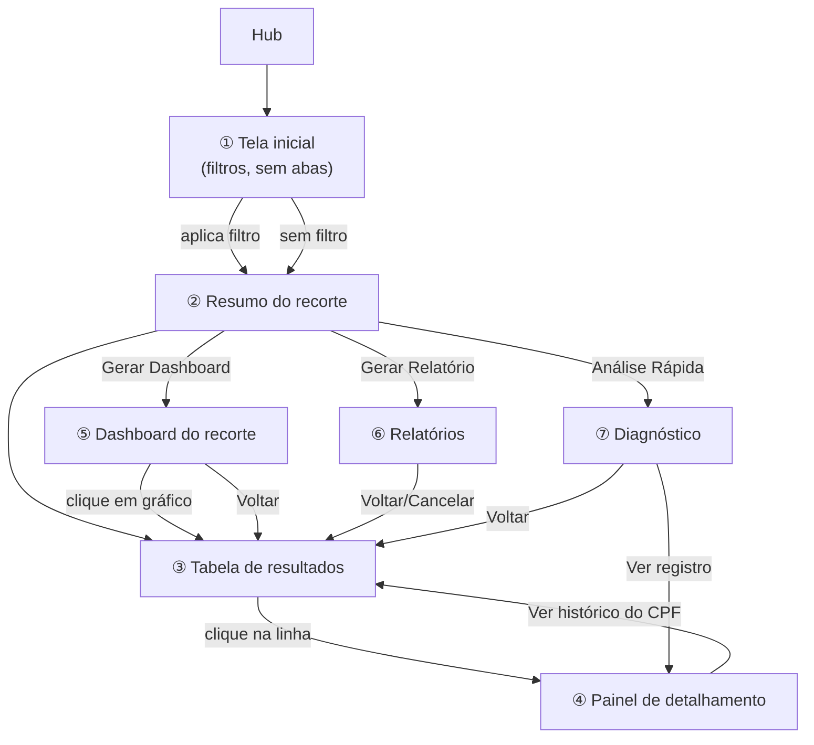

# Central Analítica — Wireframes da Experiência v2 (Sprint 19.2)

> **Sprint 19.2 — exclusivamente wireframes (ASCII, mesma convenção já
> usada em `ux-wireframes.md` e `ui-wireframes.md`). Nenhuma linha de
> código, nenhuma biblioteca de gráficos escolhida, nenhum endpoint
> criado ou alterado.** Constrói sobre o que foi aprovado em
> [`v2-arquitetura-funcional.md`](v2-arquitetura-funcional.md) (Sprint
> 19.1) — fluxo único filtros → resultados → ações → Dashboard/Relatório/
> Diagnóstico, sem abas fixas.

> ⚠️ **Todo valor numérico, nome, SEI ou data nestes wireframes é
> ilustrativo** — marcado sempre com o rótulo `[exemplo]` na primeira
> aparição em cada tela, para nunca ser confundido com dado real da
> Planilha Oficial.

> 🟡 **Convenção de pendência usada neste documento:** qualquer elemento
> que dependa de uma das 8 perguntas em aberto da Sprint 19.1
> (`v2-arquitetura-funcional.md` § 14) aparece marcado com `🟡 PENDENTE
> DE VALIDAÇÃO` e a referência à pergunta correspondente — nunca
> desenhado como se já fosse decisão fechada.

## Sumário

0. [O que este documento cobre](#0-o-que-este-documento-cobre)
1. [Tela inicial](#1-tela-inicial)
2. [Resumo do recorte](#2-resumo-do-recorte)
3. [Tabela de resultados](#3-tabela-de-resultados)
4. [Painel de detalhamento](#4-painel-de-detalhamento)
5. [Dashboard do recorte](#5-dashboard-do-recorte)
6. [Relatórios](#6-relatórios)
7. [Diagnóstico](#7-diagnóstico)
8. [Estados da interface](#8-estados-da-interface)
9. [Responsividade e usabilidade](#9-responsividade-e-usabilidade)
10. [Perguntas em aberto — impacto nos wireframes](#10-perguntas-em-aberto--impacto-nos-wireframes)
11. [Fluxos representados (mapa geral)](#11-fluxos-representados-mapa-geral)
12. [Riscos e decisões de UX](#12-riscos-e-decisões-de-ux)
13. [Resultado desta Sprint](#13-resultado-desta-sprint)

---

## 0. O que este documento cobre

Dá forma visual ao fluxo já aprovado em `v2-arquitetura-funcional.md` §§ 2–10.
Não redesenha o que já está homologado e sem mudança de comportamento —
tabela, paginação, ordenação e detalhamento reaproveitam a mecânica já
existente em `ui-wireframes.md` §§ 2–3, só reorganizados no novo layout
sem abas. Cada seção abaixo cita, quando aplicável, o que é novo nesta
Sprint e o que é herdado.

---

## 1. Tela inicial

### 1.1 Estrutura geral (sem abas fixas)

```
┌──────────────────────────────────────────────────────────────────────────┐
│ ← Hub                                              ⚙        [status app] │  Cabeçalho (herdado, sem mudança)
├──────────────────────────────────────────────────────────────────────────┤
│  🕐 Base Local sincronizada às 14:32 [exemplo]      [ Sincronizar agora ] │  Indicador de sincronização (herdado)
├──────────────────────────────────────────────────────────────────────────┤
│  Central Analítica                                                       │
│  Filtre os registros da Planilha Oficial e gere dashboards, relatórios   │
│  ou diagnósticos a partir do mesmo recorte.                              │
├──────────────────────────────────────────────────────────────────────────┤
│  FILTROS RÁPIDOS                                                          │
│  [ Hoje ] [ Últimos 7 dias ] [ Últimos 30 dias ] [ Mês atual ]            │
│  [ Mês anterior ] [ Ano inteiro ] [ Aguardando liberação 🟡 ]             │
│  [ Registros incompletos ] [ Possível inconsistência ]                   │
├──────────────────────────────────────────────────────────────────────────┤
│  FILTROS                                                    [ Avançados ▾]│
│  ┌────────────────────┐ ┌────────────────────┐ ┌─────────────────────┐  │
│  │ Período             │ │ SEI                 │ │ CPF                  │  │
│  │ [dd/mm/aaaa] até    │ │ [_______________]   │ │ [_______________]    │  │
│  │ [dd/mm/aaaa]        │ │                     │ │                       │  │
│  └────────────────────┘ └────────────────────┘ └─────────────────────┘  │
│                                                                            │
│                            [ Limpar filtros ]     [ Aplicar filtros ]    │
├──────────────────────────────────────────────────────────────────────────┤
│                                                                            │
│                (resultados aparecem aqui — § 2 e § 3)                    │
│                                                                            │
└──────────────────────────────────────────────────────────────────────────┘
```

- **Sem abas** — o topo da tela já é o painel de filtros, não uma escolha
  entre "Dashboard/Pesquisa/Relatórios" (correção da 19.1 § 0).
- **Filtros rápidos acima dos avançados** — atendem primeiro a intenção
  mais comum ("quero o mês atual", "quero o que está incompleto") sem
  exigir que o servidor do DIMCAC entenda o vocabulário de campos
  individuais.
- **Botões "Aplicar"/"Limpar" sempre visíveis**, nunca escondidos atrás de
  rolagem — mesmo com "Avançados" expandido (§ 1.3).
- Largura de referência mantida: `max-w-6xl` (herdado de `ux-wireframes.md`).

### 1.2 Apresentação simples e intuitiva (linguagem)

Nenhum rótulo usa termo técnico — mesma tabela de tradução já fixada em
`v2-arquitetura-funcional.md` § 10.2:

```
Campo técnico          Rótulo na tela
──────────────────────────────────────
servidor_situacao   →  "Situação do servidor"   (nunca só "Situação")
q                    →  "Buscar por SEI, CPF, servidor ou município"
periodo_inicial/final → "Período"
municipio            →  "Cidade (origem ou destino)"
```

### 1.3 Filtros avançados (painel expandido)

```
  FILTROS                                                      [ Avançados ▴]
  ┌────────────────────┐ ┌────────────────────┐ ┌─────────────────────┐
  │ Nome do servidor    │ │ Matrícula            │ │ Origem                │
  │ [_______________]   │ │ [_______________]    │ │ [_______________]     │
  └────────────────────┘ └────────────────────┘ └─────────────────────┘
  ┌────────────────────┐ ┌────────────────────┐ ┌─────────────────────┐
  │ Destino             │ │ Trecho (origem→dest.)│ │ Motivo                │
  │ [_______________]   │ │ [_______________]    │ │ [ Todos          ▾]  │
  └────────────────────┘ └────────────────────┘ └─────────────────────┘
  ┌────────────────────┐ ┌────────────────────┐
  │ Situação do servidor│ │ Valor (R$)            │
  │ [ Todas          ▾]│ │ [mínimo] até [máximo] │
  └────────────────────┘ └────────────────────┘
  ┌──────────────────────────────────────────────┐
  │ ☐ Somente registros com campos vazios 🟡      │
  │ ☐ Somente registros com possível inconsistência 🟡│
  └──────────────────────────────────────────────┘

                            [ Limpar filtros ]     [ Aplicar filtros ]
```

- **Origem, Destino, Trecho** — três campos novos (gap identificado na
  19.1 § 3.1); "Trecho" busca a concatenação "origem → destino", igual
  ao que a coluna `TRECHO` da planilha já representa.
- **Valor (R$)** — campo novo (faixa mínimo/máximo).
- Os dois checkboxes de "campos vazios"/"inconsistência" ficam
  **🟡 PENDENTE DE VALIDAÇÃO** — dependem da lista fechada de campos e
  do catálogo de diagnóstico ainda sem regra confirmada (19.1 § 14,
  perguntas 5 e 6). Aparecem no wireframe porque o pedido os lista
  explicitamente, mas o rótulo exato e o critério continuam em aberto.
- Combinação sempre por interseção (E) — mesma regra já aprovada, sem
  mudança (19.1 § 3.3).

### 1.4 Aplicar / Limpar

| Botão | Comportamento |
| --- | --- |
| **Aplicar filtros** | Dispara a busca com os valores atuais dos campos; sempre volta a tabela para a página 1. Nos campos de texto livre, a busca já ocorre com debounce ao digitar (herdado) — o botão existe para os campos que não disparam sozinhos (seleções, faixas) e para reforçar a ação de forma explícita a quem prefere não depender de comportamento implícito. |
| **Limpar filtros** | Remove todos os filtros de uma vez (inclusive busca global) e volta ao estado inicial (§ 8.1) — mesma função já existente (`limparFiltros`), sem mudança de comportamento. |

---

## 2. Resumo do recorte

Aparece assim que houver ao menos uma busca resolvida (com ou sem filtro
aplicado — o estado inicial "todos os registros" já é um recorte válido,
19.1 § 5):

```
├──────────────────────────────────────────────────────────────────────────┤
│  RECORTE ATUAL                                                            │
│  Filtros ativos:  [ Período: 01/06/2026–30/06/2026 ✕ ]  [ Destino:       │
│                     Araripina-PE ✕ ]                      [ Limpar tudo ]│
│                                                                            │
│  312 registros [exemplo]  ·  período considerado: 01/06/2026–30/06/2026  │
│  312 diárias · 298 servidores · 1 município · R$ 149.760,00 [exemplo]    │
├──────────────────────────────────────────────────────────────────────────┤
│  [ 📊 Gerar Dashboard ]   [ 📄 Gerar Relatório ]   [ 🔎 Análise Rápida ] │
└──────────────────────────────────────────────────────────────────────────┘
```

- **Filtros ativos** — chips removíveis individualmente (reaproveita
  `ChipsFiltroAtivo`, já existente), com "Limpar tudo" ao lado.
- **Período considerado** — sempre mostrado mesmo quando o filtro de
  período não foi explicitamente aplicado (nesse caso, mostra o menor e
  maior período encontrado no recorte, rotulado "período coberto pelos
  resultados" para não sugerir que foi um filtro escolhido pelo
  usuário).
- **Resumo básico** — contagem de diárias, servidores distintos,
  municípios distintos e valor total; todos calculados sobre o mesmo
  recorte (mesma fonte que alimenta os KPIs do Dashboard, § 5.1 — nunca
  dois números diferentes para a mesma pergunta).
- **Três ações sempre visíveis**, com estado habilitado/desabilitado
  conforme 19.1 § 5:

```
Recorte vazio (0 resultados):
  [ 📊 Gerar Dashboard ]   [ 📄 Gerar Relatório ]   [ 🔎 Análise Rápida ]
    (desabilitados, cinza)   (desabilitados, cinza)   (desabilitados, cinza)
  Ajuste os filtros para habilitar as ações.

Backend offline / Base Local indisponível:
  [ 📊 Gerar Dashboard ]   [ 📄 Gerar Relatório ]   [ 🔎 Análise Rápida ]
    (desabilitados)          (desabilitados)          (desabilitados)
  ⚠️ Aguardando o aplicativo ficar disponível para habilitar as ações.
```

---

## 3. Tabela de resultados

### 3.1 Estrutura com colunas essenciais

```
  312 resultados [exemplo] · ordenados por período (mais recente primeiro)     [ ⚙ Colunas ]

  ┌──────────────────┬──────────────────┬──────────────┬──────────────┬────────────┬───┐
  │ SEI               │ Servidor          │ Período       │ Destino       │ Valor       │   │
  ├──────────────────┼──────────────────┼──────────────┼──────────────┼────────────┼───┤
  │ 19.20...0720/2024 │ João da Silva     │ 08–10/06/2026 │ Araripina-PE  │ R$ 480,00  │ ▸ │
  │ 19.20...0331/2024 │ Maria Souza       │ 22–23/06/2026 │ Araripina-PE  │ —  ⚠        │ ▸ │
  │ 19.20...0512/2024 │ (não cadastrado) ⚠│ 03–05/06/2026 │ —  ⚠          │ R$ 308,19  │ ▸ │
  │ ...                │                   │                │                │             │   │
  └──────────────────┴──────────────────┴──────────────┴──────────────┴────────────┴───┘
                                                                    ‹ 1  2  3 … 13 ›
```

*(exemplos ilustrativos — os três primeiros nomes/SEI/valores não são
dados reais)*

### 3.2 Textos longos, trechos completos e tooltip

Colunas como "Motivo" e "Trecho" (quando ativadas, § 3.4) frequentemente
excedem a largura da célula — nunca truncadas silenciosamente:

```
  │ Motivo                                              │
  ├──────────────────────────────────────────────────────┤
  │ Participação em curso de capacitação e...  (cortado) │  ← célula com reticências
  └──────────────────────────────────────────────────────┘
        ↑ ao passar o mouse (ou focar via teclado):
  ┌───────────────────────────────────────────────────────────┐
  │ Participação em curso de capacitação e atualização      │
  │ profissional promovido pela Secretaria Estadual [exemplo]│
  └───────────────────────────────────────────────────────────┘
```

- Tooltip acessível (`title`/`aria-describedby`), acionável tanto por
  mouse quanto por foco de teclado — nunca só `:hover`.
- "Trecho completo" (origem → destino) segue a mesma regra quando
  ativado como coluna.

### 3.3 Rolagem horizontal e largura mínima

```
  ┌─ contêiner com rolagem própria (scroll-x) ──────────────────────────▶
  │ SEI │ Servidor │ Período │ Destino │ Valor │ Origem │ Trecho │ Motivo │ ...
  └────────────────────────────────────────────────────────────────────▶
     160px   220px     140px     140px    120px   140px    220px   240px
       (larguras mínimas — nunca colapsam menores, mesmo em tela estreita)
```

A página em volta da tabela **nunca** rola na horizontal — só o
contêiner da tabela (mesmo princípio de qualquer artefato responsivo do
app).

### 3.4 Configuração de colunas

```
  [ ⚙ Colunas ]
  ┌─────────────────────────────────────┐
  │ Sempre visíveis                       │
  │ ✓ SEI  ✓ Servidor  ✓ Período          │
  │ ✓ Destino  ✓ Valor                     │
  │ ─────────────────────────────────────│
  │ Opcionais                             │
  │ ☐ Origem        ☐ Trecho completo     │
  │ ☐ Motivo         ☐ Situação do servidor│
  │ ☐ Matrícula      ☐ CPF (mascarado)     │
  │ ☐ Doc. origem    ☐ Transporte           │
  │                                        │
  │                    [ Aplicar ]        │
  └─────────────────────────────────────┘
```

Preferência de colunas visíveis é local (não é dado de negócio — não
precisa de endpoint novo, 19.1 § 4.2).

### 3.5 Ordenação e paginação

Herdado sem mudança de comportamento (`ui-wireframes.md` § 2) — cabeçalho
clicável alterna asc/desc, paginação sempre no servidor:

```
  │ SEI ▾ │ Servidor │ Período │ ...
     ↑ seta indica coluna/ordem ativa

                                                    ‹ 1  2  3 … 13 ›
```

### 3.6 Destaque de campos vazios

```
  │ Destino       │
  ├───────────────┤
  │ —  ⚠           │  ← ícone âmbar (não vermelho — RN-08), tooltip:
  └───────────────┘     "Campo vazio. Ver diagnóstico do registro."
```

Cor âmbar/atenção, nunca vermelha (herdado de RN-08 — vermelho é
reservado a falha técnica). Qual campo vazio "conta" para o destaque
depende da lista fechada ainda pendente — 🟡 **PENDENTE DE VALIDAÇÃO**
(19.1 § 14, pergunta 5). Neste wireframe, Destino e Valor ilustram o
padrão visual, não uma lista definitiva.

### 3.7 Destaque de inconsistências

```
  │ SEI                │ ...  │   │
  ├────────────────────┼──────┼───┤
  │ 19.20...0331/2024 ⚠│ ...  │ ▸ │  ← linha inteira com marcador de atenção
  └────────────────────┴──────┴───┘
        ↑ tooltip: "1 possível inconsistência — ver detalhes"
```

Mesmo ícone/cor do Diagnóstico (§ 7) — a tabela nunca inventa um estilo
próprio para "inconsistência", sempre reflete o mesmo catálogo.

### 3.8 Ação para abrir detalhes

Clique em qualquer ponto da linha (ou `Enter`/`Espaço` com foco de
teclado) abre o painel de detalhamento (§ 4) — mesmo comportamento já
existente e testado (`onSelecionarLinha`), sem mudança.

---

## 4. Painel de detalhamento

Painel lateral sobre a lista (mesma mecânica herdada de
`ui-wireframes.md` § 3 — nunca troca de tela inteira):

```
                                                    ┌─────────────────────────────────┐
                                                    │  Diária                       ✕ │
  (tabela ao fundo,                                ├─────────────────────────────────┤
   levemente escurecida)                           │  SEI                              │
                                                    │  19.20.0903.0030720/2024-36 [ex.]│
                                                    ├─────────────────────────────────┤
                                                    │  Servidor                         │
                                                    │  João da Silva [exemplo]          │
                                                    │  Matrícula: 123456 [exemplo]       │
                                                    │  CPF: ***.***.***-11              │
                                                    │  Situação do servidor: Em exercício│
                                                    ├─────────────────────────────────┤
                                                    │  Período                          │
                                                    │  08/06/2026 – 10/06/2026 [exemplo]│
                                                    ├─────────────────────────────────┤
                                                    │  Origem → Destino                  │
                                                    │  Recife-PE → Araripina-PE          │
                                                    │  Trecho completo:                  │
                                                    │  "Recife-PE - Araripina-PE"        │
                                                    ├─────────────────────────────────┤
                                                    │  Motivo                           │
                                                    │  Participação em curso de          │
                                                    │  capacitação [exemplo]             │
                                                    ├─────────────────────────────────┤
                                                    │  Valores                          │
                                                    │  Total das diárias: R$ 480,00     │
                                                    │  Transporte: Aéreo [exemplo]        │
                                                    ├─────────────────────────────────┤
                                                    │  ⚠ Campos vazios                   │
                                                    │  — Nenhum neste registro           │
                                                    │    (ou lista, se houver)           │
                                                    ├─────────────────────────────────┤
                                                    │  🔎 Avisos e diagnósticos          │
                                                    │  ⚠ Atenção — DH ainda não emitido  │
                                                    │    (processo em fase de liquidação)│
                                                    │                                    │
                                                    │  [ Ver histórico deste CPF ]       │
                                                    │  [ Copiar SEI ]                    │
                                                    └─────────────────────────────────┘
```

- **Ordem dos blocos** segue a ordem pedida: SEI, Servidor (com CPF
  mascarado, matrícula, situação cadastral), Período, Origem/Destino/
  Trecho completo, Motivo, Valores, Campos vazios, Avisos e diagnósticos.
- **CPF sempre mascarado** — decisão já vinculante, herdada sem mudança
  (`ui-wireframes.md` § 3, "sem mecanismo de revelar nesta fase").
- **"Situação do servidor"**, nunca só "Situação" — mesma correção de
  nomenclatura da 19.1 § 3.1/§ 10.2.
- **Bloco "Avisos e diagnósticos"** é novo nesta Sprint — mostra só os
  diagnósticos do catálogo (§ 7) relacionados a **este** registro
  específico, com a mesma explicação rastreável (nunca uma frase
  genérica desconectada da regra real).
- **Ações novas** (19.1 § 4.2): "Ver histórico deste CPF" aplica o filtro
  `cpf` desta linha e volta para a tabela (reaproveita o filtro já
  existente, sem endpoint novo); "Copiar SEI" copia o texto para a área
  de transferência.

---

## 5. Dashboard do recorte

> Todos os números abaixo são **exemplos ilustrativos**, marcados
> `[exemplo]`. Nenhuma biblioteca de gráfico foi escolhida — os desenhos
> abaixo representam a intenção visual, não uma implementação.

### 5.1 Estrutura geral

```
┌──────────────────────────────────────────────────────────────────────────┐
│  ← Voltar aos resultados                          312 registros [exemplo]│
│  Dashboard · Período: 01/06/2026–30/06/2026 · Destino: Araripina-PE      │
├──────────────────────────────────────────────────────────────────────────┤
│  KPIs (§5.2)                                                              │
├──────────────────────────────────────────────────────────────────────────┤
│  Gráficos (§5.3)                                                          │
├──────────────────────────────────────────────────────────────────────────┤
│                                        [ Exportar dashboard ▾ ]           │
└──────────────────────────────────────────────────────────────────────────┘
```

### 5.2 KPIs

```
  ┌───────────────┐ ┌───────────────┐ ┌───────────────┐ ┌───────────────┐
  │ Total de       │ │ Total de       │ │ Total de       │ │ Total de       │
  │ diárias        │ │ servidores     │ │ municípios 🟡  │ │ valor          │
  │ 312 [exemplo]  │ │ 298 [exemplo]  │ │  1  [exemplo]  │ │ R$ 149.760,00  │
  └───────────────┘ └───────────────┘ └───────────────┘ └───────────────┘
  ┌───────────────┐ ┌───────────────┐ ┌───────────────┐ ┌───────────────┐
  │ Valor médio    │ │ Completos      │ │ Incompletos 🟡│ │ Aguardando     │
  │ R$ 480,00      │ │ 289 [exemplo]  │ │ 23  [exemplo]  │ │ liberação 🟡   │
  │ [exemplo]      │ │                │ │                │ │ 4   [exemplo]  │
  └───────────────┘ └───────────────┘ └───────────────┘ └───────────────┘
```

*"Total de processos" não aparece como cartão separado — é o mesmo valor
que "Total de diárias" (1 SEI = 1 diária, 19.1 § 6.1); mostrar os dois
lado a lado sugeriria uma diferença que não existe no dado.*

- 🟡 **Total de municípios** — pendente de definir se conta origem,
  destino ou união (19.1 § 14, pergunta 2).
- 🟡 **Incompletos** e 🟡 **Aguardando liberação** — pendentes da lista
  fechada de campos e do limiar de tempo (19.1 § 14, perguntas 4 e 5).

### 5.3 Gráficos

```
┌─ Evolução por período [exemplo] ──────────┐  ┌─ Valores por período [exemplo] ───────┐
│     ▂▃▅▆█▇▅▃▂                              │  │   R$ ▂▃▅▆█▇▅▃▂                         │
│  jan fev mar abr mai jun                    │  │   jan fev mar abr mai jun               │
└────────────────────────────────────────────┘  └────────────────────────────────────────┘

┌─ Ranking de servidores (top 5) [exemplo] ─┐  ┌─ Ranking de municípios (top 5) [exemplo]┐
│ João da Silva      ████████ 12             │  │ Araripina-PE      ██████████ 89          │
│ Maria Souza        ██████   9               │  │ Petrolina-PE      ███████    62          │
│ ...                                          │  │ ...                                       │
└────────────────────────────────────────────┘  └────────────────────────────────────────┘

┌─ Distribuição por motivo [exemplo] ───────┐  ┌─ Distribuição por situação do servidor ─┐
│  ◕ Capacitação        41%                  │  │  ◕ Em exercício        94%               │
│  ◔ Reunião             33%                  │  │  ◔ Não informado        6%                │
│  ◑ Fiscalização        26%                  │  │  [exemplo]                                │
└────────────────────────────────────────────┘  └────────────────────────────────────────┘

┌─ Origem × Destino (principais pares) [ex.]┐  ┌─ Completos × incompletos [exemplo] ───────┐
│ Recife-PE → Araripina-PE        ██████ 58  │  │  ████████████████░░░░  289 completos      │
│ Recife-PE → Petrolina-PE        ████   34  │  │                        23 incompletos 🟡  │
│ ...                                          │  │                                            │
└────────────────────────────────────────────┘  └────────────────────────────────────────┘
```

Layout em grade 2 colunas (empilha em 1 coluna em janelas estreitas — §9).

### 5.4 Interação: clique em gráfico refina a tabela

```
  Usuário clica na barra "jun" do gráfico "Evolução por período":

  ┌─────────────────────────────┐        aplica filtro adicional
  │     ▂▃▅▆[█]▇▅▃▂              │  ──▶   periodo = junho/2026
  │  jan fev mar abr [mai] jun   │        (soma ao recorte atual,
  └─────────────────────────────┘         nunca substitui)
                                            │
                                            ▼
                              ← Voltar aos resultados
                              312 registros [exemplo]
                              Filtros ativos: [Período: jun/2026 ✕] [Destino: Araripina-PE ✕]
```

### 5.5 Desfazer filtro do gráfico

O filtro adicionado pelo clique vira um chip comum em "Filtros ativos"
(§ 2) — removê-lo (✕) desfaz exatamente esse refinamento, sem afetar os
demais filtros. Nenhuma UI nova: mesmo mecanismo de `ChipsFiltroAtivo`.

### 5.6 Retorno ao recorte original

"← Voltar aos resultados" (topo, § 5.1) sempre leva à tabela com o
recorte **como estava antes de entrar no Dashboard** — não desfaz
refinamentos feitos por clique em gráfico (esses já viraram filtros
reais do recorte, § 5.4/§ 5.5); só sai da visualização de Dashboard.

### 5.7 Exportação visual

```
  [ Exportar dashboard ▾ ]
  ┌─────────────────────┐
  │ Exportar como PDF     │
  │ Exportar como imagem  │
  │ Imprimir                │
  └─────────────────────┘
```

Mesmo timestamp de sincronização impresso no rodapé do arquivo exportado
(regra vinculante herdada, `README.md` § 0.1 item 6).

---

## 6. Relatórios

### 6.1 Janela de escolha do tipo de relatório

```
┌──────────────────────────────────────────────────────────────────────────┐
│  Gerar relatório                                                     ✕   │
│  Recorte atual: 312 registros [exemplo] · 01/06/2026–30/06/2026          │
├──────────────────────────────────────────────────────────────────────────┤
│  Tipo de relatório                                                        │
│  ( ) Executivo        — resumo de 1 página para apresentar à chefia       │
│  ( ) Detalhado         — todos os indicadores, gráficos e a tabela        │
│  ( ) Financeiro        — foco em valores, sem dados cadastrais            │
│  ( ) Por servidor      — agrupado por pessoa                              │
│  ( ) Por município     — agrupado por cidade de destino                   │
│  ( ) Por situação      — agrupado por situação do servidor                │
│  ( ) Inconsistências   — só os registros sinalizados no Diagnóstico       │
│  ( ) Qualidade dos dados — % completos/incompletos, por tipo de lacuna    │
├──────────────────────────────────────────────────────────────────────────┤
│  Formato                                                                  │
│  ( ) PDF    ( ) Excel (.xlsx)    ( ) CSV                                  │
├──────────────────────────────────────────────────────────────────────────┤
│  Conteúdo a incluir                                                       │
│  ☑ Indicadores    ☑ Gráficos*    ☑ Tabela completa    ☑ Inconsistências   │
│  *Gráficos disponíveis apenas para PDF                                    │
├──────────────────────────────────────────────────────────────────────────┤
│                                    [ Cancelar ]     [ Pré-visualizar ]    │
└──────────────────────────────────────────────────────────────────────────┘
```

### 6.2 Pré-visualização

```
┌──────────────────────────────────────────────────────────────────────────┐
│  Pré-visualização — Relatório Executivo (PDF)                        ✕   │
├──────────────────────────────────────────────────────────────────────────┤
│  ┌────────────────────────────────────────────────────────────────┐     │
│  │                                                                    │     │
│  │        (miniatura da estrutura do PDF — § 6.4)                   │     │
│  │                                                                    │     │
│  └────────────────────────────────────────────────────────────────┘     │
├──────────────────────────────────────────────────────────────────────────┤
│                          [ ← Voltar ]        [ Gerar relatório ]         │
└──────────────────────────────────────────────────────────────────────────┘
```

### 6.3 Confirmação, progresso, sucesso e erro

```
Progresso:
  ┌────────────────────────────────────┐
  │  Gerando relatório...                │
  │  ▓▓▓▓▓▓▓▓▓░░░░░░░░░░  45%             │
  └────────────────────────────────────┘

Sucesso:
  ┌────────────────────────────────────┐
  │  ✅ Relatório gerado com sucesso     │
  │  relatorio-executivo-jun2026.pdf     │
  │  [exemplo]                           │
  │                                       │
  │  [ Abrir arquivo ]  [ Salvar como ]  │
  └────────────────────────────────────┘

Erro:
  ┌────────────────────────────────────┐
  │  ⚠️ Não foi possível gerar o          │
  │  relatório.                          │
  │                                       │
  │  [ Tentar novamente ]                │
  └────────────────────────────────────┘
```

Mesmo padrão visual de progresso/erro já usado no Processamento
(`BotaoArquivo`/relatório de lote, reaproveitado — sem componente novo
de progresso).

### 6.4 Estrutura visual do PDF executivo

```
┌────────────────────────────────────────┐
│  [Identidade visual do app]              │  ← Capa
│  Relatório Executivo — Central Analítica │
│  Gerado em 03/08/2026 14:40 [exemplo]    │
├────────────────────────────────────────┤
│  Período: 01/06/2026 – 30/06/2026        │
│  Filtros aplicados:                      │
│   · Destino: Araripina-PE                │
├────────────────────────────────────────┤
│  Indicadores                              │
│  [ grade de KPIs, mesmo conteúdo do §5.2]│
├────────────────────────────────────────┤
│  Gráficos                                 │
│  [ 1–2 gráficos-chave, mesmo do §5.3 ]    │
├────────────────────────────────────────┤
│  Inconsistências                          │
│  [ contagem por tipo, mesmo catálogo §7 ]│
├────────────────────────────────────────┤
│  Gerado em: 03/08/2026 14:40 [exemplo]   │
│  Última sincronização: 03/08/2026 14:32  │
│  [exemplo]                                │
└────────────────────────────────────────┘
```

Rodapé com data de geração **e** última sincronização é obrigatório em
todo artefato exportado (regra vinculante herdada, não uma escolha
desta Sprint).

---

## 7. Diagnóstico

### 7.1 Resumo de qualidade dos dados

```
┌──────────────────────────────────────────────────────────────────────────┐
│  ← Voltar aos resultados                          312 registros [exemplo]│
│  Análise Rápida · Período: 01/06/2026–30/06/2026 · Destino: Araripina-PE │
├──────────────────────────────────────────────────────────────────────────┤
│   ●  Esperado           ●  Atenção            ●  Inconsistência          │
│      289 (93%)              19 (6%)               4 (1%)   [exemplo]     │
│  ████████████████████████████░░░░░░░░░░█                                  │
├──────────────────────────────────────────────────────────────────────────┤
│  Nenhum problema crítico encontrado. 23 registros merecem atenção ou      │
│  conferência manual — veja a lista abaixo.                                │
└──────────────────────────────────────────────────────────────────────────┘
```

- Cores: **esperado** = neutro/verde suave; **atenção** = âmbar; **
  inconsistência** = laranja mais forte — **nunca vermelho** (RN-08:
  vermelho fica só para falha técnica real, ex. backend indisponível).

### 7.2 Lista de registros afetados

```
  ┌────────────────────┬──────────────┬────────────────────────┬───────────┐
  │ SEI                 │ Classificação │ Campo problemático       │           │
  ├────────────────────┼──────────────┼────────────────────────┼───────────┤
  │ 19.20...0512/2024   │ ● Atenção     │ DH                       │ ▸ Ver     │
  │ 19.20...0331/2024   │ ● Atenção     │ Destino                  │ ▸ Ver     │
  │ 19.20...0890/2024   │ ● Inconsist.  │ CPF + Período (duplicado)│ ▸ Ver     │
  │ ...                  │               │                          │           │
  └────────────────────┴──────────────┴────────────────────────┴───────────┘
  [exemplo — SEI e ocorrências ilustrativos]
```

Clicar em "▸ Ver" abre o mesmo painel de detalhamento (§ 4), já com o
bloco "Avisos e diagnósticos" em foco.

### 7.3 Cartão de diagnóstico individual (motivo provável + ação recomendada)

**Respeitando a correção já fixada na 19.1 (nunca confundir as duas
regras):**

```
Caso 1 — DH vazio (fase de liquidação, NUNCA confundido com PASSAR DIA):
┌──────────────────────────────────────────────────────────────────┐
│  ● Atenção — Documento Hábil (DH) ainda não emitido                 │
│                                                                        │
│  Campo problemático: DH                                              │
│  Motivo provável: este processo ainda não chegou à fase de           │
│  liquidação — a extração do PDF só grava o DH quando o Despacho de   │
│  Validação já existe. Isso é esperado para processos recentes.       │
│                                                                        │
│  Ação recomendada: nenhuma ação imediata; se o processo já é         │
│  antigo, confira manualmente o andamento no SEI. 🟡 PENDENTE DE      │
│  VALIDAÇÃO — limiar de "antigo demais" ainda não definido            │
│  (v2-arquitetura-funcional.md § 14, pergunta 4).                     │
└──────────────────────────────────────────────────────────────────┘

Caso 2 — PASSAR DIA (liberação pela data, regra DIFERENTE de DH):
┌──────────────────────────────────────────────────────────────────┐
│  ● Esperado — Aguardando janela de liberação                        │
│                                                                        │
│  Campo problemático: nenhum (não é ausência de dado — é uma janela   │
│  de tempo prevista pela própria planilha)                            │
│  Motivo provável: a coluna "PASSAR DIA" (período inicial menos 15    │
│  dias) ainda não foi atingida — o processo aguarda essa data antes    │
│  de seguir no fluxo administrativo (regra confirmada, RN-06).        │
│                                                                        │
│  Ação recomendada: nenhuma — aguardar a data calculada.               │
└──────────────────────────────────────────────────────────────────┘

Caso 3 — sem regra segura:
┌──────────────────────────────────────────────────────────────────┐
│  ● Inconsistência — Valor fora do padrão observado                  │
│                                                                        │
│  Campo problemático: Valor total das diárias                         │
│  Motivo provável: Motivo não determinado automaticamente.             │
│  Recomenda-se conferência manual.                                     │
│                                                                        │
│  Ação recomendada: conferir manualmente contra a Tabela de Valores   │
│  por estado de destino.                                                │
└──────────────────────────────────────────────────────────────────┘
```

- **DH vazio** e **PASSAR DIA** aparecem sempre com título, campo e
  explicação distintos — nunca no mesmo cartão, nunca com texto que
  misture as duas regras (requisito explícito desta Sprint).
- Quando não houver regra documentada suficiente (Caso 3), o texto é
  **sempre e exatamente** "Motivo não determinado automaticamente.
  Recomenda-se conferência manual." — nunca uma explicação inventada
  para preencher o espaço.

### 7.4 Legenda de classificação (fixa, sempre visível)

```
  ●  Esperado        — o vazio/padrão já tem uma regra confirmada que o explica.
  ●  Atenção         — vale conferência manual; não é, por si só, um erro confirmado.
  ●  Inconsistência  — divergência que não tem explicação esperada conhecida.
```

---

## 8. Estados da interface

```
① Nenhum filtro aplicado (estado inicial):
   Painel de filtros aberto, tabela mostrando os registros mais recentes
   (sem filtro) — nunca uma tela em branco. Resumo do recorte (§2) já
   presente, rotulado "todos os registros".

② Carregando:
   ┌────────────────────┬──────────────────┬───────────────┬────────────┐
   │ ░░░░░░░░░░░░░░░░░  │ ░░░░░░░░░░░░░░░  │ ░░░░░░░░░░░░  │ ░░░░░░░░░  │
   └────────────────────┴──────────────────┴───────────────┴────────────┘
   (esqueleto — mesmo padrão herdado, `ui-wireframes.md` §5)

③ Sem resultados:
                          🔍
        Nada encontrado para os filtros aplicados.
     Ajuste os filtros ou use "Limpar filtros" para recomeçar.
   (ações de Dashboard/Relatório/Diagnóstico desabilitadas, §2)

④ Erro:
   ⚠️  Não foi possível carregar os resultados. [ Tentar novamente ]

⑤ Resultados encontrados:
   Resumo do recorte (§2) + tabela (§3), ações habilitadas.

⑥ Dashboard sendo gerado:
   ┌────────────────────────────────────┐
   │  Calculando indicadores...            │
   │  (esqueleto nos cartões de KPI e nas  │
   │   áreas de gráfico, mesmo padrão de ②)│
   └────────────────────────────────────┘

⑦ Relatório sendo gerado:
   Ver §6.3 (barra de progresso).

⑧ Diagnóstico sem problemas:
   ┌────────────────────────────────────┐
   │   ✅ Nenhuma inconsistência          │
   │   encontrada neste recorte.           │
   │   312 de 312 registros classificados  │
   │   como esperado. [exemplo]            │
   └────────────────────────────────────┘

⑨ Diagnóstico com inconsistências:
   Ver §7.1/§7.2 — resumo + lista, nunca cor vermelha (RN-08).
```

---

## 9. Responsividade e usabilidade

### 9.1 Janela padrão do Electron

Layout desenhado para a largura de referência `max-w-6xl` (herdada) —
painel de filtros, resumo do recorte e tabela cabem sem rolagem
horizontal da página; só a tabela (quando colunas opcionais estão
ativas, §3.3) ou os wireframes de dashboard com muitos gráficos rolam
internamente.

### 9.2 Textos longos

Nunca cortados sem tooltip (§ 3.2) — nome de servidor, motivo e trecho
completo são os campos mais sujeitos a isso; célula com `ellipsis` +
tooltip acessível é o padrão único para qualquer texto longo em
qualquer tela deste módulo (tabela, cartão de diagnóstico, painel de
detalhamento).

### 9.3 Muitos filtros

```
  FILTROS                                                    [ Avançados ▾]
  (colapsado por padrão — mesma decisão herdada de `PainelFiltrosAvancados`)

  Quando expandido, grid responsivo:
  - Janela larga:   3 colunas de campo
  - Janela média:   2 colunas
  - Janela estreita: 1 coluna (empilhado)
```

Os filtros rápidos (§ 1.1) sempre ficam visíveis mesmo com "Avançados"
colapsado — cobrem o caso de uso mais comum sem exigir expandir nada.

### 9.4 Tabela larga

Contêiner de rolagem próprio (§ 3.3) com sombra sutil nas bordas
esquerda/direita quando há conteúdo cortado fora da área visível — sinal
visual de que existe mais coluna para o lado, sem depender só da barra
de rolagem.

### 9.5 Sem exigir conhecimento técnico

| Prática adotada | Onde se aplica |
| --- | --- |
| Nenhum termo de banco de dados/código na tela | Todos os rótulos (§ 1.2) |
| Nenhum código de erro cru | Estados de erro sempre em frase (§ 8) |
| Filtros rápidos com nome de intenção, não de campo | "Registros incompletos", não "campos_vazios=true" (§ 1.1) |
| Diagnóstico sempre explica o "porquê" em linguagem natural | § 7.3 |
| Nenhuma tela pede para o usuário "escolher uma query" | O usuário só vê filtros de negócio, nunca uma sintaxe de consulta |

---

## 10. Perguntas em aberto — impacto nos wireframes

Nenhuma das 8 perguntas da 19.1 (`v2-arquitetura-funcional.md` § 14) foi
tratada como decidida neste documento. Onde afetam um elemento visual,
o elemento está marcado `🟡` e listado abaixo com as alternativas
possíveis — a escolha final cabe ao DIMCAC, não a este documento.

| # | Pergunta (19.1 § 14) | Onde aparece aqui | Alternativas propostas (nenhuma pré-aprovada) |
| --- | --- | --- | --- |
| 1 | "Situação" deve continuar só cadastral, ou existe "situação do processo"? | Rótulo "Situação do servidor" em toda a tela (§ 1.2, § 4, § 3.4) | (a) manter como está, sempre "Situação do servidor"; (b) se o DIMCAC confirmar uma futura coluna de status de processo, ela ganharia rótulo e filtro próprios, sem reaproveitar "situação". |
| 2 | "Total de municípios" conta origem, destino ou união? | KPI do Dashboard (§ 5.2) | (a) união (mesmo critério do filtro "Município"); (b) só destino (mais comum em relatório de viagem); (c) os dois lado a lado como dois KPIs distintos. |
| 3 | "Aguardando liberação" calculado em consulta ou persistido? | Filtro rápido (§ 1.1) e KPI (§ 5.2) — não muda a aparência, só a performance por trás | Sem impacto visual direto — decisão de implementação (19.4). |
| 4 | Limiar de "processo antigo demais sem DH"? | Cartão de diagnóstico Caso 1 (§ 7.3) | (a) limiar fixo em dias (ex. 60); (b) sem limiar — todo DH vazio fica "atenção" até o DIMCAC decidir caso a caso; (c) usar `DMTC`/`DMOF` como referência em vez de um número fixo de dias. |
| 5 | Lista fechada de campos para "incompleto"? | Checkbox "registros com campos vazios" (§ 1.3), destaque de vazio (§ 3.6), KPI "Incompletos" (§ 5.2) | (a) destino + valor + matrícula + situação; (b) lista maior incluindo motivo/transporte; (c) configurável pelo próprio DIMCAC futuramente (fora de escopo desta fase). |
| 6 | Existe regra de faixa de valor aceitável por estado? | Diagnóstico "dados incoerentes" (§ 7.3, Caso 3) | (a) sem regra — permanece sempre "motivo não determinado"; (b) o DIMCAC define uma tolerância percentual sobre a Tabela de Valores. |
| 7 | Migrar também repositórios da Conferência para SQLite? | Sem impacto visual nesta tela | — |
| 8 | Controle de acesso/perfil no app? | Sem impacto visual nesta tela (CPF já mascarado por padrão, sem depender de perfil) | — |

---

## 11. Fluxos representados (mapa geral)



---

## 12. Riscos e decisões de UX

| # | Risco / decisão | Tratamento |
| --- | --- | --- |
| 1 | Painel de filtros avançados com muitos campos (§ 1.3) pode intimidar um usuário não técnico se aberto por padrão. | Colapsado por padrão (herdado de `PainelFiltrosAvancados`) — filtros rápidos cobrem o caso comum sem exigir abrir o avançado. |
| 2 | Checkboxes "campos vazios"/"inconsistência" (§ 1.3) dependem de regra ainda não fechada (perguntas 5/6) — risco de implementar antes da hora. | Marcados `🟡`; nenhuma implementação desta Sprint; ficam bloqueados para a 19.4/19.5 até a regra ser confirmada. |
| 3 | Confundir "DH vazio" com "PASSAR DIA" continua sendo o erro mais fácil de cometer ao escrever o texto de diagnóstico (mesmo risco identificado na 19.1). | Cartões de diagnóstico (§ 7.3) desenhados com título, campo problemático e explicação sempre diferentes entre os dois casos, lado a lado neste documento para servir de referência à implementação. |
| 4 | Botão "Aplicar filtros" ao lado de campos que já aplicam sozinhos (debounce) pode parecer redundante. | Mantido porque cobre os campos que não têm debounce (seleções, faixas, checkboxes) e dá uma ação explícita para quem prefere não depender de comportamento implícito — mesma razoação de "Limpar filtros" já existir separado de remover chip a chip. |
| 5 | Dashboard com 8 gráficos (§ 5.3) pode ficar denso numa janela padrão do Electron. | Grade 2 colunas com rolagem vertical da seção (não da página inteira) — mesmo padrão de qualquer lista longa do app. |

---

## 13. Resultado desta Sprint

1. **Tela inicial** sem abas fixas, com filtros rápidos e avançados — § 1.
2. **Resumo do recorte** com filtros ativos, período, contagem, resumo e
   as 3 ações — § 2.
3. **Tabela de resultados** com colunas configuráveis, tooltip, rolagem
   horizontal, destaques de vazio/inconsistência — § 3.
4. **Painel de detalhamento** completo, incluindo o novo bloco de avisos
   e diagnósticos por registro — § 4.
5. **Dashboard do recorte**: KPIs, 8 gráficos, interação de clique,
   desfazer, retorno e exportação — § 5.
6. **Relatórios**: escolha de tipo/formato, pré-visualização, progresso,
   sucesso/erro, estrutura do PDF executivo — § 6.
7. **Diagnóstico**: resumo de qualidade, classificação em 3 níveis, lista
   de registros, cartões individuais respeitando a distinção DH ×
   PASSAR DIA — § 7.
8. **9 estados de interface** cobertos — § 8.
9. **Responsividade e usabilidade** documentadas para a janela do
   Electron, textos longos, muitos filtros e tabela larga — § 9.
10. **8 perguntas em aberto** mapeadas contra os elementos visuais que
    dependem delas, sem nenhuma tratada como decidida — § 10.

**Confirmação:** nenhum código foi escrito ou alterado nesta Sprint;
nenhum endpoint foi criado; nenhuma biblioteca de gráficos foi escolhida.
Aguardando aprovação explícita antes da Sprint 19.3 (Demonstração
Visual).
