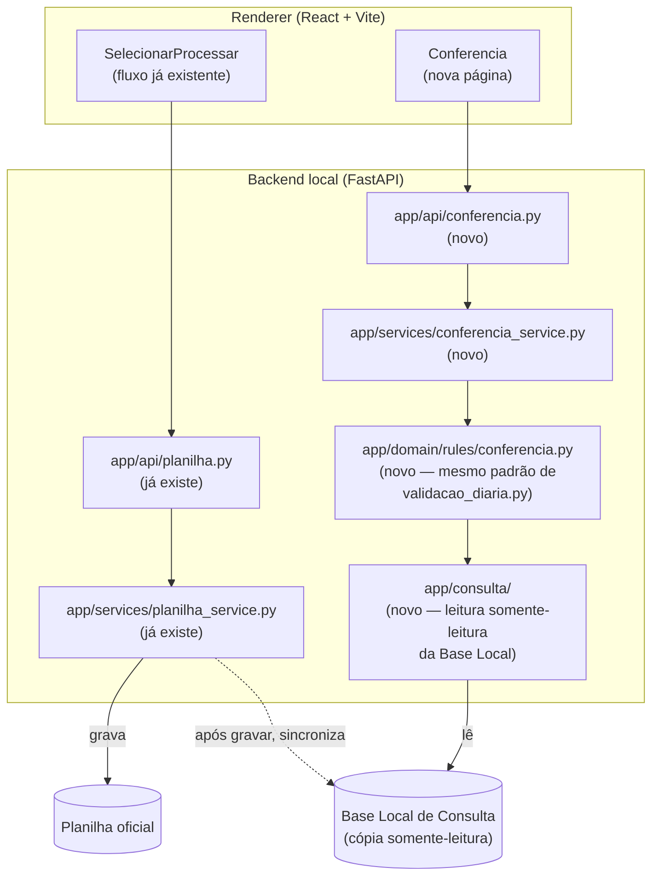
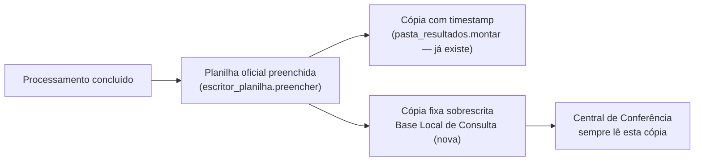
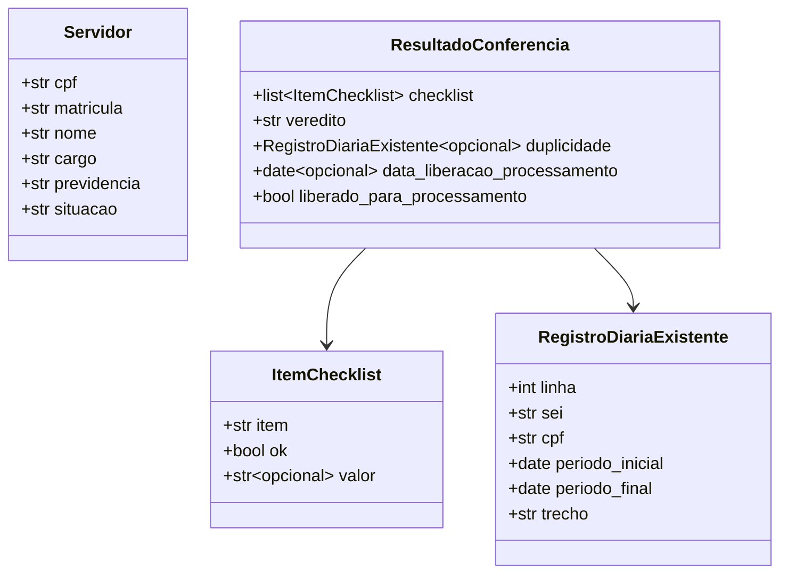

# Central Inteligente de Conferência — Engenharia Reversa e Proposta Arquitetural

> **Sprint 11 — exclusivamente análise, engenharia reversa e documentação.**
> Nenhuma linha de código de produção foi alterada nesta Sprint. Toda regra
> listada aqui foi extraída diretamente de fórmulas reais da planilha oficial
> (fixture sintética [`tests/e2e/fixtures/planilha_copia_teste.xlsx`](../../tests/e2e/fixtures/planilha_copia_teste.xlsx),
> estrutura idêntica à planilha de produção, dados 100% sintéticos desde a
> Sprint 10). Onde a fórmula não deixava a regra de negócio 100% explícita,
> isso ficou sinalizado como **pendente de validação** até ser confirmado
> pelo especialista do processo — nada foi implementado ou assumido por
> interpretação. Ver [§ 0](#0-decisões-oficiais-2026-07-21) para todas as
> decisões já confirmadas pelo DIMCAC — **todas as pendências desta Sprint,
> incluindo a RN-04, foram resolvidas em 2026-07-21** (§ 6 permanece no
> documento só como registro histórico das perguntas originais).

## Sumário

0. [Decisões oficiais (2026-07-21)](#0-decisões-oficiais-2026-07-21)
1. [Contexto](#1-contexto)
2. [Estrutura da planilha oficial](#2-estrutura-da-planilha-oficial)
3. [Regras de negócio identificadas](#3-regras-de-negócio-identificadas)
4. [Proposta arquitetural — Central Inteligente de Conferência](#4-proposta-arquitetural--central-inteligente-de-conferência)
5. [Riscos e pontos de atenção](#5-riscos-e-pontos-de-atenção)
6. [Perguntas em aberto antes da Sprint 12](#6-perguntas-em-aberto-antes-da-sprint-12)

Backlog de evoluções futuras: [`docs/backlog/`](../backlog/).

---

## 0. Decisões oficiais (2026-07-21)

Respostas do DIMCAC às perguntas levantadas na primeira versão deste
documento. Cada uma já foi propagada para as seções correspondentes abaixo —
esta tabela é só o resumo executivo, com a versão completa da decisão.

| # | Tema | Decisão oficial | Onde foi propagada |
| --- | --- | --- | --- |
| 1 | Chave de duplicidade | Segue exatamente a regra da planilha: **CPF + Período Inicial + Período Final**. Nenhuma regra nova baseada em uma única data. | [RN-02](#rn-02-detecção-de-duplicidade-de-diária), [§ 4.4](#44-contrato-de-api-proposta) |
| 2 | Tratamento do "Complemento de Diária" | A Central **nunca aprova nem reprova** — apenas informa que existe um registro anterior correspondente. A decisão sobre o caso é sempre administrativa, do DIMCAC. | [RN-07](#rn-07-exceção-operacional--complemento-de-diária), [RN-08](#rn-08--princípio-arquitetural-a-central-inteligente-apenas-auxilia-a-decisão) |
| 3 | Semântica visual da duplicidade | Mantém o Design System já aprovado: duplicidade é **Revisão Recomendada (âmbar)**. Vermelho fica reservado só para erro técnico do sistema. | [§ 4.4](#44-contrato-de-api-proposta), [§ 5](#5-riscos-e-pontos-de-atenção) |
| 4 | Colunas `DMTC` e `DMOF` | Regra oficialmente definida: sempre recebem a **data atual do processamento** (data do registro administrativo, não a data da viagem). | [RN-09](#rn-09--datas-de-registro-administrativo-dmtc-e-dmof) |
| 5 | Coluna `VALOR DA PASSAGEM` (`M`) | Ignorar completamente — sem validação, consulta ou regra de negócio na Central. Permanece só documentada como coluna existente na planilha oficial. | [§ 2.1](#21-controle-de-diárias--base-principal--2-mil-linhas-na-fixture-de-teste--3-mil-em-produção), tabela coluna `M` |
| 6 | Local da Base Local de Consulta | Pasta de dados da aplicação (**AppData**), 100% transparente ao usuário, substituída automaticamente após cada processamento bem-sucedido. | [§ 4.2](#42-sincronização-automática-da-base-local-de-consulta) |
| 7 | Novo princípio arquitetural | **RN-08** — a Central Inteligente é só apoio operacional; a decisão final (aprovar, negar, solicitar complementação) é sempre do servidor. | [RN-08](#rn-08--princípio-arquitetural-a-central-inteligente-apenas-auxilia-a-decisão) |
| 8 | Coluna `V` ("PASSAR DIA") | Confirmado com o especialista do processo (2026-07-21, resposta em separado): é a **data mínima em que o processo pode seguir para as próximas etapas administrativas** — regra operacional do setor, não um prazo do sistema. | [RN-06](#rn-06--coluna-passar-dia), [RN-10](#rn-10--controle-da-janela-de-processamento) |
| 9 | Coluna `O` (QUANT. DIÁRIA PARCIAL) | Regra fixa do processo operacional: **sempre `1`**. Toda viagem gera obrigatoriamente uma diária parcial; o que varia é só a quantidade de diárias integrais (pernoites), calculada por RN-03. | [RN-04](#rn-04--quantidade-de-diárias-parciais) |
| 10 | Novo princípio arquitetural | **RN-11** — a Central Inteligente é um módulo exclusivamente consultivo: nunca aprova, rejeita ou altera registros da planilha oficial; interpreta regras, apresenta diagnósticos e auxilia a decisão, que continua sempre com o servidor. Complementa a RN-08. | [RN-11](#rn-11--princípio-arquitetural-a-central-inteligente-é-um-módulo-exclusivamente-consultivo) |
| 11 | Formato do número do SEI na Etapa 2 | Confirmado com o DIMCAC (2026-07-22, durante a Sprint 13): o SEI é preservado exatamente como digitado (pontos, barra, hífen), nunca normalizado — tratado como texto livre, usado só para compor o histórico. | [RN-12](#rn-12--preservação-do-número-do-processo-sei) |
| 12 | Template de texto do histórico do e-Fisco | Confirmado com o DIMCAC (2026-07-22, durante a Sprint 13), a partir de exemplos reais: 3 casos conforme a quantidade de diárias integrais (0, 1, 2+), com frases distintas para cada um. | [RN-13](#rn-13--template-de-texto-do-histórico-do-e-fisco) |

Com os itens 8, 9 e 10, **todas as pendências da primeira versão deste
documento foram respondidas e o princípio arquitetural do módulo está
fechado** — não há mais nenhuma pergunta em aberto para a Sprint 12 (ver
[§ 6](#6-perguntas-em-aberto-antes-da-sprint-12), mantida só como registro
histórico). **A Sprint 11 está encerrada.**

**Adendo — Sprint 13 (2026-07-22):** durante a implementação, dois pontos do
histórico do e-Fisco (fora do escopo de engenharia reversa da Sprint 11, pois
não existem como fórmula na planilha) precisaram de confirmação direta do
DIMCAC — itens 11 e 12 acima, detalhados em RN-12 e RN-13. Nenhuma regra
RN-01 a RN-11 foi alterada; são regras novas, aditivas.

## 1. Contexto

Até a Sprint 10, o sistema cobre apenas a primeira metade do processo real do
DIMCAC: extrair os PDFs do SEI e preencher a aba **Controle de Diárias** da
planilha oficial (`app/planilha/escritor_planilha.py`). A segunda metade —
**conferir** se cada solicitação está apta a virar diária (servidor
cadastrado, sem duplicidade) — continua inteiramente manual, dentro do
próprio Excel.

Esta Sprint fez engenharia reversa dessa segunda metade: abriu a planilha
oficial (via `openpyxl`, sem `data_only`, para ler as fórmulas como texto —
não os valores já calculados) e documentou, célula por célula, o que já
existe. O objetivo é que a Sprint 12 apenas **reproduza** esse comportamento
dentro do sistema — nunca reinvente.

## 2. Estrutura da planilha oficial

A planilha tem três abas, confirmando exatamente a expectativa do briefing.

### 2.1 `Controle de Diárias` — base principal (≈ 2 mil linhas na fixture de teste, ≈ 3 mil em produção)

Tabela completa de todas as 29 colunas com conteúdo (`A` a `AC`; as colunas
`AD` a `AW`, dentro do `max_column` do arquivo, estão vazias em toda a
planilha — resíduo do intervalo usado do Excel, sem conteúdo relevante).

| Col | Cabeçalho | Origem | Detalhe |
| --- | --- | --- | --- |
| A | DH | ✅ Sistema (`COLUNA_DH`) | Documento Hábil, já escrito pelo `escritor_planilha.py` |
| B | SEI | ✅ Sistema (`COLUNA_SEI`) | Identificador único da diária — chave de duplicidade **já implementada** (por SEI, na gravação) |
| C | DOC ORIGEM | ✅ Sistema (`COLUNA_DOC_ORIGEM`) | Histórico por CPF (Sprint 06) ou extração do PDF |
| D | CPF | ✅ Sistema (`COLUNA_CPF`) | Gravado como número, máscara `00000000000` |
| **E** | **PREVIDÊNCIA** | 🔢 **Fórmula** | `=VLOOKUP($D2,Dados!$A:$E,4,FALSE)` — ver [RN-01](#rn-01-consulta-cadastral-por-cpf) |
| **F** | **NOME** | 🔢 **Fórmula** | `=VLOOKUP($D2,Dados!$A:$E,3,FALSE)` — ver [RN-01](#rn-01-consulta-cadastral-por-cpf) |
| **G** | **CARGO** | 🔢 **Fórmula** | `=VLOOKUP($D2,Dados!$A:$E,5,FALSE)` — ver [RN-01](#rn-01-consulta-cadastral-por-cpf) |
| H | PERÍODO INICIAL | ✅ Sistema (`COLUNA_PERIODO_INICIAL`) | Data |
| I | PERÍODO FINAL | ✅ Sistema (`COLUNA_PERIODO_FINAL`) | Data |
| J | TRECHO | ✅ Sistema (`COLUNA_TRECHO`) | `"{origem} - {destino}"` |
| K | TRANSPORTE | ✅ Sistema (`COLUNA_TRANSPORTE`) | Só quando há evidência segura |
| L | MOTIVO | ✅ Sistema (`COLUNA_MOTIVO`) | |
| M | VALOR DA PASSAGEM | ✋ Manual | Praticamente sempre vazia na fixture (1 ocorrência em ~1984 linhas) — **decisão oficial: fora de escopo, sem validação, consulta ou regra de negócio na Central** (ver [§ 0](#0-decisões-oficiais-2026-07-21) item 5) |
| **N** | **QUANT. DIÁRIA INTEGRAL** | 🔢 **Fórmula** | `=I2-H2` — ver [RN-03](#rn-03-quantidade-de-diárias-integrais) |
| **O** | QUANT. DIÁRIA PARCIAL | ✋ Manual, regra fixa | Não é fórmula, mas segue regra confirmada: **sempre `1`** — ver [RN-04](#rn-04--quantidade-de-diárias-parciais) |
| **P** | VALOR TOTAL DAS DIÁRIAS | 🔢 **Fórmula** (exceto Diária de Membro) | `=R2+S2` — coluna já escrita diretamente pelo sistema **apenas** para `TipoProcesso.DIARIA_MEMBRO` (Sprint 04); nos demais casos é a fórmula quem calcula |
| Q | LOCAL | ✅ Sistema (`COLUNA_LOCAL`) | Estado/UF de destino — também é a **chave de busca** em `Tabela Valores` |
| **R** | VALOR DAS DIÁRIAS INTEGRAIS | 🔢 **Fórmula** | `=(VLOOKUP(Q2,'Tabela Valores'!A:C,2,FALSE))*N2` — ver [RN-05](#rn-05-cálculo-do-valor-das-diárias) |
| **S** | VALOR DAS DIÁRIAS PARCIAIS | 🔢 **Fórmula** | `=(VLOOKUP(Q2,'Tabela Valores'!A:C,3,FALSE))*O2` — ver [RN-05](#rn-05-cálculo-do-valor-das-diárias) |
| T | DMTC | ✋ Manual (data) | Preenchida em ~89% das linhas; **regra confirmada** — ver [RN-09](#rn-09--datas-de-registro-administrativo-dmtc-e-dmof) |
| U | DMOF | ✋ Manual (data) | Idem, quase sempre igual a T na fixture — ver [RN-09](#rn-09--datas-de-registro-administrativo-dmtc-e-dmof) |
| **V** | PASSAR DIA | 🔢 **Fórmula** | `=H2-15` — data mínima para o processo seguir no fluxo administrativo, **regra confirmada** — ver [RN-06](#rn-06--coluna-passar-dia) e [RN-10](#rn-10--controle-da-janela-de-processamento) |
| W | RESTITUIÇÃO | ✋ Manual (valor) | Raríssima (9 em ~1984 linhas) — fora de escopo |
| X | COMPROVANTES | ✋ Manual (`"sim"`) | Preenchida em ~62% das linhas — **é literalmente uma etapa manual da conferência atual** |
| Y | CONFIRMAÇÃO DE DIÁRIAS | ✋ Manual (`"sim"`) | Idem — etapa manual da conferência atual |
| **Z** | CONCATENAÇÃO | 🔢 **Fórmula** | `=CONCATENATE(D2,H2,I2)` — chave de duplicidade, ver [RN-02](#rn-02-detecção-de-duplicidade-de-diária) |
| **AA** | AVISO | 🔢 **Fórmula** | Ver [RN-02](#rn-02-detecção-de-duplicidade-de-diária) — motor da checagem de duplicidade |
| **AB** | AVISO AUXILIAR | 📌 Texto fixo / **exceção manual observada** | Ver [RN-02](#rn-02-detecção-de-duplicidade-de-diária) e [RN-07](#rn-07-exceção-operacional--complemento-de-diária) |
| AC | ESTORNO DE DH | ✋ Manual (número) | Rara (11 em ~1984 linhas) — estorno/cancelamento do Documento Hábil, fora de escopo |

### 2.2 `Dados` — cadastro de servidores (≈ 1.582 pessoas na fixture)

| Col | Cabeçalho | Conteúdo observado |
| --- | --- | --- |
| A | **`SEI`** ⚠️ | Na verdade contém o **CPF** (ex.: `11111111200`) — o cabeçalho da própria planilha está com o rótulo errado. É a coluna usada como chave de todos os `VLOOKUP` (`Dados!$A:$E`). Ver [§ 5](#5-riscos-e-pontos-de-atenção). |
| B | MATRÍCULA | Número da matrícula funcional |
| C | NOME | Nome completo |
| D | PREVIDÊNCIA | Nome do fundo/regime (ex.: `FUNAFIN`, `INSS`) — **é esta coluna que a fórmula E da aba principal lê**, não a `G` |
| E | CARGO | Cargo/função |
| F | ÓRGÃO DE ORIGEM | Quase sempre vazia/`#N/A` na fixture |
| G | REGIME DE PREVIDÊNCIA | `RPPS` / `RGPS` — **não é a coluna lida pela fórmula `PREVIDÊNCIA`**, apesar do nome parecido |
| H | SITUAÇÃO DO SERVIDOR | `"Em exercício"` ou `#N/A` |

### 2.3 `Tabela Valores` — valores por UF/região (3 faixas, cabeçalho na linha 3)

| Coluna | Conteúdo |
| --- | --- |
| A | Nome do estado/região (chave de busca) |
| B | Valor da diária **integral** |
| C | Valor da diária **parcial** |

Três faixas de valor identificadas nos dados:

| Faixa | Estados | Integral | Parcial |
| --- | --- | --- | --- |
| Local | Pernambuco | R$ 308,19 | R$ 154,09 |
| Nordeste/Norte + Fernando de Noronha | AL, BA, CE, MA, PB, PI, RN, SE, AM, AC, AP, RR, RO, PA, TO, Fernando de Noronha | R$ 539,33 | R$ 308,19 |
| Centro-Oeste/Sul/Sudeste | DF, GO, MT, MS, RS, SC, PR, MG, RJ, ES, SP | R$ 770,47 | R$ 385,24 |

---

## 3. Regras de negócio identificadas

Cada regra abaixo é rastreável à fórmula exata encontrada na planilha, com a
tradução em linguagem de negócio e a relação com a futura Central de
Conferência.

### RN-01 — Consulta cadastral por CPF

**Fórmulas** (linha 2 de `Controle de Diárias`):
```
E2 = VLOOKUP($D2, Dados!$A:$E, 4, FALSE)   →  PREVIDÊNCIA (lê Dados!D)
F2 = VLOOKUP($D2, Dados!$A:$E, 3, FALSE)   →  NOME        (lê Dados!C)
G2 = VLOOKUP($D2, Dados!$A:$E, 5, FALSE)   →  CARGO       (lê Dados!E)
```

**Em linguagem de negócio:** dado o CPF gravado na coluna D, a planilha
procura esse CPF na coluna A da aba `Dados` (busca exata, `FALSE` =
`VERDADEIRO` não permitido) e traz de volta, da mesma linha encontrada, o
nome (`Dados!C`), o cargo (`Dados!E`) e o nome do fundo de previdência
(`Dados!D`). Se o CPF não existe na aba `Dados`, o Excel mostra `#N/A` nas
três colunas — não existe hoje nenhuma mensagem amigável tipo "servidor não
cadastrado", é só o erro nativo do Excel.

**Relação com o sistema futuro:** é exatamente a "Consulta cadastral" já
aprovada para a Central de Conferência (CPF → Nome, Cargo, Previdência).
`#N/A` na fórmula = "Servidor ainda não cadastrado." no novo sistema.

### RN-02 — Detecção de duplicidade de diária

**Fórmulas** (linha *n* de `Controle de Diárias`):
```
Zn  = CONCATENATE(Dn, Hn, In)
AAn = VLOOKUP(Zn, Z$1:AB(n-1), 3, 0)
ABn = "JÁ EXISTE DIÁRIA"   (texto fixo, digitado em toda linha de dados)
```

**Em linguagem de negócio:** a chave de duplicidade **não é o SEI** (esse já
é tratado à parte, na gravação — Sprint "Sprint de Correção Crítica" e
`escritor_planilha.py`). É a combinação exata de **CPF + Período Inicial +
Período Final**: a fórmula concatena os três valores (`Z`) e, para cada
linha, verifica se essa mesma combinação **já apareceu em alguma linha
anterior** (o intervalo de busca de `AA` cresce uma linha por vez —
`Z$1:AB1` na linha 2, `Z$1:AB2` na linha 3, e assim por diante: é uma busca
incremental, só "para trás"). Se achar, `AA` mostra o texto fixo
`"JÁ EXISTE DIÁRIA"` (vindo da coluna `AB` da linha encontrada); se não
achar, `AA` mostra o erro nativo `#N/A` do Excel (busca exata sem
correspondência).

Importante: a fórmula **não indica em qual linha** está o registro
duplicado, nem o SEI, nem o trecho — só sinaliza "existe". Hoje, para
descobrir os detalhes, o servidor do DIMCAC precisa localizar manualmente a
outra linha na planilha (usando `Ctrl+F` pelo CPF, por exemplo).

**Relação com o sistema futuro:** é a base do critério de duplicidade da
Central de Conferência — mas o sistema deve ir além da fórmula, pois o
usuário já aprovou que o resultado traga **linha, SEI, trecho e período** do
registro encontrado (não apenas "existe/não existe" como a fórmula faz
hoje). A **chave de comparação em si** (CPF + período inicial + período
final, correspondência exata) é a regra de negócio confirmada; o
enriquecimento do retorno é responsabilidade nova do sistema, não uma cópia
literal da fórmula.

**✅ Decisão oficial (2026-07-21):** confirmado — a chave de duplicidade da
Central de Conferência é exatamente **CPF + Período Inicial + Período
Final**, sem nenhuma variação baseada em data única. A tela de conferência
pedirá as duas datas do período, não apenas uma "data da viagem". Ver
[§ 0](#0-decisões-oficiais-2026-07-21) item 1.

⚠️ Ver [RN-07](#rn-07-exceção-operacional--complemento-de-diária) e
[RN-08](#rn-08--princípio-arquitetural-a-central-inteligente-apenas-auxilia-a-decisão)
— esta regra tem uma exceção operacional real, encontrada nos dados, e a
Central nunca decide sozinha o que fazer com ela.

### RN-03 — Quantidade de diárias integrais

```
Nn = In - Hn
```

**Em linguagem de negócio:** número de diárias integrais = período final
menos período inicial, em dias corridos. Usada como multiplicador do valor
unitário integral (`R`, RN-05). Fora do escopo direto da Central de
Conferência (é cálculo de valor, não de conferência), mas documentada por
completude e porque compõe `P` (VALOR TOTAL DAS DIÁRIAS).

### RN-04 — Quantidade de diárias parciais

A coluna `O` **não é uma fórmula** — é digitada manualmente. Na fixture de
teste aparecem tanto `0` quanto `1` (ver observação de risco abaixo), mas o
critério correto, confirmado pelo especialista do processo, é uma regra
fixa da concessão de diárias do órgão, independente do que está gravado
historicamente na planilha:

> **Toda solicitação válida de diária possui exatamente uma diária
> parcial.** A coluna `O` é sempre `1`. O que varia entre uma viagem e outra
> é apenas a quantidade de diárias **integrais** (coluna `N`, RN-03),
> conforme o número de pernoites.

**Exemplos** (mesma lógica de RN-03, `N = período final − período
inicial`):

| Ida | Volta | `N` (integrais) | `O` (parciais) |
| --- | --- | --- | --- |
| 21/07/2026 | 21/07/2026 (sem pernoite) | 0 | 1 |
| 21/07/2026 | 23/07/2026 (2 pernoites) | 2 | 1 |

**✅ Decisão oficial (2026-07-21, validada com o especialista do
processo):** `O` deixa de ser tratada como entrada manual arbitrária — é
regra de negócio oficial: sempre `1` para toda diária válida. `N` continua
calculado por RN-03 (`I − H`), sem alteração.

**Relação com o sistema futuro:** compõe RN-05 (cálculo de valor), que
segue fora do escopo funcional já aprovado para a Central de Conferência
(cadastro, duplicidade e janela de processamento) — documentada por
completude, e disponível caso uma evolução futura de cálculo de valores
entre em pauta.

⚠️ **Observação de risco:** a fixture de teste tem pelo menos uma linha
histórica com `O = 0` (linha 100), o que diverge da regra oficial acima. Não
foi possível confirmar se é um erro de digitação isolado ou um caso
operacional específico anterior à formalização da regra — não deve ser
tratado como uma segunda regra válida. Qualquer evolução futura que precise
ler `O` de linhas já existentes na planilha (em vez de calculá-la para uma
diária nova) deve considerar essa divergência.

### RN-05 — Cálculo do valor das diárias

```
Rn = VLOOKUP(Qn, 'Tabela Valores'!A:C, 2, FALSE) * Nn   → valor diárias integrais
Sn = VLOOKUP(Qn, 'Tabela Valores'!A:C, 3, FALSE) * On   → valor diárias parciais
Pn = Rn + Sn                                             → valor total das diárias
```

**Em linguagem de negócio:** o valor unitário da diária (integral e parcial)
depende do estado de destino (coluna `Q`, mesma origem de dados que
`estado_destino` já extraído pelo sistema em `local_destino.py`), buscado na
aba `Tabela Valores`. O valor total é `(unitário integral × dias integrais)
+ (unitário parcial × dias parciais)`. Fora do escopo funcional já aprovado
para a Central de Conferência (que trata de cadastro e duplicidade, não de
cálculo financeiro) — documentado por completude, pois é a regra que dá
sentido às colunas `N`, `O`, `Q`, `R`, `S`, `P` como um conjunto.

### RN-06 — Coluna "PASSAR DIA"

```
Vn = Hn - 15
```

**Em linguagem de negócio:** a coluna `PASSAR DIA` calcula a **data mínima
em que aquele processo pode ser encaminhado para a continuidade do fluxo
administrativo** — período inicial da viagem menos 15 dias corridos. Não é
um prazo do sistema, é uma regra operacional do setor: quando uma diária é
solicitada com muita antecedência em relação à data da viagem, o processo
não deve seguir imediatamente para as etapas seguintes. O servidor do DIMCAC
aguarda a data calculada por esta coluna antes de:

- realizar o DH;
- registrar a diária na planilha;
- registrar no e-Fisco;
- encaminhar o processo no SEI.

**Exemplo:** solicitação registrada em 01/07/2026, período de viagem
iniciando em 22/07/2026 → `PASSAR DIA = 15/07/2026`. Até essa data o
processo permanece aguardando; só a partir dela o fluxo administrativo pode
continuar.

**✅ Decisão oficial (2026-07-21, validada com o especialista do
processo):** confirmado o significado acima. Ver
[RN-10](#rn-10--controle-da-janela-de-processamento) para a consequência
desta regra na Central de Conferência.

### RN-07 — Exceção operacional: "complemento de diária"

**Achado nos dados, não em fórmula:** em 5 das ~1984 linhas de dados da
fixture, a coluna `AB` (que deveria conter sempre o texto fixo
`"JÁ EXISTE DIÁRIA"`, ver RN-02) foi **sobrescrita manualmente** com texto
livre, por exemplo:
- `"valor da diária complementado através do 2025DH700001."`
- `"INFORMO QUE É UM COMPLEMENTO DE DIÁRIA COM A MESMA DATA"`
- `"complemento de diária"`
- `"pagamento do valor maior da diária"`

**Em linguagem de negócio:** o servidor do DIMCAC já reconhece, na prática,
que **nem toda duplicidade de CPF + período é um erro**. Às vezes uma mesma
viagem recebe um segundo lançamento legítimo — um complemento/ajuste de
valor para o mesmo período — e quando isso acontece, a pessoa **anota
manualmente** por que aquela duplicidade aparente não é um problema, em vez
de tratá-la como duplicidade de fato.

**Relação com o sistema futuro:** isto é uma regra de negócio real, só que
**não expressável como fórmula** — é julgamento humano registrado em texto
livre. A Central de Conferência não decide, sozinha ou não, se uma
duplicidade é "erro" ou "complemento legítimo".

**✅ Decisão oficial (2026-07-21):** a Central **não terá nenhum
tratamento especial** para "complemento de diária" — nem bloqueio automático,
nem campo para marcar "é complemento legítimo". Quando houver uma
duplicidade (RN-02), o sistema apenas **informa** que existe um registro
anterior correspondente (linha, SEI, trecho, período). A decisão sobre o que
fazer com essa informação — inclusive reconhecer um caso de complemento —
continua sendo exclusivamente administrativa, do servidor do DIMCAC. Ver
[RN-08](#rn-08--princípio-arquitetural-a-central-inteligente-apenas-auxilia-a-decisão)
e [§ 0](#0-decisões-oficiais-2026-07-21) item 2.

### RN-08 — Princípio arquitetural: "a Central Inteligente apenas auxilia a decisão"

**Origem:** não é uma fórmula da planilha — é uma decisão operacional
confirmada pelo DIMCAC em 2026-07-21, e passa a valer como **princípio
arquitetural** de todo o módulo, acima de qualquer regra individual.

**Em linguagem de negócio:** a Central Inteligente de Conferência é
exclusivamente um módulo de apoio operacional. Ela nunca toma decisões
administrativas. Sua responsabilidade é apenas consultar a Base Local de
Consulta e apresentar ao servidor informações como:

- CPF encontrado ou não;
- Nome do servidor;
- Função;
- Previdência;
- Histórico encontrado;
- Possível duplicidade;
- Outras inconsistências identificadas pelas regras existentes.

A decisão final de aprovar, negar ou solicitar complementação continua
sendo **exclusivamente do servidor** responsável pelo processo.

**Relação com o sistema futuro:** nenhuma tela, endpoint ou campo da Central
de Conferência deve se comportar como um "aprovador" — o `veredito` do
checklist (ver [§ 4.4](#44-contrato-de-api-proposta)) é um resumo
informativo do estado das verificações, nunca uma ação de aprovação ou
bloqueio de registro executada pelo sistema. Isto vale tanto para RN-02
(duplicidade) quanto para RN-07 (complemento de diária) e para qualquer
regra futura do backlog. Ver
[RN-11](#rn-11--princípio-arquitetural-a-central-inteligente-é-um-módulo-exclusivamente-consultivo)
— complementar a esta regra, torna explícito que a Central também nunca
escreve na planilha oficial.

### RN-09 — Datas de registro administrativo (DMTC e DMOF)

**Origem:** não são fórmulas — `T` (DMTC) e `U` (DMOF) são preenchidas
manualmente na planilha, mas o critério de preenchimento é uma regra
operacional confirmada pelo DIMCAC em 2026-07-21.

**Em linguagem de negócio:** as colunas `DMTC` e `DMOF` sempre recebem a
**data atual do processamento** — o dia em que o servidor está alimentando a
planilha —, não o período da viagem. Exemplo: se o registro é feito em
22/05/2026, tanto `DMTC` quanto `DMOF` recebem `22/05/2026`, independente de
quando a viagem (colunas `H`/`I`) efetivamente ocorreu. Essas datas
representam o momento do registro administrativo.

**Relação com o sistema futuro:** fora do escopo funcional já aprovado para
a Central de Conferência (que trata de cadastro e duplicidade, não do
registro em si) — documentada por completude, já sem status de "pendente".

### RN-10 — Controle da janela de processamento

**Origem:** RN-06 (fórmula `V = H - 15`), elevada a regra funcional da
Central de Conferência por decisão do DIMCAC em 2026-07-21.

**Em linguagem de negócio:** a Central Inteligente deverá informar quando um
processo **ainda não atingiu a data mínima** para continuidade do fluxo
administrativo (RN-06). A regra usa exatamente a mesma lógica hoje aplicada
na planilha oficial (`período inicial − 15 dias`), preservando integralmente
o comportamento operacional já adotado pelo DIMCAC — nenhuma antecedência
nova é inventada pelo sistema.

Ao consultar um processo, a Central deve apresentar um destes dois estados:

- 🟡 **Aguardar processamento** — "Este processo poderá seguir para
  registro a partir de: `{data calculada por RN-06}`", quando a data atual
  for anterior à data calculada.
- 🟢 **Liberado para processamento** — "Este processo já pode seguir para as
  próximas etapas administrativas.", quando a data atual já tiver atingido
  ou ultrapassado a data calculada.

**Relação com RN-08:** como todo o restante da Central, esta regra é
puramente informativa — ela nunca impede, bloqueia ou libera nada por conta
própria. Ela apenas apresenta ao servidor a data calculada pela regra de
negócio já existente na planilha; a decisão de aguardar ou prosseguir
continua sendo do servidor responsável pelo processo.

### RN-11 — Princípio arquitetural: "a Central Inteligente é um módulo exclusivamente consultivo"

**Origem:** não é uma fórmula da planilha — é um princípio arquitetural
definido pelo DIMCAC em 2026-07-21, complementar à RN-08 e válido para todo
o módulo, presente e futuro.

**Em linguagem de negócio:** a Central Inteligente **nunca aprova, rejeita
ou altera registros da planilha oficial**. Seu papel é interpretar as
regras de negócio já existentes (RN-01 a RN-10), apresentar diagnósticos ao
servidor e auxiliar a tomada de decisão. A decisão administrativa continua
sendo sempre do servidor do DIMCAC.

Enquanto a RN-08 estabelece que a Central **não decide**, a RN-11 deixa
explícito um segundo limite, complementar e igualmente permanente:

- ela não substitui o servidor;
- ela não substitui o Excel;
- ela não toma decisões;
- ela apenas informa.

**Relação com o sistema futuro:** este é o limite arquitetural mais forte
do módulo — protege o sistema mesmo que ele cresça além do escopo desta
Sprint. Na prática, significa que a Central de Conferência:

- **nunca grava na planilha oficial** — todo acesso é somente-leitura,
  sempre contra a Base Local de Consulta (§ 4.2), nunca contra o arquivo
  original que o fluxo de processamento/preenchimento já escreve
  (`app/planilha/escritor_planilha.py`, `app/services/planilha_service.py`);
- **não expõe nenhuma rota de escrita** — `app/api/conferencia.py` (§ 4.3)
  só deve ter operações de leitura (`GET`/consulta), nunca `POST`/`PUT` que
  alterem a planilha oficial;
- vale para qualquer regra futura do backlog (`docs/backlog/`) — nenhuma
  evolução da Central pode, no futuro, ganhar poder de escrita ou de
  aprovação/rejeição sem que isso seja uma decisão nova e explícita do
  DIMCAC, revisando esta regra.

### RN-12 — Preservação do número do processo SEI

**Origem:** não é uma fórmula da planilha — é uma decisão operacional
confirmada pelo DIMCAC em 2026-07-22, durante a implementação da Sprint 13,
a partir de uma ambiguidade encontrada no exemplo de histórico do e-Fisco
usado na proposta de UX da Sprint 12 (o placeholder numérico do exemplo não
representava nenhuma regra de negócio real e foi descartado).

**Em linguagem de negócio:** o número do processo SEI é um dos três dados
pedidos ao servidor na Etapa 2 (Geração do Histórico), por não existir na
Base Local de Consulta. Esse número **deve ser preservado exatamente como o
servidor o digitou**, incluindo pontos, barra e hífen (ex.:
`19.20.0903.0030720/2024-36`) — nunca normalizado, mascarado ou reduzido a
apenas dígitos.

**Relação com o sistema futuro:** diferente do CPF (que é normalizado por
`_cpf_normalizado` para casar com a planilha, RN-01/RN-02) e do SEI já
gravado pelo sistema na coluna `B` de `Controle de Diárias` (que é uma
chave de duplicidade tratada na gravação, não pela Central), o SEI da Etapa
2 é **puramente textual e de exibição** — usado só para compor a frase do
histórico, nunca em nenhuma comparação, busca ou validação da Central. O
campo deve ser tratado como `str` livre em todas as camadas (schema, domínio,
frontend), sem qualquer parsing, regex de limpeza ou aplicação de máscara.

### RN-13 — Template de texto do histórico do e-Fisco

**Origem:** não é uma fórmula da planilha — é o padrão textual já usado
manualmente pelo setor para registrar diárias no e-Fisco, confirmado pelo
DIMCAC em 2026-07-22 a partir de exemplos reais fornecidos durante a
implementação da Sprint 13. Complementa RN-03 (quantidade de diárias
integrais, `N`) e RN-04 (quantidade de diárias parciais, `O`, sempre `1`).

**Em linguagem de negócio:** o histórico é sempre uma única frase, em texto
contínuo (sem título, sem quebra de linha, sem formatação), no formato:

```
{SEI, exatamente como digitado — RN-12} {NOME DO SERVIDOR EM MAIÚSCULAS} {trecho de diárias} DEST. {ORIGEM} - {DESTINO}, NO PERÍODO DE {período inicial dd/mm/aaaa} A {período final dd/mm/aaaa}.
```

O "trecho de diárias" (a parte que descreve a quantidade) depende de `N`
(diárias integrais, RN-03) — `O` (diárias parciais) é sempre `1` (RN-04),
então "UMA PARCIAL" nunca varia. Três casos, confirmados por exemplos reais:

| `N` (diárias integrais) | Trecho de diárias |
| --- | --- |
| `0` (viagem no mesmo dia, sem pernoite) | `UMA DIÁRIA PARCIAL,` — **a menção a diárias integrais é omitida por completo**, não escrita como "00 (ZERO) DIÁRIAS INTEGRAIS E..." |
| `1` (uma noite) | `01 (UMA) DIÁRIA INTEGRAL E UMA PARCIAL,` — singular, "DIÁRIA INTEGRAL" |
| `2` ou mais | `{N com dois dígitos} ({N por extenso, feminino plural}) DIÁRIAS INTEGRAIS E UMA PARCIAL,` — plural, ex.: `02 (DUAS) DIÁRIAS INTEGRAIS E UMA PARCIAL,` |

**Exemplos confirmados pelo DIMCAC:**

```
19.20.0903.0030720/2024-36 JOÃO DA SILVA UMA DIÁRIA PARCIAL, DEST. RECIFE-CARUARU, NO PERÍODO DE 21/07/2026 A 21/07/2026.

{SEI} {NOME} 01 (UMA) DIÁRIA INTEGRAL E UMA PARCIAL, DEST. {ORIGEM} - {DESTINO}, NO PERÍODO DE {inicial} A {final}.

{SEI} {NOME} 02 (DUAS) DIÁRIAS INTEGRAIS E UMA PARCIAL, DEST. {ORIGEM} – {DESTINO}, NO PERÍODO DE 21/07/2026 A 23/07/2026.
```

⚠️ **Decisão técnica de padronização (Sprint 13, não confirmada por um quarto
exemplo):** os exemplos acima usam separadores diferentes entre origem e
destino (`RECIFE-CARUARU` sem espaço, `RECIFE – GARANHUNS` com espaços e
travessão). Para não introduzir um caractere novo no sistema, a
implementação desta Sprint padroniza no **mesmo formato que a coluna
`TRECHO` já grava na planilha oficial hoje** (`app/planilha/escritor_planilha.py`,
"{origem} - {destino}", hífen simples com espaços) — decisão sinalizada aqui
para validação explícita do DIMCAC, mesma disciplina das demais pendências
deste documento.

**Relação com o sistema futuro:** este template é usado exclusivamente na
Etapa 2 (Geração do Histórico), depois que o diagnóstico da Etapa 1 já
retornou 🟢 Apto para Processamento — nunca antes disso. A geração do
histórico não é uma regra de conferência (não entra no checklist nem no
veredito da Etapa 1) — é uma funcionalidade de composição de texto, isolada
das regras RN-01 a RN-11.

### Observação — inconsistência de nomenclatura em `Dados!A`

O cabeçalho da coluna `A` da aba `Dados` está escrito **`SEI`**, mas o
conteúdo real da coluna é sempre um CPF (mesmo formato/tamanho da coluna `D`
de `Controle de Diárias`). É um erro de rotulagem dentro da própria planilha
oficial, não um problema do sistema. Registrado para não confundir quem ler
a planilha pela primeira vez — e para que o código da Sprint 12 nomeie a
coluna corretamente (`cpf`, nunca `sei`) mesmo lendo do índice `A` de
`Dados`.

---

## 4. Proposta arquitetural — Central Inteligente de Conferência

### 4.1 Onde entra na arquitetura atual

Mesma arquitetura em camadas já documentada em
[`docs/architecture/`](../architecture/README.md) — a Central de Conferência
é um **novo fluxo paralelo** ao de processamento/preenchimento, não uma
substituição:



Nenhum componente já existente é alterado em seu comportamento — a
sincronização da Base Local é um passo adicional ao final de um fluxo que já
existe (ver 4.2), e a Central de Conferência é 100% código novo, em módulos
próprios, seguindo a mesma convenção de camadas do restante do backend.

Por **RN-11**, o diagrama acima é deliberado: o caminho da Central
(`R3 → API2 → SVC2 → DOM → REPO`) só tem uma seta de leitura (`lê`) contra a
`Base Local`, nunca uma seta de escrita — quem escreve na planilha oficial
continua sendo exclusivamente o fluxo já existente
(`R1 → API1 → SVC1 → grava → XLSX`). `app/api/conferencia.py` não deve
ganhar nenhuma rota de escrita (`POST`/`PUT`/`DELETE` que altere a planilha
oficial ou a Base Local) — apenas consulta.

### 4.2 Sincronização automática da Base Local de Consulta

O gancho já existe hoje. `app/planilha/pasta_resultados.py:montar()`
**já copia** a planilha recém-preenchida para uma pasta de resultados a cada
processamento (`resultado_AAAAMMDD_HHMMSS/`, ao lado da planilha original) —
é o `caminho_planilha_gerada` devolvido pela API de preenchimento.

Proposta: adicionar, no mesmo ponto, uma segunda cópia — desta vez para um
**caminho fixo e conhecido** (não com timestamp), que é sempre sobrescrito:



O usuário nunca escolhe qual planilha consultar — a Base Local é sempre a
mais recente.

**✅ Decisão oficial (2026-07-21):** a Base Local de Consulta fica na pasta
de dados da aplicação (**AppData**), de forma 100% transparente ao usuário —
o servidor do DIMCAC nunca precisa localizar, abrir ou gerenciar esse
arquivo manualmente. Após cada processamento bem-sucedido, ela é substituída
automaticamente pela versão mais recente, garantindo que toda consulta da
Central de Conferência seja feita sobre o último estado conhecido da
planilha oficial. O caminho exato dentro de AppData (nome de pasta/arquivo)
fica para definição técnica na Sprint 12, sem impacto em nenhuma regra de
negócio documentada aqui. Ver [§ 0](#0-decisões-oficiais-2026-07-21) item 6.

### 4.3 Módulos novos propostos (nomes ilustrativos — não implementar ainda)

**Backend:**
| Módulo | Responsabilidade | Espelha |
| --- | --- | --- |
| `app/consulta/base_local.py` | Sincronizar e localizar a Base Local de Consulta | `app/planilha/pasta_resultados.py` |
| `app/consulta/repositorio_servidores.py` | Ler a aba `Dados` por CPF (RN-01) | leitura já existente em `_historico_doc_origem_por_cpf` |
| `app/consulta/repositorio_diarias.py` | Ler `Controle de Diárias` para checar CPF+período (RN-02) | `_seis_existentes`, mesmo padrão de indexação em memória |
| `app/domain/entities/servidor.py` | Entidade `Servidor` (CPF, matrícula, nome, cargo, previdência, situação) | `app/domain/entities/diaria.py` |
| `app/domain/entities/resultado_conferencia.py` | Entidade `ResultadoConferencia` (checklist + veredito) | — |
| `app/domain/rules/conferencia.py` | Regra pura `conferir(cpf, período) -> ResultadoConferencia` | `app/domain/rules/validacao_diaria.py` |
| `app/schemas/conferencia.py` | Contratos Pydantic da API | `app/schemas/planilha.py` |
| `app/api/conferencia.py` | `POST /api/v1/conferencia` | `app/api/planilha.py` |

**Frontend:**
| Módulo | Responsabilidade |
| --- | --- |
| `pages/Conferencia.tsx` | Nova página — CPF + data, botão "Conferir", checklist de resultado |
| `services/api.ts` (`conferir(...)`) | Chamada HTTP, mesmo padrão de `preencherPlanilha` |
| `components/conferencia/ChecklistConferencia.tsx` | Lista de itens ✔/✖ + veredito final, reaproveitando `ui/Badge.tsx` e `ui/Cartao.tsx` |

Reaproveitamento deliberado: mesma normalização de CPF já existente em
`escritor_planilha._cpf_normalizado` (o CPF aparece ora como número, ora como
texto, tanto em `Controle de Diárias!D` quanto em `Dados!A`), mesmo padrão de
indexação em memória por dicionário antes do laço (`_seis_existentes`), e
mesma identidade visual (`theme/`, sem nenhuma cor ou espaçamento novo fora
do design system já aprovado nas Sprints 07–09.3).

### 4.4 Contrato de API (proposta)

Período inicial e final confirmados como obrigatórios pela decisão oficial
de [§ 0](#0-decisões-oficiais-2026-07-21) item 1 (RN-02) — não é mais uma
questão em aberto.

```jsonc
// POST /api/v1/conferencia
{
  "cpf": "12345678901",
  "periodo_inicial": "2026-07-21",
  "periodo_final": "2026-07-23"
}
```

Por RN-08, `veredito` é um **rótulo informativo** que resume o estado do
checklist — não uma aprovação ou bloqueio executado pelo sistema; a decisão
final é sempre do servidor. Por decisão de [§ 0](#0-decisões-oficiais-2026-07-21)
item 3, duplicidade é sempre `"severidade": "aviso"` (âmbar, "Revisão
Recomendada") — nunca `"erro"` (vermelho, reservado a falhas técnicas do
próprio sistema, como a Base Local indisponível).

Por RN-10, o checklist também informa a janela de processamento (RN-06) —
sempre como informação, nunca como bloqueio (RN-08).

```jsonc
// 200 OK
{
  "checklist": [
    { "item": "cadastro_localizado", "ok": true },
    { "item": "cpf_reconhecido", "ok": true },
    { "item": "nome_localizado", "ok": true, "valor": "..." },
    { "item": "cargo_localizado", "ok": true, "valor": "..." },
    { "item": "previdencia_localizada", "ok": true, "valor": "..." },
    { "item": "duplicidade", "ok": true, "duplicado": false },
    { "item": "janela_processamento", "ok": true, "liberado": true, "data_liberacao": "2026-07-15" }
  ],
  "veredito": "APTO_PARA_REGISTRO",
  "duplicidade": null
}
```

```jsonc
// 200 OK — janela de processamento ainda não atingida (informativo — RN-08/RN-10)
{
  "checklist": [
    { "item": "cadastro_localizado", "ok": true },
    { "item": "cpf_reconhecido", "ok": true },
    { "item": "duplicidade", "ok": true, "duplicado": false },
    { "item": "janela_processamento", "ok": false, "liberado": false, "data_liberacao": "2026-07-15" }
  ],
  "veredito": "AGUARDAR_PROCESSAMENTO",
  "duplicidade": null
}
```

```jsonc
// 200 OK — caso com duplicidade encontrada (informativo, não é um bloqueio do sistema — RN-08)
{
  "checklist": [
    { "item": "cadastro_localizado", "ok": true },
    { "item": "cpf_reconhecido", "ok": true },
    { "item": "duplicidade", "ok": false, "duplicado": true, "severidade": "aviso" }
  ],
  "veredito": "NAO_APTO",
  "duplicidade": {
    "linha": 547,
    "sei": "19.20.0903.0030720/2024-36",
    "trecho": "ARARIPINA-RECIFE",
    "periodo_inicial": "2025-01-08",
    "periodo_final": "2025-01-10"
  }
}
```

### 4.5 Modelagem de entidades (proposta)



`data_liberacao_processamento` e `liberado_para_processamento` implementam
RN-10 (janela de processamento, derivada de RN-06 — coluna `V`).

---

## 5. Riscos e pontos de atenção

Dois riscos da primeira versão deste documento foram resolvidos pelas
decisões de [§ 0](#0-decisões-oficiais-2026-07-21) e saíram desta lista: a
chave de duplicidade com uma única data (resolvido — sempre período inicial
e final, item 1) e o risco de falso "NÃO APTO" por complemento de diária
(resolvido — a Central nunca bloqueia, só informa, RN-08 e item 2).

1. **`Dados!A` rotulado `SEI` mas contém CPF.** Risco de um desenvolvedor
   futuro (ou um agente de IA sem este documento) nomear a variável errada
   no código novo. Mitigação: este documento + nomear sempre `cpf` no código,
   nunca `sei`, ao ler `Dados!A`.
2. **`PREVIDÊNCIA` (fórmula) lê `Dados!D`, não `Dados!G` ("REGIME DE
   PREVIDÊNCIA").** Os dois nomes são parecidos o suficiente para um erro de
   leitura apressada da planilha trocar a coluna errada na Sprint 12.
3. **Performance de leitura em cada conferência.** A base tem ~3 mil linhas
   em `Controle de Diárias` e ~1,5 mil em `Dados`. Ler e indexar tudo a cada
   clique em "Conferir" com `openpyxl` (que já é usado hoje, sem
   `data_only`, para preservar fórmulas) precisa ser medido — se o tempo de
   resposta ultrapassar a meta de "menos de cinco segundos" do produto,
   cachear a Base Local em memória (recarregada só quando o arquivo mudar)
   é a saída natural, sem precisar de banco de dados novo.

   **✅ Medido (Sprint 13.1, 2026-07-23) — linha de base de desempenho.**
   Metodologia: `tests/e2e/fixtures/planilha_copia_teste.xlsx` sincronizada
   como Base Local (1.580 servidores em `Dados`, 1.984 diárias indexadas em
   `Controle de Diárias`, 0 linhas ignoradas), 10 execuções por operação,
   chamando diretamente a camada de serviço (`app/services/conferencia_service.py`),
   sem servidor HTTP no meio (tempo de rede/IPC do Electron não incluído).
   Cache de arquivo do SO já aquecido entre execuções — não mede a primeira
   leitura "fria" após o app abrir.

   | Operação | Média | Mínimo | Máximo |
   | --- | --- | --- | --- |
   | Abrir o workbook (`load_workbook`) | 2.257ms | 2.101ms | 2.394ms |
   | Indexar Servidores (workbook já aberto) | 39ms | 32ms | 47ms |
   | Indexar Diárias (workbook já aberto) | 91ms | 64ms | 189ms |
   | **"Realizar Conferência" (ponta a ponta)** | **2.414ms** | **2.252ms** | **2.535ms** |
   | **"Gerar Histórico" (ponta a ponta)** | **2.358ms** | **2.226ms** | **2.573ms** |
   | Etapa 1 + Etapa 2 em sequência (o que o servidor sente ao concluir o fluxo todo) | 4.901ms | 4.612ms | **5.810ms** |

   **Leitura:** praticamente 100% do tempo de cada operação é o
   `load_workbook` em si (~2,2s) — indexar já com o workbook em memória é
   ordens de grandeza mais rápido (dezenas/centenas de ms). Isso confirma o
   diagnóstico original: qualquer estratégia futura de cache só precisa
   evitar reabrir o `.xlsx`, não otimizar os laços de indexação. Nesta
   fixture (escala de teste, menor que a produção) o fluxo completo já
   tocou **5,81s** no pior caso — acima da meta de "menos de cinco
   segundos" já numa única execução, mesmo antes de considerar que a
   planilha de produção tem ~50% mais linhas. Não é ainda motivo para
   implementar cache nesta Sprint (decisão explícita de não o fazer agora),
   mas é o sinal objetivo de que a margem está estreita e que a estratégia
   de cache por `mtime` já cogitada acima deixa de ser especulativa assim
   que a Base Local de produção crescer.
4. **`X` (COMPROVANTES) e `Y` (CONFIRMAÇÃO DE DIÁRIAS) já são, hoje, uma
   conferência manual em texto livre (`"sim"`).** A Central de Conferência
   não decide nada sobre essas duas colunas nesta proposta — mas elas são a
   evidência mais direta de que a conferência manual, hoje, é feita
   diretamente na planilha, linha a linha. Vale registrar como candidata a
   evolução futura (ver backlog), não como escopo atual — e, por RN-08,
   qualquer evolução futura aqui também será só informativa, nunca decisória.
5. **CPF armazenado de forma inconsistente (número vs. texto)**, tanto em
   `Controle de Diárias!D` quanto em `Dados!A` — mitigado reaproveitando a
   normalização já homologada em `_cpf_normalizado`.

---

## 6. Perguntas em aberto antes da Sprint 12

**Status: todas resolvidas em 2026-07-21.** Esta seção é mantida só como
registro histórico das 6 perguntas originais e de suas respostas — ver
[§ 0](#0-decisões-oficiais-2026-07-21) para o resumo executivo de cada
decisão.

1. ~~Chave de duplicidade~~ — resolvida, item 1 de [§ 0](#0-decisões-oficiais-2026-07-21).
2. ~~Tratamento do "complemento de diária"~~ — resolvida, item 2 de [§ 0](#0-decisões-oficiais-2026-07-21).
3. ~~Cor semântica de duplicidade no checklist~~ — resolvida, item 3 de [§ 0](#0-decisões-oficiais-2026-07-21).
4. ~~Colunas `T` (DMTC) e `U` (DMOF)~~ — resolvida, item 4 de [§ 0](#0-decisões-oficiais-2026-07-21) (ver [RN-09](#rn-09--datas-de-registro-administrativo-dmtc-e-dmof)).
5. ~~Coluna `V` (PASSAR DIA)~~ — resolvida em 2026-07-21 com o especialista do processo, item 8 de [§ 0](#0-decisões-oficiais-2026-07-21) (ver [RN-06](#rn-06--coluna-passar-dia) e [RN-10](#rn-10--controle-da-janela-de-processamento)).
6. ~~Caminho fixo da Base Local de Consulta~~ — resolvida, item 6 de [§ 0](#0-decisões-oficiais-2026-07-21).

Nenhuma pendência de engenharia reversa impede o início da Sprint 12.

