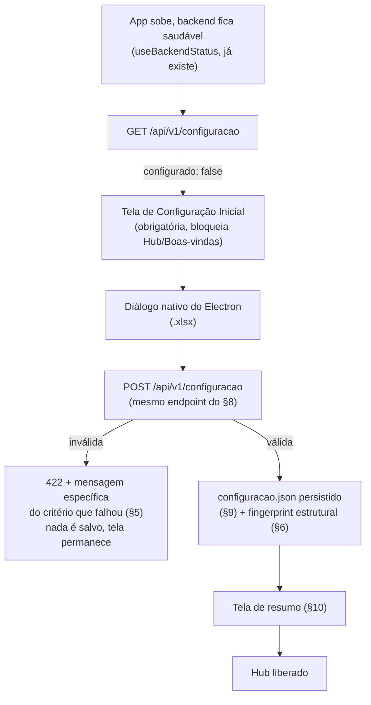
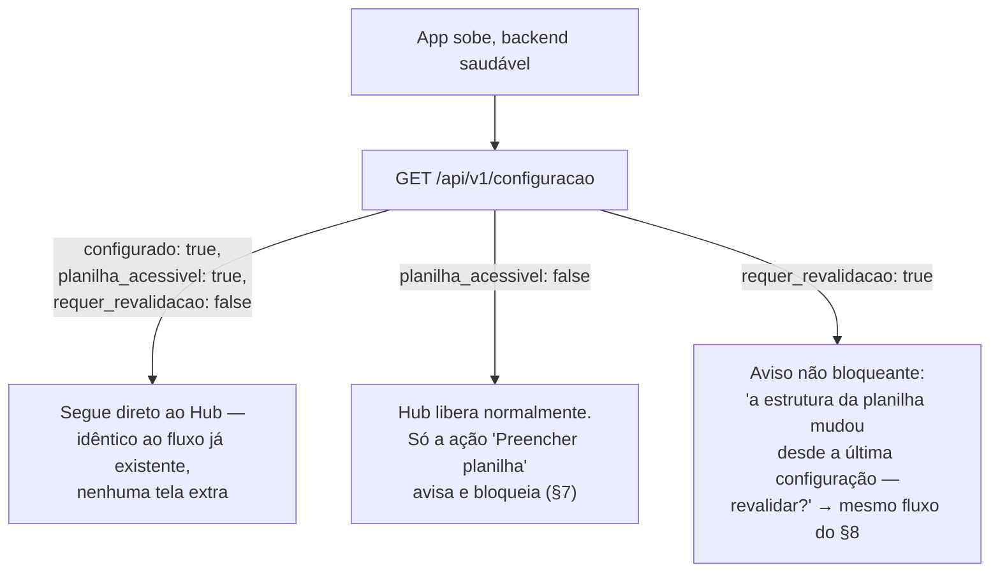

# Sprint 15 — Configuração Inicial da Planilha Oficial

> **Sprint 15 — exclusivamente arquitetura e documentação. Nenhuma linha de
> código de produção foi escrita nesta Sprint.** Esta é a versão final,
> consolidada após três rodadas de revisão no mesmo dia (2026-07-30) — é a
> única que deve ser usada como base de implementação.

> **Nota de numeração:** o número 15 já foi usado, no mesmo dia, por uma
> proposta de arquitetura completamente diferente (recuperação de
> processamento, `ProcessoOperacional`, Fila do Dia) — **oficialmente
> cancelada e removida do projeto**, sem nenhum vestígio em código ou
> documentação (ver `docs/roadmap/README.md`). O número foi reaproveitado
> deliberadamente para esta proposta, que não tem nenhuma relação com
> aquela. A Sprint originalmente prevista como "15 — Build e Distribuição"
> foi renumerada para **Sprint 16**.

> **Correção de escopo (2026-07-30, durante a implementação — não é uma
> funcionalidade adicional, é um ajuste à regra de negócio real do
> DIMCAC):** confirmado que **existe apenas uma planilha oficial**, usada
> continuamente em todos os processamentos — não uma planilha escolhida a
> cada execução. Isso muda uma peça que a primeira versão desta
> documentação não cobria explicitamente: hoje, `SelecionarProcessar.tsx`
> tem um seletor de arquivo `.xlsx` **próprio, manual, repetido a cada
> processamento**, independente de qualquer configuração. Esse seletor
> **deixa de existir**. A partir desta correção:
>
> - **Toda ação de preenchimento usa, automaticamente, a planilha oficial
>   configurada** — o usuário nunca mais escolhe um caminho de destino
>   durante o Processamento.
> - **O backend passa a ser a única autoridade sobre esse caminho.** O
>   frontend deixa de enviar `caminho_planilha` no corpo da requisição de
>   preenchimento — o backend resolve o caminho internamente, a partir de
>   `configuracao.json` (§ 9), e nunca aceita um caminho vindo do cliente
>   para esse fim.
> - Ver [§ 7.1](#71-autoridade-do-backend-sobre-o-caminho-da-planilha-oficial)
>   para o contrato revisado e [§ 11](#11-pontos-de-impacto) para os
>   arquivos adicionais afetados por esta correção.

## Sumário

1. [Contexto e motivação](#1-contexto-e-motivação)
2. [Fluxo da primeira inicialização](#2-fluxo-da-primeira-inicialização)
3. [Fluxo das inicializações seguintes](#3-fluxo-das-inicializações-seguintes)
4. [Contrato do endpoint de configuração](#4-contrato-do-endpoint-de-configuração)
5. [Critérios de validação da planilha](#5-critérios-de-validação-da-planilha)
6. [Detecção de substituição estrutural](#6-detecção-de-substituição-estrutural)
7. [Bloqueio por ação, não por módulo](#7-bloqueio-por-ação-não-por-módulo)
   - [7.1 Autoridade do backend sobre o caminho da planilha oficial](#71-autoridade-do-backend-sobre-o-caminho-da-planilha-oficial)
8. ["Alterar Planilha Oficial" — mesmo fluxo, sem duplicação](#8-alterar-planilha-oficial--mesmo-fluxo-sem-duplicação)
9. [Local e formato da configuração local](#9-local-e-formato-da-configuração-local)
10. [Tela de resumo pós-configuração](#10-tela-de-resumo-pós-configuração)
11. [Pontos de impacto](#11-pontos-de-impacto)
12. [Testes necessários](#12-testes-necessários)
13. [Riscos e perguntas em aberto](#13-riscos-e-perguntas-em-aberto)

## 1. Contexto e motivação

Hoje, o caminho da planilha oficial é escolhido a cada preenchimento —
`SelecionarProcessar.tsx` tem um seletor de arquivo `.xlsx` próprio,
repetido a cada processamento, e `preencherPlanilha`
(`frontend/src/services/api.ts`) envia esse caminho ao backend junto com
os dados extraídos, sem nenhuma configuração persistente. Não há uma
noção de "planilha oficial desta instalação": o usuário poderia, sem
querer, apontar para arquivos diferentes em execuções diferentes, e a
Central Inteligente de Conferência já assume, desde a Sprint 11, a
existência de "a" planilha oficial do DIMCAC como referência única.

**Regra de negócio confirmada com o DIMCAC:** existe apenas **uma**
planilha oficial, usada continuamente em todos os processamentos — nunca
uma planilha escolhida pontualmente a cada execução. Esta Sprint resolve
o problema com uma configuração explícita, obrigatória na primeira
execução: o usuário aponta, uma vez, para o arquivo `.xlsx` que passa a
ser "a planilha oficial desta instalação" — guardado por caminho, nunca
copiado ([§ 9](#9-local-e-formato-da-configuração-local)) — e **essa
configuração passa a ser usada automaticamente em toda ação de
preenchimento**, daí em diante. O seletor manual de `SelecionarProcessar.tsx`
deixa de existir ([§ 7.1](#71-autoridade-do-backend-sobre-o-caminho-da-planilha-oficial)):
não é mais o usuário quem escolhe o destino da gravação a cada execução —
é a configuração já validada uma vez.

## 2. Fluxo da primeira inicialização



## 3. Fluxo das inicializações seguintes



`configuracao.json` **nunca é apagado automaticamente** por inacessibilidade
ou por divergência estrutural — só é sobrescrito por uma nova configuração
bem-sucedida ([§ 8](#8-alterar-planilha-oficial--mesmo-fluxo-sem-duplicação)).

## 4. Contrato do endpoint de configuração

`GET /api/v1/configuracao` — booleanos independentes, sem estados de texto:

```jsonc
// nunca configurado
{ "configurado": false }

// configurado, tudo certo
{
  "configurado": true,
  "planilha_acessivel": true,
  "requer_revalidacao": false,
  "caminho_planilha_oficial": "G:\\Meu Drive\\...\\Controle de Diárias.xlsx",
  "configurado_em": "2026-07-30T14:32:10"
}

// configurado, caminho inacessível agora
{ "configurado": true, "planilha_acessivel": false }
```

- `requer_revalidacao` só é computado quando `planilha_acessivel: true` —
  não é possível avaliar divergência estrutural de um arquivo que nem
  pôde ser aberto; esse caso já é coberto por `planilha_acessivel: false`.
- **Nome escolhido deliberadamente após revisão:** a primeira versão desta
  proposta usava `planilha_possivelmente_substituida` — descartado por
  expressar uma suspeita no próprio contrato da API, em vez de descrever o
  que o backend efetivamente sabe (uma divergência estrutural foi
  detectada) e o que o frontend deve fazer a respeito (oferecer
  revalidação). `requer_revalidacao` foi escolhido entre as alternativas
  consideradas (`estrutura_validada`, `configuracao_requer_revisao`)
  porque é o único que descreve uma **ação necessária**, no mesmo
  registro dos outros dois campos do contrato (`configurado` e
  `planilha_acessivel` também dizem ao frontend o que fazer, não só o que
  é verdade) — consistência de estilo dentro do próprio contrato.

`POST /api/v1/configuracao` — corpo `{ "caminho_planilha_oficial": "..." }`,
valida (§ 5) e persiste (§ 9); usado tanto na primeira configuração quanto
em "Alterar Planilha Oficial" (§ 8).

## 5. Critérios de validação da planilha

Na ordem, parando no primeiro que falhar, cada um com mensagem própria:

1. **Existência/acesso** — arquivo existe e é legível.
2. **Extensão** — `.xlsx`.
3. **Abertura com `openpyxl`** — `load_workbook`, captura corrupção/bloqueio.
4. **Aba esperada** — `"Controle de Diárias"` (`escritor_planilha.NOME_ABA`)
   presente em `workbook.sheetnames`.
5. **Cabeçalhos exigidos pelo escritor atual** — linha 1 deve ter, nas
   colunas que `escritor_planilha.preencher` de fato escreve
   (`A, B, C, D, H, I, J, K, L, P, Q`), os rótulos reais já documentados
   em `docs/central-conferencia/README.md`
   (`DH, SEI, DOC ORIGEM, CPF, PERÍODO INICIAL, PERÍODO FINAL, TRECHO,
   TRANSPORTE, MOTIVO, VALOR TOTAL DAS DIÁRIAS, LOCAL`). Não valida
   fórmulas de `E/F/G/N/R/S/Z/AA` — o escritor nunca as toca, não é
   requisito para ele funcionar.

## 6. Detecção de substituição estrutural

**Objetivo:** perceber quando o caminho continua o mesmo, mas o arquivo
foi trocado por um completamente diferente — sem impedir o uso, só
solicitando revalidação (mesmo fluxo do § 8).

**Sinais descartados, com justificativa (revisão final):**

- **Tamanho do arquivo** — descartado. O uso normal já altera o tamanho
  legitimamente (planilha nova fornecida pelo órgão, limpeza de registros
  antigos, reorganização) — usar tamanho como heurística de detecção
  geraria falsos positivos em cenários operacionais legítimos, não só em
  trocas indevidas.
- **Data de última modificação (mtime)** — descartada pelo mesmo motivo,
  ainda mais acentuado: muda a cada gravação normal do próprio app
  (`workbook.save()` em `escritor_planilha.preencher`). Continua
  armazenada só para exibição (`configurado_em` é a data da
  *configuração*, não a de modificação do arquivo — nenhuma confusão
  entre as duas).
- **Hash do arquivo inteiro** — descartado pelo mesmo motivo: muda a cada
  preenchimento bem-sucedido, então não distingue "o app gravou linhas
  novas" de "alguém trocou a planilha".

**Estratégia final — fingerprint só sobre elementos estruturais que não
mudam no uso normal:**

- **Nomes das abas** (`workbook.sheetnames`, lista ordenada) — o escritor
  nunca cria, remove ou renomeia abas.
- **Hash da linha de cabeçalho** da aba "Controle de Diárias" — as
  mesmas células já validadas no critério 5 (`A, B, C, D, H, I, J, K, L,
  P, Q`). O escritor nunca escreve na linha 1 — só nas linhas de dados,
  a partir da linha 2 (`PRIMEIRA_LINHA_DADOS`) — então esse hash é
  estável entre gravações normais, mas muda se a planilha for substituída
  por um template ou arquivo diferente.

Custo desprezível: a linha 1 já precisa ser lida para o critério 5 da
validação — o fingerprint reaproveita a mesma leitura, sem I/O adicional.
Deliberadamente **não** estendido a outras abas (`Dados`, `Tabela
Valores`): o conteúdo delas muda legitimamente (cadastro de servidores,
valores de diária reajustados anualmente) — hashear qualquer coisa além
do cabeçalho de `Controle de Diárias` reintroduziria o mesmo problema de
falso positivo que motivou descartar tamanho/mtime/hash total.

Se o fingerprint calculado na inicialização divergir do registrado na
última configuração válida: `requer_revalidacao: true` (§ 4) — nunca um
bloqueio, sempre um convite a revalidar pelo mesmo fluxo do § 8.

## 7. Bloqueio por ação, não por módulo

**Princípio:** o único bloqueio em nível de aplicação é o gate obrigatório
da primeira execução (`configurado: false`, § 2). Depois disso, **nenhum
módulo inteiro é bloqueado** — só a ação específica que precisa ler ou
escrever no caminho configurado, no momento em que é acionada.

| Módulo | Depende de quê, de fato | Bloqueio quando `planilha_acessivel: false` ou `requer_revalidacao: true` |
| --- | --- | --- |
| Processamento — seleção/extração de PDFs | Nada (`POST /api/v1/processamento` nunca toca a planilha) | Nenhum — PDFs continuam sendo selecionados e processados normalmente |
| Processamento — ação "Preencher planilha" | Sim, diretamente — e, desde a correção de escopo abaixo, é a **única** fonte do caminho de destino (§ 7.1) | Só esta ação, com mensagem própria + atalho para "Alterar Planilha Oficial". `requer_revalidacao: true` **também** bloqueia especificamente esta ação (revisão desta correção — nas demais telas continua só informativo, nunca bloqueante) |
| Central Inteligente de Conferência | A Base Local de Consulta (cópia sincronizada, `app/consulta/base_local.py`), não o caminho ao vivo — já tem seu próprio erro (`BaseLocalIndisponivel` → 503, `app/api/conferencia.py:33-34,81-84`) | Nenhum bloqueio novo — mecanismo já existente e independente |
| Configurações | É o próprio mecanismo de correção | Nunca |
| Relatórios (planejado) | Provavelmente pastas de resultado já geradas, não o caminho ao vivo | Mesma regra a aplicar quando desenhado: bloquear só a ação que precisa do caminho ao vivo |
| Dashboard (planejado) | A confirmar no desenho do módulo — se ler de um cache local, mesma lógica da Central | A confirmar, mesmo princípio |

Nenhuma lista central de "módulos bloqueados" existe ou precisa ser
mantida — cada ação que depende do caminho ao vivo checa por conta
própria, no momento em que é acionada.

### 7.1 Autoridade do backend sobre o caminho da planilha oficial

**Correção de escopo, confirmada pela regra de negócio do DIMCAC (nota no
topo do documento):** como existe apenas uma planilha oficial, o
Processamento deixa de aceitar um caminho de destino escolhido pelo
usuário a cada execução. O contrato de `POST /api/v1/planilha/preencher`
muda:

- **`RequisicaoPreenchimento` deixa de ter o campo `caminho_planilha`.**
  O frontend nunca mais envia um caminho de planilha para preenchimento —
  só os dados já extraídos (`itens`, `erros`, `avisos`,
  `tempo_processamento_ms`).
- **O backend resolve o caminho internamente**, chamando
  `app/infra/config/configuracao_app.avaliar_estado_atual()` — a mesma
  função que já alimenta `GET /api/v1/configuracao` ([§ 4](#4-contrato-do-endpoint-de-configuração)),
  reaproveitada aqui, não duplicada.
- **Antes de delegar a `escritor_planilha.preencher`, o backend valida,
  nesta ordem:**
  1. `configurado` — se `false`, recusa (não deveria nem ser possível
     chegar aqui, já que a Configuração Inicial é obrigatória, mas o
     backend não confia no frontend para isso).
  2. `planilha_acessivel` — se `false`, recusa com mensagem indicando que
     a planilha oficial está inacessível (movida/renomeada/excluída) e
     que é preciso "Alterar Planilha Oficial".
  3. `requer_revalidacao` — se `true`, recusa com mensagem pedindo
     revalidação antes de prosseguir. **Esta é a única ação de todo o
     sistema em que `requer_revalidacao` bloqueia** — em qualquer outro
     lugar (Central Inteligente, Hub, tela de status) continua sendo só
     informativo ([§ 6](#6-detecção-de-substituição-estrutural)); aqui,
     como o backend está prestes a escrever no arquivo, exigir a
     confirmação explícita do usuário antes é a mesma cautela que já
     motivou a existência do fingerprint.
  4. Só se as três checagens passarem, chama `escritor_planilha.preencher`
     com o `caminho_planilha_oficial` resolvido da configuração —
     `escritor_planilha.py` em si **não muda**, continua recebendo um
     caminho de string como sempre recebeu.
- **Falha em qualquer uma das três checagens:** HTTP 422 com mensagem
  específica, mesmo padrão já usado para `ErroPreenchimentoPlanilha`.
  Nunca bloqueia `POST /api/v1/processamento` (seleção/extração de PDFs
  continua livre, [§ 7](#7-bloqueio-por-ação-não-por-módulo)) — só a
  chamada de preenchimento em si.

Isso não é uma funcionalidade nova: é a extensão natural do princípio "o
backend é a autoridade" que já existia implicitamente (o backend sempre
validou a planilha antes de escrever, via `ErroPreenchimentoPlanilha`) —
a mudança é só **de onde vem o caminho**, que deixa de ser um dado
arbitrário do cliente e passa a ser uma configuração já validada.

## 8. "Alterar Planilha Oficial" — mesmo fluxo, sem duplicação

Faz parte desta Sprint (deixou de ser melhoria futura). **Um único
endpoint, uma única função de validação, um único componente de
frontend** atendem os dois casos:

- Primeira configuração: tela obrigatória → formulário de seleção →
  `POST /api/v1/configuracao` → resumo (§ 10) → libera o Hub.
- "Alterar Planilha Oficial" (ação em Configurações, disponível a
  qualquer momento): mesmo formulário, mesmo `POST /api/v1/configuracao`,
  mesmo resumo — só o destino pós-sucesso muda (volta para onde o
  usuário estava, em vez de liberar o Hub pela primeira vez).

Trocar a planilha configurada **não exige que o caminho anterior ainda
esteja acessível** — é, inclusive, o próprio caminho de correção para os
casos de `planilha_acessivel: false` e `requer_revalidacao: true`.

## 9. Local e formato da configuração local

Um único arquivo JSON, sem SQLite — mesma pasta de dados já usada por
`app/consulta/base_local.py` (`EXTRATOR_DIARIAS_USER_DATA`, passada pelo
Electron via `app.getPath("userData")` em `main.ts`, fallback
`%APPDATA%/ExtratorDiarias`):

`%APPDATA%/ExtratorDiarias/configuracao.json`

```jsonc
{
  "caminho_planilha_oficial": "G:\\Meu Drive\\...\\Controle de Diárias.xlsx",
  "configurado_em": "2026-07-30T14:32:10",
  "fingerprint_estrutural": {
    "abas": ["Controle de Diárias", "Dados", "Tabela Valores"],
    "hash_cabecalho": "sha256:...."
  }
}
```

A planilha escolhida **nunca é copiada nem movida** — só o caminho é
guardado, e o sistema continua trabalhando diretamente sobre o arquivo
original, exatamente como o fluxo de preenchimento já faz hoje. Escrita
do próprio `configuracao.json` deve seguir o mesmo padrão seguro já usado
em `base_local.py::sincronizar` (arquivo temporário + `os.replace`), para
não deixar a configuração corrompida por uma interrupção no meio da
gravação.

## 10. Tela de resumo pós-configuração

Depois de uma configuração válida (primeira vez ou "Alterar Planilha
Oficial"), um componente `ResumoConfiguracao` — reaproveitado nos dois
fluxos (§ 8) — mostra algo como:

```
✓ Planilha configurada

Nome: Controle de Diárias.xlsx
Local: G:\Meu Drive\DIMCAC\Controle de Diárias.xlsx
Configurada em: 30/07/2026 14:32
```

Layout livre na implementação — o requisito é o conteúdo (confirmação
visual clara de nome, caminho completo e data/hora), não um layout
específico.

**Correção de escopo — mesmo componente, um terceiro uso:** com o fim do
seletor manual em Processamento (§ 7.1), `ResumoConfiguracao` passa a ter
um **terceiro** ponto de uso, além dos dois já previstos (tela de
Configuração Inicial e "Alterar Planilha Oficial"): dentro de
`SelecionarProcessar.tsx`, no lugar exato onde hoje fica o seletor manual
`.xlsx`. Nesse terceiro uso, o componente precisa mostrar, além de
nome/local/data, o que os outros dois usos não precisam mostrar porque
acabaram de validar com sucesso:

- **Situação de acessibilidade** (`planilha_acessivel`) — um indicador
  visual (ex.: o mesmo padrão de `Alerta variante="erro"` já usado no
  resto do app) quando a planilha configurada está inacessível.
- **Ação "Alterar Planilha Oficial"** sempre disponível a partir deste
  resumo — não só a partir de uma futura página de Configurações,
  também aqui, para o servidor não precisar sair de Processamento para
  corrigir uma planilha mostrada como inacessível.

## 11. Pontos de impacto

| Módulo | Impacto |
| --- | --- |
| `app/infra/config/` (pasta reservada, vazia hoje) | Novo módulo de validação + persistência (`configuracao.json`, fingerprint estrutural, escrita segura temp+replace). |
| Novo `app/api/configuracao.py` | `GET`/`POST /api/v1/configuracao`, mesmo padrão de `app/api/saude.py`. |
| `app/planilha/escritor_planilha.py` | Nenhuma mudança de lógica — só consultado (constantes `NOME_ABA`, colunas) pela validação e, agora, pelo endpoint de preenchimento (§ 7.1) exatamente como antes (recebe um caminho de string, não sabe de onde veio). |
| `app/schemas/planilha.py` (`RequisicaoPreenchimento`) | **Correção de escopo (§ 7.1):** remove o campo `caminho_planilha` — deixa de existir como entrada do cliente. |
| `app/api/planilha.py` (`POST /planilha/preencher`) | **Correção de escopo (§ 7.1):** resolve o caminho via `configuracao_app.avaliar_estado_atual()` em vez de ler do corpo da requisição; valida `configurado`/`planilha_acessivel`/`requer_revalidacao` antes de delegar a `preencher_planilha`. |
| `app/services/planilha_service.py` (`preencher_planilha`) | Sem mudança de assinatura — continua recebendo `caminho_planilha` como parâmetro explícito; só quem chama (a camada de API) muda de onde tira esse valor. |
| Central Inteligente (`conferencia.py`, `conferencia_service.py`, `api/conferencia.py`) | Nenhuma mudança — continua usando `BaseLocalIndisponivel`, independente desta Sprint. |
| `frontend/electron/ipc/planilha.ts` (ou novo `ipc/configuracao.ts`) | Novo handler com `dialog.showOpenDialog` (filtro `.xlsx`) — mesmo padrão já usado em `planilha:salvar-como`. |
| `frontend/electron/preload.ts` | Nova função exposta ao renderer para abrir o diálogo. |
| Frontend — novo `ConfiguracaoInicial.tsx` + `ResumoConfiguracao` (componente reaproveitado) | Tela obrigatória de primeira execução + ação "Alterar Planilha Oficial" em Configurações + terceiro uso dentro de Processamento (§ 10). |
| Frontend — `App.tsx` | Checagem de `GET /api/v1/configuracao` logo após o backend ficar saudável, antes de liberar Boas-vindas/Hub. |
| Frontend — `Hub.tsx` | Nenhuma lógica de bloqueio por módulo — só a ação "Preencher planilha" (dentro de Processamento) ganha uma checagem própria. |
| Frontend — `SelecionarProcessar.tsx` | **Correção de escopo (§ 7.1):** remove o seletor manual `.xlsx` (`BotaoArquivo accept=".xlsx"`, estado `planilhaCaminho`, handler `selecionarPlanilha`) e o texto residual "cópia de teste". No lugar, exibe `ResumoConfiguracao`. A chamada a `preencherPlanilha` (services/api.ts) deixa de enviar um caminho — o backend resolve sozinho (§ 7.1). |
| Frontend — `services/api.ts` (`preencherPlanilha`) | Assinatura perde o parâmetro `caminhoPlanilha` — a função para de enviar `caminho_planilha` no corpo da requisição. |
| Nova página "Configurações" | Ainda não existe no projeto — esta Sprint cria a mínima necessária para "Alterar Planilha Oficial"; não é uma tela de configurações genérica. |

## 12. Testes necessários

- Cada critério de validação (§ 5) falhando isoladamente → 422 com
  mensagem específica, nada persistido.
- Validação completa passando → `configuracao.json` criado com caminho e
  fingerprint corretos.
- `GET /api/v1/configuracao` nos três formatos de resposta (§ 4).
- Fingerprint estrutural: alterar o cabeçalho da aba (simulando um
  arquivo diferente) → `requer_revalidacao: true`; gravar novas linhas de
  dados (uso normal) → `requer_revalidacao` permanece `false`.
- Confirmar que nenhuma mudança de tamanho ou `mtime` isolada, sem
  mudança estrutural, dispara `requer_revalidacao`.
- "Alterar Planilha Oficial" reaproveita a mesma validação — nenhum teste
  de regra duplicada/divergente entre os dois fluxos.
- Frontend: `configurado: false` força a tela inicial e bloqueia
  navegação; `requer_revalidacao: true` mostra aviso não bloqueante fora
  do contexto de preenchimento (ex.: Central Inteligente, se algum dia
  precisar exibir esse dado).
- Electron: diálogo abre filtrado para `.xlsx`; cancelamento não dispara
  chamada ao backend.
- Escrita segura do `configuracao.json` (temp + `os.replace`) não deixa
  arquivo corrompido em falha simulada.
- Regressão: nenhuma mudança de comportamento em `escritor_planilha.py`
  nem na Central Inteligente.

**Testes adicionais da correção de escopo (§ 7.1):**

- `POST /api/v1/planilha/preencher` sem nenhuma configuração
  (`configurado: false`) → 422, nenhuma tentativa de abrir arquivo.
- Idem com `planilha_acessivel: false` (planilha configurada foi
  movida/excluída) → 422 com mensagem específica.
- Idem com `requer_revalidacao: true` → 422 com mensagem pedindo
  revalidação — **esta é a única rota de todo o backend em que
  `requer_revalidacao` rejeita a operação**.
- `RequisicaoPreenchimento` não aceita mais (ou ignora) um
  `caminho_planilha` vindo do cliente — o caminho realmente usado na
  gravação é sempre o de `configuracao.json`, mesmo que o corpo da
  requisição tente enviar outro.
- Frontend: `SelecionarProcessar.tsx` sem o seletor manual — a tela
  mostra `ResumoConfiguracao` e a ação "Preencher Planilha" chama
  `preencherPlanilha` sem nenhum caminho como argumento.
- Frontend: com `planilha_acessivel: false` ou `requer_revalidacao: true`,
  a ação "Preencher Planilha" aparece desabilitada/bloqueada com
  mensagem clara e o atalho "Alterar Planilha Oficial" — sem bloquear a
  seleção/processamento de PDFs na mesma tela.
- Regressão: com a planilha oficial configurada e acessível, o resultado
  de um preenchimento (`ResultadoPreenchimento`, pasta de resultados,
  relatório, sincronização da Base Local) é idêntico ao comportamento já
  homologado — só a origem do caminho muda, nunca a lógica de escrita.

## 13. Riscos e perguntas em aberto

1. **Relatórios/Dashboard (planejados)** — a regra de bloqueio por ação
   (§ 7) foi antecipada para eles, mas a dependência real só será
   confirmada quando cada módulo for desenhado.
2. **Página de Configurações** — esta Sprint cria só o necessário para
   "Alterar Planilha Oficial"; se o DIMCAC quiser outras opções ali no
   futuro, é uma tela a crescer, não a redesenhar.
3. ~~Frequência do cálculo do fingerprint~~ — **resolvida pela correção de
   escopo (§ 7.1):** o backend recalcula o fingerprint (via
   `avaliar_estado_atual()`) imediatamente antes de qualquer
   preenchimento, não só na inicialização — é, inclusive, o que torna
   `requer_revalidacao` capaz de bloquear essa ação especificamente.
4. **Nome do arquivo/atalho "Alterar Planilha Oficial" dentro de
   Processamento** — o § 10 já prevê a ação disponível a partir do
   `ResumoConfiguracao` mostrado ali; falta decidir, na implementação, se
   ela abre a mesma tela cheia de "Alterar Planilha Oficial" ou um modal
   compacto sobre a própria tela de Processamento — decisão de UX, não de
   arquitetura.
