# GUIA DO USUÁRIO — AUTOMATIZADOR DE DIÁRIAS

**DIMCAC — Guia rápido de instalação e operação**

| Versão do aplicativo | Data | Público-alvo |
|---|---|---|
| 2.0.0 | Agosto de 2026 | Servidores do DIMCAC |

> Este é o texto-fonte editável do guia. O arquivo `GUIA-DO-USUARIO.html` é a versão estilizada usada para
> gerar o PDF final (`GUIA DO USUARIO - AUTOMATIZADOR DE DIARIAS.pdf`). As imagens referenciadas aqui estão
> na pasta `imagens/`.

---

## Sumário

1. Antes de começar — organize sua pasta de trabalho
2. Instalando o Automatizador de Diárias
3. Configurando a Planilha Oficial
4. Tela inicial (Hub)
5. Processando Diárias
6. Central de Conferência
7. Central Analítica
8. Finalizando (confirmando) diárias
9. Fechando o aplicativo
10. Boas práticas e fluxo resumido

---

## 1. Antes de começar — organize sua pasta de trabalho

Antes de instalar ou usar o Automatizador de Diárias, organize manualmente a pasta onde fica a sua Planilha
Oficial. Recomendamos criar **três pastas** no mesmo diretório da planilha:

```
DIMCAC/
│
├── CONTROLE DIÁRIAS MEMBROS E SERVIDORES - Banco de Dados 2026.xlsx
│
├── PDFS A PROCESSAR/
├── PDFS PROCESSADOS/
└── PDFS DIÁRIAS PARA CONFIRMAR/
```

- **PDFS A PROCESSAR** — coloque aqui os PDFs de processos do SEI que ainda serão utilizados na tela de
  **Processamento da Planilha**.
- **PDFS PROCESSADOS** — use para guardar os PDFs cujo processamento e preenchimento na planilha já foram
  concluídos e conferidos.
- **PDFS DIÁRIAS PARA CONFIRMAR** — coloque aqui os processos que serão usados depois na função **Finalizar
  Diárias** (confirmação de comprovantes).

> ⚠ **Atenção**: o aplicativo **não move os PDFs automaticamente** entre essas pastas. Essa organização é
> inteiramente manual — você mesmo arrasta os arquivos de uma pasta para outra, conforme avança no
> trabalho. Pense nelas como uma esteira de organização, não como uma função do programa.

---

## 2. Instalando o Automatizador de Diárias

A instalação é feita com um único arquivo instalador, sem necessidade de nenhum programa adicional.

1. **Localize o instalador** recebido — um arquivo com nome parecido com *"Automatizador de Diárias
   Setup.exe"*, geralmente enviado pela pasta compartilhada do setor.
2. **Dê duplo clique** no arquivo para executá-lo.
3. Se o Windows perguntar *"Deseja permitir que este aplicativo faça alterações no dispositivo?"*, clique
   em **Sim**.
4. **Siga o assistente de instalação** normalmente, usando as opções padrão sugeridas — não é necessário
   alterar a pasta de destino.
5. Ao final, clique em **Concluir**. O instalador cria automaticamente um atalho na Área de Trabalho e no
   Menu Iniciar chamado **"Automatizador de Diárias"**.
6. **Abra o aplicativo** por esse atalho. Na primeira execução, a tela de boas-vindas é exibida.

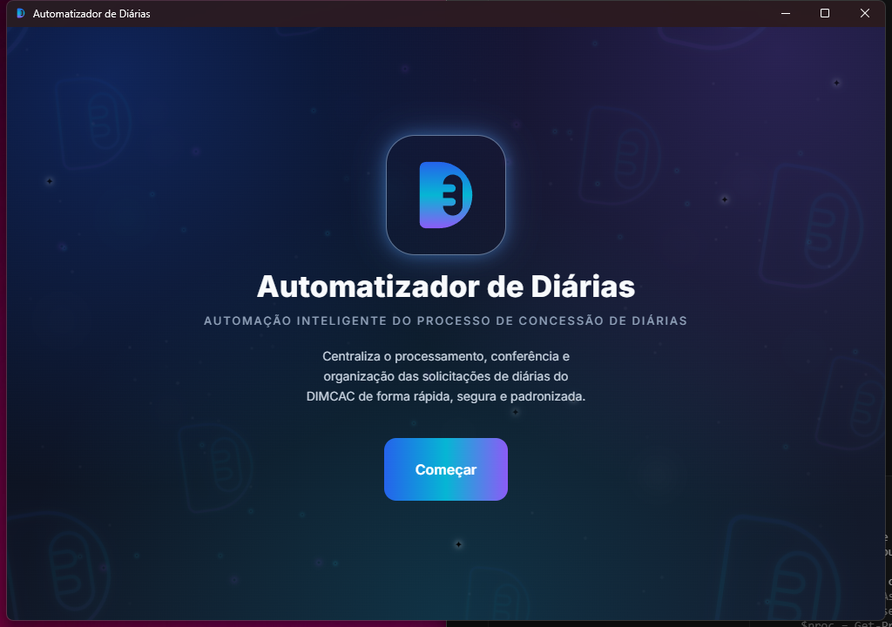

> 💡 **Dica**: você não precisa de nenhum conhecimento técnico para instalar ou usar este aplicativo — não
> é necessário instalar Python, Node ou qualquer outro programa. Tudo já vem pronto dentro do instalador.

Clique em **Começar** para seguir para a tela inicial.

---

## 3. Configurando a Planilha Oficial

Na primeira vez que o aplicativo é aberto (ou sempre que a Planilha Oficial mudar de lugar), é preciso
indicar qual arquivo `.xlsx` o aplicativo deve usar como planilha oficial do setor.

1. Clique em **Selecionar planilha oficial (.xlsx)**.
2. Na janela do Windows que abrir, localize e selecione o arquivo da Planilha Oficial do DIMCAC.
3. Aguarde a validação — o aplicativo confirma que a planilha tem a estrutura correta antes de liberar o
   restante das funcionalidades.
4. Com a planilha validada, clique em **Continuar** (na primeira configuração) ou **Fechar** (ao alterar
   depois).

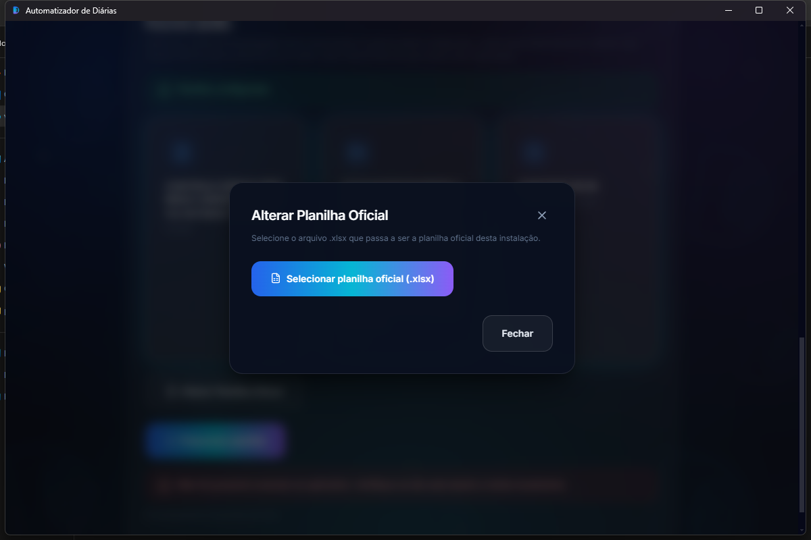

> ⚠ **Atenção**: sempre selecione a **Planilha Oficial** utilizada pelo setor — nunca uma cópia pessoal, um
> rascunho ou uma versão de teste. Todo processamento e toda finalização gravam diretamente no arquivo que
> estiver configurado aqui.

> ✕ **Se a planilha estiver indisponível**: se o arquivo configurado for movido, renomeado, excluído, ou
> estiver aberto e bloqueado por outro programa (como o Excel), o aplicativo avisa que a planilha está
> inacessível e pede para você selecioná-la novamente em **Alterar Planilha Oficial**. Feche o Excel antes
> de processar ou finalizar diárias.

---

## 4. Tela inicial (Hub)

Depois de configurada a planilha, esta é a tela central do aplicativo — a partir dela você escolhe o que
precisa fazer.

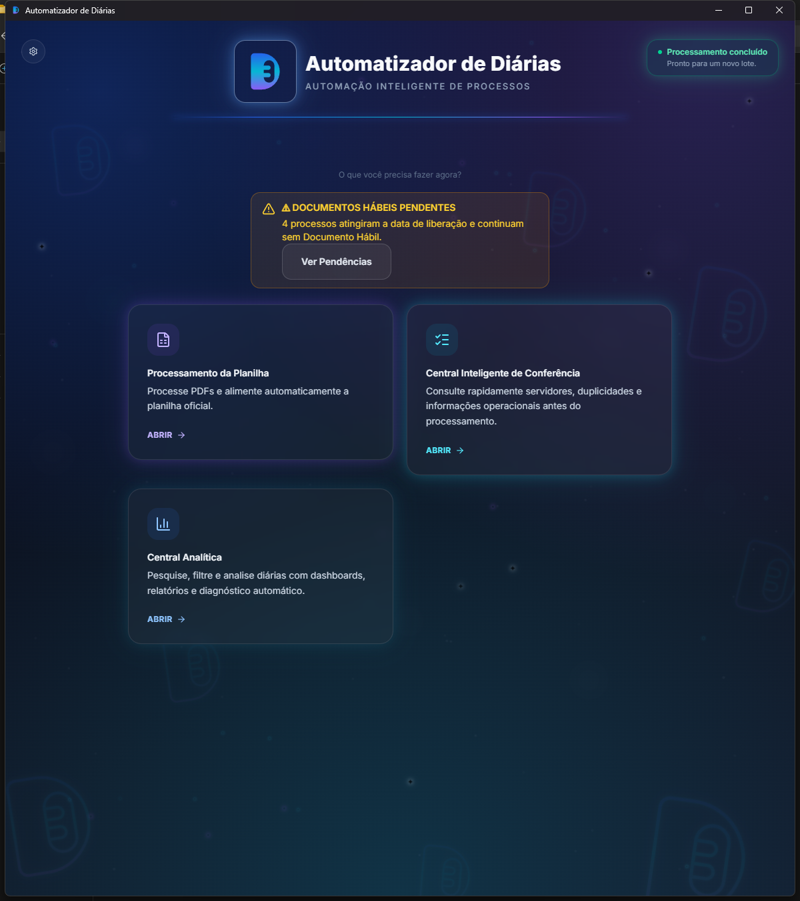

- 📄 **Processamento da Planilha** — processa PDFs do SEI e preenche automaticamente a planilha oficial.
- ☑️ **Central Inteligente de Conferência** — consulta servidores, duplicidades e informações operacionais
  antes de processar.
- 📊 **Central Analítica** — pesquisa, filtra e analisa diárias já lançadas, com dashboards e relatórios.

No canto superior esquerdo de qualquer tela de funcionalidade, dois botões ficam sempre disponíveis:

- **← Voltar** — retorna para esta tela inicial.
- **⚙️ Configurações** — abre a tela para alterar a Planilha Oficial a qualquer momento.

> 💡 **Dica**: se aparecer o aviso **"Documentos Hábeis Pendentes"**, clique em **Ver Pendências** — ele
> leva direto para a Central Analítica já filtrada nesses processos, sem precisar configurar filtro nenhum.

---

## 5. Processando Diárias

Abra pelo card **Processamento da Planilha**. Esta é a função usada no dia a dia para transformar PDFs de
processos do SEI em linhas novas na Planilha Oficial.

**Fluxo:** PDF → Selecionar → Processar → Conferir → Preencher planilha → Resultado

1. Clique em **Selecionar PDFs** (ou arraste os arquivos diretamente para a janela) — use os PDFs da pasta
   **PDFS A PROCESSAR**.
2. Confira a lista de arquivos selecionados. É possível remover um item clicando no **×** ao lado dele.
3. Clique em **Processar**. Nesta etapa, **nada ainda é gravado na planilha** — o aplicativo apenas lê e
   extrai as informações dos PDFs.

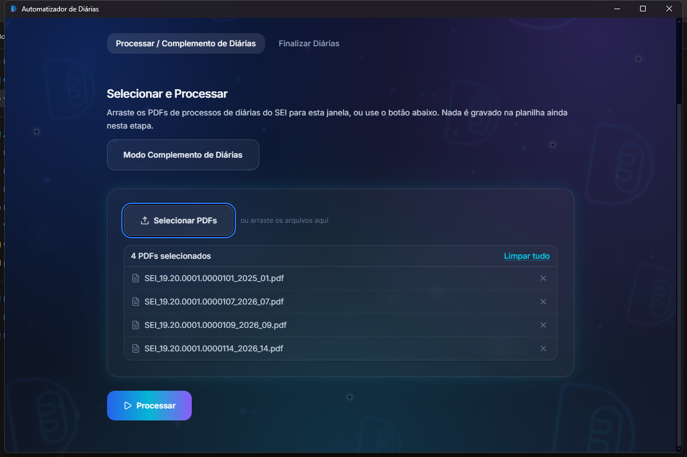

4. **Aguarde a conclusão** — os contadores de **Total**, **Sucesso** e **Erro** aparecem assim que o
   processamento termina.
5. **Confira a pré-visualização** antes de gravar qualquer coisa na planilha: SEI, CPF, período e trecho
   extraídos de cada PDF.

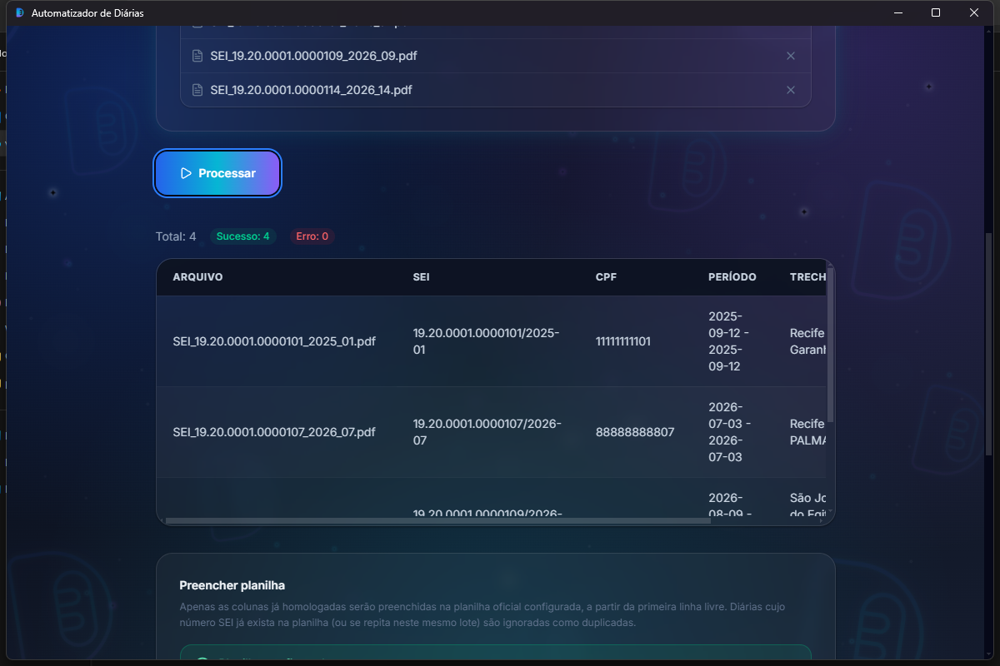

6. Estando tudo correto, clique em **Preencher planilha**. Só agora os dados são gravados na Planilha
   Oficial, sempre a partir da primeira linha livre.

> ⚠ **Atenção**: enquanto o aplicativo estiver processando ou preenchendo a planilha, **não feche o
> aplicativo nem troque a Planilha Oficial**. Os botões ficam bloqueados automaticamente durante essas
> operações — se você tentar sair, o aplicativo pede confirmação antes de interromper.

### Conferindo o resultado final

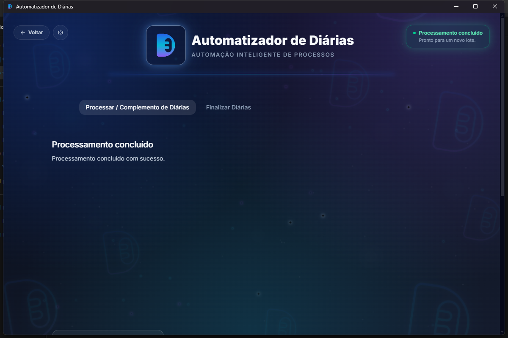

- **Abrir Planilha** — abre a Planilha Oficial no Excel.
- **Salvar Como...** — salva uma cópia da planilha em outro local.
- **Abrir Relatório** / **Salvar Relatório** — o relatório detalhado desta execução.
- **Abrir Pasta dos Resultados** — pasta com os arquivos gerados neste lote.

### Entendendo os resultados e possíveis erros

Cada PDF processado recebe um status na tabela de resultado. Se apenas alguns PDFs de um lote grande derem
problema, **não é preciso refazer o lote inteiro** — confira só os arquivos apontados:

| Status | O que significa |
|---|---|
| Inserido | A diária foi gravada normalmente na planilha. |
| Inserido (SEI já existente) | Gravado mesmo assim — só ocorre no Modo Complemento de Diárias. |
| Duplicado no lote | O mesmo SEI apareceu duas vezes no lote enviado — só a primeira ocorrência é gravada. |
| Já existe na planilha | Esse SEI já estava cadastrado — nenhuma linha nova foi criada. |
| Necessita inserção manual | O PDF não pôde ser gravado automaticamente — insira essa diária manualmente e revise o motivo indicado na coluna "Motivo". |

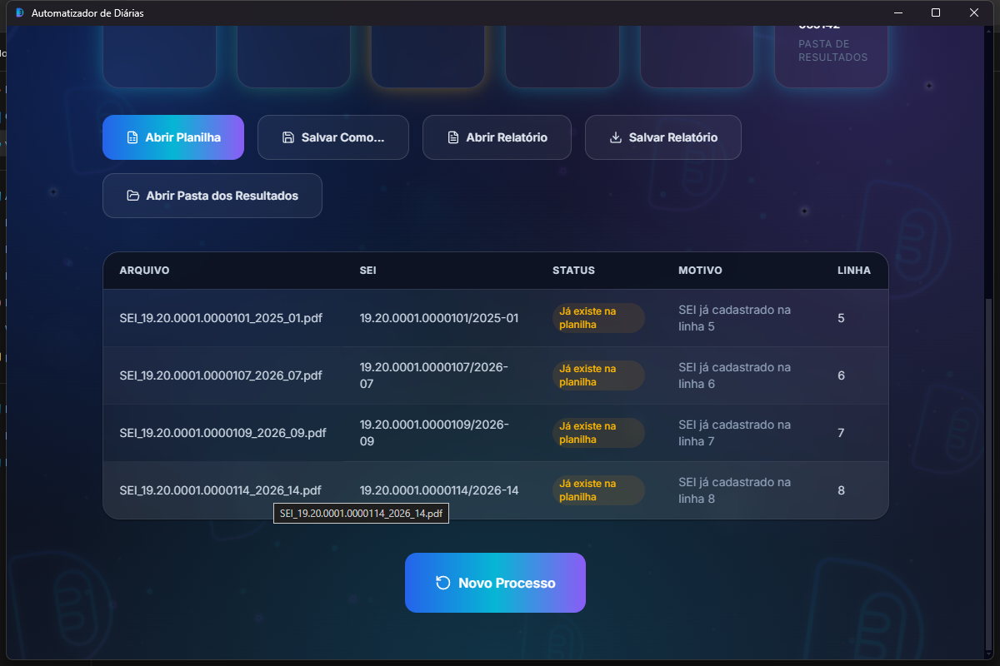

Terminado o lote, clique em **Novo Processo** para reiniciar a tela e processar o próximo grupo de PDFs.

### Modo Complemento de Diárias

Use quando o PDF se refere a um **complemento** de uma diária já lançada anteriormente (não a um processo
novo). Na mesma tela de Processamento, ative o botão **Modo Complemento de Diárias** antes de processar.
Com o modo ativo:

- Um SEI já existente na planilha **não impede** mais a gravação da nova linha.
- A coluna de aviso da planilha recebe automaticamente a marcação **"COMPLEMENTO DE DIÁRIAS"**.

O restante do fluxo (selecionar, processar, conferir, preencher) é idêntico ao processamento normal.

---

## 6. Central de Conferência

Use antes de processar um PDF para checar rapidamente a situação de um servidor: se ele já está cadastrado,
se já existe diária no mesmo período (duplicidade) e se a janela de prazo já está liberada. **Nada é
gravado nesta tela** — ela só consulta e informa.

1. Informe o **CPF do servidor**, o **período inicial** e o **período final** da diária.
2. Clique em **Realizar Conferência**.

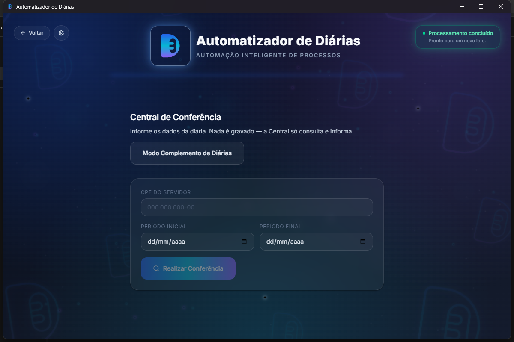

O resultado aparece com um selo de veredito:

- 🟢 **APTO PARA PROCESSAMENTO** — pode seguir com tranquilidade para o Processamento.
- 🟠 **REVISAR** — algo precisa da sua atenção antes de continuar (veja o checklist abaixo do selo).

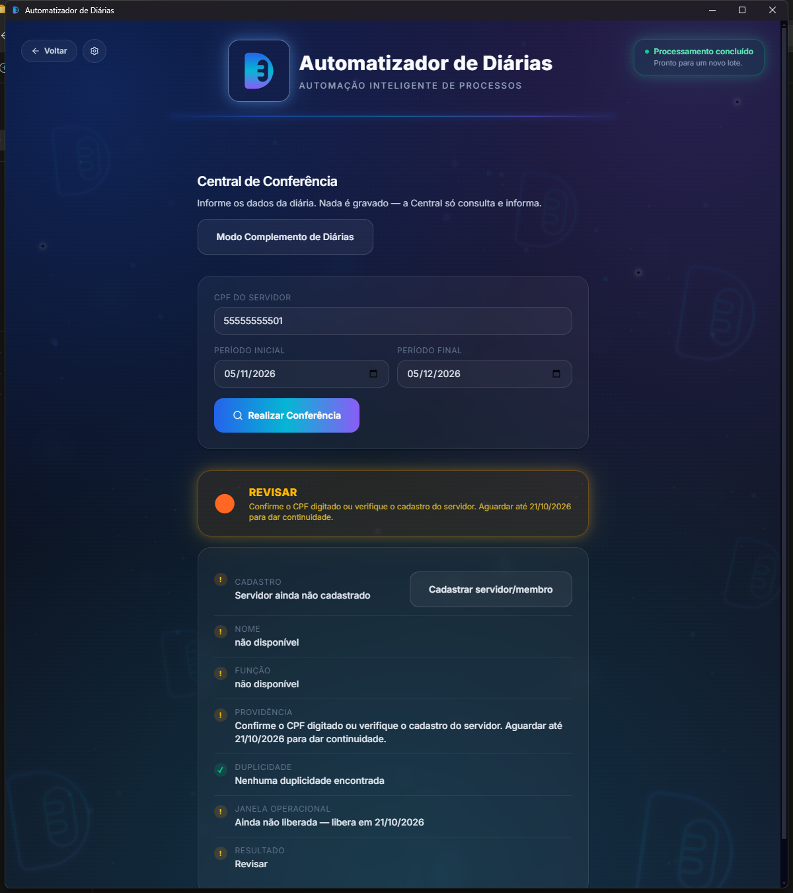

### CPF não cadastrado — o que fazer?

**Fluxo:** CPF não localizado → Cadastrar servidor/membro → Consultar no Arquimedes → Preencher cadastro →
Salvar → Verificar sincronização do Drive

Quando o checklist mostrar **"Servidor ainda não cadastrado"**, um botão **Cadastrar servidor/membro**
aparece ao lado do item.

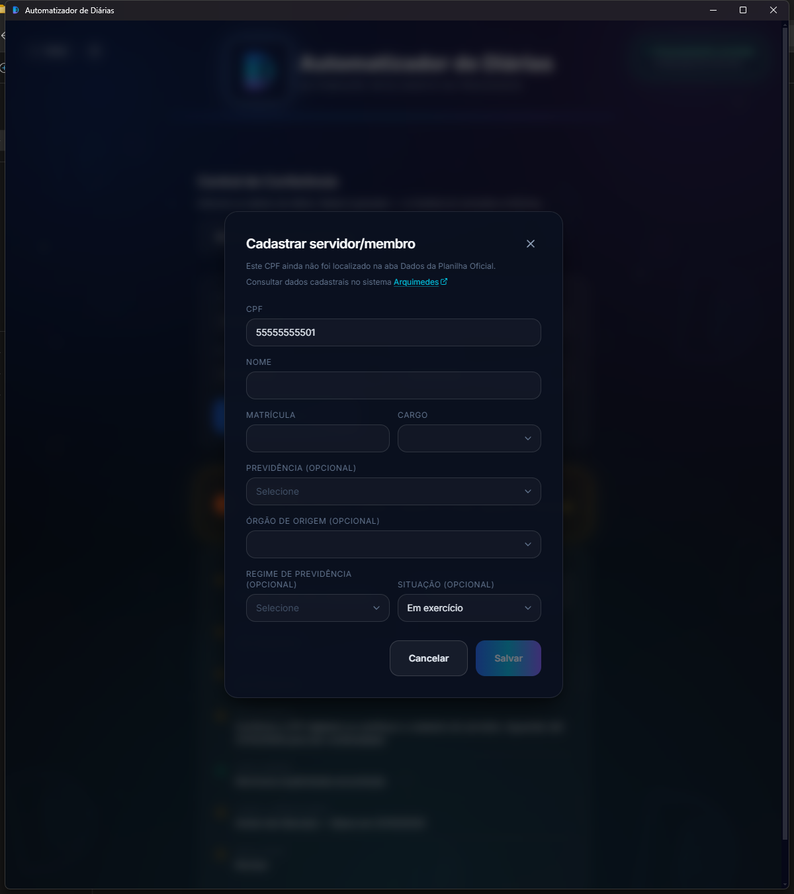

1. Clique no link **Arquimedes** para consultar os dados cadastrais oficiais do servidor.
2. O campo **CPF** vem pré-preenchido, mas pode ser **corrigido** se estiver digitado errado.
3. Preencha **Nome**, **Matrícula** e **Cargo** (obrigatórios); Previdência, Órgão de origem, Regime de
   previdência e Situação são opcionais.
4. Clique em **Salvar**.

> ⚠ **Atenção**: depois de salvar, o aplicativo pede para você confirmar que o **Google Drive já
> sincronizou** a versão atualizada da planilha antes de continuar (clique em **Já sincronizei /
> Continuar**). O aplicativo não verifica essa sincronização sozinho — a confirmação é sempre manual.

#### Gerando o Histórico para o e-Fisco

Quando o resultado for **APTO PARA PROCESSAMENTO**, um segundo formulário aparece para gerar o texto de
histórico usado no e-Fisco. Informe o **Número do SEI** e o **Destino**, clique em **Gerar Histórico** e
depois em **Copiar Histórico** para colar diretamente no e-Fisco.

> 💡 **Dica**: no **Modo Complemento de Diárias** (mesmo botão de alternância presente nesta tela), se a
> simulação representar uma parcial isolada (sem diária integral), marque a opção correspondente no
> formulário — o texto gerado passa a mencionar **"UMA PARCIAL"** corretamente nesse cenário específico.

---

## 7. Central Analítica

A Central Analítica utiliza os dados já sincronizados da Planilha Oficial para permitir pesquisas, filtros,
dashboards e relatórios sem precisar abrir o Excel.

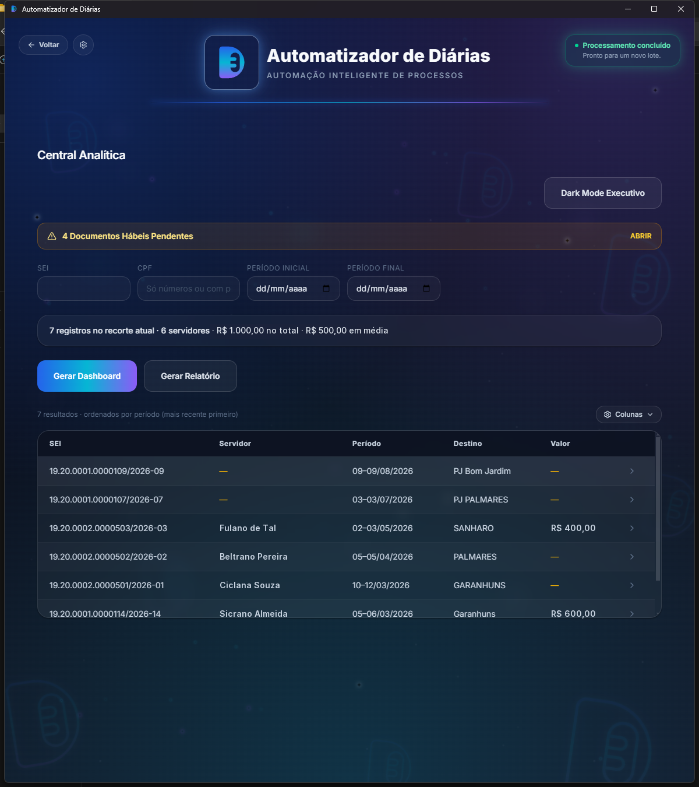

- 🔎 **Filtros** — pesquise por SEI, CPF ou período (inicial/final).
- 📈 **Gerar Dashboard** / **Gerar Relatório** — indicadores e relatório exportável do recorte filtrado.
- 🌓 **Dark Mode Executivo** — visual alternativo, pensado para apresentações e leitura executiva.
- ⚙️ **Colunas** — escolha quais colunas aparecem na tabela de resultados.

> 💡 **Dica**: o resumo acima da tabela ("N registros no recorte atual · N servidores · valor total · valor
> médio") atualiza sozinho a cada filtro aplicado — não é preciso clicar em nenhum botão de atualizar.

---

## 8. Finalizando (confirmando) diárias

Esta função confirma, na Planilha Oficial, que o **comprovante** e a **confirmação de diárias** de um
processo já foram recebidos — é o que grava "SIM" nas colunas correspondentes. Está dentro de
**Processamento da Planilha**, na aba **Finalizar Diárias**. Use os PDFs separados na pasta **PDFS DIÁRIAS
PARA CONFIRMAR**.

**Fluxo:** Selecionar PDFs → Analisar → Sistema localiza os SEIs → Alertas (se houver) → Você decide
finalizar → Planilha recebe SIM/SIM

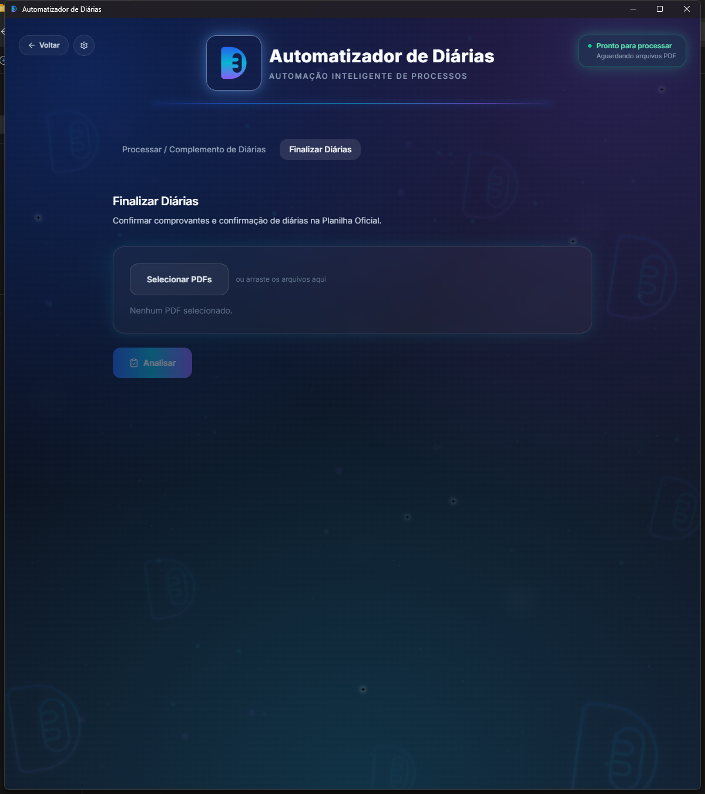

1. Clique em **Selecionar PDFs** e escolha os processos da pasta **PDFS DIÁRIAS PARA CONFIRMAR**.
2. Clique em **Analisar**. O aplicativo localiza o SEI de cada processo na Planilha Oficial e separa o
   lote em quatro grupos.

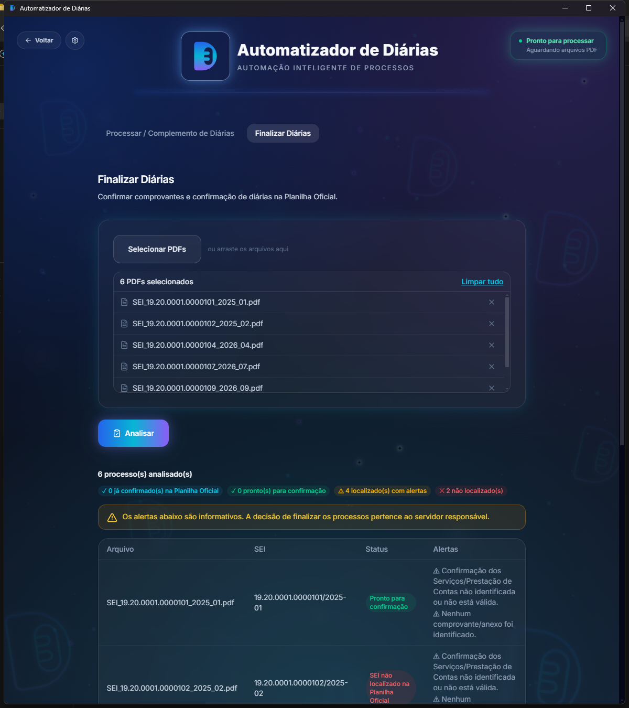

| Status | O que significa |
|---|---|
| Já confirmada na Planilha Oficial | Comprovante e confirmação já estavam "SIM/SIM" — nada será alterado. |
| Pronto para confirmação | O SEI foi localizado e o processo pode ser finalizado. |
| SEI não identificado no processo | O aplicativo não conseguiu extrair um número de SEI deste PDF. |
| SEI não localizado na Planilha Oficial | O SEI extraído não foi encontrado na planilha — nada é alterado para este processo. |
| Estado parcial — revisão manual | As colunas de comprovante/confirmação têm um valor fora do padrão — revise manualmente na planilha. |
| Erro ao ler o PDF | Falha técnica real na leitura do arquivo — tente novamente ou abra o PDF para conferir se não está corrompido. |

### Sobre os alertas

> ⚠ **Possível pendência não é erro**: um alerta (⚠) ao lado de um processo **"pronto para confirmação"**
> não significa que o processo está errado. Significa apenas que o aplicativo **não conseguiu confirmar
> automaticamente** alguma informação — por exemplo, não encontrou o documento de confirmação de serviços
> ou um comprovante anexado. **A decisão de finalizar continua sendo sua.** O aplicativo nunca bloqueia a
> finalização por causa de um alerta — só a localização do SEI decide isso.

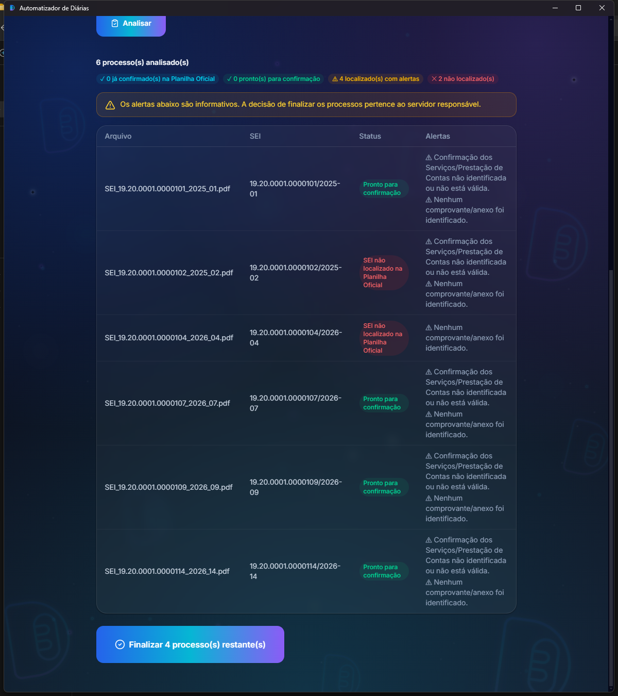

3. Clique em **Finalizar N processo(s) restante(s)**.
4. Confirme na caixa de diálogo que aparece — ela vale para **todo o lote**, não é preciso confirmar
   processo por processo.

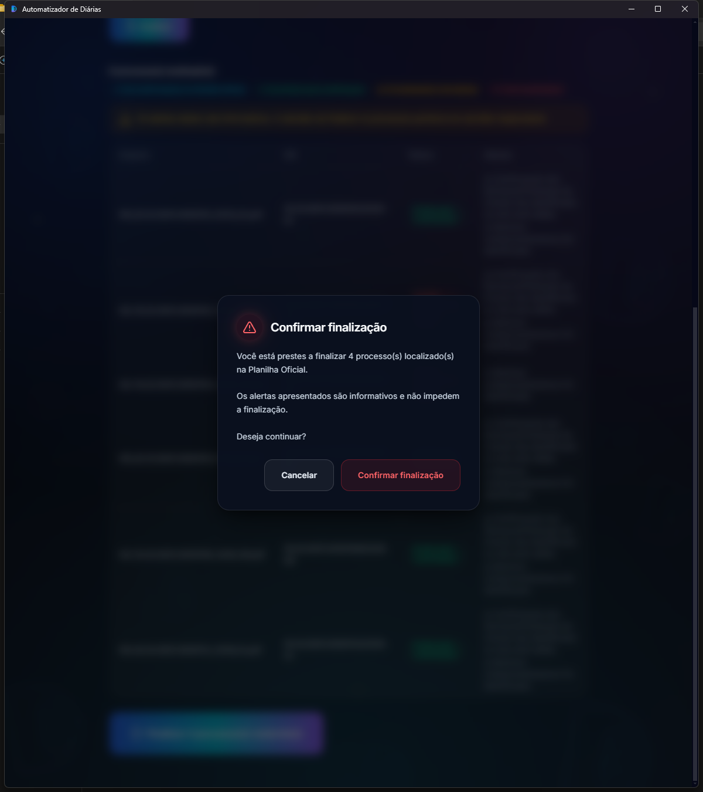

### Resultado e aviso obrigatório

A tela final reconcilia **todo o lote enviado** — nenhum processo desaparece da lista, mesmo os que não
puderam ser finalizados:

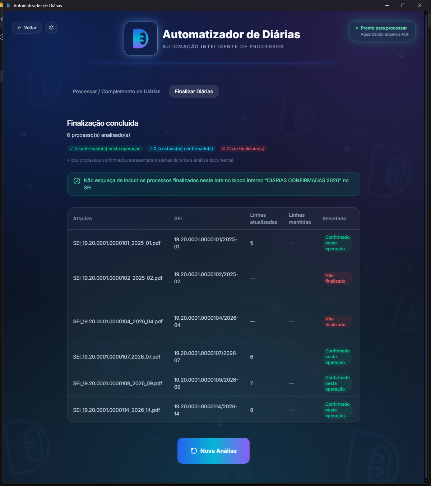

> ✅ **NÃO ESQUEÇA DE INCLUIR OS PROCESSOS FINALIZADOS NESTE LOTE NO BLOCO INTERNO "DIÁRIAS CONFIRMADAS
> 2026" NO SEI.**

Esse aviso só aparece quando pelo menos um processo foi **realmente confirmado nesta operação** — se todos
já estavam "SIM/SIM", ele não é exibido, porque nenhuma gravação nova aconteceu.

---

## 9. Fechando o aplicativo

Ao clicar no **X** da janela, o aplicativo sempre pede confirmação antes de fechar:

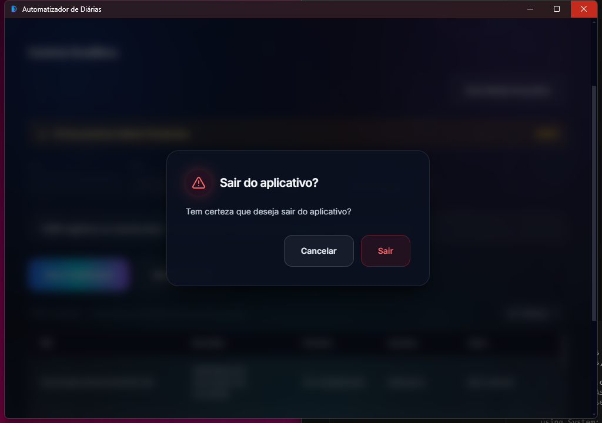

1. Clique em **Sair** para fechar definitivamente, ou em **Cancelar** para continuar trabalhando.

> ⚠ **Atenção**: se houver uma operação crítica em andamento (processamento ou preenchimento da planilha),
> a mensagem muda para avisar que sair agora vai **interromper essa operação**. Evite fechar o aplicativo
> nesse momento — espere a operação terminar antes de sair, sempre que possível.

---

## 10. Boas práticas e fluxo resumido

### Boas práticas

- Confira sempre se a **Planilha Oficial correta** está selecionada antes de processar ou finalizar.
- Aguarde cada operação terminar antes de iniciar a próxima — não processe dois lotes ao mesmo tempo.
- Leia os **alertas** exibidos nas telas — mesmo quando não bloqueiam, eles indicam algo que vale revisar.
- Não edite a mesma Planilha Oficial simultaneamente em vários computadores.
- Mantenha os PDFs organizados nas três pastas de trabalho (seção 1).
- Depois de um cadastro ou alteração importante, confira se o **Google Drive já sincronizou** a nova versão
  da planilha.
- Nunca ignore uma mensagem de erro — revise o motivo indicado antes de tentar novamente.
- Revise sempre os processos sinalizados pelo aplicativo (⚠ e ✕) antes de considerar o trabalho concluído.

### Fluxo geral do aplicativo

```
                    AUTOMATIZADOR DE DIÁRIAS
                             │
             ┌───────────────┴──────────────┐
             │                               │
        NOVA DIÁRIA                    DIÁRIA CONCLUÍDA
             │                               │
      PDFS A PROCESSAR            PDFS DIÁRIAS PARA CONFIRMAR
             │                               │
        Processar                       Finalizar Diárias
             │                               │
     Preencher planilha                 SIM / SIM na planilha
             │                               │
      Conferir resultado         Aviso: bloco "DIÁRIAS CONFIRMADAS 2026" no SEI
             │
      PDFS PROCESSADOS (mover manualmente)
```

> ✔ **Pronto**: este guia cobre o uso operacional do Automatizador de Diárias 2.0.0. Em caso de dúvidas
> sobre uma regra de negócio específica (ex.: janela de processamento, cálculo de diárias), consulte o
> setor responsável — este documento descreve apenas o funcionamento do aplicativo.
